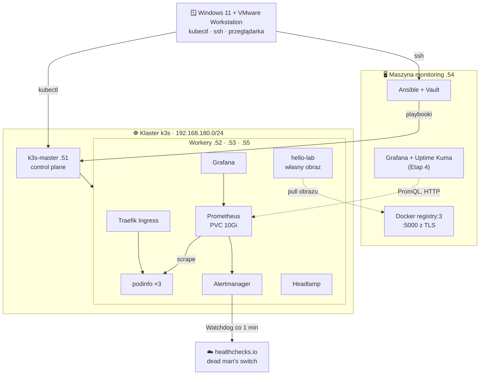
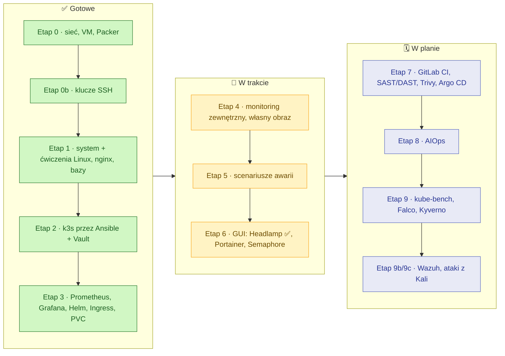
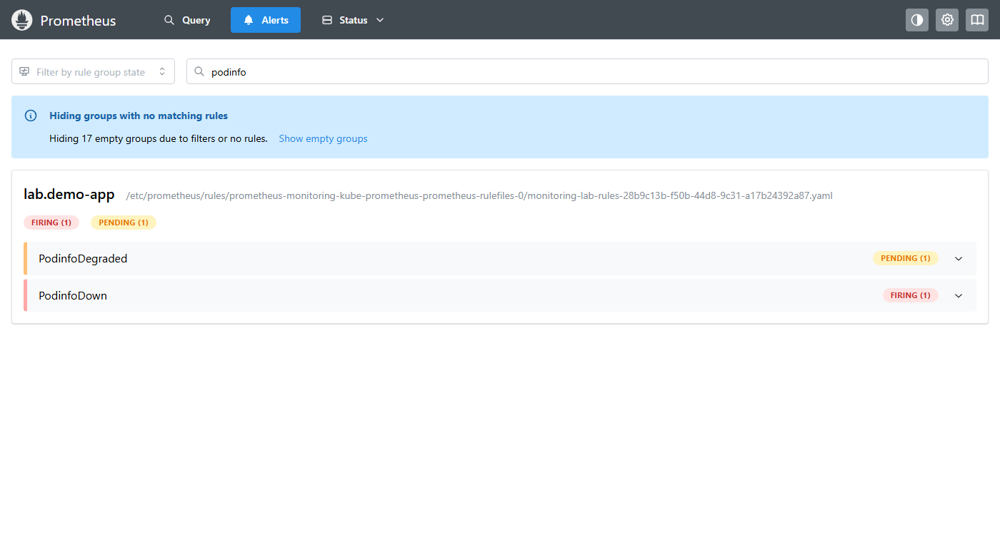
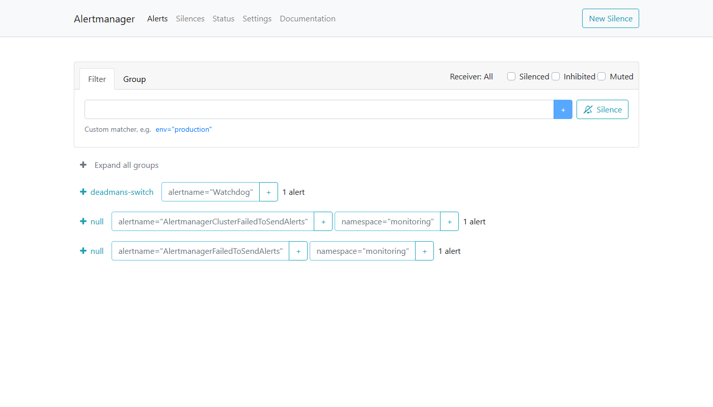
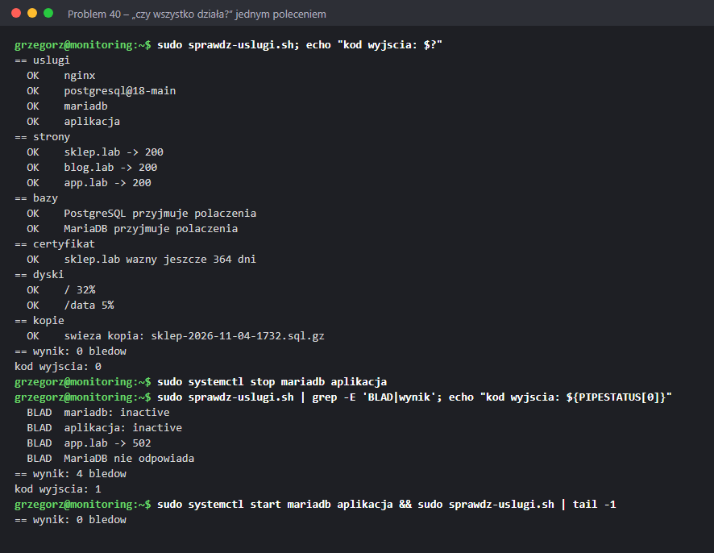
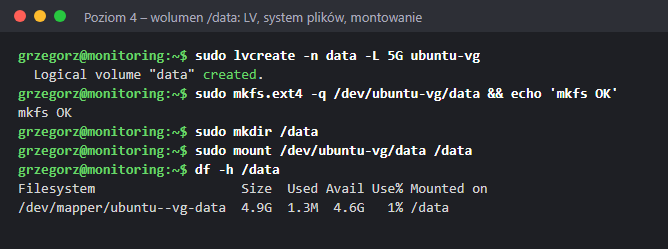
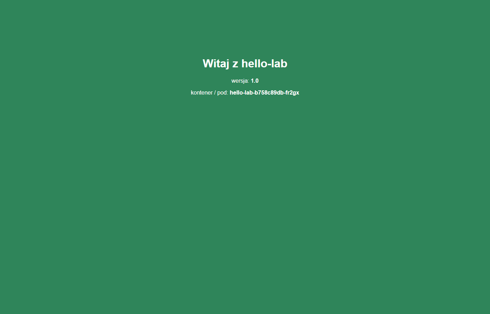
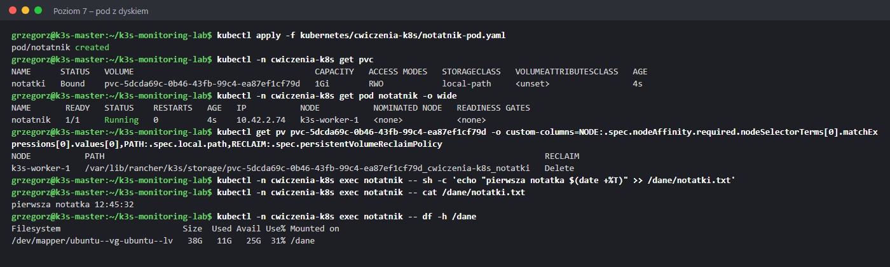
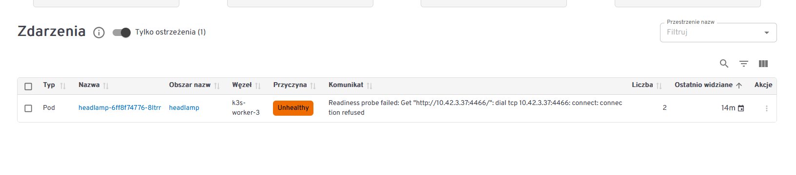

<div align="center">

# 🧪 k3s Monitoring Lab

**Domowe laboratorium DevOps zbudowane od zera, ręcznie i krok po kroku.**
Klaster Kubernetes (k3s) na 5 maszynach wirtualnych, monitoring z alertami, automatyzacja Ansible
i Packer, własny rejestr obrazów – oraz ćwiczenia z ponad 130 zrzutami z prawdziwego labu.


</div>

> Projekt powstaje jako nauka i portfolio na stanowisko **junior DevOps / administrator Linux**.
> Wszystko jest udokumentowane po polsku: każde polecenie z wyjaśnieniem, prawdziwe wyniki z labu,
> zrzuty ekranu, problemy, na które trafiłem, i pytania rekrutacyjne do każdego etapu.

## W liczbach

| 🖥️ Maszyny | ☸️ Węzły k3s | 📚 Etapy | 🧩 Ćwiczenia | 🐞 Opisane problemy |
|:---:|:---:|:---:|:---:|:---:|
| 5 działa, 3 w planie | 1 master + 3 workery | 5 gotowych, 3 w trakcie, 5 w planie | 10 poziomów Linux, 40 problemów nginx/bazy, kubectl, monitoring, Helm, Ingress, obrazy | kilkadziesiąt, każdy z objawem, przyczyną i naprawą |

## Architektura



| Maszyna | IP | Rola | Stan |
|---|---|---|---|
| k3s-master | 192.168.180.51 | control plane k3s (taint `NoSchedule`) | ✅ |
| k3s-worker-1 / -2 / -3 | .52 / .53 / .55 | workery; worker-3 zainstalowany automatycznie Packerem | ✅ |
| monitoring | .54 | węzeł sterujący Ansible, Docker, rejestr obrazów, monitoring zewnętrzny | ✅ |
| gitlab | .56 | GitLab CE, Runner, rejestr – Etap 7 | 🗓️ |
| security | .57 | Wazuh SIEM – Etap 9b | 🗓️ |
| kali | .58 | kontrolowane ataki na lab – Etap 9c | 🗓️ |

System: **Ubuntu Server 26.04** (różnice względem 24.04, np. `sudo-rs` i brak `last`, opisane w dokumentacji).
Host: Windows 11, VMware Workstation, sieć NAT `192.168.180.0/24`.

## Postęp prac



## Zrzuty z labu

<table>
<tr>
<td width="50%"><b>Alert w Prometheusie</b> – reguła <code>PodinfoDown</code> przechodzi w FIRING po wyłączeniu aplikacji<br/></td>
<td width="50%"><b>Alertmanager</b> – alerty pogrupowane i gotowe do wysłania<br/></td>
</tr>
<tr>
<td><b>Skrypt kontrolny</b> – usługi, strony, bazy, certyfikat, dyski i kopie jednym poleceniem<br/></td>
<td><b>Nowy dysk przez LVM</b> – PV, VG, LV, system plików i wpis w fstab<br/></td>
</tr>
<tr>
<td><b>Własny obraz w klastrze</b> – zbudowany w Dockerze, wypchnięty do rejestru z TLS, uruchomiony w k3s<br/></td>
<td><b>Trwałe dane</b> – PVC w stanie Bound, dane przetrwały usunięcie poda<br/></td>
</tr>
<tr>
<td colspan="2"><b>Headlamp</b> – zdarzenia klastra: nieudana sonda readiness tuż po starcie poda<br/></td>
</tr>
</table>

Ponad 120 kolejnych zrzutów jest w rozwiązaniach ćwiczeń, każdy z rozpiską użytych poleceń.

## Czego tu można się nauczyć (i czego ja się nauczyłem)

| Obszar | Co konkretnie zrobiłem |
|---|---|
| 🐧 **Linux** | LVM i nowy dysk, `fstab` po UUID, pełny dysk i usunięte pliki trzymane przez proces (`lsof +L1`), systemd (limity restartów, własne usługi), cron, logrotate, użytkownicy i katalogi setgid, `journalctl`, `grep`/`awk`/`sed` |
| 🌐 **nginx** | wirtualne hosty, `default_server` i IPv6, kody 403/404/502/504/413, reverse proxy, analiza `access.log`, HTTPS z własnym CA, przekierowania, basic auth |
| 🗄️ **Bazy danych** | PostgreSQL 18 (`pg_hba.conf`, `pg_dump`/`pg_restore`, blokady, `EXPLAIN ANALYZE`, przeniesienie katalogu danych) i MariaDB (konta `'user'@'host'`, `mariadb-dump`), nocne kopie |
| 🤖 **Automatyzacja** | Packer + autoinstall Ubuntu (maszyna z ISO bez klikania), Ansible: role, inventory, idempotencja, sekrety w Ansible Vault |
| ☸️ **Kubernetes** | k3s z Ansible, `kubectl` od podstaw, etykiety i selektory, ConfigMap, Secret, PVC (`local-path`), Ingress na Traefiku, własny chart Helm, sondy, `topologySpreadConstraints` |
| 📈 **Monitoring** | kube-prometheus-stack przez Helm, ServiceMonitor, własne reguły alertów (PromQL), Alertmanager z wyciszeniami, Watchdog jako dead man's switch |
| 🐳 **Kontenery** | własny obraz (Dockerfile, warstwy, `.dockerignore`), prywatny rejestr `registry:3` z TLS i własnym CA zaufanym przez wszystkie węzły |
| 🔥 **Diagnoza** | `CrashLoopBackOff`, `ImagePullBackOff`, `Pending`, OOM, błędne selektory – 11 celowo zepsutych obiektów do naprawy |

**Najważniejsze wnioski z labu:**

- **Monitoring nie może zależeć tylko od tego, co monitoruje.** Prometheus w klastrze padnie razem z nim, dlatego jest Watchdog do healthchecks.io i drugi monitoring na osobnej maszynie.
- **Najpierw objaw, potem log, potem konfiguracja.** Prawie każdy z 40 problemów z nginx i bazami rozwiązał się po przeczytaniu właściwego logu, a nie po zgadywaniu.
- **Automatyzacja zaczyna się od zrobienia rzeczy ręcznie.** Najpierw skrypty bash, potem te same kroki w rolach Ansible – dzięki temu wiem, co Ansible robi pod spodem.
- **Bezpieczne skróty bywają pułapką.** Zamiast `insecure-registries` w Dockerze lepiej wystawić własne CA – wtedy TLS działa wszędzie, także w k3s.

## Najważniejsze decyzje projektowe

- **Monitoring na dwóch poziomach.** Prometheus zbiera metryki w klastrze, gdzie widzi pody i zdarzenia; wizualizacja i sprawdzanie dostępności działają dodatkowo **poza klastrem**.
- **Dead man's switch.** Alert `Watchdog` jest zawsze aktywny i co minutę trafia do healthchecks.io – gdy przestanie docierać, przychodzi powiadomienie, że monitoring albo klaster nie działa.
- **Węzeł sterujący bez aplikacji.** Master ma taint `NoSchedule`, aplikacje działają tylko na workerach.
- **Trwałe dane.** Prometheus, Grafana i Alertmanager trzymają dane na wolumenach `local-path` i przeżywają restart poda.
- **Dopasowanie do k3s.** Cele, których k3s nie wystawia standardowo (controller-manager, scheduler, kube-proxy), są wyłączone – bez tego Prometheus zgłaszałby fałszywe `TargetDown`.
- **Sekrety poza repozytorium.** Hasła w `lab.env` (poza gitem) i w Ansible Vault.

## Dokumentacja – od czego zacząć

**Cała budowa krok po kroku, z każdym poleceniem do wpisania: [docs/00-przewodnik.md](docs/00-przewodnik.md).**
Każdy etap ma w `docs/` swój folder z instrukcją, teorią, ćwiczeniami, rozwiązaniami i problemami.

| Etap | Folder | Teoria | Ćwiczenia |
|---|---|---|---|
| 0 – sieć i maszyny wirtualne, Packer | [etap-0-maszyny-wirtualne](docs/etap-0-maszyny-wirtualne/README.md) | – | – |
| 0b – klucze SSH | [etap-0b-klucze-ssh](docs/etap-0b-klucze-ssh/README.md) | [klucze SSH](docs/etap-0b-klucze-ssh/01-klucze-ssh.md) | – |
| 1 – przygotowanie systemu, administracja Linuxem | [etap-1-przygotowanie-systemu](docs/etap-1-przygotowanie-systemu/README.md) | [skrypt prepare-node](docs/etap-1-przygotowanie-systemu/01-skrypt-prepare-node.md), [jak czytać polecenia](docs/etap-1-przygotowanie-systemu/06-jak-czytac-polecenia.md) | admin Linuxa, 10 poziomów: [zadania](docs/etap-1-przygotowanie-systemu/02-cwiczenia-admin-linux.md), [rozwiązania](docs/etap-1-przygotowanie-systemu/03-cwiczenia-admin-linux-rozwiazania.md); 40 problemów nginx i bazy: [zadania](docs/etap-1-przygotowanie-systemu/04-cwiczenia-nginx-bazy.md), [rozwiązania](docs/etap-1-przygotowanie-systemu/05-cwiczenia-nginx-bazy-rozwiazania.md) |
| 2 – klaster k3s przez Ansible, Vault | [etap-2-k3s-ansible](docs/etap-2-k3s-ansible/README.md) | [Ansible](docs/etap-2-k3s-ansible/01-teoria-ansible.md), [Ansible plik po pliku](docs/etap-2-k3s-ansible/07-ansible-plik-po-pliku.md) | kubectl: [zadania](docs/etap-2-k3s-ansible/05-cwiczenia-kubectl.md), [rozwiązania](docs/etap-2-k3s-ansible/06-cwiczenia-kubectl-rozwiazania.md); Ansible: [zadanie](docs/etap-2-k3s-ansible/08-cwiczenie-ansible-pakiet.md), [rozwiązanie](docs/etap-2-k3s-ansible/09-cwiczenie-ansible-pakiet-rozwiazanie.md) |
| 3 – monitoring w klastrze, Helm, Ingress | [etap-3-monitoring](docs/etap-3-monitoring/README.md) | [Kubernetes i Helm](docs/etap-3-monitoring/03-teoria-kubernetes-helm.md), [monitoring](docs/etap-3-monitoring/04-teoria-monitoringu.md), [trwałe dane](docs/etap-3-monitoring/08-trwale-dane.md), [jak pisać YAML](docs/etap-3-monitoring/15-jak-pisac-yaml-podinfo.md) | monitoring: [zadania](docs/etap-3-monitoring/05-cwiczenia-monitoringu.md), [rozwiązania](docs/etap-3-monitoring/06-cwiczenia-monitoringu-rozwiazania.md); etykiety, ConfigMap, PVC: [zadania](docs/etap-3-monitoring/09-cwiczenia-etykiety-configmap-pvc.md), [rozwiązania](docs/etap-3-monitoring/10-cwiczenia-etykiety-configmap-pvc-rozwiazania.md); własny chart Helm: [zadania](docs/etap-3-monitoring/11-cwiczenia-wlasny-chart-helm.md), [rozwiązania](docs/etap-3-monitoring/12-cwiczenia-wlasny-chart-helm-rozwiazania.md); Ingress: [zadania](docs/etap-3-monitoring/13-cwiczenia-ingress.md), [rozwiązania](docs/etap-3-monitoring/14-cwiczenia-ingress-rozwiazania.md) |
| 4 – monitoring poza klastrem, własny obraz | [etap-4-monitoring-zewnetrzny](docs/etap-4-monitoring-zewnetrzny/README.md) | [monitoring zewnętrzny](docs/etap-4-monitoring-zewnetrzny/01-monitoring-zewnetrzny.md), [własny obraz](docs/etap-4-monitoring-zewnetrzny/02-wlasny-obraz.md) | obraz i rejestr: [zadania](docs/etap-4-monitoring-zewnetrzny/03-cwiczenia-obraz.md), [rozwiązania](docs/etap-4-monitoring-zewnetrzny/04-cwiczenia-obraz-rozwiazania.md) |
| 5 – scenariusze awarii | [etap-5-scenariusze-awarii](docs/etap-5-scenariusze-awarii/README.md) | [typowe awarie Kubernetesa](docs/etap-5-scenariusze-awarii/02-typowe-awarie-kubernetesa.md) | [scenariusze awarii](docs/etap-5-scenariusze-awarii/01-scenariusze-awarii.md), [zepsute obiekty do diagnozy](kubernetes/awarie/zepsute.yaml) |
| 6 – zarządzanie przez GUI | [etap-6-gui](docs/etap-6-gui/README.md) | [Headlamp: Service, NodePort, token](docs/etap-6-gui/01-headlamp.md) | – |

Przydatne na co dzień:
- [ściągawka poleceń](docs/sciagawka-polecen.md) – wszystkie omawiane polecenia w jednym miejscu,
- [problemy-ogolne.md](docs/problemy-ogolne.md) – metoda diagnozowania i spis problemów według etapów.

## Szybki start

```bash
# Na każdej maszynie
git clone https://github.com/programmingbygrzegorz/k3s-monitoring-lab.git && cd k3s-monitoring-lab
cp lab.env.example lab.env && nano lab.env
sudo ./scripts/00-prepare-node.sh <k3s-master | k3s-worker-1 | k3s-worker-2 | monitoring>

# k3s-master
sudo ./scripts/01-install-master.sh        # zapisz wyświetlony token

# workery (po wpisaniu K3S_TOKEN do lab.env)
sudo ./scripts/02-install-worker.sh <IP_TEGO_WĘZŁA>

# k3s-master
sudo ./scripts/03-post-install.sh
sudo ./scripts/04-install-monitoring.sh
sudo ./scripts/05-deploy-demo.sh

# monitoring
sudo ./scripts/06-setup-monitoring-vm.sh
```

**Wariant z Ansible** – przygotowanie maszyn i klaster jednym poleceniem z maszyny `monitoring`:

```bash
cd ansible
cp inventory.ini.example inventory.ini && nano inventory.ini
ansible-galaxy collection install -r requirements.yml
ansible-playbook site.yml --ask-become-pass
```

Szczegóły: [k3s przez Ansible](docs/etap-2-k3s-ansible/02-k3s-przez-ansible.md), [Ansible Vault](docs/etap-2-k3s-ansible/03-ansible-vault.md).

| Usługa | Adres w labie |
|---|---|
| Grafana w klastrze | `http://192.168.180.51:30300` |
| Prometheus | `http://192.168.180.51:30090` |
| Alertmanager | `http://192.168.180.51:30093` |
| Headlamp (logowanie tokenem) | `http://192.168.180.51:30400` |
| Aplikacja demo podinfo | `http://192.168.180.51:30898` |
| hello-lab (własny obraz) | `http://192.168.180.51:30880` |
| Rejestr obrazów (TLS) | `https://192.168.180.54:5000` |
| Grafana zewnętrzna / Uptime Kuma | `http://192.168.180.54:3000` / `:3001` (Etap 4) |

## Scenariusze awarii

| Scenariusz | Polecenie | Czego szukać |
|---|---|---|
| Awaria węzła | wyłącz maszynę `k3s-worker-1` | `KubeNodeNotReady`, przeniesienie podów, `PodinfoDegraded` |
| Brak pamięci | `sudo ./scripts/chaos.sh oom` | status `OOMKilled`, alert `ContainerOOMKilled` |
| Aplikacja się wywraca | `sudo ./scripts/chaos.sh crashloop` | `CrashLoopBackOff`, `KubePodCrashLooping` |
| Zły obraz | `sudo ./scripts/chaos.sh imagepull` | `ImagePullBackOff` w zdarzeniach |
| Obciążenie CPU | `sudo ./scripts/chaos.sh cpu` | throttling CPU w Grafanie |
| Błędne wdrożenie | `sudo ./scripts/chaos.sh bad-deploy` | historia wdrożeń, `rollout undo` |
| Awaria całego klastra | wyłącz wszystkie węzły | powiadomienie z healthchecks.io, alarm w Uptime Kuma |

## Struktura repozytorium

```
.
├── lab.env.example        # wzór konfiguracji (adresy IP, hasła) – kopiujesz do lab.env
├── packer/                # nowa maszyna z ISO: przepis + autoinstall Ubuntu
├── ansible/               # site.yml, inventory, role common / k3s_server / k3s_agent, Vault
├── scripts/               # te same kroki w bashu: prepare-node, k3s, monitoring, chaos.sh
├── kubernetes/
│   ├── demo-app/          # podinfo: Deployment, Service, Ingress
│   ├── monitoring/        # ServiceMonitor, PrometheusRule
│   ├── chaos/             # manifesty awarii (OOM, CrashLoop, ImagePull, CPU)
│   ├── awarie/            # 11 zepsutych obiektów do diagnozy
│   ├── cwiczenia-k8s/     # etykiety, ConfigMap, Secret, PVC
│   └── hello-lab/         # wdrożenie własnego obrazu z rejestru labu
├── apps/hello-lab/        # własna aplikacja: app.py, Dockerfile
├── monitoring/            # values kube-prometheus-stack, Docker Compose dla maszyny monitoring
├── tools/                 # sprawdzanie odnośników, generowanie zrzutów do ćwiczeń
└── docs/                  # przewodnik + folder dla każdego etapu
```

## Plan rozwoju

- [ ] **Etap 4** – Grafana i Uptime Kuma na `monitoring`, healthchecks.io
- [ ] **Etap 6** – Portainer (Docker na `monitoring`), Semaphore UI (Ansible z przeglądarki) – Headlamp ✅
- [ ] **Etap 7** – CI/CD i GitOps: GitLab CE, GitLab Runner, skan Trivy w pipeline, Argo CD
- [ ] **Etap 7b** – AppSec w pipeline: gitleaks, Semgrep (SAST), Trivy, OWASP ZAP (DAST), OWASP Juice Shop, model zagrożeń STRIDE
- [ ] **Etap 8** – AIOps: asystent administratora diagnozujący po alercie (RBAC tylko do odczytu, zmiany po akceptacji)
- [ ] **Etap 9** – bezpieczeństwo klastra: kube-bench (CIS), Falco (alerty do Alertmanagera), Kyverno
- [ ] **Etap 9b / 9c** (opcjonalne) – Wazuh SIEM na maszynie `security`, kontrolowane ataki z `kali` (purple teaming)
- [ ] Logi w Grafana Loki, kopie zasobów klastra w Velero, klaster HA (3 węzły sterujące)
- [ ] Infrastruktura labu w chmurze (Terraform, Azure)

> ℹ️ Workflow GitHub Actions (ShellCheck, yamllint, ansible-lint) jest w `.github/workflows/lint.yml`,
> ale od 28.10.2026 nie uruchamia się z powodu blokady konta po stronie GitHub (billing) – sprawa w toku.

<div align="center">

**Autor:** Grzegorz Starzyński · [GitHub](https://github.com/programmingbygrzegorz)

</div>
