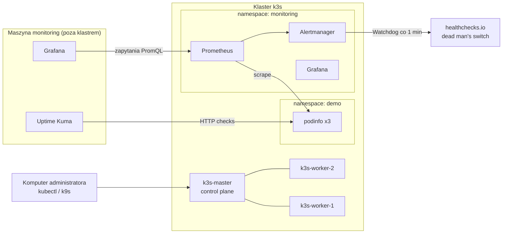

# k3s Monitoring Lab

Domowe laboratorium DevOps: **trójwęzłowy klaster Kubernetes (k3s)** z pełnym stosem monitoringu,
zewnętrznym nadzorem dostępności i przygotowanymi scenariuszami awarii.

Celem projektu jest praktyczna nauka utrzymania i monitorowania klastra Kubernetes:
od instalacji, przez zbieranie metryk i alerty, po diagnozowanie typowych awarii.


## Architektura



| Maszyna | Rola | vCPU | RAM | Dysk |
|---|---|---|---|---|
| ubuntu-template | szablon do klonowania (potem wyłączony) | 2 | 4 GB | 40 GB |
| k3s-master | węzeł sterujący (control plane) | 2 | 4 GB | 40 GB |
| k3s-worker-1 | węzeł roboczy | 2 | 6 GB | 40 GB |
| k3s-worker-2 | węzeł roboczy | 2 | 6 GB | 40 GB |
| k3s-worker-3 | węzeł roboczy (opcjonalny, `WORKER3_IP` w `lab.env`) | 2 | 6 GB | 40 GB |
| monitoring | zewnętrzny monitoring (Docker), węzeł sterujący Ansible | 2 | 4 GB | 40 GB |
| gitlab | GitLab CE: repozytoria, CI/CD, rejestr obrazów (Etap 7, planowany) | 4 | 8 GB | 60 GB |
| security | Wazuh – SIEM: logi, integralność plików, podatności (Etap 9b, opcjonalny) | 4 | 8 GB | 80 GB |
| kali | Kali Linux – kontrolowane ataki na lab (Etap 9c, opcjonalny) | 2 | 4 GB | 60 GB |

System na wszystkich maszynach: **Ubuntu Server 24.04 LTS lub nowszy** (laboratorium działa na 26.04 –
różnice, np. sudo-rs, opisane w dokumentacji). Wirtualizacja: VMware Workstation
(działa też VirtualBox, Hyper-V lub Proxmox).

## Stos technologiczny

- **Kubernetes:** k3s, Traefik (Ingress), Helm
- **Infrastructure as Code:** Ansible – przygotowanie maszyn i instalacja klastra (role, inventory, idempotentne playbooki);
  Packer – instalacja nowych maszyn z ISO bez klikania (autoinstall Ubuntu)
- **Monitoring w klastrze:** kube-prometheus-stack – Prometheus, Alertmanager, Grafana, node-exporter, kube-state-metrics
- **Monitoring zewnętrzny:** Grafana i Uptime Kuma w Docker Compose, healthchecks.io jako dead man's switch
- **Aplikacja demo:** [podinfo](https://github.com/stefanprodan/podinfo) z metrykami Prometheusa, sondami i Ingressem
- **Bezpieczeństwo:** ufw na węzłach, sekrety poza repozytorium, taint na węźle sterującym
- **CI:** GitHub Actions – ShellCheck, yamllint, kubeconform, ansible-lint

## Najważniejsze decyzje projektowe

- **Monitoring na dwóch poziomach.** Prometheus zbiera metryki wewnątrz klastra, bo ma tam pełny dostęp
  do podów i zdarzeń. Wizualizacja i sprawdzanie dostępności działają dodatkowo **poza klastrem**,
  bo monitoring uruchomiony tylko w klastrze padłby razem z nim.
- **Dead man's switch.** Alert `Watchdog` jest zawsze aktywny i co minutę trafia do healthchecks.io.
  Gdy przestanie docierać, healthchecks.io powiadamia, że monitoring lub cały klaster przestał działać.
- **Węzeł sterujący bez aplikacji.** Master ma taint `NoSchedule`, więc aplikacje działają tylko na workerach.
- **Odporność aplikacji.** Trzy repliki podinfo są rozkładane na różne węzły (`topologySpreadConstraints`),
  mają sondy `readiness` i `liveness` oraz limity zasobów.
- **Dopasowanie do k3s.** k3s nie wystawia metryk controller-managera, schedulera i kube-proxy w standardowy
  sposób, więc te cele są wyłączone w konfiguracji – bez tego Prometheus zgłaszałby fałszywe alerty `TargetDown`.

## Struktura repozytorium

```
.
├── lab.env.example              # wzór konfiguracji (adresy IP, hasła) – kopiujesz do lab.env
├── ansible/
│   ├── site.yml                 # całe laboratorium jednym poleceniem
│   ├── inventory.ini.example    # lista maszyn i grup
│   ├── group_vars/all/          # wspólne ustawienia (main.yml) i sekrety (vault.yml)
│   ├── playbooks/               # prepare.yml, k3s.yml
│   └── roles/                   # common, k3s_server, k3s_agent
├── scripts/
│   ├── 00-prepare-node.sh       # przygotowanie maszyny: hosts, aktualizacje, swap, firewall
│   ├── 01-install-master.sh     # instalacja węzła sterującego k3s
│   ├── 02-install-worker.sh     # dołączenie workera
│   ├── 03-post-install.sh       # role węzłów, kontrola klastra
│   ├── 04-install-monitoring.sh # kube-prometheus-stack przez Helm
│   ├── 05-deploy-demo.sh        # aplikacja demo + ServiceMonitor + reguły alertów
│   ├── 06-setup-monitoring-vm.sh# Grafana + Uptime Kuma poza klastrem
│   ├── chaos.sh                 # scenariusze awarii
│   └── get-kubeconfig.sh        # kubectl z własnego komputera
├── kubernetes/
│   ├── demo-app/                # Namespace, Deployment, Service, Ingress
│   ├── monitoring/              # ServiceMonitor, PrometheusRule
│   └── chaos/                   # manifesty awarii (OOM, CrashLoop, ImagePull, CPU)
├── monitoring/
│   ├── kube-prometheus-stack-values.yaml
│   └── monitoring-vm/           # Docker Compose: Grafana + Uptime Kuma
├── packer/                      # nowa maszyna z ISO: przepis + autoinstall Ubuntu (opis: packer/README.md)
└── docs/                        # szczegółowe instrukcje krok po kroku
```

## Szybki start

**Cała budowa krok po kroku, z każdym poleceniem do wpisania:
[docs/00-przewodnik.md](docs/00-przewodnik.md).** Szczegóły poszczególnych etapów: [docs/](docs/).
Problemy, które pojawiły się przy budowie, z diagnozą i rozwiązaniem:
[docs/08-problemy-administratora.md](docs/08-problemy-administratora.md).

Ćwiczenia z klastrem krok po kroku, ze zrzutami: [docs/10-cwiczenia-kubectl.md](docs/10-cwiczenia-kubectl.md).
Ćwiczenia z monitoringu (Prometheus, Grafana, Alertmanager): [docs/11](docs/11-cwiczenia-monitoring.md),
wykonanie ze zrzutami: [docs/11a](docs/11a-cwiczenia-monitoring-wykonanie.md).

Teoria dla początkujących: [Ansible](docs/teoria-ansible.md) ·
[klucze SSH – użytkownika i hosta](docs/teoria-ssh-klucze.md) ·
[Kubernetes i Helm](docs/teoria-kubernetes-helm.md) ·
[monitoring: Prometheus, Grafana, Alertmanager](docs/teoria-monitoring.md).

```bash
# Na każdej maszynie
git clone https://github.com/<twoj-login>/k3s-monitoring-lab.git && cd k3s-monitoring-lab
cp lab.env.example lab.env && nano lab.env
sudo ./scripts/00-prepare-node.sh <k3s-master | k3s-worker-1 | k3s-worker-2 | monitoring>

# k3s-master
sudo ./scripts/01-install-master.sh        # zapisz wyświetlony token

# k3s-worker-1 i k3s-worker-2 (po wpisaniu K3S_TOKEN do lab.env)
sudo ./scripts/02-install-worker.sh <IP_TEGO_WĘZŁA>

# k3s-master
sudo ./scripts/03-post-install.sh
sudo ./scripts/04-install-monitoring.sh
sudo ./scripts/05-deploy-demo.sh

# monitoring
sudo ./scripts/06-setup-monitoring-vm.sh
```

| Usługa | Adres |
|---|---|
| Grafana w klastrze | `http://<MASTER_IP>:30300` |
| Prometheus | `http://<MASTER_IP>:30090` |
| Alertmanager | `http://<MASTER_IP>:30093` |
| Aplikacja demo (NodePort) | `http://<MASTER_IP>:30898` |
| Grafana zewnętrzna | `http://<MONITORING_IP>:3000` |
| Uptime Kuma | `http://<MONITORING_IP>:3001` |

## Wariant z Ansible

Zamiast uruchamiać skrypty `00`–`03` na każdej maszynie osobno, możesz przygotować maszyny
i postawić klaster jednym poleceniem z węzła sterującego Ansible:

```bash
cd ansible
cp inventory.ini.example inventory.ini && nano inventory.ini
ansible-galaxy collection install -r requirements.yml
ansible-playbook site.yml --ask-become-pass
```

Szczegóły: [docs/06-ansible.md](docs/06-ansible.md). Hasło sudo bez wpisywania (Ansible Vault): [docs/09-ansible-vault.md](docs/09-ansible-vault.md). Pierwszy raz z Ansible? Wprowadzenie:
[docs/teoria-ansible.md](docs/teoria-ansible.md).


## Scenariusze awarii

| Scenariusz | Polecenie | Czego szukać |
|---|---|---|
| Awaria węzła | wyłącz maszynę `k3s-worker-1` | `KubeNodeNotReady`, przeniesienie podów, `PodinfoDegraded` |
| Brak pamięci | `sudo ./scripts/chaos.sh oom` | status `OOMKilled`, alert `ContainerOOMKilled` |
| Aplikacja się wywraca | `sudo ./scripts/chaos.sh crashloop` | `CrashLoopBackOff`, `KubePodCrashLooping`, `PodRestartingTooOften` |
| Zły obraz | `sudo ./scripts/chaos.sh imagepull` | `ImagePullBackOff` w zdarzeniach |
| Obciążenie CPU | `sudo ./scripts/chaos.sh cpu` | throttling CPU w Grafanie |
| Błędne wdrożenie | `sudo ./scripts/chaos.sh bad-deploy` | historia wdrożeń, `rollout undo` |
| Awaria całego klastra | wyłącz wszystkie węzły | powiadomienie z healthchecks.io, alarm w Uptime Kuma |

Opis krok po kroku: [docs/05-scenariusze-awarii.md](docs/05-scenariusze-awarii.md).

## Czego się nauczyłem

<!-- Uzupełnij własnymi wnioskami po przejściu laboratorium – to najcenniejsza część dla rekrutera. -->

- ...
- ...
- ...

## Plan rozwoju

- [ ] Logi w Grafana Loki
- [ ] Klaster HA – trzy węzły sterujące z wbudowanym etcd
- [ ] Etap 6: zarządzanie przez GUI – Headlamp (k3s), Portainer (Docker na `monitoring`), Semaphore UI (Ansible)
- [ ] Etap 7: CI/CD i GitOps – GitLab CE we własnym labie, GitLab Runner, własny obraz Docker, skan Trivy w pipeline, Argo CD
- [ ] Etap 8: AIOps – Hermes Agent jako asystent administratora (diagnoza po alercie, RBAC tylko do odczytu, zmiany po akceptacji)
- [ ] Etap 9: bezpieczeństwo klastra – kube-bench (CIS), Falco (alerty do Alertmanagera), Kyverno (polityki)
- [ ] Etap 9b (opcjonalny): Wazuh na maszynie `security` – agenty na wszystkich maszynach
- [ ] Etap 9c (opcjonalny): kontrolowane ataki z maszyny `kali` i sprawdzenie, czy obrona je wykrywa
- [ ] Instalacja monitoringu i aplikacji demo również w Ansible
- [ ] Infrastruktura laboratorium w chmurze (Terraform, Azure)
- [ ] Kopie zapasowe zasobów klastra w Velero
