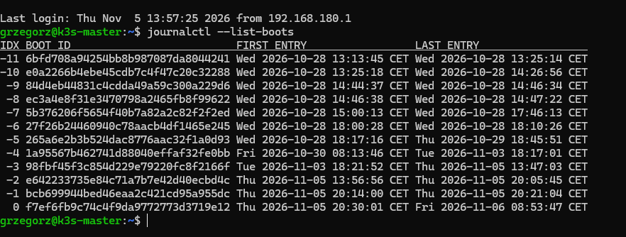
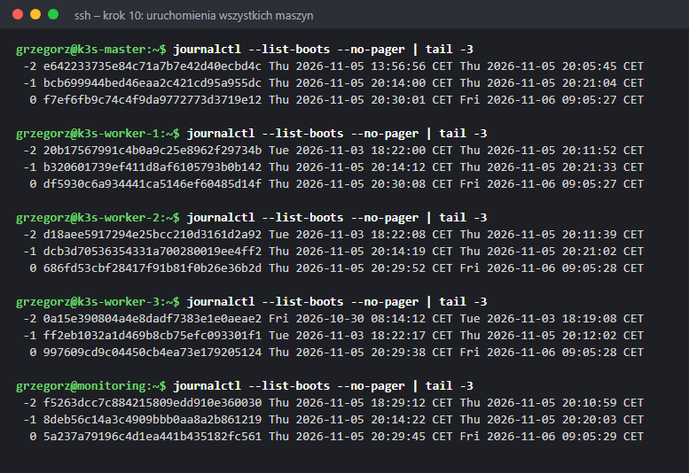
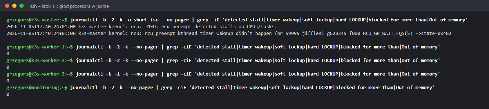
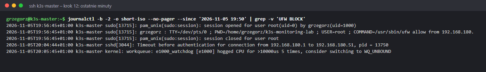
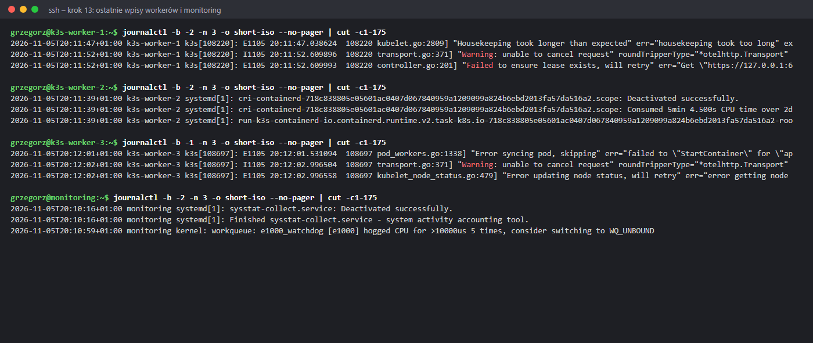

# Diagnoza: dlaczego zawiesza się komputer z maszynami

05.11.2026 około 20:00 konsola `k3s-master` pokazała `rcu: INFO: rcu_preempt detected stalls on CPUs/tasks`,
SSH przestało odpowiadać, a po chwili zawiesił się cały Windows. Pomogło tylko twarde wyłączenie (ok. 20:12).
Następnego dnia (06.11) host został przejrzany krok po kroku. Wszystkie polecenia **tylko odczytują** – nic nie
zmieniają i nie wymagają uprawnień administratora.

🪟 Wszystko wpisujesz w **PowerShell na Windowsie** (Start → „PowerShell” → Enter).

Jak działa `Get-WinEvent` i jak go używać: [instrukcja](04-get-winevent.md).

**Metoda:** najpierw ustal, **kiedy** i **jak** padło, potem wyklucz typowe przyczyny (pamięć, dysk), na końcu
szukaj wzorca. Ta sama kolejność obowiązuje na Linuksie – tam zamiast `Get-WinEvent` jest `journalctl`
([metoda diagnozowania](../problemy-ogolne.md)).

| Krok | Pytanie | Odpowiedź |
|---|---|---|
| 1 | Ile było awarii? | 8 w miesiącu – to wzorzec, nie przypadek |
| 2 | Co działo się tuż przed? | nic – komputer stanął bez ostrzeżenia |
| 3 | Niebieski ekran czy zawieszenie? | zawieszenie (brak zrzutu, `BugcheckCode = 0`) |
| 4 | Czy sprzęt zgłosił błąd? | nie (0 zdarzeń WHEA) |
| 5 | Brak miejsca albo pamięci? | nie |
| 6 | Czy maszyny zabrały za dużo RAM? | nie – 26 z 64 GB |
| 7 | Co mówi VMware? | maszyny przestały dostawać procesor – to skutek |
| 8 | Procesor i BIOS? | i7-14700KF, stary mikrokod 0x129 – najbardziej prawdopodobna przyczyna |
| 9 | Co widział master od środka? | każda awaria hosta urywa uruchomienie mastera – maszyna ginie razem z hostem |
| 10 | Kiedy padły pozostałe maszyny? | wszystkie 5 w ciągu 7 minut (20:05–20:12) – wspólna przyczyna |
| 11 | Czy jądro zgłosiło głód procesora? | jeden RCU stall – o 17:40, od snapshotu (niegroźny); brak braku pamięci |
| 12 | Ostatnie minuty mastera? | SSH nie zdążył się zalogować, ostatni wpis 20:05:45 |
| 13 | Ostatnie wpisy reszty? | kubelet czeka 17 s zamiast 1 s – głód procesora na wszystkich maszynach |

---

## Krok 1 – Ile było awarii

**Co robi polecenie:**

- `Get-WinEvent` czyta **dziennik zdarzeń Windows** – ten sam, który pokazuje okienkowy *Podgląd zdarzeń*
  (`Win + R` → `eventvwr.msc`).
- `-FilterHashtable @{…}` – filtr w nawiasach klamrowych: `LogName='System'` – dziennik systemowy,
  `Id=41,6008` – tylko dwa rodzaje zdarzeń, `StartTime='2026-10-06'` – od tego dnia.
- `| Select-Object TimeCreated, Id, ProviderName` – z każdego zdarzenia pokaż tylko czas, numer i źródło.

**Co znaczą numery:**

- **41** (`Kernel-Power`) – Windows uruchomił się, a wcześniej **nie został poprawnie zamknięty**.
- **6008** (`EventLog`) – „poprzednie zamknięcie systemu było nieoczekiwane”.

Zawsze przychodzą w parze, kilka sekund po starcie.

**Co zdiagnozowano:** **8 par** od 7.10 do 5.11 – dwa razy 28.10. Jedna awaria to przypadek, osiem to
**stały problem**. Od tej chwili szukamy przyczyny, która działa od tygodni, a nie czegoś, co zmieniło się 5.11.

---

## Krok 2 – Co działo się tuż przed awarią

**Co robi polecenie:**

- `Level=1,2,3` – tylko **krytyczne** (1), **błędy** (2) i **ostrzeżenia** (3); zwykłe informacje (4) pomija.
- `StartTime` / `EndTime` – okno czasu wokół awarii.
- `Sort-Object TimeCreated` – od najstarszego.
- `@{n='Opis'; e={…}}` – **własna kolumna**: `n` to nazwa, `e` to wyrażenie liczące wartość (tu: pierwsze
  80 znaków opisu, żeby wiersz zmieścił się na ekranie).

**Co zdiagnozowano:**

- **Przed zawieszeniem nie ma żadnego błędu**, który by je zapowiadał. Ostatnie wpisy to 18:54 (DCOM –
  częsty, niegroźny szum w każdym Windowsie) i 18:58 (`Tcpip 4231` – zabrakło wolnych portów TCP; zdarzyło się też
  30.10 i 4.11 bez zawieszenia, więc to osobna sprawa).
- 20:12:50 – start po twardym wyłączeniu (41, 6008).
- **6008 podaje czas: 19:39:47.** To ostatni moment, w którym Windows zdążył zapisać „żyję”. Od tej chwili
  system już był w kłopotach, choć jeszcze częściowo działał (krok 7).
- Wpisy z 20:12:56 i później (DCOM, usługa `TavernComn`, Bluetooth) to zwykłe komunikaty przy starcie.

---

## Krok 3 – Niebieski ekran czy zawieszenie

**Co robi polecenie:**

- `Get-ChildItem C:\Windows\Minidump` – lista plików w katalogu, do którego Windows zapisuje **zrzut pamięci po
  niebieskim ekranie** (BSOD). Pusto = brak zrzutu.
- Drugie polecenie bierze 8 ostatnich zdarzeń 41 (`-MaxEvents 8`) i z każdego wyciąga pole `BugcheckCode`:
  - `ForEach-Object { … }` – wykonaj blok dla każdego zdarzenia, `$_` to bieżące zdarzenie;
  - `[xml]$_.ToXml()` – zdarzenie jako XML, bo tylko tam są jego szczegółowe pola;
  - `[pscustomobject]@{…}` – zbuduj wiersz tabeli z dwiema kolumnami.

**Co zdiagnozowano:** brak zrzutów i `BugcheckCode = 0` przy **każdej** z 8 awarii. Przy niebieskim ekranie
byłby tu kod błędu (np. `0x9C`, `0x124`). Zero znaczy, że Windows nie zdążył nic zgłosić – to **twarde
zawieszenie**: system zamarzł, a komputer wyłączono przyciskiem. Taki objaw zwykle wskazuje na sprzęt albo
sterowniki niskiego poziomu, a nie na zwykły program.

---

## Krok 4 – Czy sprzęt zgłosił błąd

**Co robi polecenie:**

- `ProviderName='Microsoft-Windows-WHEA-Logger'` – zdarzenia **WHEA** (*Windows Hardware Error Architecture*):
  błędy, które zgłasza sam sprzęt – procesor, pamięć, kontroler PCIe.
- `-ErrorAction SilentlyContinue` – gdy nic nie ma, nie pokazuj czerwonego błędu „No events were found”.
- `@( … ).Count` – policz wyniki (`@()` robi z wyniku listę, więc działa też przy zerze).

**Co zdiagnozowano:** **0**. Sprzęt nie zgłosił żadnego błędu. To wyklucza awarie, które zwykle zostawiają
ślad (np. uszkodzony moduł RAM z błędami korekcji), ale **nie wyklucza procesora** – przy twardym zawieszeniu
komputer staje, zanim cokolwiek zapisze.

---

## Krok 5 – Miejsce na dysku i pamięć

**Co robi polecenie:**

- `Get-PSDrive C` – zajęte i wolne miejsce na dysku C:.
- `Get-CimInstance Win32_OperatingSystem` – informacje o systemie z WMI/CIM (wbudowanej „bazy” Windowsa o sprzęcie
  i systemie); `TotalVisibleMemorySize` i `FreePhysicalMemory` są **w KB**.
- `Win32_PageFileUsage` – plik wymiany (`pagefile.sys`, odpowiednik swapu): `AllocatedBaseSize` – rozmiar w MB,
  `PeakUsage` – **największe użycie** od startu, w MB.

**Co zdiagnozowano:**

- dysk: **1278 GB wolne** – brak miejsca wykluczony;
- RAM: 66 946 680 KB ≈ **64 GB**, wolne ≈ 22 GB przy działających maszynach;
- plik wymiany: szczyt **14 MB** z 13,8 GB – Windows prawie nie sięgał na dysk po pamięć. Gdyby brakowało RAM,
  byłyby tu gigabajty.

---

## Krok 6 – Ile pamięci i procesorów dostały maszyny

**Co robi polecenie:**

- `$env:APPDATA\VMware\inventory.vmls` – plik, w którym VMware Workstation trzyma **listę maszyn** z biblioteki;
  linie `vmlistN.config` to ścieżki do plików `.vmx`.
- `Select-String` – odpowiednik `grep`: szuka wzorca w plikach. `-Pattern '^memsize|^numvcpus'` – linie
  zaczynające się (`^`) od `memsize` **albo** (`|`) `numvcpus`.
- `.vmx` – plik konfiguracji maszyny: `memsize` – RAM w MB, `numvcpus` – liczba wirtualnych procesorów.
- `"$($_.Filename): $($_.Line)"` – wypisz nazwę pliku i znalezioną linię.

**Co zdiagnozowano:**

| Maszyna | RAM | vCPU |
|---|---|---|
| k3s-master | 4 GB | 2 |
| k3s-worker-1 / -2 / -3 | 3 × 6 GB | 3 × 2 |
| monitoring | 4 GB | 2 |
| **Razem** | **26 z 64 GB** | **10 z 28 wątków** |

Maszyny nie zabrały za dużo pamięci ani procesora – zostaje duży zapas dla Windowsa. Hipoteza „VM-ki zjadły
pamięć” odpada.

---

## Krok 7 – Co zapisał VMware

**Co robi polecenie:**

- `vmware.log` – log jednej maszyny w jej folderze. VMware trzyma kilka ostatnich: `vmware.log` (bieżące
  uruchomienie), `vmware-0.log`, `-1`, `-2` (starsze). Wybierz ten, którego data zmiany obejmuje awarię
  (`Get-ChildItem … -Filter 'vmware*.log'`).
- `-Pattern '^2026-11-05T19:12'` – linie z tej minuty; `Select-Object -Last 6` – ostatnie 6.
- ⚠️ **Czas w logach VMware jest w UTC** (litera `Z` na końcu). W Polsce zimą jest +1 h: `19:12Z` = **20:12**.
- `Hyper-V detected|Monitor Mode` – w jakim trybie VMware uruchomił maszynę.
- `(Get-CimInstance Win32_ComputerSystem).HypervisorPresent` – czy w Windowsie działa hiperwizor Microsoftu (Hyper-V).

**Co zdiagnozowano:**

- O 20:12 VMware zgłasza `GuestRpcSendTimedOut: message to toolbox timed out` – **system w maszynie nie
  odpowiada**, bo nie dostaje czasu procesora. To ten sam objaw co `rcu_preempt detected stalls` na konsoli
  mastera, tylko widziany z zewnątrz. Maszyny są **ofiarą**, nie przyczyną.
- `Hyper-V detected by CPUID` + `Monitor Mode: ULM` + `True` – w Windowsie działa Hyper-V (włączają go m.in.
  WSL2, Docker Desktop, „Izolacja rdzenia”). VMware nie ma wtedy bezpośredniego dostępu do sprzętowej
  wirtualizacji i pracuje **na Hyper-V** (tryb ULM, *User Level Monitor*, przez Windows Hypervisor Platform).
  To działa, ale wolniej. Samo w sobie raczej nie zawiesza komputera.

---

## Krok 8 – Procesor, mikrokod i BIOS

**Co robi polecenie:**

- `HKLM:\HARDWARE\DESCRIPTION\System\CentralProcessor\0` – gałąź **rejestru Windows** z opisem pierwszego rdzenia
  procesora. `Get-ItemProperty` czyta jej wartości do zmiennej `$cpu`.
- `ProcessorNameString` – nazwa procesora.
- `'Update Revision'` – wersja **mikrokodu**: wewnętrznego oprogramowania procesora, które poprawia jego błędy.
  Windows zapisuje ją jako 4 bajty **od tyłu**: `41 1 0 0` → szesnastkowo `29 01 00 00` → czytane od końca
  `0x00000129`.
- `[BitConverter]::ToInt32(…, 0)` – zamienia te 4 bajty na liczbę, `'0x{0:X}' -f` – zapisuje ją szesnastkowo.
- `Win32_BIOS` – wersja i data BIOS-u; `Win32_BaseBoard` – model płyty głównej (potrzebny, żeby pobrać
  **właściwy** BIOS).

**Co zdiagnozowano:**

- **i7-14700KF** – 14. generacja Intela. Procesory 13. i 14. generacji mają **znany problem niestabilności**
  (*Vmin shift*): pod długim obciążeniem zbyt wysokie napięcie stopniowo je degraduje, co daje zawieszenia
  i błędy **bez śladu w logach** – dokładnie jak w krokach 2–4.
- Mikrokod **0x129** i BIOS **H.50 z 12.08.2024** – to wczesna poprawka. Intel wydał później kolejne (0x12B,
  0x12F), które przychodzą razem z aktualizacją BIOS-u płyty.
- Lab trzyma 5 maszyn włączonych godzinami – procesor jest stale obciążony, więc problem wychodzi częściej.

---

## Krok 9 – Uruchomienia mastera od środka (🐧 k3s-master)

Kroki 1–8 patrzyły z Windowsa. Teraz ten sam okres widziany z wnętrza maszyny – wykonał właściciel.

**Co robi polecenie:**

- `journalctl` – czyta dziennik systemd, linuksowy odpowiednik `Get-WinEvent` ([porównanie](04-get-winevent.md#8-ściąga-windows--linux)).
- `--list-boots` – lista **uruchomień** systemu z dziennika:
  - `IDX` – numer względny: `0` = bieżące, `-1` = poprzednie, `-2` = jeszcze wcześniejsze… Tego numeru używasz
    potem w `journalctl -b -2`;
  - `BOOT ID` – unikalny identyfikator uruchomienia (losowy, nadawany przy starcie);
  - `FIRST ENTRY` / `LAST ENTRY` – pierwszy i **ostatni** wpis w tym uruchomieniu. `LAST ENTRY` to ostatni
    moment, w którym system zdążył coś zapisać – przy awarii to w przybliżeniu chwila śmierci.
- Lista sięga 28.10, więc dziennik jest zapisywany **na dysk** (`/var/log/journal`) i przetrwał restarty –
  bez tego byłoby tylko bieżące uruchomienie.

**Co zdiagnozowano – zestawienie z awariami Windowsa z kroku 1:**

| Awaria Windowsa (zdarzenie 41) | Uruchomienie mastera | Ostatni wpis mastera | Co to znaczy |
|---|---|---|---|
| 28.10 18:13 | `-6` (18:00 → 18:10) | 18:10:26 | master ginie ~3 min przed restartem Windowsa |
| 03.11 18:19 | `-4` (30.10 → 03.11) | 18:17:01 | master ginie ~2 min przed restartem Windowsa |
| 05.11 20:12 | `-2` (13:56 → 20:05) | **20:05:45** | master pisał jeszcze o 20:05, 7 min przed restartem |

- **Każda** awaria hosta urywa uruchomienie mastera. Maszyna nie pada sama – ginie razem z hostem, a ostatni
  wpis to chwila, w której host przestał jej dawać procesor. Tak się zachowuje maszyna, gdy winny jest **host**.
- 5.11: Windows zapisał ostatni znak życia o 19:39:47 (krok 2), a master pisał do 20:05:45. Host więc nie stanął
  od razu – przez ~25 minut działał coraz gorzej (to wtedy był RCU stall na konsoli mastera), aż zamarł całkiem.
- `-1` (20:14 → 20:21) – pierwsze uruchomienie po restarcie hosta; po 7 minutach maszyna wyłączona przy walce
  z blokadami `.lck`. `0` (od 20:30) – bieżące uruchomienie.
- `0` trwa od 5.11 20:30, choć Windows wyłączał się dziś o 08:02 (zdarzenie 1074). VMware przy wyłączaniu
  Windowsa **wstrzymuje** maszyny (*suspend* – zapis pamięci na dysk) i wznawia je po starcie, więc dla Linuksa
  to jedno, nieprzerwane uruchomienie (`vmware-0.log` z 08:02, `vmware.log` z 08:21 – krok 7).
- 28.10 to aż 7 krótkich uruchomień (`-11` … `-5`) – dzień z dwiema awariami Windowsa (08:09 i 18:13) i dużą
  liczbą restartów przy budowie klastra.

---

Kroki 10–13 wykonał Claude przez SSH z Windowsa (`ssh k3s-master "…"`, klucze z Etapu 0b), na prośbę
właściciela. Wszystkie polecenia tylko czytają dziennik. Jak działa `journalctl`:
[instrukcja](05-journalctl.md).

## Krok 10 – Uruchomienia wszystkich maszyn

**Co robi polecenie:** to samo co w kroku 9, na każdej maszynie; `| tail -3` – tylko 3 ostatnie wiersze listy
(`tail` = koniec, odwrotność `head`).

**Co zdiagnozowano:** szukamy uruchomienia, które kończy się 5.11 około 20:00–20:12 – to to, które przerwała
awaria. Na workerach 1–2 i `monitoring` ma numer `-2`, na worker-3 `-1` (ma o jedno uruchomienie mniej).
Uszeregowane według **ostatniego wpisu**, czyli chwili śmierci:

| Maszyna | Uruchomienie | Ostatni wpis |
|---|---|---|
| k3s-master | `-2` | **20:05:45** – pierwszy, 6 minut przed resztą |
| monitoring | `-2` | 20:10:59 |
| k3s-worker-2 | `-2` | 20:11:39 |
| k3s-worker-1 | `-2` | 20:11:52 |
| k3s-worker-3 | `-1` | 20:12:02 – ostatni, ok. 30 s przed twardym wyłączeniem Windowsa |

Wszystkie pięć maszyn zginęło **w ciągu kilku minut**, w tym samym czasie co Windows. Gdyby winna była jedna
maszyna (jej system, k3s, aplikacja), padłaby tylko ona. Wszystkie naraz = wspólna przyczyna, czyli **host**.
Następne uruchomienia (`-1` / `0`) zaczynają się ok. 20:14 i 20:30 – po restarcie Windowsa.

## Krok 11 – Czy jądro zgłosiło głód procesora

**Co robi polecenie:**

- `-b -2` – tylko uruchomienie z awarią (numer z kroku 10); `-k` – tylko komunikaty **jądra** (jak `dmesg`).
- `-o short-iso` – czas w formacie `2026-11-05T17:40:24+01:00` (pełna data, strefa czasowa).
- `grep -iE '…|…'` – linie z którymkolwiek z napisów: `detected stall` i `timer wakeup` (RCU stall – jądro nie
  dostało procesora), `soft lockup` / `hard LOCKUP` (rdzeń zablokowany), `blocked for more than` (proces czeka
  ponad 2 min), `Out of memory` (brak pamięci).
- `grep -c` – zamiast linii pokaż ich **liczbę**.

**Co zdiagnozowano:**

- Na masterze jest **jeden** RCU stall – o **17:40:24**, z `59995 jiffies` (ok. 60 s bez procesora; *jiffy* to
  tyknięcie zegara jądra, tu 1 ms). To nie jest chwila awarii: o 17:37–17:43 robiony był **snapshot** maszyn
  (krok 7: `vmware-2.log` mastera – `Tools heartbeat timeout` o 16:37Z i `Done with snapshot` o 16:43Z). Przy
  snapshocie z pamięcią VMware **zatrzymuje** maszynę na czas zapisu RAM, a jądro po wznowieniu widzi, że minęła
  minuta bez procesora. Taki stall po snapshocie jest **niegroźny**.
- RCU stall widziany na konsoli mastera około 20:00 (w opisie Etapu 4: `55995 jiffies`) **nie trafił do
  dziennika** – system był już zbyt zagłodzony, żeby zapisać go na dysk. Konsola pokazuje komunikaty jądra od
  razu, dziennik zapisuje je z opóźnieniem.
- Na workerach i `monitoring`: **0** takich komunikatów. Nie było też braku pamięci (`Out of memory`) na żadnej
  maszynie – kolejne potwierdzenie kroku 6.

## Krok 12 – Ostatnie minuty mastera

**Co robi polecenie:**

- `--since '2026-11-05 19:50'` – wpisy od tej chwili (do końca uruchomienia).
- `grep -v 'UFW BLOCK'` – **bez** linii z tym napisem (`-v` = odwróć). Firewall zapisuje każdy zablokowany pakiet
  i te linie zasłaniałyby resztę ([osobny temat](#przy-okazji--ufw-block-w-logach-mastera)).
- Linie są obcięte do 175 znaków, żeby zmieściły się na zrzucie.

**Co zdiagnozowano – oś czasu:**

| Czas | Wpis | Znaczenie |
|---|---|---|
| 19:56:45 | `sudo … COMMAND=/usr/sbin/ufw allow from 192.168.180…` | właściciel dodaje regułę 6443 – master jeszcze działa |
| 20:04:44 | `sshd: Timeout before authentication for connection from 192.168.180.1` | SSH z Windowsa nie zdążył się zalogować – „nie mogę dostać się po ssh” |
| 20:05:45 | `workqueue: e1000_watchdog [e1000] hogged CPU for >10000us` | ostatni wpis: zadanie sterownika karty sieciowej trzymało procesor >10 ms – system ledwo dostaje czas procesora |

Potem cisza – master przestał zapisywać cokolwiek 7 minut przed twardym wyłączeniem Windowsa.

## Krok 13 – Ostatnie wpisy pozostałych maszyn

**Co robi polecenie:** `-n 3` – trzy **ostatnie** wpisy uruchomienia (jak `tail -3`); `| cut -c1-175` – obetnij
każdą linię do 175 znaków.

**Co zdiagnozowano:**

- **worker-1:** `Housekeeping took longer than expected … expected="1s" actual="16.93…"` – kubelet co sekundę
  sprząta po kontenerach, a tym razem trwało to **17 s**. Proces dostawał procesor co kilkanaście sekund.
- **worker-1, worker-3:** `Failed to ensure lease exists`, `Error updating node status` – kubelet nie może
  połączyć się z API Kubernetesa. API działa na **masterze**, a master od 20:05 milczy (krok 12).
- **monitoring:** ten sam `e1000_watchdog … hogged CPU` co ostatni wpis mastera.
- **worker-2:** zwykłe sprzątanie po zakończonym kontenerze – urwane w pół słowa.

Na wszystkich maszynach w ostatnich minutach pojawiają się oznaki **głodu procesora** (`hogged CPU`,
`Housekeeping took longer`) – od 20:04 na worker-3, od 20:08 na pozostałych. Żadna maszyna nie miała własnej
awarii (braku pamięci, błędu dysku, paniki jądra). Wszystkie po prostu przestały dostawać procesor od hosta.

### Przy okazji – UFW BLOCK w logach mastera

Krok 12 bez `grep -v` pokazałby dziesiątki linii `[UFW BLOCK] IN=ens33 OUT=flannel.1 … SRC=192.168.180.54
DST=10.42.1.36`. To Uptime Kuma (`monitoring`, .54) pyta o NodePort na masterze, a kube-proxy przekazuje ruch do
poda na innym węźle (10.42.x.x) przez `flannel.1` – i ten **przekazywany** ruch blokuje ufw. Nie ma związku
z zawieszeniem, ale może psuć monitory w Kumie – do sprawdzenia przy kończeniu Etapu 4.

---

## Wniosek i co dalej

| Hipoteza | Wynik | Krok |
|---|---|---|
| brak miejsca na dysku | ❌ wykluczona | 5 |
| brak pamięci RAM | ❌ wykluczona | 5, 6 |
| maszyny zabrały za dużo zasobów | ❌ wykluczona | 6 |
| uszkodzony sprzęt zgłaszający błędy (np. RAM) | ❌ mało prawdopodobna | 4 |
| awaria w jednej maszynie (k3s, brak pamięci, dysk) | ❌ wykluczona – padły wszystkie naraz, bez własnych błędów | 10–13 |
| niestabilny procesor ze starym mikrokodem | ✅ **najbardziej prawdopodobna** | 1, 3, 8, 9–13 |

To **hipoteza, nie pewność**. Potwierdzi ją dopiero to, że po aktualizacji awarie znikną.

**Co zrobić (właściciel):**

1. Wyłącz maszyny wirtualne.
2. Ze strony MSI (Support → **B760M GAMING PLUS WIFI**, MS-7D99) pobierz najnowszy BIOS.
3. Wgraj go przez **M-Flash** z pendrive'a według instrukcji MSI. **Nie wyłączaj komputera w trakcie.**
4. W BIOS-ie wybierz profil **Intel Default Settings**.
5. Po starcie sprawdź mikrokod poleceniem z kroku 8 – ma być większy niż `0x129`.
6. Obserwuj: polecenie z kroku 1 co jakiś czas. Brak nowych par 41/6008 przez kilka tygodni = problem rozwiązany.
   Jeśli awarie wrócą – test stabilności i reklamacja procesora (Intel wydłużył gwarancję tych modeli).

Skrót tego opisu: [problemy Etapu 0](problemy.md#host-zawiesza-się-razem-z-maszynami). Polecenia:
[ściągawka](../sciagawka-polecen.md#sieć-firewall-i-maszyny-vmware).

## Pytania rekrutacyjne

**Serwer się zawiesił i trzeba go było wyłączyć przyciskiem. Od czego zaczniesz?**
Od dziennika: ile razy to się zdarzyło (Windows: zdarzenia 41/6008, Linux: `journalctl --list-boots` i `last -x`),
czy był niebieski ekran / kernel panic (zrzut, kod błędu), co działo się tuż przed, czy sprzęt zgłosił błędy
(WHEA / `mcelog`, `dmesg`). Potem wykluczam typowe przyczyny – dysk, pamięć – i szukam wzorca.

**Maszyna wirtualna pokazuje „rcu_preempt detected stalls”. Co to znaczy?**
Jądro Linuksa przez dłuższy czas nie dostało procesora. W maszynie wirtualnej zwykle oznacza to problem hosta
(przeciążony, zawieszony, za dużo vCPU względem rdzeni), a nie samej maszyny – więc szukam po stronie hiperwizora.

**Czym jest mikrokod procesora i jak się go aktualizuje?**
To oprogramowanie wewnątrz procesora, którym producent poprawia jego błędy (także luki bezpieczeństwa, np.
Spectre). Ładuje go BIOS/UEFI przy starcie, a system operacyjny może załadować nowszy (Linux: pakiet
`intel-microcode`). Na Windowsie najpewniejsza droga to aktualizacja BIOS-u płyty.
