# Etap 1 – rozwiązania ćwiczeń: codzienna praca administratora Linuxa

Wykonanie poziomów z [ćwiczeń](02-cwiczenia-admin-linux.md) na maszynie `monitoring`
(`192.168.180.54`, Ubuntu 26.04.1), ze zrzutami terminala i odpowiedziami na „Sprawdź się”.

**Jak powstały zrzuty (04.11.2026):** polecenia wykonał Claude przez SSH z Windowsa, z tymczasowym
`sudo` bez hasła (`/etc/sudoers.d/99-claude-tymczasowe`). Na zrzucie każde polecenie jest
poprzedzone znakiem zachęty, a długie wyniki są przycięte (`cut`, `head`, `tail`). Restart
z poziomu 4 zastąpiono sprawdzeniem `findmnt --verify` (wynik ten sam: `fstab` jest poprawny).
Potem maszyna wróciła do snapshotu `przed-cwiczeniami-linux`, więc Ty zaczynasz od czystego systemu.

**Najciekawsze rzeczy, które wyszły po drodze** (w ćwiczeniach ich nie zapowiadano):

| Odkrycie | Poziom |
|---|---|
| Ubuntu 26.04 nie ma już polecenia `last` | [1](#poziom-1--kto-próbował-się-zalogować) |
| Dwa pliki SSH mówią co innego o hasłach – wygrywa pierwszy alfabetycznie | [3](#poziom-3--grep-w-plikach-konfiguracyjnych) |
| Port 5000 działa, choć `ufw` go nie wpuszcza – Docker omija `ufw` | [3](#poziom-3--grep-w-plikach-konfiguracyjnych) |
| `find` znalazł zapomniany `/swap.img` (3,8 GB) | [5](#poziom-5--kończy-się-miejsce) |
| Po naprawie usługa dalej nie wstaje – limit startów systemd | [6](#poziom-6--usługa-nie-wstaje) |
| Plik tworzony przez Annę nie ma prawa zapisu dla grupy (`umask`) | [8](#poziom-8--nowy-użytkownik-i-wspólny-katalog) |
| `logrotate -f` z jednym plikiem odmawia – brak ustawień z `logrotate.conf` | [9](#poziom-9--zadanie-co-noc-i-rotacja-logów) |

---

## Przygotowanie

Dysk 10 GB dodany w VMware. Pierwsza próba się nie udała: system nie widział `sdb`, a ponowne
skanowanie magistrali SCSI (`echo "- - -" > /sys/class/scsi_host/host*/scan`) nie pomogło. Dysk
pojawił się dopiero po ponownym dodaniu w VMware i restarcie maszyny. W `lsblk` widać go jako `sdb`
10G, bez partycji (zrzut w poziomie 0).

## Poziom 0 – co to za maszyna?

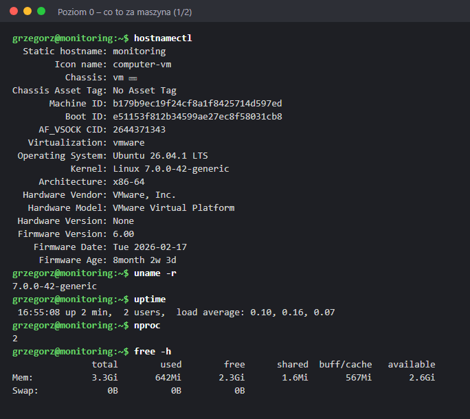

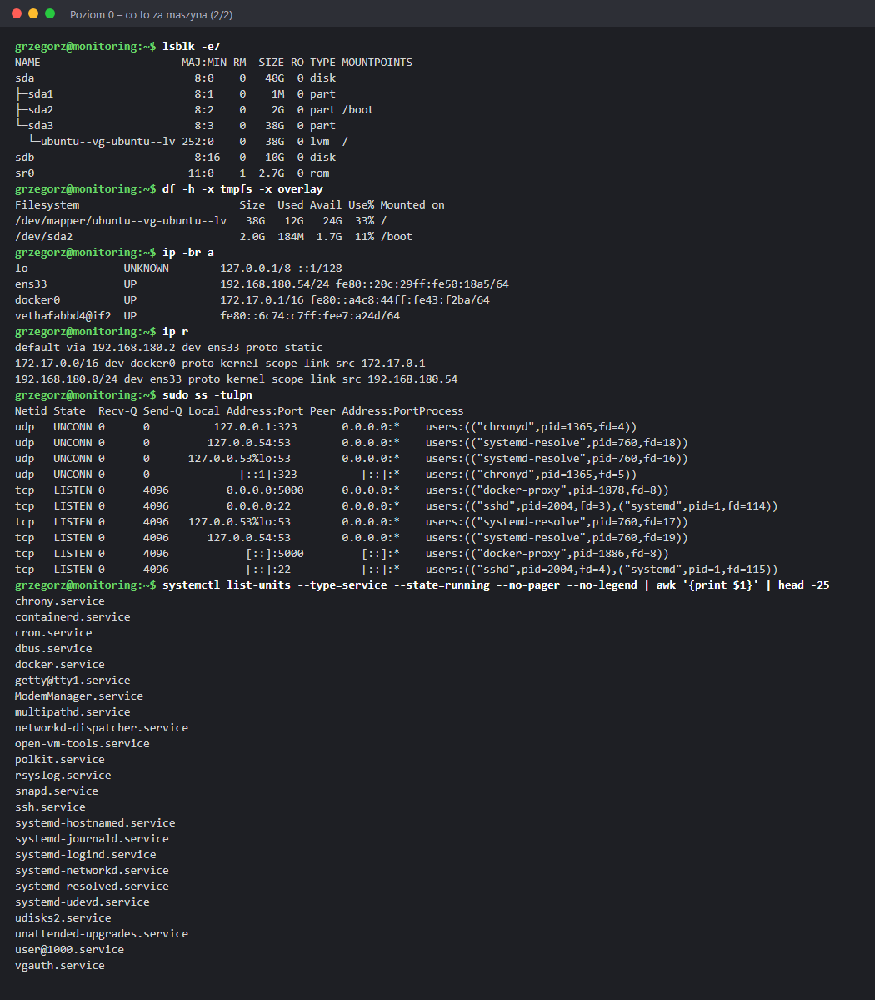

**Notatka o maszynie:**

| Co | Wynik |
|---|---|
| System, jądro | Ubuntu 26.04.1 LTS, jądro `7.0.0-42-generic`, maszyna VMware |
| Procesor, pamięć | 2 rdzenie, 3,3 GiB RAM (`available` 2,6 GiB), **swap 0** |
| Dyski | `sda` 40G: `/boot` 2G, `/` 38G na LVM (33% zajęte); `sdb` 10G pusty |
| Sieć | `ens33` `192.168.180.54/24`, brama `192.168.180.2`; `docker0` `172.17.0.1/16` |
| Porty | 22 (`sshd`), 5000 (`docker-proxy`), 53 tylko lokalnie (`systemd-resolved`), 323/udp lokalnie (`chronyd`) |
| Usługi | `ssh`, `docker`, `containerd`, `cron`, `rsyslog`, `chrony`, `open-vm-tools`… |

**Sprawdź się:**
- **`load average`** to średnia liczba procesów, które chcą procesora (działają albo czekają na
  niego, a w Linuxie także czekają na dysk) – z ostatnich 1, 5 i 15 minut. Odnosisz ją do liczby
  rdzeni: przy 2 rdzeniach wartość 2,0 oznacza pełne obciążenie, a długo powyżej 2 – kolejkę.
  Tu `0.10, 0.16, 0.07` – maszyna odpoczywa.
- **`free` małe, `available` duże:** Linux używa wolnej pamięci jako pamięci podręcznej plików
  (`buff/cache`). Gdy program potrzebuje pamięci, jądro oddaje ją z cache. Liczy się `available`,
  nie `free` – to nie jest problem.
- **Port 5000:** `docker-proxy` – Docker przekazuje ruch z portu hosta do kontenera rejestru
  (`registry:3`, postawiony w Etapie 4 – patrz [własny obraz](../etap-4-monitoring-zewnetrzny/02-wlasny-obraz.md)).
- **`ss -tulpn` bez `sudo`:** kolumna `Process` jest pusta dla procesów innych użytkowników.
  Widzisz, że port słucha, ale nie wiesz, kto. Z `sudo` widać nazwę i PID.

## Poziom 1 – kto próbował się zalogować?

Z Windowsa: `ssh admin@…`, `ssh root@…`, `ssh test@…`, `ssh oracle@…`, `ssh admin@…`.

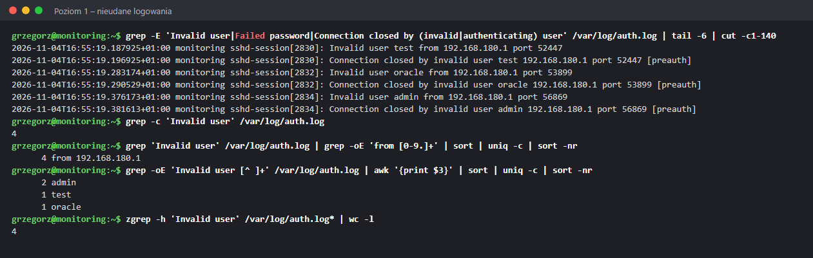

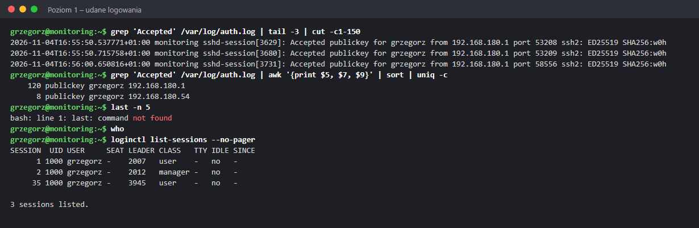

Rozwiązanie kroków 4 i 5:

```bash
grep 'Invalid user' /var/log/auth.log | grep -oE 'from [0-9.]+' | sort | uniq -c | sort -nr
grep -oE 'Invalid user [^ ]+' /var/log/auth.log | awk '{print $3}' | sort | uniq -c | sort -nr
```

Wynik: **4 próby, wszystkie z `192.168.180.1`**: `admin` 2 razy, `test` i `oracle` po razie.
Próba na `root` nie ma wpisu `Invalid user` – konto istnieje, więc w logu jest `Connection closed by
authenticating user root`. Udanych logowań kluczem: 120 z Windowsa i 8 z samej maszyny
`192.168.180.54` – to Ansible, który łączy się z `monitoring` także do niej samej.

**Niespodzianka – nie ma `last`:** w Ubuntu 26.04 polecenie `last` (pakiet `util-linux`) zniknęło,
bo stary plik `/var/log/wtmp` miał problem roku 2038. Zastępstwa:

```bash
loginctl list-sessions            # bieżące sesje (systemd-logind)
sudo apt install wtmpdb           # nowa baza logowań, potem:
wtmpdb last                       # historia logowań, jak dawniej last
```

`who` jest pusty, bo pokazuje sesje z terminalem (tty), a sesje uruchamiane poleceniem `ssh host
"polecenie"` terminala nie mają. W Twojej interaktywnej sesji `who` pokaże `grzegorz pts/0`.

**Sprawdź się:**
- **`192.168.180.1`:** VMware w trybie NAT ukrywa Twój komputer za adresem `.1` w sieci VMnet8.
  Maszyna widzi tylko ten adres.
- **`Invalid user` / `Failed password`:** `Invalid user` – takiego konta nie ma. `Failed password` –
  konto jest, ale hasło złe. U nas logowanie hasłem jest wyłączone (`PasswordAuthentication no`),
  więc serwer nawet nie pyta o hasło i takiego wpisu nie ma.
- **`sort | uniq -c | sort -nr`:** `sort` układa linie, `uniq -c` skleja **sąsiednie** identyczne
  linie i liczy je (dlatego wcześniej `sort`, inaczej te same adresy rozrzucone po pliku liczyłby
  osobno), `sort -nr` sortuje liczbowo malejąco – najczęstsze na górze.
- **Automatyczna blokada:** `fail2ban` – czyta logi i po kilku nieudanych próbach dopisuje regułę
  firewalla blokującą adres (np. na 10 minut).

## Poziom 2 – logi systemowe: journalctl

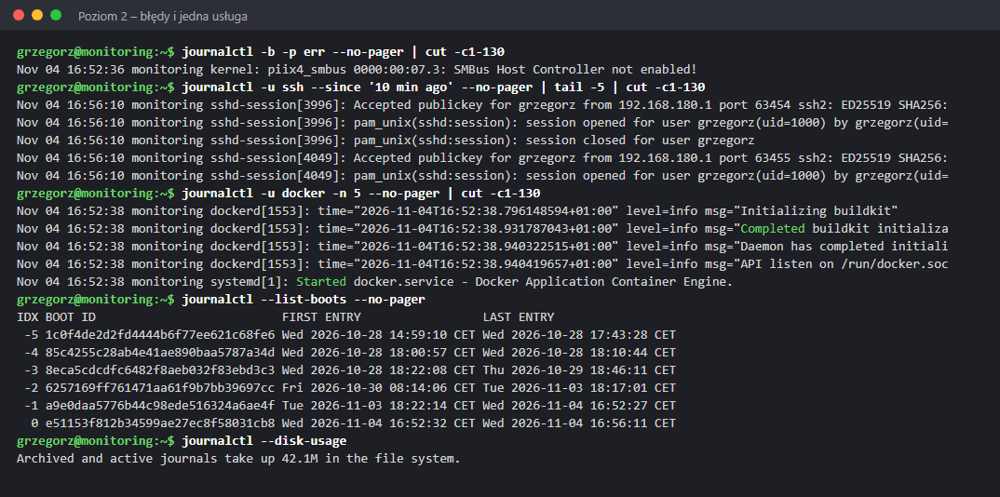

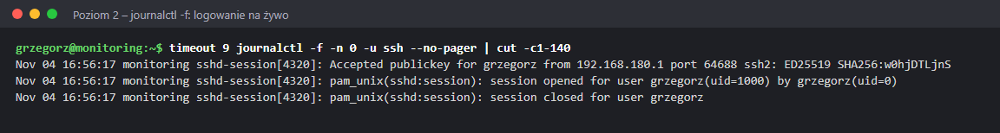

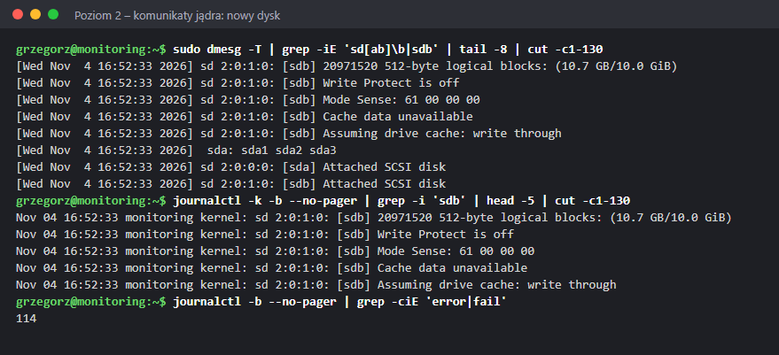

Wyniki: w `-p err` tylko jeden wpis – `piix4_smbus … SMBus Host Controller not enabled!`. To znany,
niegroźny komunikat o wirtualnej płycie głównej VMware. Lista uruchomień: 6 (od 28.10). Dziennik
zajmuje 42,1 MB. `grep -ciE 'error|fail'` znalazł 114 linii od startu – większość to zwykłe
komunikaty, w których słowo „fail” występuje w nazwie opcji. Dlatego `-p err` jest lepszym filtrem.

**Sprawdź się:**
- **`journalctl` a `/var/log`:** `journald` zbiera logi w swoim binarnym dzienniku, a `rsyslog`
  dostaje od niego kopię i zapisuje ją jako zwykłe pliki tekstowe (`syslog`, `auth.log`). Stąd te
  same wpisy w obu miejscach. `journalctl` umie filtrować po usłudze, priorytecie i czasie; pliki
  tekstowe przeszukasz `grep`.
- **Poziomy `-p`:** `0 emerg`, `1 alert`, `2 crit`, `3 err`, `4 warning`, `5 notice`, `6 info`,
  `7 debug`. `-p warning` pokazuje poziom `warning` **i wszystkie poważniejsze** (0–4).
- **`-b -1` puste:** gdy dziennik jest trzymany tylko w pamięci (`/run/log/journal`, brak katalogu
  `/var/log/journal` albo `Storage=volatile`), po restarcie znika. U nas jest trwały – widać 6
  uruchomień.
- **Moment wykrycia dysku:** `sudo dmesg -T | grep sdb` albo `journalctl -k | grep sdb` – tu
  `16:52:33` (start maszyny po dodaniu dysku).

## Poziom 3 – grep w plikach konfiguracyjnych

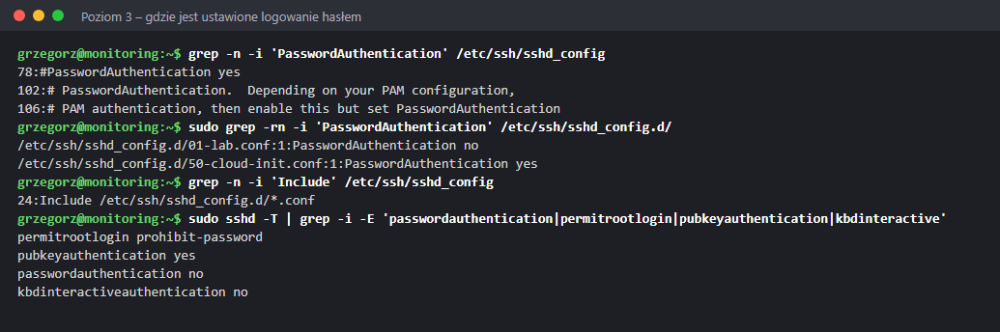

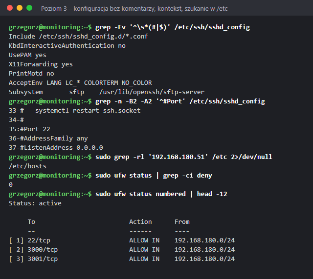

**Niespodzianka – dwa pliki, dwa różne ustawienia:**

```
/etc/ssh/sshd_config.d/01-lab.conf:1:PasswordAuthentication no        ← skrypt z Etapu 1
/etc/ssh/sshd_config.d/50-cloud-init.conf:1:PasswordAuthentication yes ← instalator Ubuntu (cloud-init)
```

Które wygrywa? `sshd -T` mówi `passwordauthentication no`. W `sshd` obowiązuje zasada **pierwsza
znaleziona wartość wygrywa**, a pliki z `sshd_config.d/` są czytane alfabetycznie – `01-…` przed
`50-…`. Dlatego pliki labu mają numer `01`. Gdyby skrypt nazwał plik `99-lab.conf`, hasła byłyby
**włączone**. (W wielu innych programach, np. `nginx`, `sysctl`, jest odwrotnie – wygrywa ostatnia.)

Krok 5: adres mastera `192.168.180.51` jest tylko w `/etc/hosts`.

Krok 6: `ufw status | grep -ci deny` daje **0**. Blokowanie robi domyślna polityka
(`Default: deny (incoming)`), a nie osobne reguły. Reguły wpuszczają z sieci labu porty 22, 3000
i 3001 (Grafana i Uptime Kuma z Etapu 4). **Portu 5000 nie ma, a rejestr działa** – Docker dopisuje
własne reguły `iptables` przed regułami `ufw`, więc porty opublikowane przez `docker run -p` są
otwarte mimo `ufw`. To częsta pułapka w produkcji. Rozwiązania: publikować port tylko na
`127.0.0.1` albo dopisać reguły do łańcucha `DOCKER-USER`.

**Sprawdź się:**
- **Sam `grep` w `sshd_config`** pokazuje tylko jeden plik. Ustawienie może być w dołączonym pliku
  (`Include`), może być nadpisane albo wcale nie istnieć (wtedy obowiązuje wartość domyślna).
  `sshd -T` wypisuje **ostateczną** konfigurację, której serwer naprawdę używa.
- **Opcje `grep`:** `-r` rekurencyjnie po katalogach, `-l` tylko nazwy plików, `-n` numery linii,
  `-i` bez rozróżniania wielkości liter, `-v` odwrotnie (linie **bez** wzorca), `-E` rozszerzone
  wyrażenia (`|`, `+`, `()`), `-c` liczba pasujących linii, `-A N` / `-B N` – N linii po / przed
  trafieniem.
- **`^\s*(#|$)`:** początek linii, dowolne odstępy, potem `#` (komentarz) **albo** od razu koniec
  linii (pusta linia). Z `-v` zostają tylko linie z prawdziwymi ustawieniami.

## Poziom 4 – nowy dysk

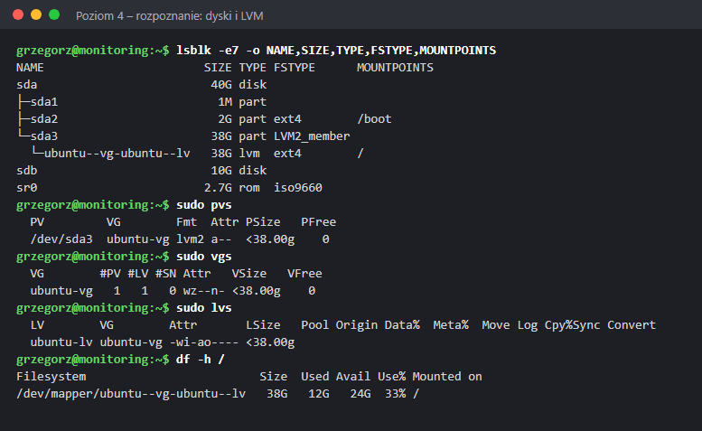

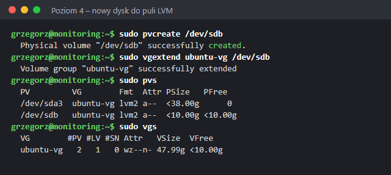

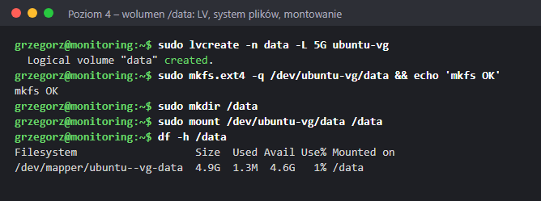

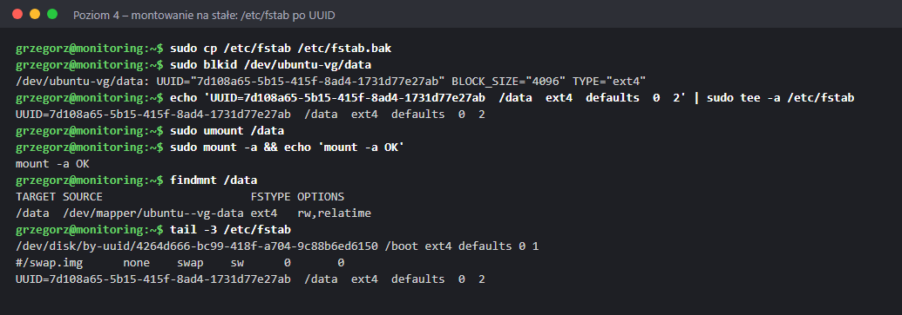

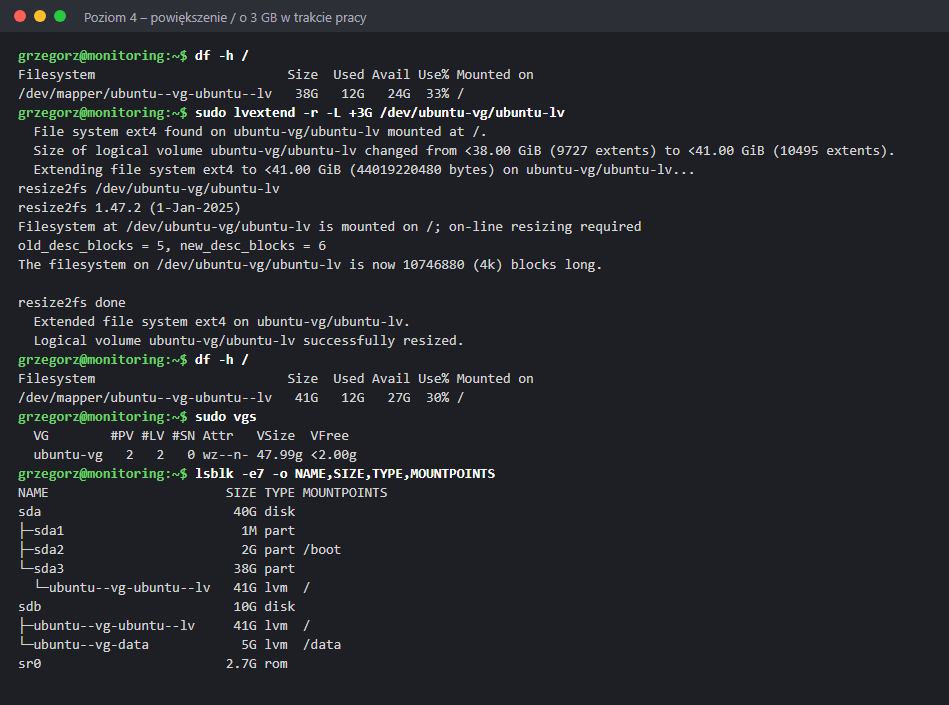

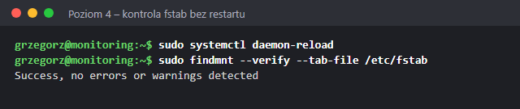

Po kroku 2 pula `ubuntu-vg` urosła do 47,99 GB, wolne `<10.00g`. `/data` ma 4,9G (część zajmują
struktury ext4). `lvextend -r` powiększył wolumen i od razu system plików (`resize2fs … on-line
resizing required`) – `/` ma 41G, bez zatrzymywania czegokolwiek. `lsblk` pokazuje, że
`ubuntu--vg-ubuntu--lv` leży teraz **na dwóch dyskach**: `sda3` i `sdb`.

Zamiast restartu: `sudo findmnt --verify` → `Success, no errors or warnings detected`. To polecenie
sprawdza `fstab` (czy urządzenia istnieją, czy typy systemów plików się zgadzają). Restart w Twoim
wykonaniu jest dobrym, ostatecznym testem.

**Sprawdź się:**
- **`mount -a` przed restartem:** montuje wszystko z `fstab`, więc błąd wychodzi od razu, gdy
  jeszcze masz działającą sesję. Bez tego literówka w `fstab` kończy się tym, że po restarcie
  system staje w trybie awaryjnym (*emergency mode*) – naprawa tylko z konsoli VMware.
- **UUID zamiast `/dev/sdb`:** nazwy `sda`/`sdb` nadawane są w kolejności wykrycia i mogą się
  zamienić po dodaniu dysku. UUID jest zapisany w samym systemie plików i się nie zmienia.
- **Bez LVM:** `sudo fdisk /dev/sdb` (albo `parted`) → partycja `sdb1`, `sudo mkfs.ext4 /dev/sdb1`,
  `mkdir`, `mount`, wpis w `fstab`. Powiększenie zwykłej partycji jest trudniejsze: musi za nią być
  wolne miejsce na **tym samym** dysku (`growpart`, potem `resize2fs`).
- **Zmniejszanie:** ext4 nie zmniejsza się w trakcie pracy – trzeba odmontować (dla `/` – start
  z innego systemu), sprawdzić `e2fsck`, zmniejszyć system plików, a dopiero potem wolumen.
  Pomyłka w kolejności niszczy dane. XFS w ogóle nie umie się zmniejszać.
- **Powiększony istniejący dysk:** system widzi nowy rozmiar po `echo 1 > /sys/class/block/sda/device/rescan`,
  potem powiększasz partycję (`growpart /dev/sda 3`), PV (`pvresize /dev/sda3`), a na końcu
  `lvextend -r`.

## Poziom 5 – kończy się miejsce

Pliki z ćwiczeń (6G i 4G) dały u nas tylko ~55% zajęcia, więc użyto **15G i 8G**, żeby dojść do 91%.

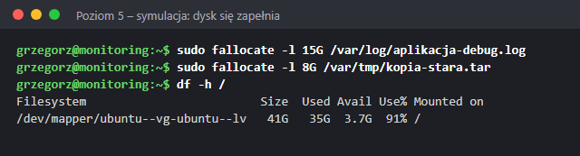

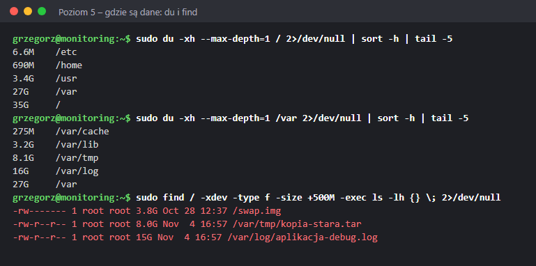

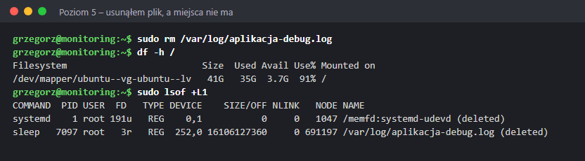

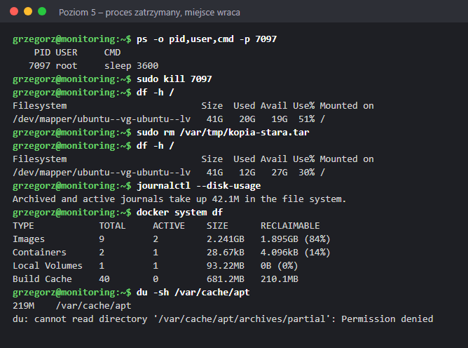

`du` prowadzi krok po kroku: `/` → `/var` 27G → `/var/log` 16G i `/var/tmp` 8,1G. `find` znalazł oba
pliki i **trzeci, niezapowiedziany: `/swap.img` 3,8G** z 28.10. W Etapie 1 swap został wyłączony
(Kubernetes tego wymaga) i zakomentowany w `fstab`, ale plik został na dysku. Na prawdziwym
serwerze to 3,8 GB do odzyskania: `sudo rm /swap.img`.

Po `rm` dalej 91%. `lsof +L1` pokazuje proces `sleep` (PID 7097) z plikiem `(deleted)` o rozmiarze
16106127360 B (15 GiB). Po `kill` – 51%, po usunięciu drugiego pliku – 30%. Bonus: `docker system df`
pokazuje 1,9 GB obrazów do odzyskania, a `/var/cache/apt` – 219 MB.

**Sprawdź się:**
- **`df` a `du`:** `df` pyta system plików, ile bloków zajętych; `du` sumuje rozmiary plików, które
  widzi w katalogach. Nie zgadzają się, gdy plik jest usunięty, ale otwarty (`du` go nie widzi,
  `df` tak), albo gdy coś jest zamontowane na niepustym katalogu (pliki „pod spodem” są niewidoczne
  dla `du`).
- **Usunięty, a miejsce zajęte:** `rm` usuwa tylko **nazwę** pliku (link w katalogu). Dane są
  zwalniane, gdy znikną wszystkie nazwy **i** zamknie go ostatni proces. Typowy przypadek: program
  pisze do logu, ktoś ręcznie usuwa log.
- **Bez zatrzymywania procesu** – obetnij plik przez otwarty deskryptor:
  ```bash
  sudo ls -l /proc/7097/fd          # widać: 3 -> /var/log/aplikacja-debug.log (deleted)
  sudo truncate -s 0 /proc/7097/fd/3
  ```
  Na przyszłość: logu, który ktoś trzyma otwarty, nie usuwaj – opróżnij go (`sudo truncate -s 0
  plik` albo `: > plik`).
- **`-x` / `-xdev`:** nie wchodź na inne systemy plików (`/boot`, `/data`, `/proc`, montowania
  Dockera). Liczysz tylko ten dysk, który się zapełnia.
- **`/` na 100%:** usługi nie mogą zapisać logów ani plików tymczasowych – padają bazy danych,
  Docker (nie startują kontenery), `apt`, czasem logowanie (brak miejsca na plik sesji). ext4
  rezerwuje ~5% dla roota (`tune2fs -m`), dzięki temu root zwykle może jeszcze się zalogować
  i posprzątać.

## Poziom 6 – usługa nie wstaje

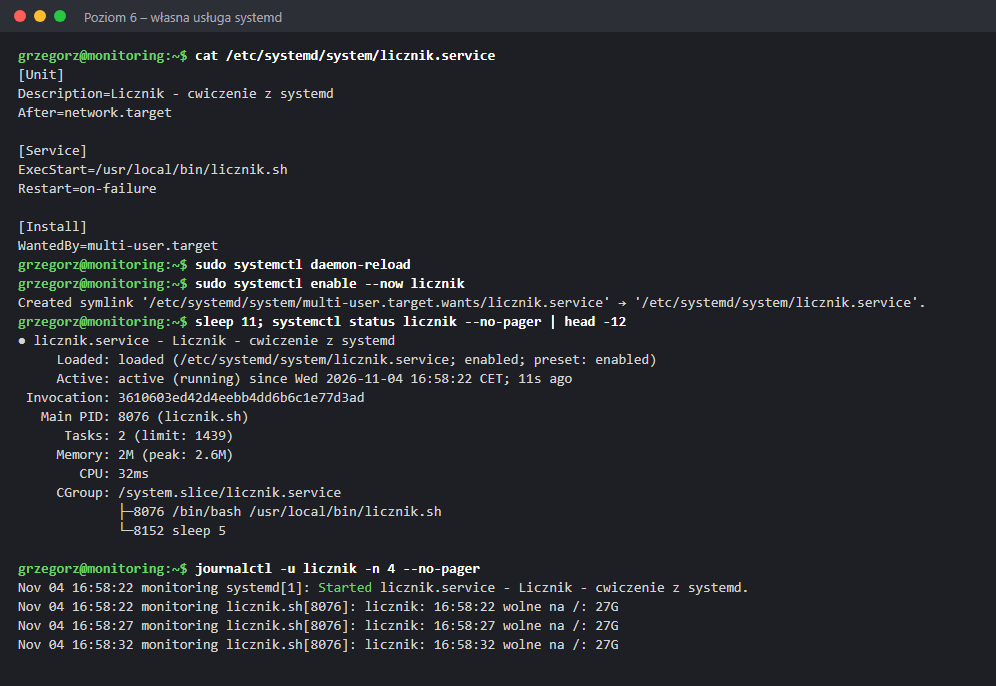

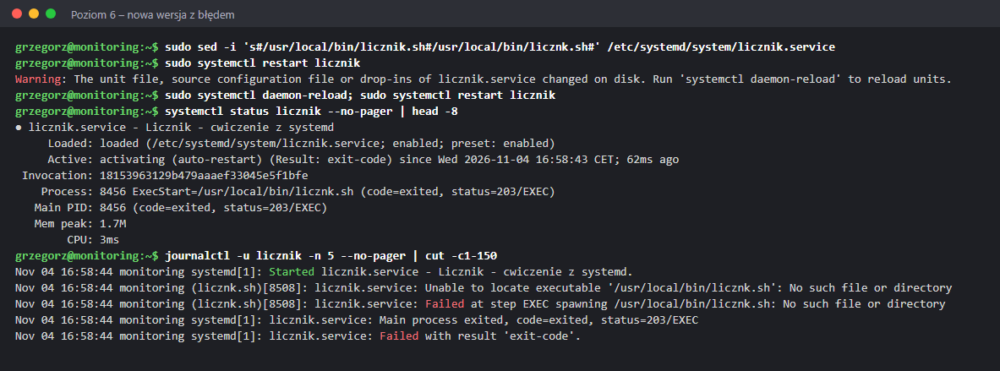

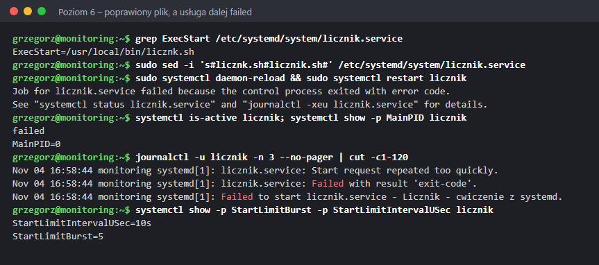

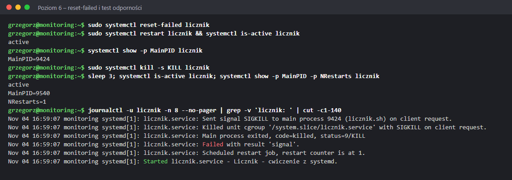

Przebieg:

1. Po `sed` z literówką `systemctl restart` ostrzegł: `The unit file … changed on disk. Run
   'systemctl daemon-reload'` – bez `daemon-reload` systemd dalej używał starej wersji pliku (z
   poprawną ścieżką) i usługa „działała”.
2. Po `daemon-reload` – `status=203/EXEC` i w dzienniku `Unable to locate executable
   '/usr/local/bin/licznk.sh': No such file or directory`. Kod `203/EXEC` oznacza: systemd nie mógł
   uruchomić programu (brak pliku, brak prawa `x`, zła pierwsza linia `#!`).
3. **Pułapka, której nie było w ćwiczeniu:** po poprawieniu ścieżki i `daemon-reload` restart dalej
   się nie udaje, a w dzienniku jest `Start request repeated too quickly`. `Restart=on-failure`
   wznawiał zepsutą usługę raz za razem, a systemd pozwala na **5 startów w 10 sekund**
   (`StartLimitBurst=5`, `StartLimitIntervalUSec=10s`). Po przekroczeniu blokuje usługę. Pomaga:
   ```bash
   sudo systemctl reset-failed licznik
   sudo systemctl restart licznik
   ```
   (Albo odczekanie 10 sekund – limit liczy się w oknie czasu.)
4. Odporność: po `systemctl kill -s KILL` usługa wstała sama – nowy PID (`9424` → `9540`),
   `NRestarts=1`. `is-enabled` – `enabled`.

**Sprawdź się:**
- **`daemon-reload`:** systemd czyta pliki `.service` raz i trzyma je w pamięci. Po zmianie pliku
  trzeba kazać mu przeczytać je ponownie. Bez tego używa starej wersji (i ostrzega, jak wyżej).
- **`enable` / `start`:** `start` – uruchom teraz. `enable` – uruchamiaj przy starcie systemu
  (dowiązanie w `multi-user.target.wants/`). `enable --now` – jedno i drugie.
- **`Restart=on-failure`:** wznawia, gdy proces skończy się kodem różnym od 0, zostanie zabity
  sygnałem (jak nasz `KILL`) albo przekroczy limit czasu. **Nie** wznawia, gdy proces sam skończy
  się kodem 0, gdy zatrzymasz go `systemctl stop` i gdy zadziała limit startów.
- **Gdzie trafiło `echo`:** wyjście (stdout i stderr) usługi systemd przekazuje do `journald` –
  stąd linie `licznik.sh[8076]: licznik: 16:58:22 …` w `journalctl -u licznik`.

## Poziom 7 – coś zjada procesor

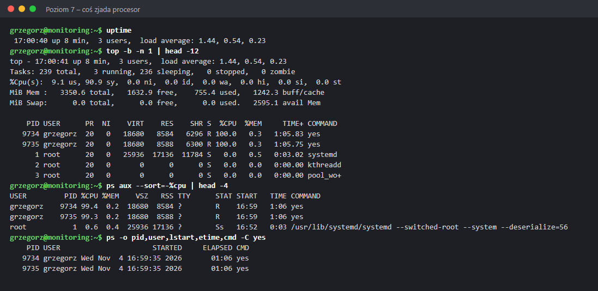

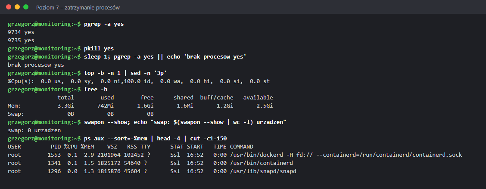

Dwa procesy `yes` po 100% CPU. Po minucie `load average: 1.44, 0.54, 0.23` – pierwsza liczba rośnie
w stronę 2,0, pozostałe wolniej (dłuższe okno). `%Cpu(s): 9.1 us, 90.9 sy, 0.0 id` – procesor bez
chwili wolnego. Dużo `sy`, bo `yes > /dev/null` głównie wywołuje funkcję jądra `write`. `ps -o lstart`
pokazuje, że oba wystartowały o 16:59:35 i należą do `grzegorz`. Po `pkill yes` – `100.0 id`.
Swapu nie ma (`swapon --show` pusty); najwięcej pamięci zajmują `dockerd`, `containerd` i `snapd`.

**Sprawdź się:**
- **`load average` 2,0:** na 2 rdzeniach – 100% wykorzystania, jeszcze bez kolejki (granica).
  Na 16 rdzeniach – ok. 12% – nic się nie dzieje.
- **`kill` / `kill -9`:** `kill` wysyła SIGTERM – prośbę o zakończenie; program może posprzątać
  (zapisać dane, zamknąć pliki). `kill -9` (SIGKILL) zabija natychmiast przez jądro – bez
  sprzątania, ryzyko uszkodzonych danych. Dlatego najpierw zwykły `kill`, a `-9` dopiero, gdy proces
  nie reaguje.
- **Kolumny CPU:** `us` – programy użytkownika, `sy` – jądro, `wa` – czekanie na dysk/sieć (I/O),
  `id` – bezczynność. Wysokie `wa` = wolny albo przeciążony dysk (sprawdzisz `iostat -x`,
  `iotop`).
- **OOM killer:** gdy brakuje pamięci (a swapu nie ma albo się skończył), jądro wybiera proces
  z największym „oom_score” i go zabija. Ślad w logach: `sudo dmesg -T | grep -i "out of memory"`
  albo `journalctl -k | grep -i oom` – wpis `Out of memory: Killed process 1234 (java)`.

## Poziom 8 – nowy użytkownik i wspólny katalog

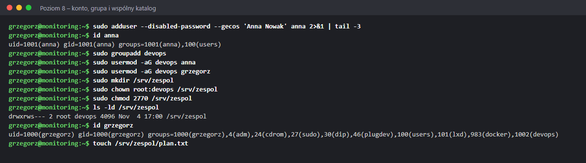

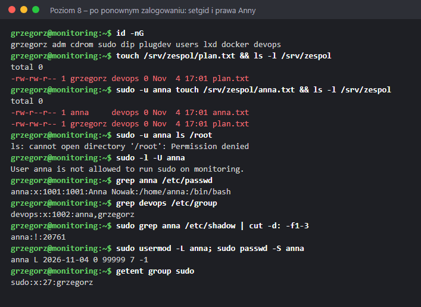

Wyniki: `uid=1001(anna)`, katalog `drwxrws--- root devops` (litera `s` w miejscu `x` grupy to
setgid). Oba pliki w `/srv/zespol` mają grupę **`devops`**, choć grupa podstawowa użytkowników to
`grzegorz` i `anna`. Anna nie może czytać `/root` (`Permission denied`), `sudo -l -U anna` – `User
anna is not allowed to run sudo`. W `/etc/shadow` – `anna:!:20761` (`!` = brak hasła, 20761 = dzień
ostatniej zmiany liczony od 1.01.1970). Po `usermod -L` `passwd -S` pokazuje `L` (locked).

**Niespodzianka – prawa plików:** `plan.txt` (grzegorz) ma `-rw-rw-r--`, a `anna.txt` ma
`-rw-r--r--`, czyli inni członkowie `devops` nie mogą go zmieniać. Powód: `umask`. Twoja sesja ma
`umask 002` (grupa może pisać), a polecenie uruchomione przez `sudo -u anna` – `022`. Na wspólnym
katalogu to częsty problem. Rozwiązania: `umask 002` w profilu użytkowników zespołu albo domyślne
listy ACL na katalogu:

```bash
sudo setfacl -d -m g:devops:rwx /srv/zespol    # nowe pliki dostaną prawo zapisu dla devops
```

**Sprawdź się:**
- **`2770`:** `2` – setgid, `7` – właściciel `rwx`, `7` – grupa `rwx`, `0` – inni nic. Setgid na
  katalogu: nowe pliki i katalogi dziedziczą **grupę katalogu** (`devops`) zamiast grupy
  podstawowej twórcy. Dzięki temu cały zespół ma do nich dostęp.
- **Wylogowanie:** lista grup jest przypisywana procesowi przy logowaniu. Bieżąca sesja ma starą
  listę. Pomaga nowe logowanie albo `newgrp devops` (nowa powłoka z grupą). Na zrzucie od razu
  widać `devops`, bo każde polecenie szło przez nowe połączenie SSH.
- **`passwd` / `shadow`:** `/etc/passwd` – nazwa, UID, GID, opis, katalog domowy, powłoka; czytają
  go wszyscy (programy zamieniają UID na nazwę). `/etc/shadow` – skróty haseł i daty ważności;
  czyta tylko root, żeby nikt nie mógł łamać skrótów offline.
- **`adduser` / `useradd`:** `useradd` to niskopoziomowe polecenie – bez opcji nie tworzy katalogu
  domowego ani nie pyta o nic. `adduser` (Debian/Ubuntu) to wygodny skrypt: tworzy katalog,
  kopiuje `/etc/skel`, pyta o dane i hasło.
- **Restart jednej usługi przez `sudo`:** plik w `/etc/sudoers.d/`, edytowany przez `visudo`
  (sprawdza składnię):
  ```bash
  sudo visudo -f /etc/sudoers.d/anna-licznik
  # treść:
  anna ALL=(root) /usr/bin/systemctl restart licznik
  ```
  Wtedy `sudo -l -U anna` pokaże tylko to jedno polecenie.

## Poziom 9 – zadanie co noc i rotacja logów

Zamiast `crontab -e` (edytor) wpis dodano jednym poleceniem – przydatne w skryptach i Ansible:

```bash
(sudo crontab -l 2>/dev/null; echo '* * * * * /usr/local/bin/kopia-zespol.sh') | sudo crontab -
```

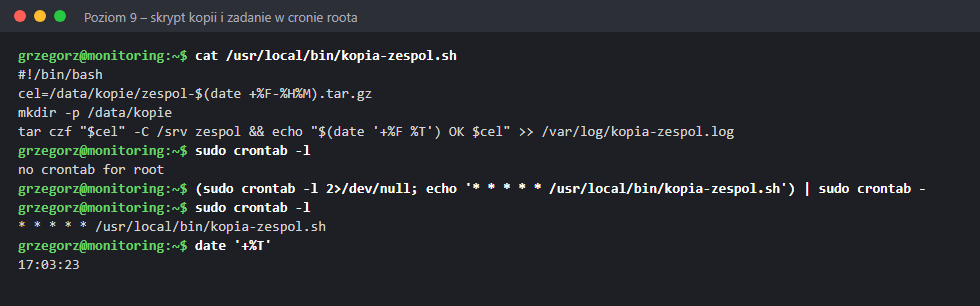

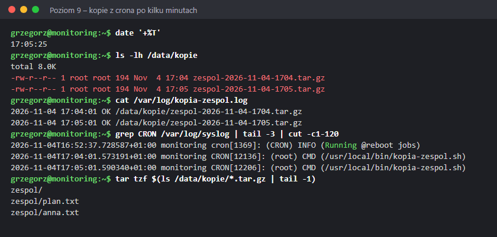

Cron uruchamia zadanie w pełnej minucie (`17:04:01`, `17:05:01`) – co minutę nowy plik
`zespol-…tar.gz`, linia `OK` w logu i wpis `CRON[…]: (root) CMD (…)` w `syslog`. W archiwum są
oba pliki zespołu.

**Niespodzianka – `logrotate -f` odmówił:**

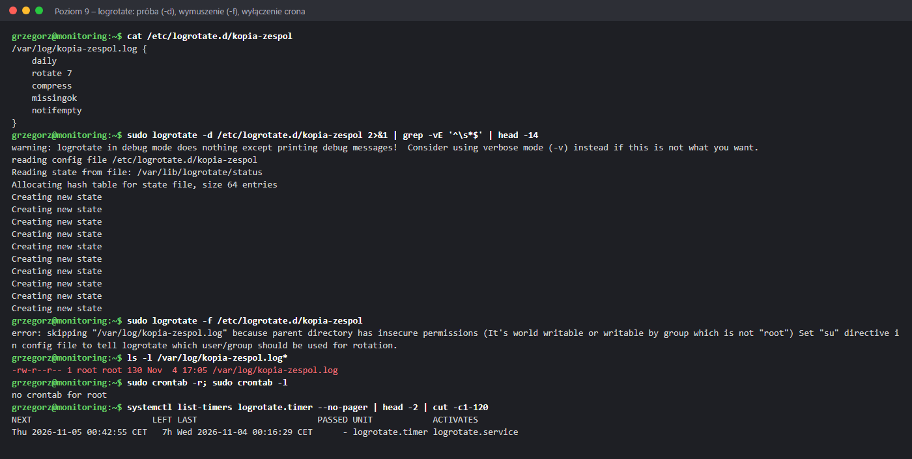

```
error: skipping "/var/log/kopia-zespol.log" because parent directory has insecure permissions
(It's world writable or writable by group which is not "root") Set "su" directive …
```

Katalog `/var/log` należy do `root:syslog` i grupa `syslog` może w nim pisać (`drwxrwxr-x`).
`logrotate` w takim katalogu nie rotuje, dopóki nie wie, jako kto ma to robić (ochrona przed
atakiem przez podmienione pliki). Ubuntu ma na to ustawienie `su root adm` w **głównym** pliku
`/etc/logrotate.conf` (linia 10). Codzienny przebieg czyta `logrotate.conf`, a on dołącza
`/etc/logrotate.d/` (linia 25) – wtedy wszystko działa. My uruchomiliśmy `logrotate` **tylko
z naszym plikiem**, więc ustawień globalnych nie było. Naprawa – `su` w naszym pliku:

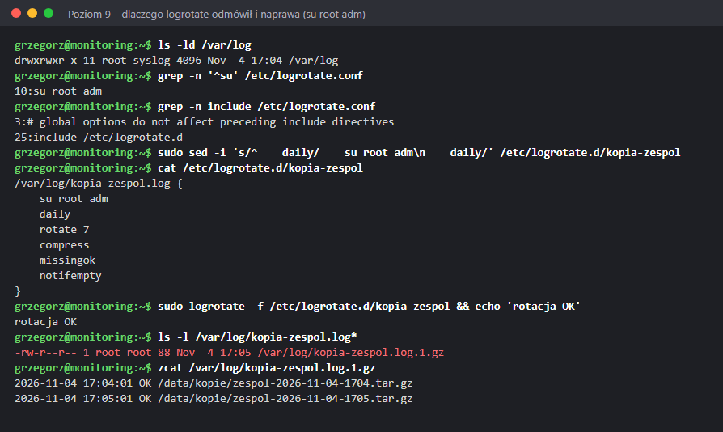

Po rotacji jest `kopia-zespol.log.1.gz`, a nowego, pustego logu **nie ma** – z tego samego powodu
(dyrektywa `create` też jest tylko w `logrotate.conf`). Nie szkodzi: skrypt dopisuje `>>`, więc
przy następnym przebiegu utworzy log sam. Można też dopisać `create 0640 root adm` do naszego pliku.

Na koniec `sudo crontab -r` – zadanie co minutę usunięte (`no crontab for root`). Rotację
codziennie uruchamia `logrotate.timer` (systemd), widoczny w `systemctl list-timers`.

**Sprawdź się:**
- **`0 2 * * *`:** minuta (0), godzina (2), dzień miesiąca (`*` – każdy), miesiąc (`*`), dzień
  tygodnia (`*`; 0 i 7 = niedziela). „W dni robocze o 6:30”: `30 6 * * 1-5`. Pomoc:
  [crontab.guru](https://crontab.guru).
- **Pełne ścieżki:** cron uruchamia zadanie z minimalnym środowiskiem – krótki `PATH`
  (`/usr/bin:/bin`), bez Twoich aliasów i zmiennych z `.bashrc`, katalog bieżący to katalog domowy,
  bez terminala. Polecenie, które działa w Twojej sesji, w cronie może nie znaleźć programu.
  Wyjście zadania nie trafia na ekran – przekieruj je do pliku (`>> /var/log/… 2>&1`).
- **`logrotate -d` / `-f`:** `-d` (debug) – tylko opisuje, co **by** zrobił, niczego nie zmienia.
  `-f` (force) – rotuje teraz, nawet jeśli według `daily` jeszcze nie czas. Codziennie uruchamia
  go `logrotate.timer` (na starszych systemach skrypt `/etc/cron.daily/logrotate`).
- **`systemd timer`:** jednostka `.timer` uruchamiająca jednostkę `.service` według harmonogramu
  (`OnCalendar=*-*-* 02:00`). Przewagi nad cronem: logi w `journalctl -u`, zależności między
  usługami, `Persistent=true` (zadanie pominięte, bo maszyna była wyłączona, wykona się po starcie),
  `RandomizedDelaySec` (nie wszystkie serwery naraz), lista w `systemctl list-timers`.

## Poziom 10 – sprzątanie

Maszyna wróciła do snapshotu `przed-cwiczeniami-linux` – nie ma dysku z danymi, usługi `licznik`,
konta `anna` ani tymczasowego `sudo` dla Claude. Powiększonego `/` nie dałoby się łatwo cofnąć
(`sdb` stał się jego częścią), więc snapshot był jedyną prostą drogą.

**Sprawdź się (cały rozdział):** jeśli umiesz bez zaglądania odpowiedzieć „gdzie są logi logowań”,
„jak dołożyć miejsce na `/` bez restartu”, „dlaczego `rm` nie zwolnił miejsca” i „dlaczego usługa
po naprawie dalej nie wstaje” – jesteś gotowy na typowe pytania o Linuxa na rozmowie na juniora.
