# Etap 1 – rozwiązania: 40 typowych problemów z nginx, PostgreSQL i MariaDB

Wykonanie [ćwiczeń](04-cwiczenia-nginx-bazy.md) na maszynie `monitoring` (Ubuntu 26.04.1,
nginx 1.28.3, PostgreSQL 18.6, MariaDB 11.8.6), ze zrzutami terminala i odpowiedziami.

**Jak powstały zrzuty (04.11.2026):** polecenia wykonał Claude przez SSH z Windowsa, z tymczasowym
`sudo` bez hasła, zaraz po [poprzednich ćwiczeniach](03-cwiczenia-admin-linux-rozwiazania.md)
(stąd `/data`, konto `anna` itp.). Zrzuty z Windowsa mają znak zachęty `PS C:\Users\User>`,
z innych maszyn – ich nazwę (`k3s-master`, `k3s-worker-1`). Potem maszyna wróciła do snapshotu
`przed-cwiczeniami-linux`.

**Co wyszło inaczej, niż zakładał plan** (to są najcenniejsze lekcje):

| Odkrycie | Problem |
|---|---|
| `flock` na pliku blokady nie zatrzymuje `apt` – dpkg używa blokad `fcntl` | [1](#problem-1--could-not-get-lock-varlibdpkglock-frontend) |
| `curl localhost` łączy się najpierw po IPv6 (`::1`), a vhost słuchał tylko na IPv4 | [6](#problem-6--skleplab-pokazuje-stronę-powitalną-nginx) |
| Brakujący średnik – nginx wskazuje linię 44, a błąd jest w 41 | [3](#problem-3--po-zmianie-konfiguracji-reload-się-nie-udaje) |
| `try_files … =404` nie pisze nic do `error.log` | [9](#problem-9--404-not-found) |
| `systemctl is-active postgresql` mówi `active`, gdy baza leży | [31](#problem-31--postgresql-nie-wstaje) |
| MariaDB widzi klienta po nazwie (`Host 'monitoring'`), nie po adresie | [36](#problem-36--dostęp-z-sieci) |
| Skrypt kontrolny zgłosił fałszywy błąd: `-L` szedł za przekierowaniem do nieistniejącej nazwy | [40](#problem-40--czy-wszystko-działa-jednym-poleceniem) |

---

## Poziom 0 – instalacja nginx

### Problem 1 – `Could not get lock /var/lib/dpkg/lock-frontend`

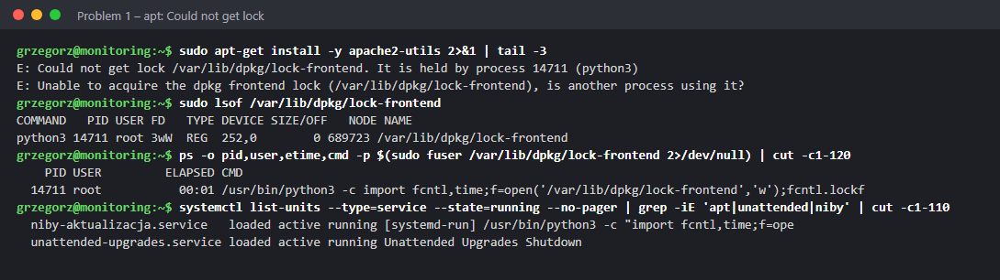

`lsof` i `fuser` pokazują proces, który trzyma blokadę (`python3`, PID 14711, od 1 sekundy). Na
prawdziwym serwerze byłby to `unattended-upgr` albo `apt` z innej sesji. Rozwiązanie: **poczekać**
(albo zakończyć własną, zawieszoną sesję `apt`). Po zwolnieniu blokady instalacja przeszła:

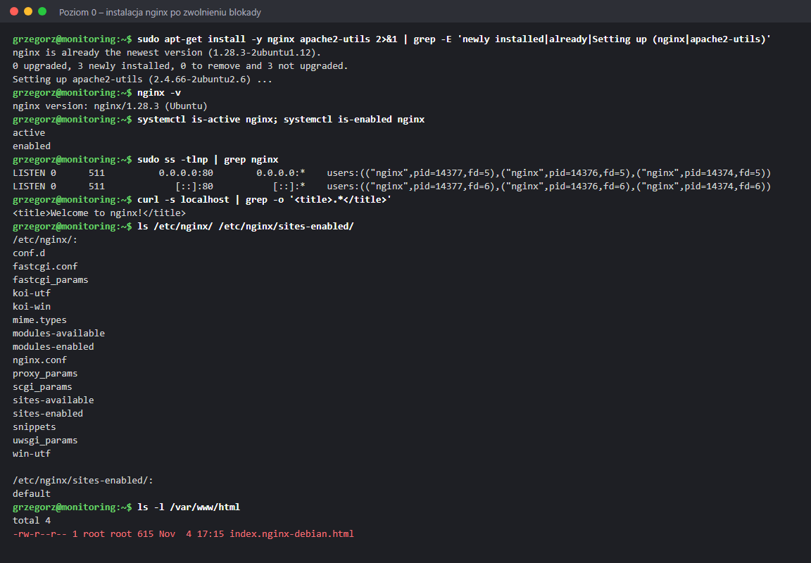

nginx po instalacji od razu działa (`active`, `enabled`), słucha na porcie 80 (IPv4 i IPv6),
konfiguracja w `/etc/nginx/`, strona domyślna w `/var/www/html`.

**Lekcja z przygotowania zrzutu:** pierwsza próba symulacji (`flock /var/lib/dpkg/lock-frontend
sleep 120`) **nie** zatrzymała `apt` – nginx po prostu się zainstalował. `flock` zakłada blokadę
typu BSD, a dpkg używa blokad `fcntl` (POSIX). W Linuxie te dwa rodzaje się nie widzą. Dopiero
`fcntl.lockf` w Pythonie dał prawdziwy błąd.

**Sprawdź się:**
- **Nie usuwaj plików `lock`:** blokada chroni bazę pakietów przed dwoma zapisami naraz. Usunięcie
  pliku przy działającym `apt` może zostawić pół-zainstalowane pakiety i uszkodzoną bazę dpkg
  (naprawa: `sudo dpkg --configure -a`). Zresztą sam plik nie jest blokadą – blokadą jest
  `fcntl` trzymany przez proces, więc usunięcie pliku i tak nic nie da.
- **`apache2-utils`:** zawiera `htpasswd` – plik haseł do `basic auth` w problemie 23.

### Problem 2 – strona działa na serwerze, z Windowsa nie

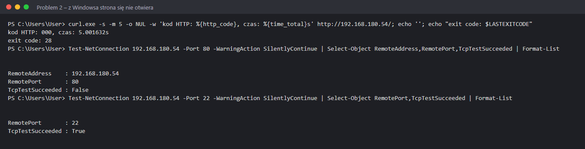

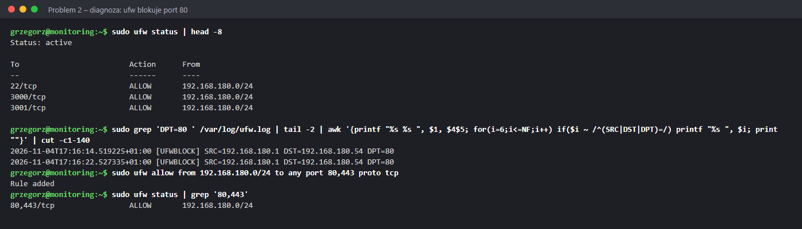

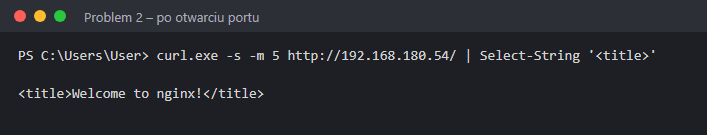

`curl.exe` czekał 5 s (kod `000`, wyjście 28 = timeout), a port 22 działa. W `/var/log/ufw.log`
widać `[UFW BLOCK] SRC=192.168.180.1 … DPT=80` – pakiety z Windowsa odrzucane. Reguła
`ufw allow from 192.168.180.0/24 to any port 80,443 proto tcp` otwiera oba porty tylko dla sieci labu.

**Sprawdź się:** firewall z polityką `deny` **po cichu wyrzuca** pakiety – klient czeka do
przekroczenia czasu (timeout). Gdy nic nie słucha na porcie, jądro od razu odsyła odmowę –
klient natychmiast dostaje `Connection refused`. Szybka odmowa = brak usługi, długie czekanie =
firewall (albo zła trasa).

## Poziom 1 – usługa nginx

### Problem 3 – po zmianie konfiguracji `reload` się nie udaje

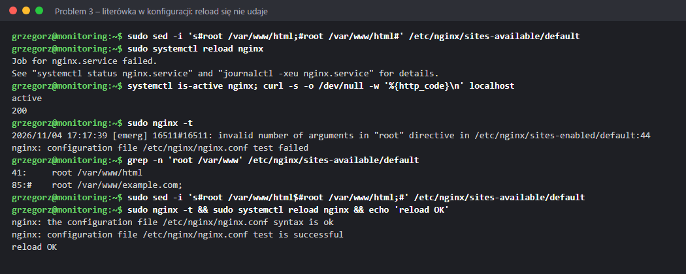

`reload` się nie udał, ale strona **dalej działa** (`200`) – nginx sprawdza nową konfigurację,
a gdy jest błędna, zostaje przy starej. `nginx -t` mówi: `invalid number of arguments in "root"
directive in /etc/nginx/sites-enabled/default:44`. Brakujący średnik jest w linii 41 – nginx czyta
dalej, aż trafi na `;` (linia 44), i dopiero wtedy widzi, że dyrektywa `root` ma za dużo słów.
Szukaj więc błędu **w linii z komunikatu i powyżej**.

**Sprawdź się:** `reload` (sygnał `HUP`) wczytuje konfigurację bez przerywania połączeń; przy
błędzie zostaje stara wersja. `restart` = `stop` + `start` – przy błędnej konfiguracji nginx się
zatrzyma i **nie wstanie**: strona leży. Dlatego zawsze `nginx -t && systemctl reload nginx`.

### Problem 4 – nginx nie startuje

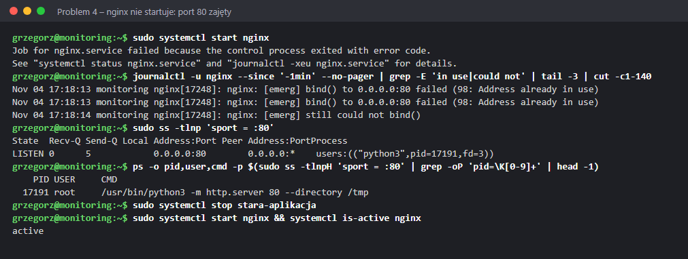

Komunikat `bind() to 0.0.0.0:80 failed (98: Address already in use)`, `ss -tlnp 'sport = :80'`
pokazuje `python3` (PID 17191), `ps` – pełne polecenie. Po zatrzymaniu intruza nginx wstaje.

**Sprawdź się:** błąd 98 (`EADDRINUSE`) – jądro nie pozwala dwóm programom słuchać na tym samym
adresie i porcie. `dpkg -S $(which python3)` powie, z jakiego pakietu jest program; dla usługi
pomoże też `systemctl status PID` – pokaże, w jakiej jednostce systemd działa proces.

### Problem 5 – po restarcie maszyny strona nie działa

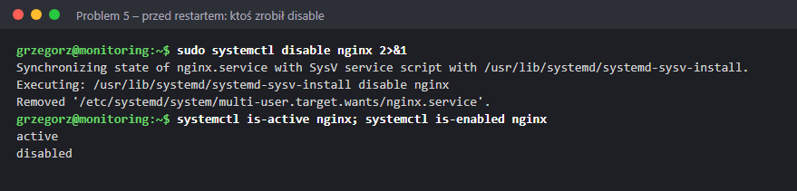

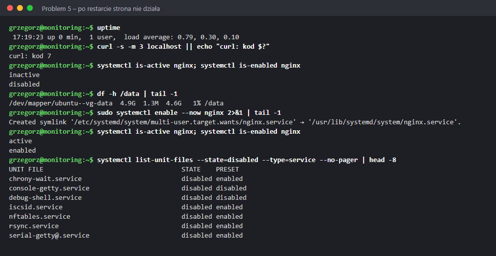

Pułapka: po `disable` usługa **dalej działa** (`active`) – `disable` zmienia tylko start przy
uruchomieniu systemu. Wychodzi to dopiero przy restarcie, często po tygodniach. Po restarcie:
`curl` kod 7 (nie da się połączyć), `inactive`/`disabled`. `/data` zamontował się sam – `fstab`
z poprzednich ćwiczeń działa.

**Sprawdź się:** po zmianie, która ma przetrwać restart, sprawdź `systemctl is-enabled`, `findmnt
--verify` (fstab), `ufw status` (reguły są trwałe), pliki w `/etc/sysctl.d/`. Najlepszy test to
kontrolowany restart w oknie serwisowym.

## Poziom 2 – wirtualne hosty

### Problem 6 – `sklep.lab` pokazuje stronę powitalną nginx

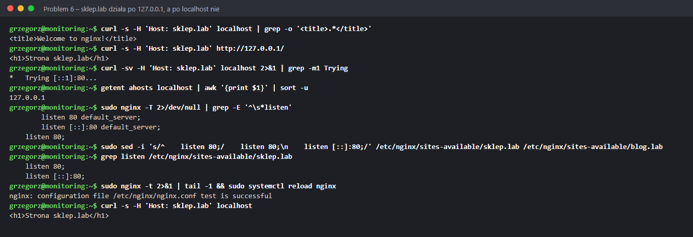

Tego problemu nie planowałem – wyszedł sam. `curl -v` pokazuje `Trying [::1]:80` – `curl` łączy
się z `localhost` najpierw po **IPv6** (ma wbudowaną zasadę, że `localhost` to `::1`
i `127.0.0.1`, mimo że `getent` pokazuje tylko `127.0.0.1`). Nasz vhost miał tylko `listen 80;`
(IPv4). Na `[::]:80` słucha wyłącznie strona `default` (`listen [::]:80 default_server`) – i to
ona odpowiada. Po dopisaniu `listen [::]:80;` wszystko działa.

To samo spotkasz w produkcji: klienci z IPv6 dostają inną stronę niż klienci z IPv4. Zasada:
każdy `listen 80` ma swoją parę `listen [::]:80`.

### Problem 7 – `blog.lab`: plik konfiguracyjny jest, strony nie ma

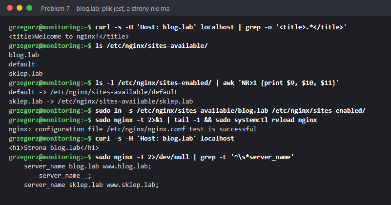

`blog.lab` jest w `sites-available`, ale nie ma dowiązania w `sites-enabled` – nginx wczytuje tylko
`sites-enabled/*` (linia `include` w `nginx.conf`). Po `ln -s` i `reload` strona działa, a `nginx -T`
(pełna, złożona konfiguracja) pokazuje oba `server_name`.

### Problem 8 – literówka w `server_name`

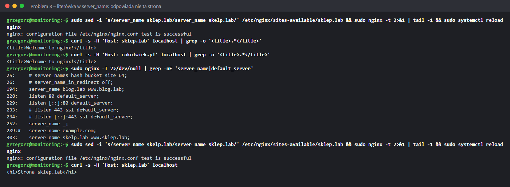

Z literówką `skelp.lab` zapytanie o `sklep.lab` nie pasuje do żadnego `server_name`, więc nginx
oddaje je serwerowi **domyślnemu** (`default_server` w pliku `default`) – tak samo jak zapytanie
o `cokolwiek.pl`. Wniosek: „pokazuje się nie ta strona” = sprawdź `server_name` i nagłówek `Host`.
W produkcji serwer domyślny zwykle zwraca `444` (zamknij połączenie) albo pustą stronę, żeby nie
pokazywać obcym nazwom przypadkowej witryny.

### Problem 9 – 404 Not Found

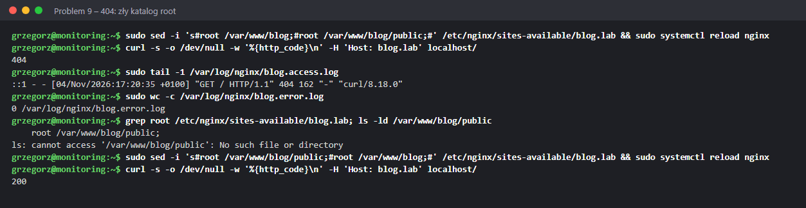

`root /var/www/blog/public` – katalogu nie ma. `blog.error.log` ma **0 bajtów**: przy `try_files
$uri $uri/ =404` brak pliku to dla nginx normalna odpowiedź, nie błąd. Ślad jest tylko w
`access.log` (`"GET / HTTP/1.1" 404`). Bez `try_files` nginx zapisałby w `error.log` `open() …
failed (2: No such file or directory)`.

### Problem 10 – 403 Forbidden, choć pliki są

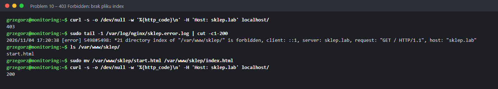

`directory index of "/var/www/sklep/" is forbidden` – w katalogu nie ma `index.html`, a nginx
domyślnie nie pokazuje listy plików (`autoindex off`), więc odpowiada `403`. Częsty przypadek po
wdrożeniu, w którym plik startowy nazywa się inaczej (`start.html`, `index.htm`) – napraw nazwę albo
dyrektywę `index`.

### Problem 11 – 403 Forbidden przez uprawnienia

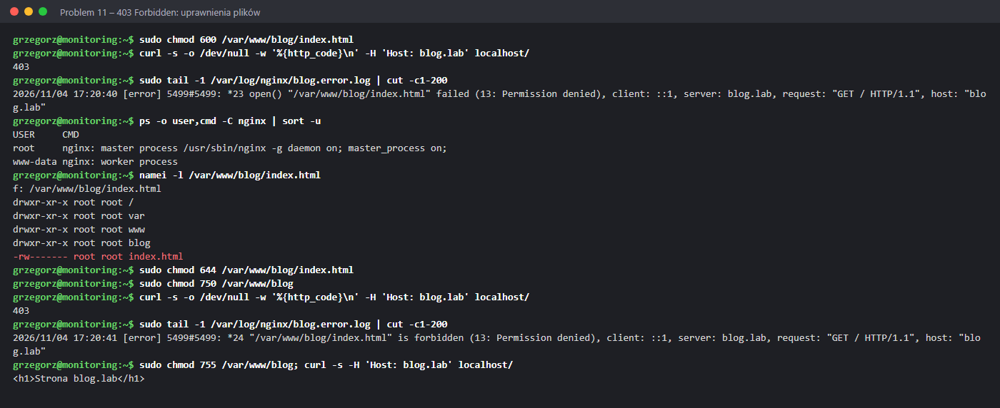

Procesy robocze nginx działają jako **`www-data`** (`ps -o user,cmd -C nginx`), master jako root.
- `chmod 600` na pliku → `open() … failed (13: Permission denied)` – `www-data` nie może czytać.
- `chmod 750` na katalogu → `"/var/www/blog/index.html" is forbidden (13: Permission denied)` –
  plik ma `644`, ale `www-data` nie może **wejść** do katalogu (brak `x` dla „innych”).

`namei -l ścieżka` pokazuje prawa każdego katalogu po drodze – najszybszy sposób na takie
problemy. Potrzeba: `r` na pliku i `x` na każdym katalogu w ścieżce.

**Sprawdź się (poziom 2):** `4xx` – błąd po stronie klienta (prośba, której serwer nie spełni):
`404` nie ma takiego zasobu, `403` zabronione, `401` wymaga logowania. `5xx` – błąd serwera:
`500` błąd aplikacji, `502` proxy nie dostało poprawnej odpowiedzi od aplikacji, `503` usługa
chwilowo niedostępna (przeciążenie, prace), `504` aplikacja nie odpowiedziała na czas.

## Poziom 3 – logi nginx

### Problem 12 – ile błędów zwraca strona?

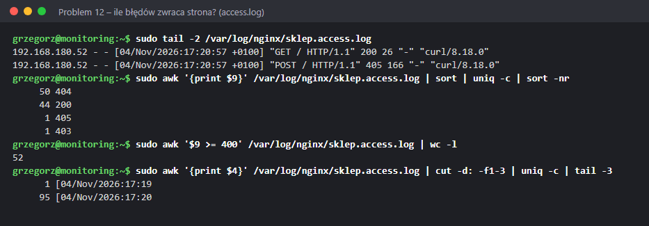

```bash
sudo awk '{print $9}' /var/log/nginx/sklep.access.log | sort | uniq -c | sort -nr   # kody
sudo awk '$9 >= 400' /var/log/nginx/sklep.access.log | wc -l                       # błędy
sudo awk '{print $4}' /var/log/nginx/sklep.access.log | cut -d: -f1-3 | uniq -c      # na minutę
```
Wynik: 50 × `404`, 44 × `200`, po jednym `405` (POST na statyczną stronę) i `403`. Ponad połowa
zapytań to błędy – podejrzane.

### Problem 13 – kto nas skanuje?

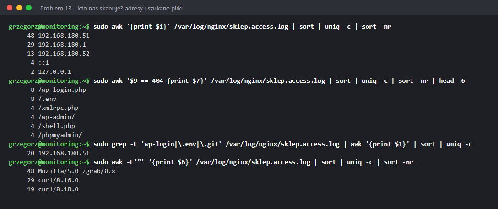

`192.168.180.51` (master) – 48 zapytań, wszystkie o `/wp-login.php`, `/.env`, `/xmlrpc.php`,
`/shell.php`, `/phpmyadmin/`… i `User-Agent` `zgrab` (znany skaner). To typowy obraz każdego
serwera wystawionego do internetu: automaty szukają WordPressa, plików z hasłami (`.env`),
repozytoriów (`.git`) i zostawionych kopii.

### Problem 14 – zablokuj skaner

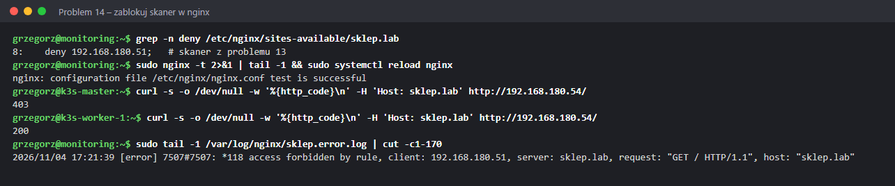

`deny 192.168.180.51;` w bloku `server` – master dostaje `403`, worker `200`, a w `error.log`:
`access forbidden by rule, client: 192.168.180.51`.

**Sprawdź się (poziom 3):** `deny` w nginx działa tylko dla tej strony i nginx dalej przyjmuje
połączenie (zużywa zasoby). `ufw deny from …` odrzuca pakiety, zanim dotrą do jakiegokolwiek
programu – dla całej maszyny. `fail2ban` czyta log, liczy np. 404 z jednego adresu w oknie czasu
i po przekroczeniu progu dopisuje regułę firewalla na określony czas.

## Poziom 4 – reverse proxy

Uwaga: przy przygotowaniu pierwsza wersja `aplikacja.py` miała błąd cudzysłowów
(`SyntaxError`) – w dzienniku od razu widać było `Start request repeated too quickly` (lekcja
z [poprzednich ćwiczeń](03-cwiczenia-admin-linux-rozwiazania.md#poziom-6--usługa-nie-wstaje)).
W ćwiczeniach jest wersja poprawiona.

### Problem 15 – 502 Bad Gateway

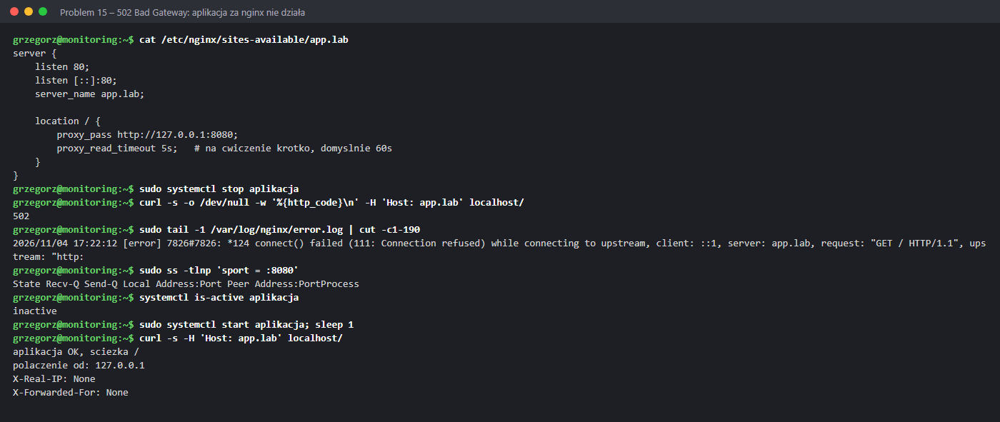

`connect() failed (111: Connection refused) while connecting to upstream` – nginx działa, ale
nikt nie słucha na `127.0.0.1:8080` (`ss` pusty, `aplikacja` `inactive`). `502` = „za mną coś
nie działa”. Diagnoza zawsze idzie dalej: od nginx do aplikacji.

### Problem 16 – 504 Gateway Timeout

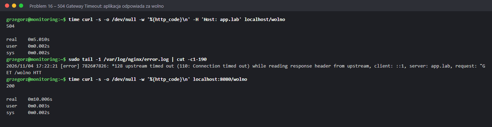

`upstream timed out (110: Connection timed out) while reading response header` po dokładnie 5 s
(`proxy_read_timeout 5s`). Zapytanie prosto do aplikacji (`localhost:8080/wolno`) daje `200` po
10 s – nginx jest zdrowy, aplikacja wolna. Dwie drogi: przyspieszyć aplikację (właściwe
rozwiązanie) albo wydłużyć `proxy_read_timeout` dla tej ścieżki (doraźnie).

### Problem 17 – 413 Request Entity Too Large

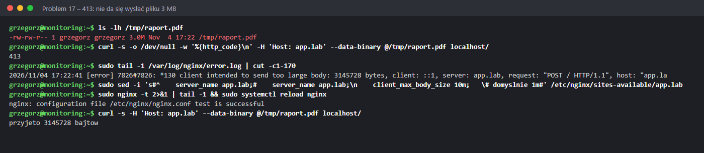

Domyślny limit `client_max_body_size` to **1 MB**. `client intended to send too large body:
3145728 bytes`. Po `client_max_body_size 10m;` w `app.lab` plik przechodzi (`przyjeto 3145728
bajtow`). Typowe zgłoszenie: „nie da się wgrać zdjęcia / załącznika”.

### Problem 18 – aplikacja widzi adres nginx zamiast klienta

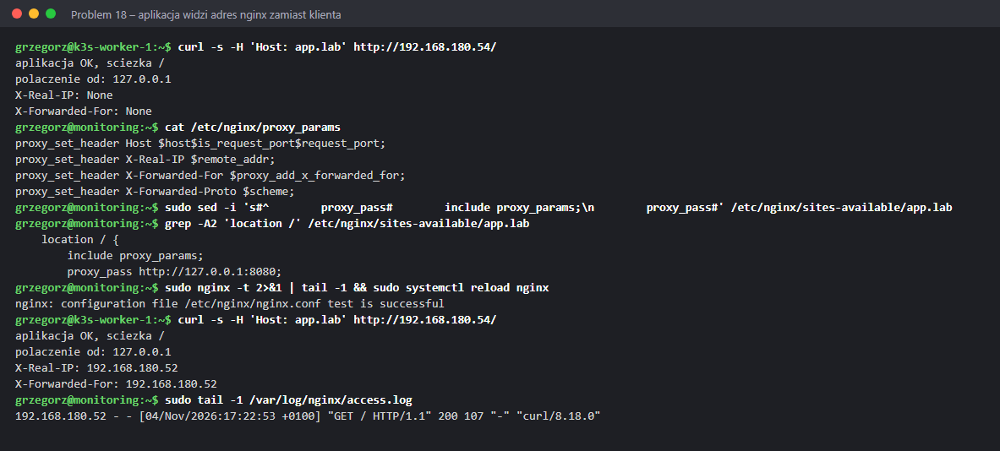

Aplikacja zawsze widzi połączenie od `127.0.0.1`, bo łączy się z nią nginx. Prawdziwy adres
nginx przekazuje w nagłówkach – Ubuntu ma gotowy plik `/etc/nginx/proxy_params` (`Host`,
`X-Real-IP`, `X-Forwarded-For`, `X-Forwarded-Proto`). Po `include proxy_params;` aplikacja widzi
`X-Real-IP: 192.168.180.52`. (W Ingress z Etapu 3 w tym miejscu był `10.42.x.0` – tam adres
gubił się wcześniej, na SNAT w Kubernetesie.)

**Sprawdź się (poziom 4):** reverse proxy: HTTPS w jednym miejscu, kilka aplikacji pod jednym
adresem, limity, cache, logi, blokady, rozkładanie ruchu. `502` – aplikacja odrzuciła połączenie
albo zwróciła bzdury; `504` – nie odpowiedziała na czas. Aplikacja na `127.0.0.1` jest dostępna
tylko przez nginx – nikt nie ominie limitów i HTTPS, łącząc się prosto na port 8080.

## Poziom 5 – HTTPS i hasła

### Problem 19 – certyfikat dla `sklep.lab`

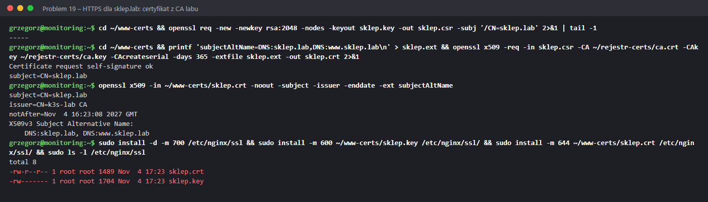

Certyfikat: `subject=CN=sklep.lab`, `issuer=CN=k3s-lab CA`, ważny do 4.11.2027, SAN `sklep.lab,
www.sklep.lab`. Klucz w `/etc/nginx/ssl` z prawami `600`, katalog `700` – czyta tylko root
(master nginx wczytuje klucz, zanim przejdzie na `www-data`).

### Problem 20 – HTTPS i przekierowanie z HTTP

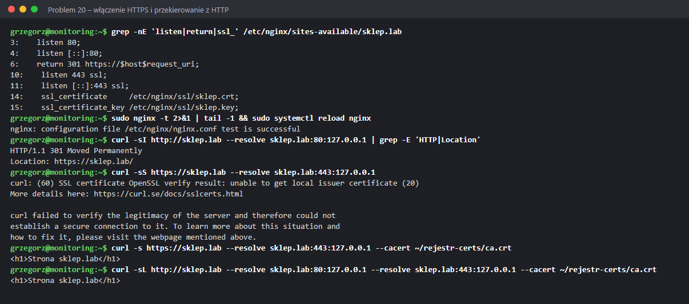

HTTP odpowiada `301 Moved Permanently`, `Location: https://sklep.lab/`. Bez `--cacert` `curl`
kończy się błędem `(60) unable to get local issuer certificate` – nie zna CA labu, więc nie ufa
certyfikatowi. Z `--cacert ~/rejestr-certs/ca.crt` działa, z `-L` przechodzi całą drogę HTTP →
HTTPS. W przeglądarce trzeba by zaimportować `ca.crt` do zaufanych (jak w ćwiczeniach z Ingress).

### Problem 21 – `no alternative certificate subject name matches`

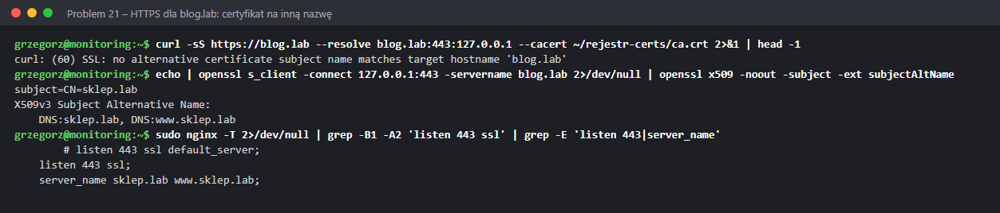

`blog.lab` nie ma bloku na 443, więc odpowiada pierwszy (domyślny) serwer HTTPS – `sklep.lab` –
ze **swoim** certyfikatem. `openssl s_client -servername blog.lab` to potwierdza: `CN=sklep.lab`.
Naprawa: osobny certyfikat dla `blog.lab` (albo jeden z obiema nazwami w SAN) i blok `listen 443
ssl` w `blog.lab`.

### Problem 22 – kiedy wygasa certyfikat?

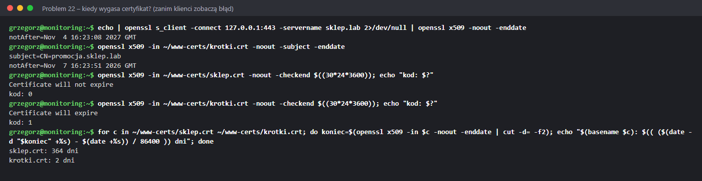

`-checkend 2592000` (30 dni w sekundach) zwraca kod `0` (`will not expire`) dla `sklep.crt`
i `1` (`will expire`) dla `krotki.crt` – idealne do skryptu i alarmu. Pętla wylicza 364 i 2 dni.
`openssl s_client … | openssl x509 -noout -enddate` sprawdza certyfikat, który serwer **wysyła**
– ważne, bo po odnowieniu pliku ktoś mógł zapomnieć o `reload` i nginx dalej podaje stary.

Przy okazji: `openssl x509 -in /etc/nginx/ssl/sklep.crt` jako zwykły użytkownik dało `Permission
denied` – katalog `ssl` ma `700`. Dlatego sprawdzałem kopie w `~/www-certs`.

### Problem 23 – hasło na panel `/admin/`

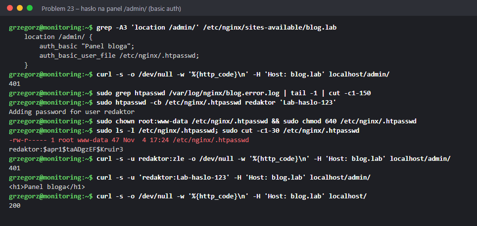

Bez hasła i ze złym hasłem `401`, z dobrym – panel. Plik `.htpasswd` zawiera skrót hasła
(`$apr1$…`, nie samo hasło), prawa `640 root:www-data` – czyta tylko nginx. Reszta bloga bez hasła
(`200`).

**Sprawdź się (poziom 5):**
- **SNI** (*Server Name Indication*) – klient podaje nazwę serwera już na początku połączenia TLS,
  więc nginx wie, który certyfikat wysłać, choć wszystkie strony są na jednym adresie IP
  (`-servername` w `openssl s_client`).
- **`basic auth` bez HTTPS:** hasło idzie w nagłówku zakodowane Base64 – to nie szyfrowanie,
  każdy w sieci je odczyta.
- **`certbot`:** automatycznie pobiera darmowe certyfikaty Let's Encrypt i je odnawia (co 60–90
  dni). Wymaga nazwy w publicznym DNS (`.lab` takiej nie ma) i dostępu z internetu (HTTP-01) albo
  dostępu do DNS (DNS-01).

## Poziom 6 – PostgreSQL: dostęp

### Problem 24 – `role "grzegorz" does not exist`

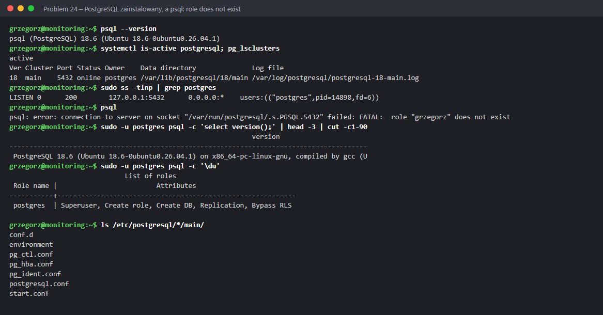

PostgreSQL 18.6, klaster `18/main` na porcie 5432, słucha tylko na `127.0.0.1`. `psql` bez opcji
łączy się jako rola o nazwie Twojego konta Linux (`grzegorz`) – takiej nie ma. Administratorem
jest rola `postgres`, a zalogować się na nią można z konta Linux `postgres`: `sudo -u postgres
psql`. Konfiguracja: `/etc/postgresql/18/main/` (`postgresql.conf`, `pg_hba.conf`, `conf.d/`),
dane: `/var/lib/postgresql/18/main`.

### Problem 25 – `Peer authentication failed`

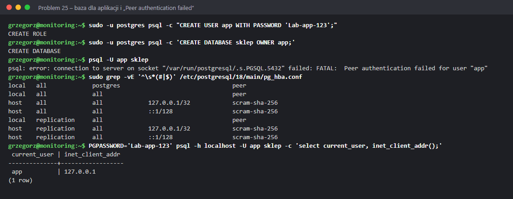

`pg_hba.conf` czytany od góry, pierwsza pasująca linia decyduje:
- `local all all peer` – połączenie przez gniazdo Unix (bez `-h`): rola musi mieć tę samą nazwę co
  konto Linux. `grzegorz` ≠ `app` → odmowa.
- `host all all 127.0.0.1/32 scram-sha-256` – przez TCP: hasło. `psql -h localhost -U app` działa.

Aplikacje prawie zawsze łączą się przez TCP z hasłem – więc zwykle wystarczy dodać `-h localhost`.

### Problem 26 – z sieci: `Connection refused`

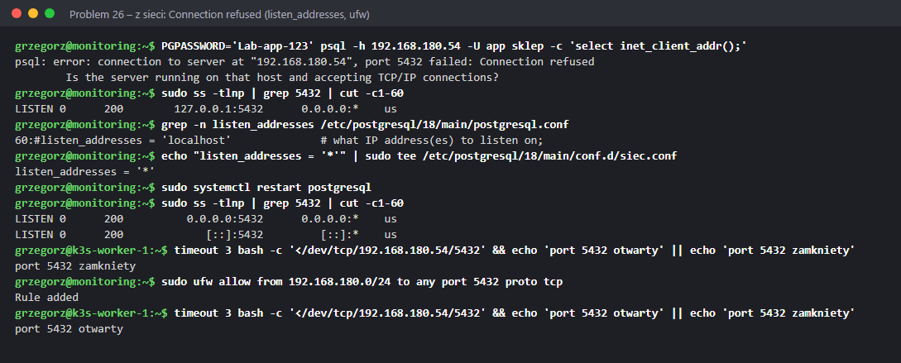

Dwie przeszkody: PostgreSQL słuchał tylko na `127.0.0.1` (domyślne `listen_addresses =
'localhost'`), a `ufw` nie wpuszczał portu 5432. `listen_addresses = '*'` w
`conf.d/siec.conf` (pliki z `conf.d/` nadpisują `postgresql.conf`) + **restart** – teraz słucha na
`0.0.0.0` i `[::]`. Test z `worker-1` przez `/dev/tcp` (wbudowane w bash, bez instalowania
klienta): zamknięty → reguła `ufw` → otwarty.

### Problem 27 – `no pg_hba.conf entry for host`

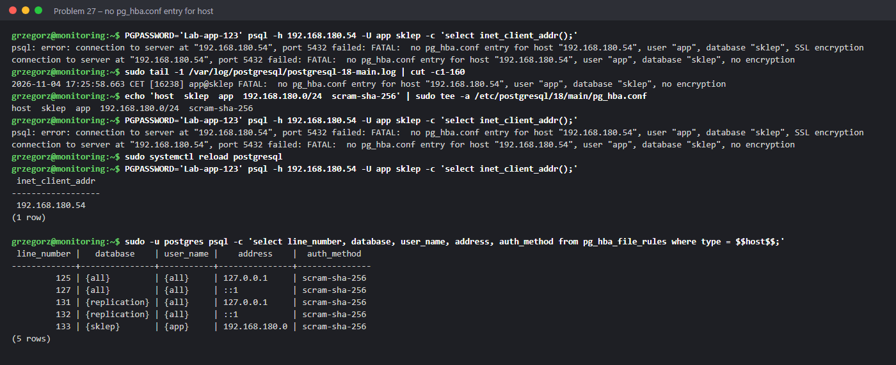

Port otwarty, ale `FATAL: no pg_hba.conf entry for host "192.168.180.54", user "app", database
"sklep"` – nie ma reguły dla tego adresu. Ten sam komunikat jest w logu
`/var/log/postgresql/postgresql-18-main.log` (tam szukasz, gdy aplikacja zgłasza „nie mogę się
połączyć”). Po dopisaniu `host sklep app 192.168.180.0/24 scram-sha-256` **dalej błąd** – plik
jest czytany przy starcie i `reload`. Po `reload` działa. `pg_hba_file_rules` pokazuje, co baza
naprawdę wczytała (linia 133).

**Sprawdź się (poziom 6):**
- **`restart` czy `reload`:** `listen_addresses`, `max_connections`, `shared_buffers`, `port`
  wymagają restartu (przerwa w działaniu). `pg_hba.conf` i większość ustawień (np. logowanie,
  `work_mem`) – `reload`. Kolumna `context` w widoku `pg_settings` mówi dokładnie: `postmaster` =
  restart, `sighup` = reload.
- **Metody:** `peer` – nazwa konta systemu = nazwa roli (tylko lokalnie), `scram-sha-256` – hasło
  przesyłane bezpiecznie (wyzwanie–odpowiedź), `trust` – **bez hasła**: każdy, kto dotrze do
  portu, może zalogować się jako dowolna rola, także `postgres`.

## Poziom 7 – PostgreSQL: utrzymanie

### Problem 28 – ktoś usunął tabelę

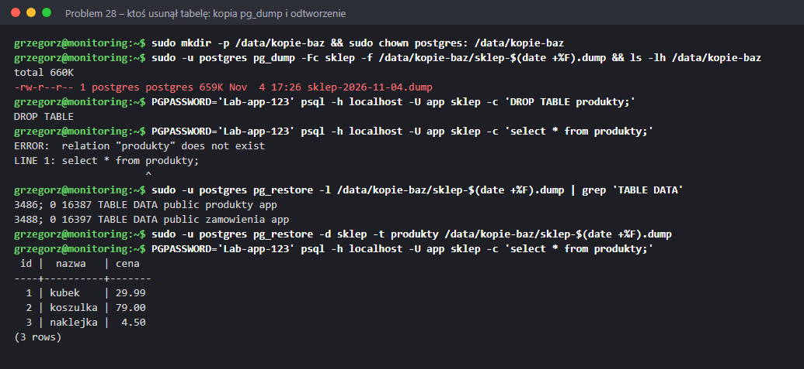

Kopia w formacie własnym (`-Fc`, 659 KB) pozwala odtworzyć wybrane elementy. `pg_restore -l` to
spis zawartości; `pg_restore -d sklep -t produkty` przywraca tabelę z danymi. Uwaga: `-t` odtwarza
tabelę i dane, ale **nie** jej indeksy, klucz główny i sekwencję – w prawdziwej sytuacji odtwórz
całą kopię do osobnej bazy (`createdb sklep_odzysk`) i przenieś stamtąd, co trzeba.

### Problem 29 – `too many clients`

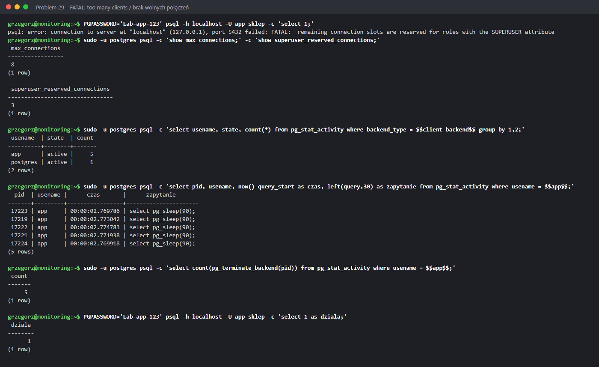

`max_connections = 8`, z czego 3 zarezerwowane dla superużytkownika
(`superuser_reserved_connections`). Pięć sesji `app` z `pg_sleep(90)` zajęło wszystkie zwykłe
miejsca, więc `remaining connection slots are reserved for roles with the SUPERUSER attribute`.
Dzięki rezerwie administrator dalej mógł się zalogować, zobaczyć winowajców w `pg_stat_activity`
i zakończyć ich `pg_terminate_backend`. W prawdziwym życiu przyczyną jest zwykle aplikacja, która
nie zamyka połączeń – rozwiązanie po stronie aplikacji albo pula połączeń (PgBouncer), nie
podnoszenie limitu w nieskończoność.

### Problem 30 – zapytanie wisi

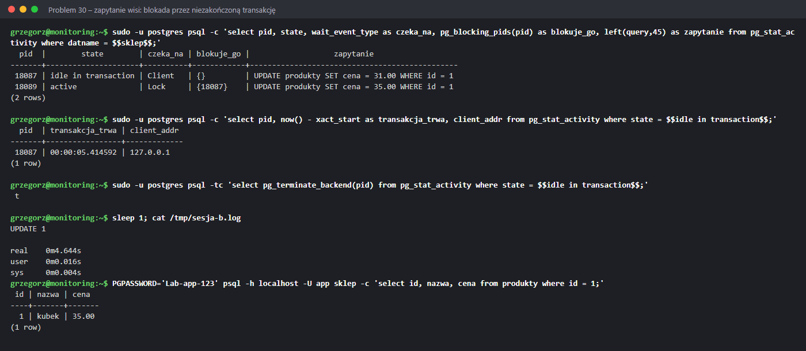

Sesja 18089 (`UPDATE … 35.00`) jest `active`, czeka na `Lock`, a `pg_blocking_pids` pokazuje
`{18087}` – sesję w stanie **`idle in transaction`**: zaczęła transakcję, zmieniła wiersz i nic
dalej nie robi. Po `pg_terminate_backend` jej transakcja została wycofana, a sesja B od razu
dokończyła zmianę (`UPDATE 1`, cena 35.00). Klasyka: ktoś zostawił otwarty `psql` z `BEGIN`
albo aplikacja nie zamknęła transakcji po błędzie. Zabezpieczenie:
`idle_in_transaction_session_timeout`.

Przy przygotowaniu zrzutu zawiesiła się sesja SSH: proces w tle (`sleep`) trzymał otwarte
standardowe wyjście i `ssh` czekał na jego koniec. Procesy uruchamiane w tle przez SSH trzeba
całkiem odłączyć: `setsid nohup polecenie >/dev/null 2>&1 </dev/null &`.

### Problem 31 – PostgreSQL nie wstaje

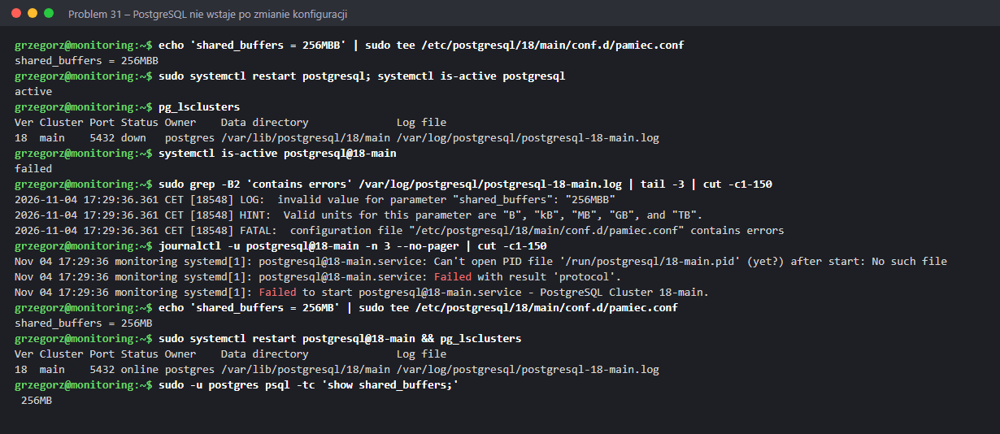

Pułapka Ubuntu: `postgresql.service` to tylko „parasol”, który zawsze jest `active`. Prawdziwa
baza to `postgresql@18-main` – `failed`, `pg_lsclusters` – `down`. Przyczyna w logu bazy:
`invalid value for parameter "shared_buffers": "256MBB"` z podpowiedzią dozwolonych jednostek.
`journalctl` pokazuje tylko, że start się nie udał – szczegóły są w `/var/log/postgresql/`.

### Problem 32 – wolne zapytanie

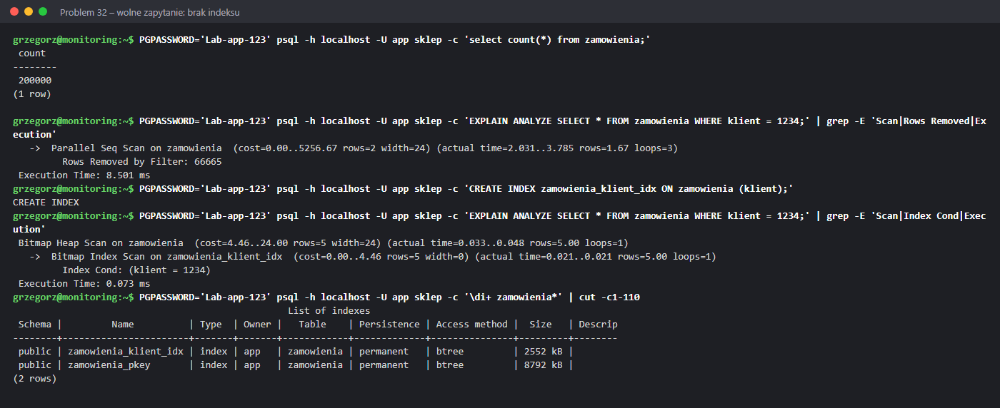

Bez indeksu: `Parallel Seq Scan` – baza czyta całą tabelę (`Rows Removed by Filter: 66665` na
każdy z 3 procesów), 8,5 ms. Z indeksem `zamowienia_klient_idx` (2,5 MB): `Bitmap Index Scan`,
0,073 ms – ponad 100 razy szybciej. Przy 200 tys. wierszy różnica jest niewidoczna dla człowieka,
przy 200 mln – to minuty zamiast milisekund. Przy okazji: `VACUUM` nie może działać w
transakcji, więc trzeba go podać jako osobne `-c`.

### Problem 33 – baza rośnie

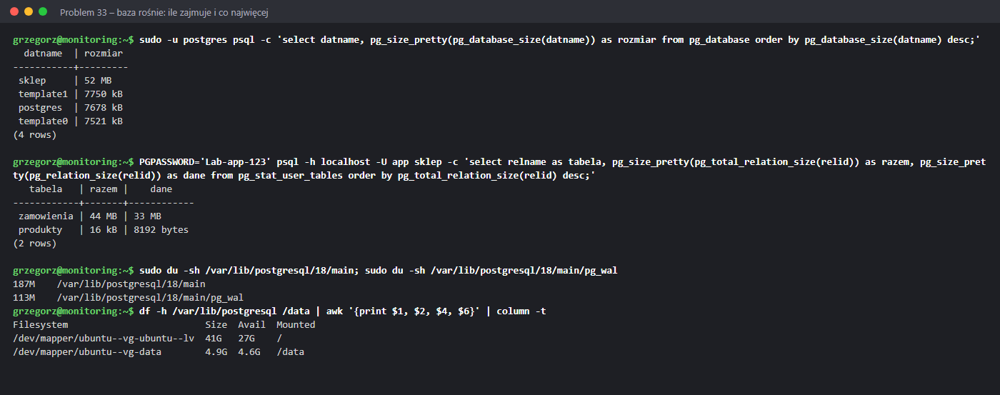

`sklep` 52 MB, z tego `zamowienia` 44 MB (33 MB dane + indeksy). Katalog danych 187 MB, z czego
**113 MB to `pg_wal`** – dziennik zapisów (WAL), który rośnie przy dużych zmianach (nasz `UPDATE`
200 tys. wierszy). Gdy `pg_wal` rośnie bez końca, zwykle winna jest nieużywana replikacja
(`replication slot`) albo nieudana archiwizacja – **nigdy** nie usuwa się plików z `pg_wal`
ręcznie.

### Problem 34 – przeniesienie bazy na dysk `/data`

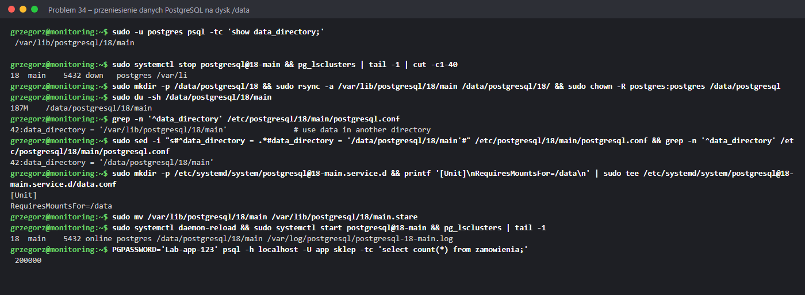

Po przeniesieniu `pg_lsclusters` pokazuje katalog `/data/postgresql/18/main`, a dane są całe
(200000 wierszy). Stary katalog został jako `main.stare` – usuwa się go dopiero po kilku dniach
spokojnej pracy.

**Sprawdź się (poziom 7):**
- **`pg_dump` a kopia plików:** `pg_dump` to logiczny zrzut jednej bazy (polecenia SQL) – działa
  w trakcie pracy, przenośny między wersjami, ale odtwarza się długo. Kopia plików (fizyczna,
  `pg_basebackup`) obejmuje cały klaster i pozwala odtworzyć stan na dowolną chwilę (z
  archiwum WAL), ale tylko na tę samą wersję. Zwykłe `cp` katalogu działającej bazy da
  niespójną kopię.
- **`RequiresMountsFor=/data`:** systemd uruchomi bazę dopiero po zamontowaniu `/data`. Bez tego
  przy starcie baza mogłaby ruszyć, zanim dysk się zamontuje.
- **Gdy `/data` się nie zamontuje:** z `RequiresMountsFor` baza nie wystartuje (błąd widoczny od
  razu). Bez tego – wystartowałaby na pustym katalogu `/data` na dysku `/` albo nie znalazła
  danych. Najgorszy scenariusz: zaczyna zapisywać „pod” punktem montowania.

## Poziom 8 – MariaDB

### Problem 35 – `Access denied for user 'root'@'localhost'`

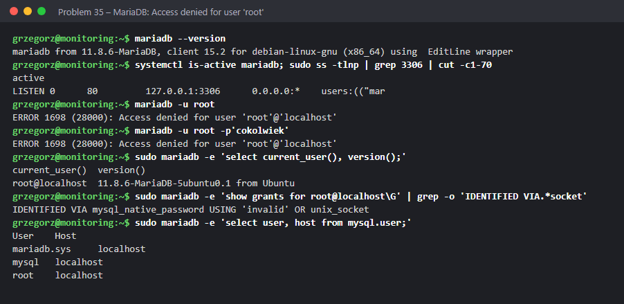

MariaDB 11.8.6 słucha na `127.0.0.1:3306`. Root jest uwierzytelniany `IDENTIFIED VIA
mysql_native_password USING 'invalid' OR unix_socket` – hasło jest celowo nieprawidłowe, a
wpuszczany jest tylko **systemowy** root przez gniazdo Unix. Dlatego `sudo mariadb` działa bez
hasła, a `mariadb -u root` z dowolnym hasłem – nie. To bezpieczniejsze niż hasło roota bazy
w pliku.

### Problem 36 – dostęp z sieci

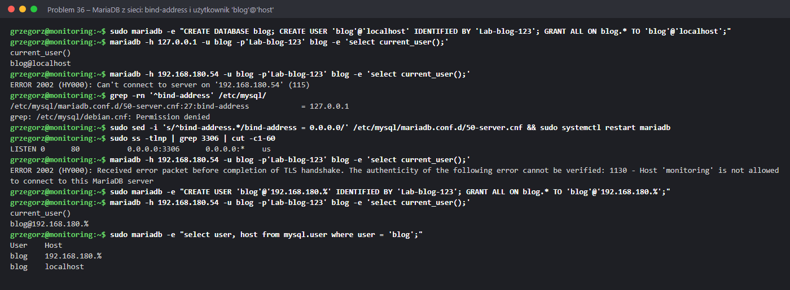

1. `Can't connect … (115)` – serwer słucha tylko na `127.0.0.1` (`bind-address` w
   `/etc/mysql/mariadb.conf.d/50-server.cnf`). Zmiana na `0.0.0.0` + restart.
2. `Host 'monitoring' is not allowed to connect` – konto `'blog'@'localhost'` pasuje tylko do
   połączeń lokalnych. MariaDB zamieniła adres `192.168.180.54` na nazwę (`monitoring` z
   `/etc/hosts`) – stąd nazwa w komunikacie. Nowe konto `'blog'@'192.168.180.%'` rozwiązuje
   problem.

### Problem 37 – `DELETE` bez `WHERE`

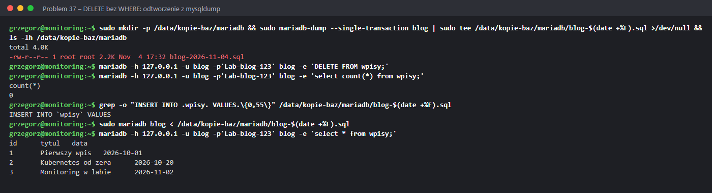

Kopia to zwykły plik SQL (`CREATE TABLE`, `INSERT INTO \`wpisy\` VALUES …`). Odtworzenie:
`sudo mariadb blog < kopia.sql` – plik zawiera `DROP TABLE IF EXISTS`, więc tabela jest tworzona
od nowa z danymi z chwili kopii. Wszystko, co dopisano po kopii, przepada – dlatego kopie robi się
regularnie (problem 39), a przy ważnych bazach także binlog (odtwarzanie do konkretnej chwili).

### Problem 38 – aplikacja zapomniała hasła

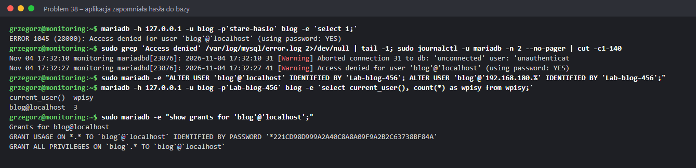

`ERROR 1045 Access denied … (using password: YES)` – hasło złe (gdyby było `NO`, aplikacja w ogóle
go nie wysłała). Nieudane logowania MariaDB zapisuje w dzienniku (`journalctl -u mariadb`):
`[Warning] Access denied for user 'blog'@'localhost'`. Root (przez `sudo mariadb`) ustawia nowe
hasło `ALTER USER` – dla **każdego** konta `blog@…` osobno.

**Sprawdź się (poziom 8):**
- **`'blog'@'localhost'` i `'blog'@'192.168.180.%'`** to dwa niezależne konta – mogą mieć inne
  hasła i inne uprawnienia. Konto w MariaDB = nazwa + skąd się łączy.
- **`localhost` a `127.0.0.1`:** dla klienta `mariadb` `-h localhost` oznacza połączenie przez
  **gniazdo Unix**, a `-h 127.0.0.1` – przez TCP. Zachowują się inaczej (np. `unix_socket`
  działa tylko z gniazdem).
- **`--single-transaction`:** robi kopię w jednej transakcji (spójny obraz InnoDB) bez blokowania
  tabel – aplikacja może w tym czasie pisać.

## Poziom 9 – automatyzacja

### Problem 39 – nocne kopie baz i usuwanie starych

Skrypt `/usr/local/bin/kopia-baz.sh`:
```bash
#!/bin/bash
# Nocna kopia baz: PostgreSQL (sklep) i MariaDB (blog), kopie starsze niż 7 dni są usuwane
set -euo pipefail
katalog=/data/kopie-baz/nocne
dzien=$(date +%F-%H%M)
mkdir -p "$katalog"
sudo -u postgres pg_dump sklep | gzip > "$katalog/sklep-$dzien.sql.gz"
mariadb-dump --single-transaction blog | gzip > "$katalog/blog-$dzien.sql.gz"
find "$katalog" -name "*.sql.gz" -mtime +7 -print -delete
echo "$(date "+%F %T") kopia OK: $(ls "$katalog" | wc -l) plikow, $(du -sh "$katalog" | cut -f1)"
```

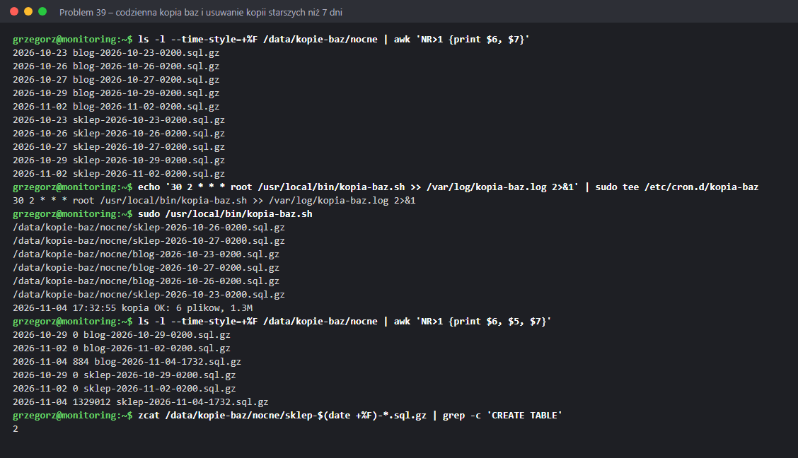

Usunięte zostały kopie sprzed 12, 9 i **8** dni, zostały sprzed 6 i 2 dni oraz dzisiejsze.
`-mtime +7` znaczy „więcej niż 7 **pełnych** dób” – plik sprzed 8 dni się łapie, sprzed 7 dni
i kilku godzin – nie. `set -euo pipefail` sprawia, że błąd `pg_dump` przerywa skrypt (bez
`pipefail` błąd w `pg_dump | gzip` by zginął, bo `gzip` się udał – zostałaby pusta „kopia”).
Wpis w `/etc/cron.d/` ma **szóste pole – użytkownika** (`root`), którego nie ma w `crontab -e`.

Kopia nieprzetestowana to nie kopia: co jakiś czas odtwórz ją do osobnej bazy.

### Problem 40 – „czy wszystko działa?” jednym poleceniem

Skrypt `/usr/local/bin/sprawdz-uslugi.sh`:
```bash
#!/bin/bash
# Szybki przegląd: czy wszystko działa. Kod wyjścia 1, gdy cokolwiek jest nie tak.
bledy=0
ok()   { printf "  OK    %s\n" "$1"; }
zle()  { printf "  BLAD  %s\n" "$1"; bledy=$((bledy+1)); }

echo "== uslugi"
for u in nginx postgresql@18-main mariadb aplikacja; do
  systemctl is-active --quiet "$u" && ok "$u" || zle "$u: $(systemctl is-active "$u")"
done

echo "== strony"
for s in sklep.lab blog.lab app.lab; do
  kod=$(curl -sk -o /dev/null -w "%{http_code}" -m 5 -L --resolve "$s:80:127.0.0.1" --resolve "$s:443:127.0.0.1" "http://$s/")
  [ "$kod" = 200 ] && ok "$s -> $kod" || zle "$s -> $kod"
done

echo "== bazy"
sudo -u postgres pg_isready -q && ok "PostgreSQL przyjmuje polaczenia" || zle "PostgreSQL nie odpowiada"
mariadb-admin ping >/dev/null 2>&1 && ok "MariaDB przyjmuje polaczenia" || zle "MariaDB nie odpowiada"

echo "== certyfikat"
dni=$(( ($(date -d "$(openssl x509 -in /etc/nginx/ssl/sklep.crt -noout -enddate | cut -d= -f2)" +%s) - $(date +%s)) / 86400 ))
[ "$dni" -gt 30 ] && ok "sklep.lab wazny jeszcze $dni dni" || zle "sklep.lab wygasa za $dni dni"

echo "== dyski"
while read -r zajete punkt; do
  p=${zajete%\%}
  [ "$p" -lt 85 ] && ok "$punkt $zajete" || zle "$punkt $zajete (powyzej 85%)"
done < <(df --output=pcent,target / /data | tail -n +2)

echo "== kopie"
ostatnia=$(find /data/kopie-baz/nocne -name "sklep-*.sql.gz" -size +1k -mtime -1 | head -1)
[ -n "$ostatnia" ] && ok "swieza kopia: $(basename "$ostatnia")" || zle "brak kopii z ostatniej doby"

echo "== wynik: $bledy bledow"
exit $(( bledy > 0 ))
```

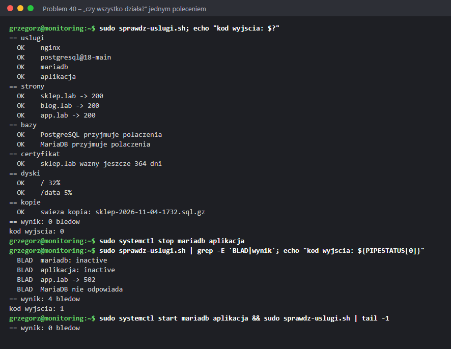

Wszystko zielone, kod `0`. Po zatrzymaniu `mariadb` i `aplikacja` – 4 błędy (dwie usługi,
`app.lab -> 502`, MariaDB nie odpowiada) i kod `1`. Po starcie – znowu `0 bledow`.

**Lekcja z pisania skryptu:** pierwsza wersja zgłaszała `sklep.lab -> 301` jako błąd. `curl -L`
szedł za przekierowaniem na `https://sklep.lab/`, a tej nazwy nie ma w DNS, więc zostawał na
`301`. Pomogło `--resolve` dla portów 80 i 443. Skrypt kontrolny też trzeba przetestować – na
fałszywe alarmy ludzie szybko przestają reagować.

Kod wyjścia to „język” monitoringu: taki skrypt może uruchamiać cron (z powiadomieniem przy
błędzie), Uptime Kuma (Etap 4) albo node-exporter (`textfile collector`) z alertem w Prometheusie.

## Poziom 10 – sprzątanie

Maszyna wróciła do snapshotu `przed-cwiczeniami-linux` – razem z wynikami poprzednich ćwiczeń
zniknęły nginx, obie bazy, reguły `ufw` dla 80/443/5432 i tymczasowe `sudo`.

**Pytania na rozmowę, na które po tym rozdziale odpowiesz z praktyki:** „strona zwraca 502 –
co sprawdzasz?”, „czym różni się 403 od 404?”, „jak sprawdzisz, kiedy wygasa certyfikat?”,
„aplikacja nie łączy się z bazą – gdzie szukasz?” (`listen_addresses`/`bind-address`, firewall,
`pg_hba.conf`/konto `user@host`, hasło), „zapytanie wisi – co robisz?”, „jak robisz kopie baz
i skąd wiesz, że działają?”.
