# Etap 2 – ćwiczenia z kubectl od podstaw

Osiem poziomów ćwiczeń na działającym klastrze k3s: od oglądania węzłów, przez pierwszą
aplikację, samonaprawę i skalowanie, po aktualizacje, konserwację węzła i pracę z YAML.
Każdy poziom ma polecenia, zrzut z prawdziwego wykonania na klastrze tego laboratorium
i wyjaśnienie, na co patrzeć.

> Wyniki pochodzą z klastra labu (k3s v1.36.5, 1 master + 3 workery, 29.10.2026). Zrzuty
> terminala są wygenerowane z tekstu wyjścia poleceń, zrzut strony – z przeglądarki.
> Nazwy podów, adresy IP i porty u Ciebie będą inne.

## Spis treści

- [Przygotowanie](#przygotowanie)
- [Poziom 1 – rozejrzyj się](#poziom-1--rozejrzyj-się)
- [Poziom 2 – pierwsza aplikacja](#poziom-2--pierwsza-aplikacja)
- [Poziom 3 – samonaprawa](#poziom-3--samonaprawa)
- [Poziom 4 – skalowanie](#poziom-4--skalowanie)
- [Poziom 5 – Service: dostęp do aplikacji](#poziom-5--service-dostęp-do-aplikacji)
- [Poziom 6 – aktualizacja i wycofanie](#poziom-6--aktualizacja-i-wycofanie)
- [Poziom 7 – konserwacja węzła](#poziom-7--konserwacja-węzła)
- [Poziom 8 – YAML i apply](#poziom-8--yaml-i-apply)
- [Sprzątanie](#sprzątanie)
- [Pojęcia](#pojęcia)
- [Ściągawka](#ściągawka)
- [Co powiedzieć na rozmowie](#co-powiedzieć-na-rozmowie)

---

## Przygotowanie

🪟 Windows:

```powershell
ssh k3s-master
```

Wszystkie polecenia poniżej wpisujesz **na masterze**. k3s jest zainstalowany z
`--write-kubeconfig-mode 0644`, więc `kubectl` działa bez `sudo`.

Ćwiczenia odbywają się w osobnej przestrzeni nazw `cwiczenia` – na końcu usuwasz ją jednym
poleceniem i klaster wraca do stanu sprzed ćwiczeń.

---

## Poziom 1 – rozejrzyj się

Tylko odczyt – nic nie zepsujesz.

```bash
kubectl get nodes -o wide
kubectl describe node k3s-master | grep -A1 Taints
kubectl describe node k3s-worker-1 | grep -A1 Taints
kubectl get namespaces
kubectl get pods -A -o wide
kubectl top nodes
kubectl get deployments,services -n kube-system
```

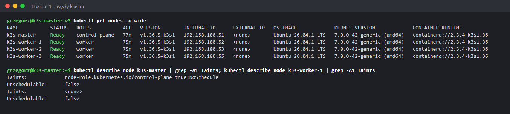

- **`STATUS Ready`** – węzeł działa i przyjmuje pracę.
- **`ROLES`** – `control-plane` to master, `worker` nadał playbook Ansible (`k3s.yml`).
- **`INTERNAL-IP`** – stałe adresy z Etapu 0; **`CONTAINER-RUNTIME`** – containerd, czyli
  program, który faktycznie uruchamia kontenery.
- **Taint `NoSchedule` na masterze** – „nie umieszczaj tu zwykłych aplikacji”. Workery nie mają
  taintów (`<none>`).

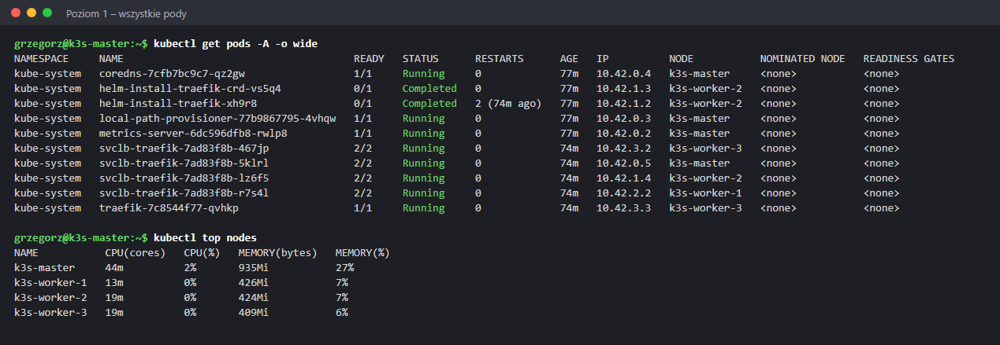

- `-A` – wszystkie przestrzenie nazw. Na razie są tylko pody systemowe w `kube-system`:
  **CoreDNS** (DNS w klastrze), **Traefik** (Ingress – ruch HTTP z zewnątrz),
  **metrics-server** (dane dla `kubectl top`), **local-path-provisioner** (dyski dla aplikacji).
- **Ciekawostka:** CoreDNS i metrics-server działają na masterze mimo taintu. Komponenty
  systemowe mają **tolerację** (*toleration*) – wyjątek od taintu. Zwykła aplikacja jej nie ma.
- `helm-install-traefik-*` w stanie `Completed` – jednorazowe zadania instalacyjne k3s, które
  już się wykonały.
- `svclb-traefik-*` jest na każdym węźle – to **DaemonSet**: jedna kopia na węzeł.
- `kubectl top nodes` – master zużywa najwięcej pamięci, bo działa na nim API i baza klastra.

---

## Poziom 2 – pierwsza aplikacja

```bash
kubectl create namespace cwiczenia
kubectl -n cwiczenia create deployment web --image=nginx --replicas=3
kubectl -n cwiczenia get deployment,replicaset,pods -o wide
```

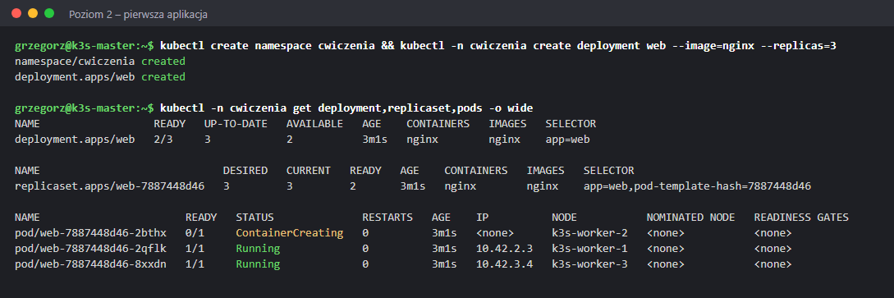

Trzy obiekty, jeden w drugim:

| Obiekt | Rola |
|---|---|
| **Deployment** `web` | Twoje życzenie: „3 kopie nginx” – i historia wersji |
| **ReplicaSet** `web-7887448d46` | pilnuje, by kopii było dokładnie tyle, ile trzeba |
| **Pod** `web-7887448d46-xxxxx` | jedna działająca kopia (kontener) |

Pody rozłożyły się na trzy workery – **scheduler** wybiera węzeł dla każdego poda. Na
`k3s-worker-2` pod był jeszcze w stanie `ContainerCreating`: węzeł pobierał obraz nginx.

```bash
kubectl -n cwiczenia describe pod <nazwa-poda>
```

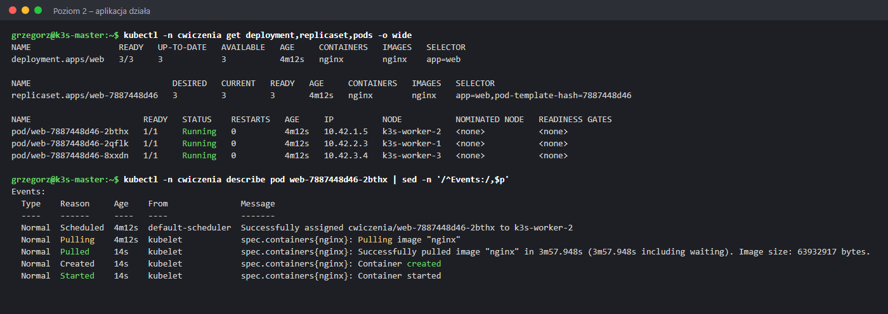

Sekcja **`Events`** w `describe` to pierwsze miejsce, w którym szukasz przyczyny problemu.
Tutaj widać: `Scheduled` (przydzielony do węzła) → `Pulling` → `Pulled` **po 3 min 58 s** →
`Created` → `Started`. Pierwsze pobranie obrazu (64 MB) na nowy węzeł trwało długo; na
węzłach, które obraz już miały, start zajmował sekundę.

```bash
kubectl -n cwiczenia logs <nazwa-poda> --tail=3
kubectl -n cwiczenia exec <nazwa-poda> -- sh -c 'hostname; nginx -v; head -2 /etc/os-release'
```

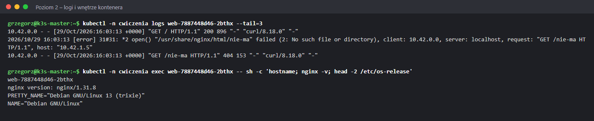

- **`logs`** – to, co aplikacja wypisuje (tu: dziennik zapytań nginx – `200` dla strony
  głównej, `404` dla nieistniejącej).
- **`exec`** – polecenie wewnątrz kontenera. Nazwa hosta to nazwa poda; w środku jest
  Debian, nie Ubuntu – kontener ma własny system plików, niezależny od węzła.
- Interaktywnie: `kubectl -n cwiczenia exec -it <nazwa-poda> -- bash` (wyjście: `exit`).

---

## Poziom 3 – samonaprawa

```bash
kubectl -n cwiczenia get pods -o wide
kubectl -n cwiczenia delete pod <nazwa-poda>
kubectl -n cwiczenia get pods -o wide
kubectl -n cwiczenia get events --sort-by=.lastTimestamp | tail -6
```

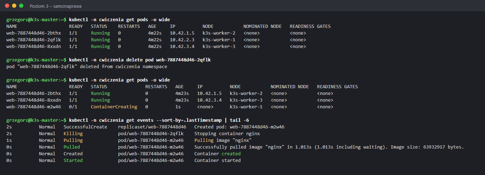

Pod z `k3s-worker-1` został usunięty, a **w tej samej sekundzie** ReplicaSet utworzył nowy
(`SuccessfulCreate`). Kubernetes stale porównuje stan **pożądany** (3 kopie) z
**rzeczywistym** (2) i sam wyrównuje różnicę – to *pętla uzgadniania* (reconciliation loop),
najważniejsza idea Kubernetesa. Ta sama zasada co idempotentność w Ansible: opisujesz stan,
a system do niego dąży.

Na żywo: `kubectl -n cwiczenia get pods -w` (koniec: `Ctrl+C`).

---

## Poziom 4 – skalowanie

```bash
kubectl -n cwiczenia scale deployment web --replicas=6
kubectl -n cwiczenia get pods -o wide
kubectl -n cwiczenia scale deployment web --replicas=2
kubectl -n cwiczenia get pods -o wide
```

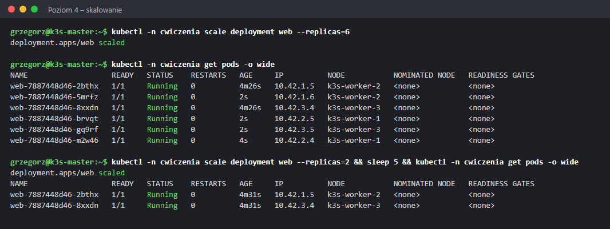

- Nowe pody trafiły po dwa na każdy worker – scheduler rozkłada obciążenie.
- Uruchomiły się w **2 sekundy**, bo obraz był już na węzłach.
- Przy zmniejszaniu Kubernetes usuwa najpierw najmłodsze pody.
- Master nie dostał żadnego – taint z Poziomu 1 w praktyce.

---

## Poziom 5 – Service: dostęp do aplikacji

Pody mają zmienne adresy (każdy nowy pod = nowy IP). **Service** daje im jeden stały adres
i rozdziela ruch między nie.

```bash
kubectl -n cwiczenia expose deployment web --port=80 --type=NodePort
kubectl -n cwiczenia get service web
kubectl -n cwiczenia get endpointslices -l kubernetes.io/service-name=web
```

Test DNS z wnętrza klastra – tymczasowy pod z obrazem `busybox`:

```bash
kubectl -n cwiczenia run test --restart=Never --image=busybox --command -- \
  sh -c 'nslookup web.cwiczenia.svc.cluster.local | grep -A1 ^Name; wget -qO- http://web | grep -o "<title>.*</title>"'
kubectl -n cwiczenia logs test
kubectl -n cwiczenia delete pod test
```

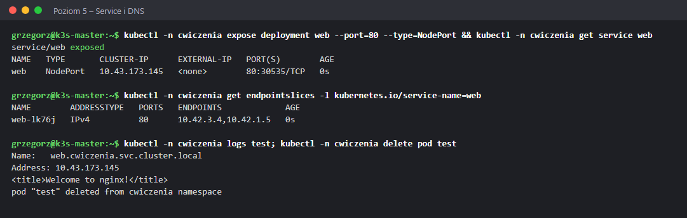

| Element | Znaczenie |
|---|---|
| `CLUSTER-IP 10.43.173.145` | stały adres usługi wewnątrz klastra (sieć usług `10.43.0.0/16`) |
| `80:30535/TCP` | port 80 usługi wystawiony na porcie **30535 każdego węzła** (NodePort, zakres 30000–32767) |
| `ENDPOINTS 10.42.3.4,10.42.1.5` | adresy podów, do których trafia ruch (sieć podów `10.42.0.0/16`) |
| `web.cwiczenia.svc.cluster.local` | nazwa DNS usługi: `<usługa>.<przestrzeń>.svc.cluster.local`; w tej samej przestrzeni wystarczy `web` |

Spoza klastra (z `monitoring` albo z Git Bash na Windowsie) – pod adresem **dowolnego** węzła:

```bash
for ip in 51 52 53 55; do printf "192.168.180.$ip:30535 -> "; curl -s http://192.168.180.$ip:30535 | grep -o "<title>.*</title>"; done
```

```
192.168.180.51:30535 -> <title>Welcome to nginx!</title>
192.168.180.52:30535 -> <title>Welcome to nginx!</title>
192.168.180.53:30535 -> <title>Welcome to nginx!</title>
192.168.180.55:30535 -> <title>Welcome to nginx!</title>
```

Odpowiadają **wszystkie** węzły – także master i `k3s-worker-1`, na których w tej chwili nie
było żadnego poda `web`. Ruch przychodzący na NodePort dowolnego węzła jest przekazywany do
podów, gdziekolwiek działają.

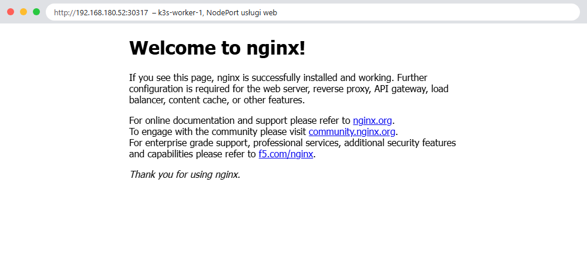

Zrzut przeglądarki pochodzi z ponownego utworzenia usługi, dlatego port jest inny (30317) –
Kubernetes losuje NodePort przy każdym tworzeniu usługi, o ile nie podasz go w YAML
(`nodePort:`).

---

## Poziom 6 – aktualizacja i wycofanie

```bash
kubectl -n cwiczenia scale deployment web --replicas=3
kubectl -n cwiczenia set image deployment/web nginx=nginx:1.27
kubectl -n cwiczenia rollout status deployment/web
kubectl -n cwiczenia rollout history deployment/web
```

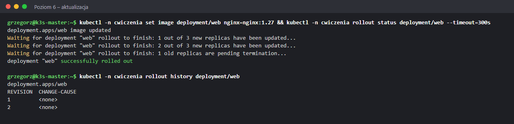

**Rolling update** – wymiana kopia po kopii: nowy pod startuje, stary jest usuwany, dopiero
potem następny. Aplikacja działa przez cały czas. Każda zmiana szablonu poda to nowa
**rewizja** w historii.

Teraz błąd – obraz, który nie istnieje:

```bash
kubectl -n cwiczenia set image deployment/web nginx=nginx:nie-ma-takiej-wersji
kubectl -n cwiczenia get pods
kubectl -n cwiczenia get events --field-selector reason=Failed --sort-by=.lastTimestamp | tail -3
```

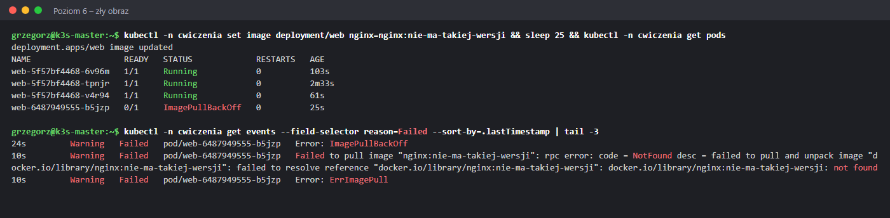

- Nowy pod utknął w **`ImagePullBackOff`** – Kubernetes próbuje pobrać obraz coraz rzadziej
  (*back-off*).
- Przyczynę podają zdarzenia: `docker.io/library/nginx:nie-ma-takiej-wersji: not found`.
- **Trzy stare pody działają dalej** – aktualizacja zatrzymuje się na pierwszej nieudanej
  kopii, aplikacja nie przestaje odpowiadać.

```bash
kubectl -n cwiczenia rollout undo deployment/web
kubectl -n cwiczenia get pods -o custom-columns=POD:.metadata.name,OBRAZ:.spec.containers[0].image,STAN:.status.phase,WEZEL:.spec.nodeName
```

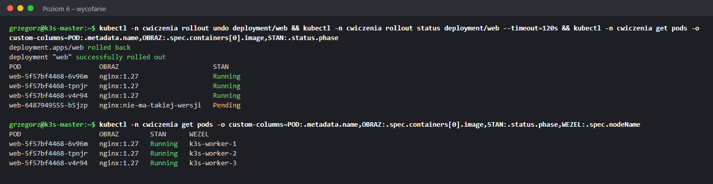

`rollout undo` wraca do poprzedniej rewizji (`nginx:1.27`); zepsuty pod jest usuwany.
`-o custom-columns` pozwala wybrać własne kolumny wyniku.

---

## Poziom 7 – konserwacja węzła

Przed aktualizacją systemu lub restartem serwera węzeł trzeba **opróżnić**.

```bash
kubectl -n cwiczenia scale deployment web --replicas=4
kubectl -n cwiczenia get pods -o wide
kubectl drain k3s-worker-1 --ignore-daemonsets --delete-emptydir-data
kubectl get nodes
kubectl -n cwiczenia get pods -o wide
kubectl uncordon k3s-worker-1
```

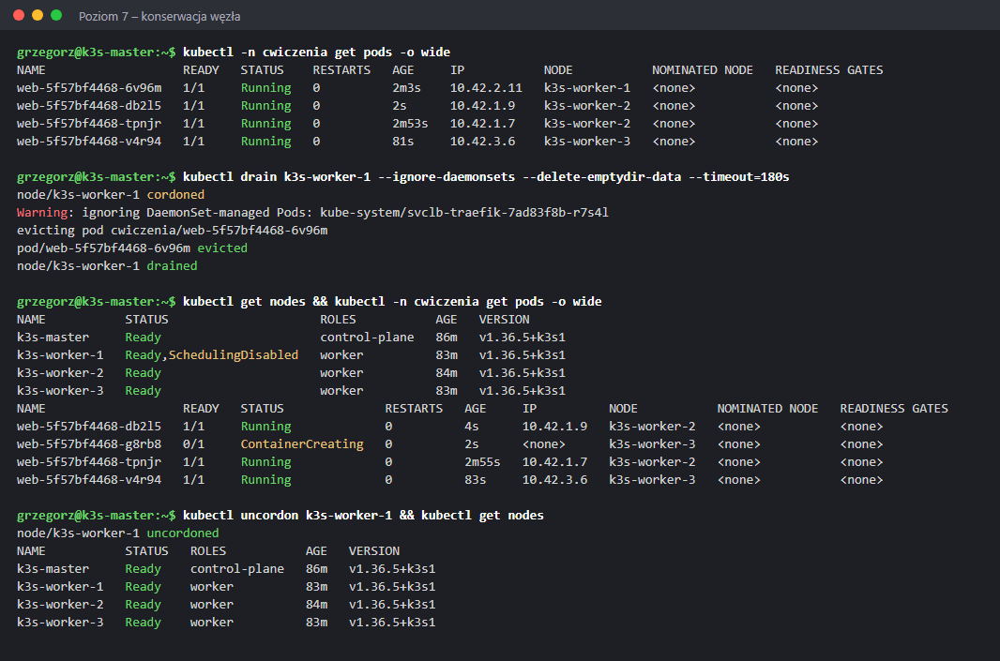

| Etap | Co się dzieje |
|---|---|
| `cordoned` | węzeł nie przyjmuje nowych podów (`Ready,SchedulingDisabled`) |
| `evicting pod ...` | pody z węzła są usuwane i tworzone na innych węzłach (tu: na `k3s-worker-3`) |
| `ignoring DaemonSet-managed Pods` | pody DaemonSet zostają – mają działać na każdym węźle |
| `drained` | węzeł pusty – można go restartować |
| `uncordon` | węzeł znów przyjmuje pody |

Po `uncordon` pody **nie wracają same** na `k3s-worker-1` – nowe trafią tam przy kolejnym
tworzeniu podów. To samo dzieje się przy awarii węzła (Etap 5), tylko bez uprzedzenia.

---

## Poziom 8 – YAML i apply

Polecenia `create`, `scale`, `set image` to styl **imperatywny** („zrób to”). W praktyce zasoby
opisuje się w plikach YAML trzymanych w gicie – styl **deklaratywny** („ma być tak”).

Jak klaster widzi istniejący obiekt:

```bash
kubectl -n cwiczenia get deployment web -o yaml
```

```yaml
spec:
  replicas: 4
  selector:
    matchLabels:
      app: web              # Deployment zarządza podami z tą etykietą
  strategy:
    rollingUpdate:
      maxSurge: 25%         # ile podów ponad liczbę docelową w trakcie aktualizacji
      maxUnavailable: 25%   # ile może brakować w trakcie aktualizacji
    type: RollingUpdate
  template:                 # szablon poda
    metadata:
      labels:
        app: web
    spec:
      containers:
      - image: nginx:1.27
        imagePullPolicy: Always
        name: nginx
```

Szkielet nowego pliku bez pisania od zera – `--dry-run=client -o yaml`:

```bash
kubectl -n cwiczenia create deployment api --image=nginx:1.27 --replicas=1 --dry-run=client -o yaml > api.yaml
cat api.yaml
kubectl apply -f api.yaml
```

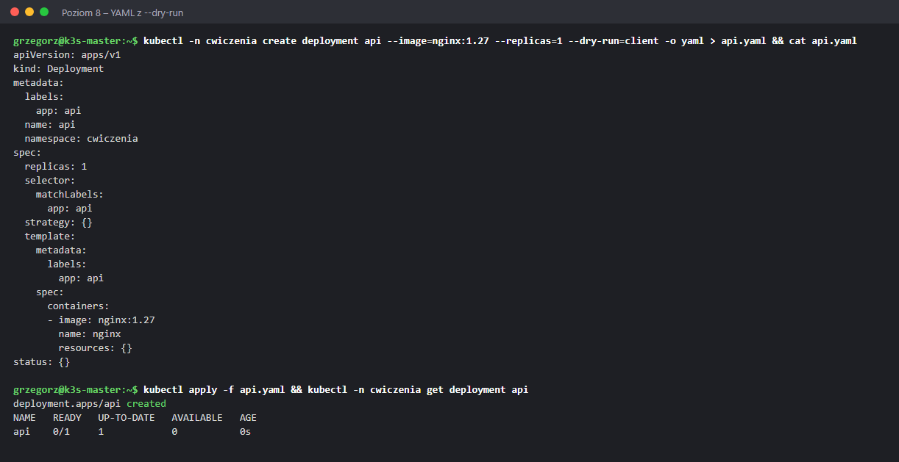

Zmiana w pliku, podgląd różnic, wdrożenie i ponowne wdrożenie bez zmian:

```bash
sed -i 's/replicas: 1/replicas: 2/' api.yaml
kubectl diff -f api.yaml
kubectl apply -f api.yaml
kubectl apply -f api.yaml
```

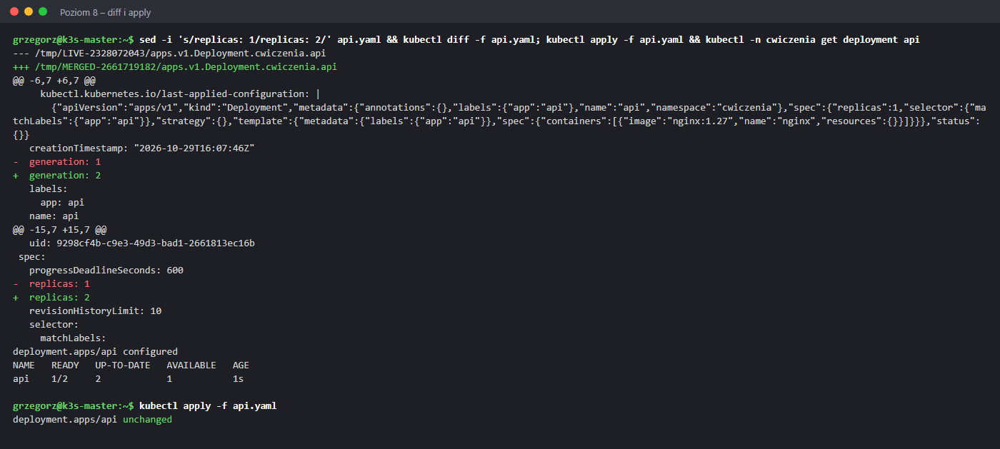

- **`kubectl diff`** – odpowiednik `ansible-playbook --check --diff`: co się zmieni, zanim się zmieni.
- **`apply`** – doprowadza klaster do stanu z pliku (`created` / `configured`).
- Drugie `apply` bez zmian w pliku → **`unchanged`** – idempotentność, tak jak `changed=0` w Ansible.

Tak wdrażane są aplikacje w tym repozytorium: `kubernetes/demo-app/*.yaml` i `kubectl apply`
(Etap 3).

---

## Sprzątanie

```bash
kubectl delete namespace cwiczenia
rm -f api.yaml
kubectl get namespaces
kubectl get nodes
```

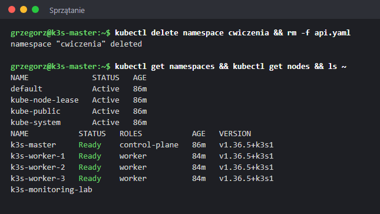

Usunięcie przestrzeni nazw usuwa **wszystko**, co w niej było: Deploymenty, ReplicaSety, pody,
Service. Klaster wraca do czterech systemowych przestrzeni i czterech węzłów `Ready`.

Na workerach zostają pobrane obrazy nginx (pamięć podręczna containerd) – nie przeszkadzają.
Podgląd i usunięcie na węźle: `sudo k3s crictl images`, `sudo k3s crictl rmi --prune`.

---

## Pojęcia

| Pojęcie | Znaczenie |
|---|---|
| **Node** | węzeł – maszyna w klastrze |
| **Namespace** | przestrzeń nazw – osobna „szuflada” na zasoby |
| **Pod** | najmniejsza jednostka – jeden lub kilka kontenerów z jednym adresem IP |
| **ReplicaSet** | pilnuje liczby kopii poda |
| **Deployment** | zarządza ReplicaSetami: liczba kopii, aktualizacje, historia, wycofanie |
| **DaemonSet** | jedna kopia poda na każdym węźle |
| **Service** | stały adres i DNS dla grupy podów; `ClusterIP` (w klastrze), `NodePort` (port na węzłach), `LoadBalancer` |
| **EndpointSlice** | lista adresów podów, do których Service kieruje ruch |
| **Taint / toleration** | „nie wpuszczaj podów na ten węzeł” / wyjątek od tego zakazu |
| **Label / selector** | etykiety na obiektach i wybieranie obiektów po etykietach (`app=web`) |
| **Scheduler** | wybiera węzeł dla nowego poda |
| **kubelet** | agent na każdym węźle – uruchamia pody, raportuje stan |
| **Reconciliation loop** | ciągłe wyrównywanie stanu rzeczywistego do pożądanego |

## Ściągawka

| Polecenie | Do czego |
|---|---|
| `kubectl get <typ> [-n ns \| -A] [-o wide\|yaml] [-w]` | lista obiektów |
| `kubectl describe <typ> <nazwa>` | szczegóły i **Events** – pierwsze miejsce diagnozy |
| `kubectl logs <pod> [-f] [--previous] [--tail=N]` | logi kontenera |
| `kubectl exec [-it] <pod> -- <polecenie>` | polecenie w kontenerze |
| `kubectl get events -A --sort-by=.lastTimestamp` | co się ostatnio działo |
| `kubectl create deployment / expose / scale / set image` | szybkie zmiany imperatywne |
| `kubectl rollout status / history / undo` | aktualizacje i wycofanie |
| `kubectl drain / cordon / uncordon <węzeł>` | konserwacja węzła |
| `kubectl apply -f plik.yaml` / `kubectl diff -f plik.yaml` | wdrożenie deklaratywne / podgląd różnic |
| `kubectl top nodes / pods` | zużycie CPU i pamięci |
| `kubectl explain <typ>.<pole>` | dokumentacja pól YAML |

## Co powiedzieć na rozmowie

> „Na klastrze k3s przećwiczyłem podstawowe operacje: wdrożenie aplikacji, samonaprawę
> i skalowanie, Service typu NodePort i DNS w klastrze, aktualizację kroczącą z wycofaniem
> po błędnym obrazie (ImagePullBackOff) oraz drain węzła przed konserwacją. Diagnozę zaczynam
> od `describe` i zdarzeń – np. tam widać było, że pierwszy pod startował 4 minuty, bo węzeł
> pobierał obraz. Zasoby docelowo opisuję w YAML i wdrażam przez `kubectl diff` i `apply`.”
