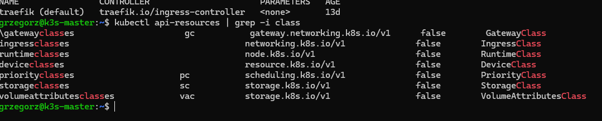
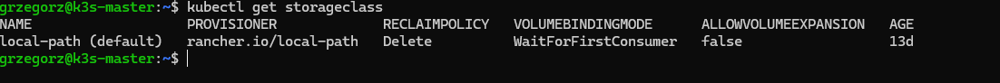
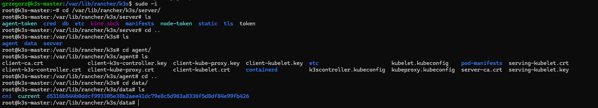

# k3s od środka – klasy, dyski i pliki na węźle

Co jest zainstalowane w klastrze, kto obsługuje ruch i dyski, gdzie na węźle leżą dane klastra,
obrazy i trwałe dane podów. Wszystkie wyniki są prawdziwe – z labu, 12.11.2026.

## Co jest zainstalowane w klastrze

🐧 na masterze:

```bash
helm list -A
```

Pokazuje wszystko, co zainstalowano przez Helm, we wszystkich namespace'ach (`-A`). Oprócz
`kube-prometheus-stack` i Headlampa zobaczysz `traefik` i `traefik-crd` w `kube-system` – k3s
instaluje je sam, też przez Helm. Rzeczy wdrożone przez `kubectl apply` (podinfo, chaos, hello-lab)
tu się **nie** pojawiają.

Porównanie: `helm list` to „Programy i funkcje” w Panelu sterowania Windowsa.

## Klasy – kto obsługuje daną rzecz

Klasa mówi Kubernetesowi, **który program** ma obsłużyć obiekt. Zamawiasz paczkę (PVC, Ingress),
a klasa wybiera firmę kurierską.

```bash
kubectl get ingressclass
kubectl api-resources | grep -i class
```



| Klasa | Wybiera | W labie |
|---|---|---|
| **IngressClass** | kto obsługuje ruch HTTP z zewnątrz | `traefik (default)` |
| **StorageClass** | skąd brać dyski dla PVC | `local-path (default)` |
| **PriorityClass** | który pod jest ważniejszy przy braku miejsca | tylko systemowe |
| **GatewayClass** | Gateway API – następca Ingressa | typ jest, obiektów brak |
| **RuntimeClass** | czym uruchamiać kontenery | brak – domyślny containerd |
| **DeviceClass** | przydział urządzeń (np. GPU) | brak |
| **VolumeAttributesClass** | zmiana parametrów dysku bez tworzenia nowego | brak |

- `(default)` – klasa używana, gdy obiekt nie poda własnej.
- `false` w kolumnie `NAMESPACED` – klasa jest wspólna dla całego klastra, przy `get` nie podajesz `-n`.
- `\` przed `gatewayclasses` na zrzucie to artefakt wyświetlania terminala.

## StorageClass `local-path`

```bash
kubectl get storageclass
```



| Kolumna | Wartość | Znaczenie |
|---|---|---|
| PROVISIONER | `rancher.io/local-path` | dysk = zwykły folder na węźle |
| RECLAIMPOLICY | `Delete` | usunięcie PVC kasuje też dane |
| VOLUMEBINDINGMODE | `WaitForFirstConsumer` | dysk powstaje dopiero wtedy, gdy pod go potrzebuje, na węźle, na którym pod wystartował |
| ALLOWVOLUMEEXPANSION | `false` | dysku nie powiększysz później |

**Skutek w labie:** dysk Prometheusa jest na worker-2, a Grafany i Alertmanagera na worker-1, więc te
pody mogą startować tylko tam. W teście B (worker-1 wyłączony) Grafana i Alertmanager w klastrze nie
działały – [przebieg testu](../etap-4-monitoring-zewnetrzny/05-przebieg-wdrozenia.md).
`local-path` to szuflada w jednym biurku: gdy pokój jest zamknięty, papierów nie dostaniesz.
W firmach używa się storage'u replikowanego (Longhorn, Ceph, dyski chmurowe) i polityki `Retain`
dla ważnych danych.

Gdzie leży każdy dysk (PVC, rozmiar, folder, węzeł):

```bash
kubectl get pv -o custom-columns=PVC:.spec.claimRef.name,SIZE:.spec.capacity.storage,PATH:.spec.hostPath.path,NODE:.spec.nodeAffinity.required.nodeSelectorTerms[0].matchExpressions[0].values[0]
```

## Pliki k3s na węźle – `/var/lib/rancher/k3s`



```
/var/lib/rancher/k3s/
├── server/      tylko master: baza klastra, certyfikaty, tokeny
├── agent/       każdy węzeł: kubelet, containerd, obrazy i kontenery
├── data/        programy k3s (kubectl, containerd, crictl, wtyczki sieci)
└── storage/     tylko węzły z dyskami PVC (worker-1, worker-2) – trwałe dane podów
```

Na masterze nie ma `storage/` – master ma taint `NoSchedule`, nie uruchamia podów aplikacji, więc nie
dostał żadnego dysku.

### `server/` – mózg klastra

| Element | Co to |
|---|---|
| `db/` | **baza klastra** (SQLite przez kine) – wszystkie obiekty, także Secrety. Najważniejsze do backupu |
| `kine.sock` | gniazdo, przez które API Kubernetesa rozmawia z bazą |
| `tls/` | certyfikaty i klucze klastra (CA, API) |
| `token`, `node-token`, `agent-token` | 🔒 hasła dołączania węzłów – kto je ma, dołączy własny węzeł |
| `manifests/` | k3s sam wdraża wszystko, co tu leży (Traefik, CoreDNS, local-path) |
| `cred/`, `etc/`, `static/` | dane logowania komponentów, konfiguracja, paczki Helm wbudowanych dodatków |

⚠️ Nazwy plików na zrzucie są bezpieczne, ale **zawartości** `token`, `tls/*.key` i `cred/` nie pokazuj
na zrzutach ani nie wklejaj do repozytorium.

### `agent/` – część robocza

| Element | Co to |
|---|---|
| `containerd/` | obrazy i pliki działających kontenerów |
| `*.crt`, `*.key` | certyfikaty, którymi kubelet i kube-proxy przedstawiają się API |
| `*.kubeconfig` | „przepustki” komponentów do API |
| `pod-manifests/` | pody statyczne (w labie puste) |

### `data/` – programy k3s

Folder o nazwie z długim skrótem to rozpakowane programy jednej wersji k3s, `current` wskazuje na
aktualną, `cni/` to wtyczki sieci podów (Flannel).

### Gdzie są dane kontenera, a gdzie trwałe dane

| Miejsce | Co | Po usunięciu poda |
|---|---|---|
| `agent/containerd/` | warstwy obrazu i pliki działającego kontenera | **znika** |
| `storage/pvc-…` | dysk PVC z `local-path` | **zostaje** |

Porównanie: `containerd` to pokój hotelowy – po wymeldowaniu go sprzątają. `storage` to sejf –
zawartość czeka na następnego gościa.

```bash
sudo k3s crictl images
```

Pokazuje obrazy pobrane przez węzeł (odpowiednik `docker images`; na węzłach k3s nie ma Dockera).

## `/var/lib` – dane programów w Linuksie

| Katalog | Rola | Przykład z labu |
|---|---|---|
| `/etc` | konfiguracja – pisze ją człowiek | `/etc/rancher/k3s/registries.yaml` |
| `/var/lib` | dane programów – program zapisuje je sam | `/var/lib/rancher/k3s`, `/var/lib/docker` |
| `/var/log` | logi | `/var/log/syslog` |
| `/usr/bin` | programy | `curl`, `ls` |
| `/tmp` | pliki tymczasowe | |

Typowe podfoldery `/var/lib`: `docker` (obrazy i wolumeny – na `monitoring` dane Grafany i Kumy),
`mysql` / `postgresql` (bazy), `apt` i `dpkg` (pakiety), `systemd` (stan usług).
**Przy backupie serwera najważniejsze są `/etc` i `/var/lib`.**

## Socket (`.sock`) – rozmowa programów bez sieci

Gniazdo uniksowe (Unix domain socket) to plik, przez który dwa programy **na tej samej maszynie**
wymieniają dane, bez TCP/IP i bez portu. Sieć to list wysłany pocztą nawet do sąsiada, socket to rura
między dwoma pokojami w jednym domu.

| | Socket | Sieć (TCP) |
|---|---|---|
| szybkość | szybszy, bez narzutu TCP/IP | wolniejszy |
| kto się połączy | tylko proces na tej maszynie z prawami do pliku | każdy, kto dosięgnie portu |
| ochrona | uprawnienia pliku | firewall, TLS, hasła |

```bash
sudo ls -l /var/lib/rancher/k3s/server/kine.sock
```

Linia zaczyna się od **`s`** (socket) – tak jak `d` to katalog, a `-` zwykły plik. W `ls` z kolorami
socket jest różowy.

| Socket | Kto przez niego rozmawia |
|---|---|
| `/var/lib/rancher/k3s/server/kine.sock` | API Kubernetesa ↔ baza klastra |
| `/run/k3s/containerd/containerd.sock` | kubelet i `crictl` ↔ containerd |
| `/var/run/docker.sock` | polecenie `docker` ↔ silnik Dockera (na `monitoring`) |

Dlatego w Etapie 4 dopisałeś się do grupy `docker` – ta grupa ma prawo do `docker.sock`.

⚠️ **Bezpieczeństwo:** dostęp do `docker.sock` = pełny root na maszynie (można uruchomić kontener
z zamontowanym dyskiem hosta). Nie montuje się go do kontenerów aplikacji, a grupę `docker` traktuje
się jak `sudo`.

## Pytania rekrutacyjne

1. **Gdzie k3s trzyma stan klastra i co backupujesz?** – `/var/lib/rancher/k3s/server/db` (SQLite
   przez kine, przy wielu masterach embedded etcd) plus token z `server/token`. Z nimi odtworzysz klaster.
2. **Co oznacza `WaitForFirstConsumer`?** – dysk powstaje dopiero przy pierwszym podzie, na jego węźle.
   Przy `local-path` wiąże to pod z węzłem – sprawdzone testem awarii.
3. **`Delete` czy `Retain`?** – `Delete` kasuje dane razem z PVC; dla baz i historii metryk `Retain`.
4. **Czym jest IngressClass i co oznacza `(default)`?** – wybór kontrolera Ingress (u mnie Traefik);
   `default` obsługuje Ingressy bez podanej klasy.
5. **Czym różni się Ingress od Gateway API?** – Gateway API rozdziela role: GatewayClass (dostawca),
   Gateway (admin), HTTPRoute (zespół aplikacji), i obsługuje więcej niż HTTP.
6. **Co to Unix socket i dlaczego `docker.sock` jest niebezpieczny?** – komunikacja lokalna przez plik;
   kto ma do niego dostęp, steruje Dockerem, czyli ma roota na hoście.
7. **Co jest w `/etc`, a co w `/var/lib`?** – konfiguracja vs dane robocze programów.
