# Etap 3 – rozwiązania ćwiczeń z monitoringu (wykonanie ze zrzutami)

Wykonanie poziomów z [ćwiczenia z monitoringu](05-cwiczenia-monitoringu.md) na klastrze labu, 30.10.2026, ze
zrzutami ekranu i prawdziwymi wynikami. Służy do porównania: zrób poziom sam, potem zajrzyj tutaj.

**Jak powstały zrzuty.** Poziomy 1–4, 6 i 7 wykonano automatycznie: polecenia `kubectl` przez SSH
na masterze, wyciszenie przez API Alertmanagera (`POST /api/v2/silences` – to samo, co robi
przycisk **Create** w przeglądarce), a zrzuty stron – przeglądarką Edge bez okna, sterowaną przez
DevTools Protocol. Poziomy w **Grafanie** (5 i 8) wykonano 31.10.2026 w przeglądarce wbudowanej
w aplikację Claude: hasło wpisał właściciel labu, dalsze kroki i zrzuty – Claude. Grafana pokazuje
czas lokalny przeglądarki (nie UTC).

Na końcu przywrócono stan wyjściowy: podinfo ma 3 repliki, brak aktywnych wyciszeń, alerty
`Podinfo…` – *inactive*.

> **Czas na zrzutach.** Prometheus pokazuje godziny w **UTC** – o godzinę mniej niż zegar w Polsce
> zimą. Przełącznik strefy: ikona ustawień (koło zębate) → *Use local time*.

---

## Poziom 1 – co Prometheus zbiera

*Status → Target health*:

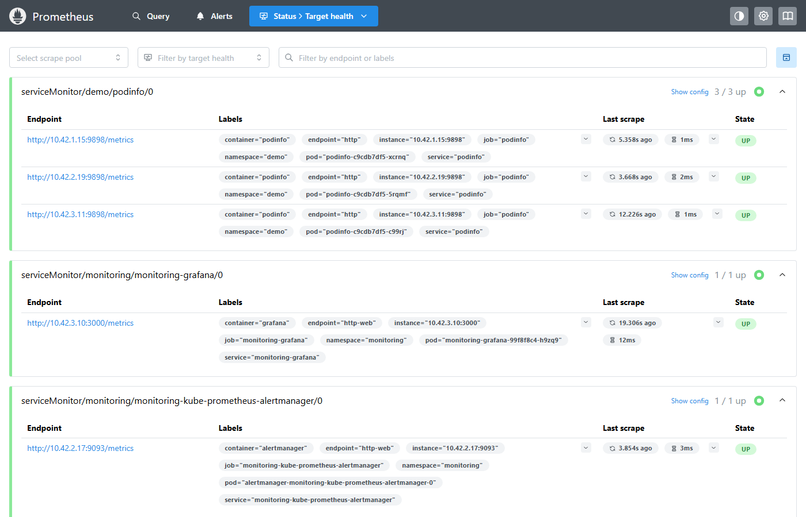

- `serviceMonitor/demo/podinfo/0` – **3 / 3 up**: trzy repliki, każda pod własnym adresem poda
  (`10.42.2.19`, `10.42.3.11`, `10.42.1.15`) na porcie `9898`, ścieżka `/metrics`.
- Etykiety przy celu (`namespace`, `pod`, `service`, `job`…) Prometheus dokleja do każdej metryki
  z tego celu – po nich później filtrujesz.
- *Last scrape* – kiedy ostatnio pobrano dane (kilka sekund temu), obok czas pobrania (1–2 ms).

Filtr `node-exporter`:

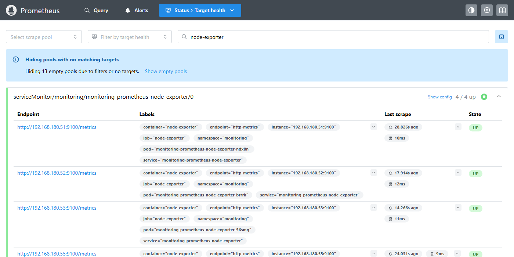

Cztery cele z adresami **maszyn** (`192.168.180.51/52/53/55:9100`) – node-exporter działa
w sieci maszyny (`hostNetwork`), bo mierzy samą maszynę.

Surowe metryki, czyli to, co Prometheus pobiera z celu (na masterze):

```
$ curl -s http://192.168.180.52:9100/metrics | grep -E "^node_memory_Mem(Available|Total)_bytes"
node_memory_MemAvailable_bytes 4.779139072e+09
node_memory_MemTotal_bytes 5.6209408e+09
$ curl -s http://192.168.180.52:9100/metrics | wc -l
1353
```

Jedna strona node-exportera to ~1350 linii – Prometheus pobiera ją z każdego węzła co 30 sekund.

**Odpowiedzi:** podinfo ma 3 cele, bo ma 3 repliki; node-exporter 4, bo jest DaemonSetem na
4 węzłach. Podinfo nie ma na masterze – taint `NoSchedule`.

## Poziom 2 – pierwsze zapytania

`up` – zakładka *Table*:

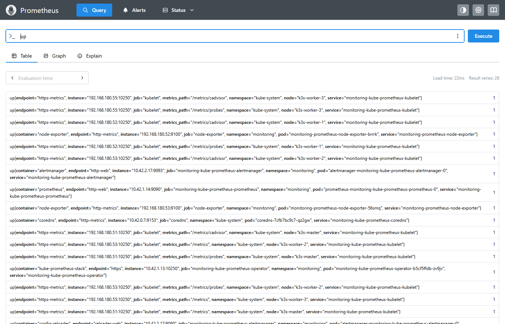

Każdy wiersz to jeden cel z poziomu 1, wartość `1` – odpowiada.

`node_memory_MemAvailable_bytes / 1024 / 1024`:

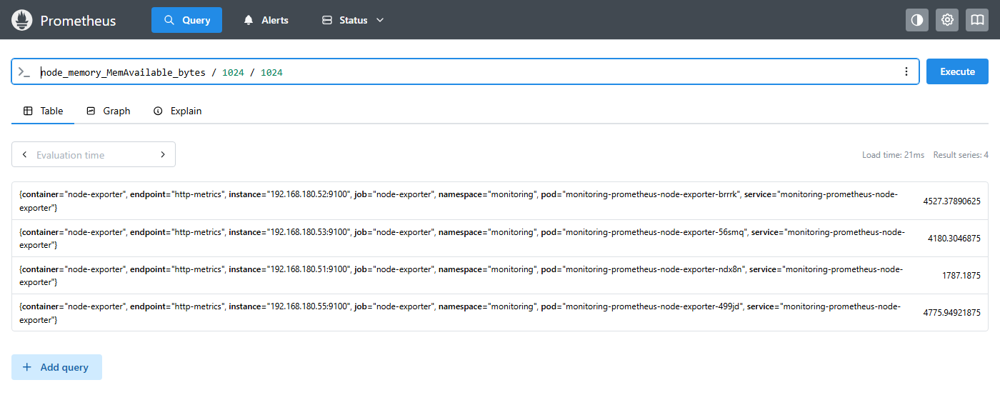

| Część wiersza | Przykład | Co to jest |
|---|---|---|
| nazwa metryki | `node_memory_MemAvailable_bytes` | co mierzymy |
| etykiety | `{instance="192.168.180.51:9100", …}` | skąd – tu: master |
| wartość | `1787.1875` | wolne MiB w chwili zapytania |

| Węzeł | Wolna pamięć |
|---|---|
| master `.51` | ~1787 MiB |
| worker-2 `.53` | ~4180 MiB |
| worker-1 `.52` | ~4527 MiB |
| worker-3 `.55` | ~4776 MiB |

Porównanie z terminalem na masterze – kolumna *available*:

```
$ free -m
               total        used        free      shared  buff/cache   available
Mem:            3350        1636         857          85        1159        1714
```

`1714` w `free -m` a `1787` w Prometheusie – inny moment pomiaru (kilka minut różnicy), ta sama
metryka z jądra (`MemAvailable` z `/proc/meminfo`).

## Poziom 3 – historia na wykresie

Wolna pamięć, zakładka *Graph*, zakres `1h`:

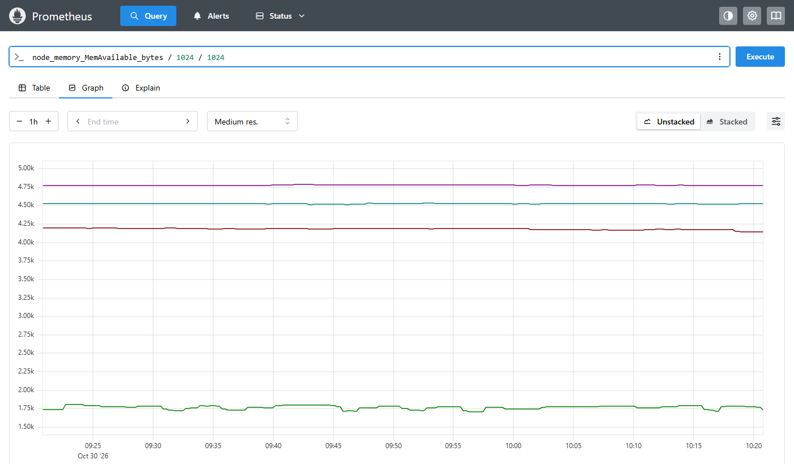

Cztery prawie płaskie linie – lab nic nie robi. Dolna (~1,75 GiB) to master.

Zużycie CPU w procentach:

```
100 - avg by (instance) (rate(node_cpu_seconds_total{mode="idle"}[5m])) * 100
```

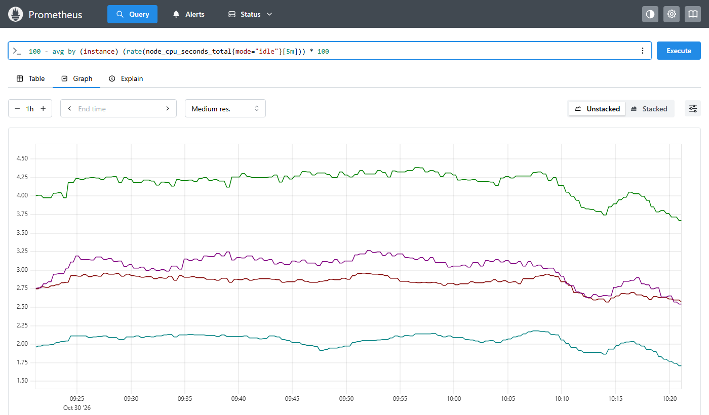

`node_cpu_seconds_total{mode="idle"}` to licznik sekund bezczynności procesora. `rate(...[5m])`
zamienia go na „ile sekund bezczynności na sekundę” (0–1 na rdzeń), `avg by (instance)` uśrednia
rdzenie maszyny, a `100 - … * 100` odwraca bezczynność w zajętość w procentach.

Restarty kontenerów (`kube_pod_container_status_restarts_total`, *Table*):

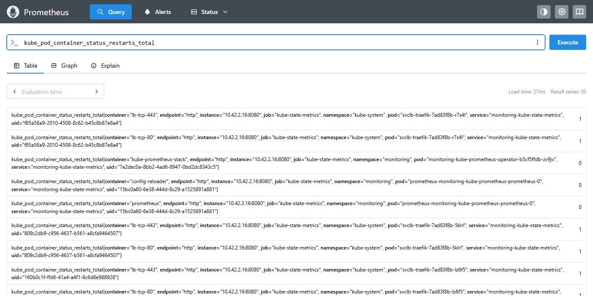

Licznik tylko rośnie – dlatego reguła `PodRestartingTooOften` liczy `increase(...[10m])`, czyli
przyrost w ostatnich 10 minutach, a nie samą wartość.

## Poziom 4 – reguły i alerty

*Status → Rule health*:

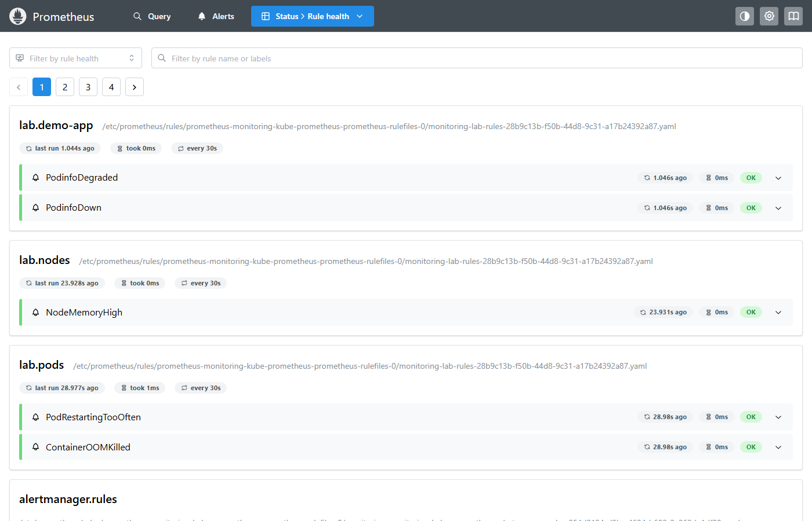

Każda grupa reguł z plikiem, z którego operator ją wygenerował (`/etc/prometheus/rules/…`), stan
`ok` i czas ostatniego obliczenia.

*Alerts*:

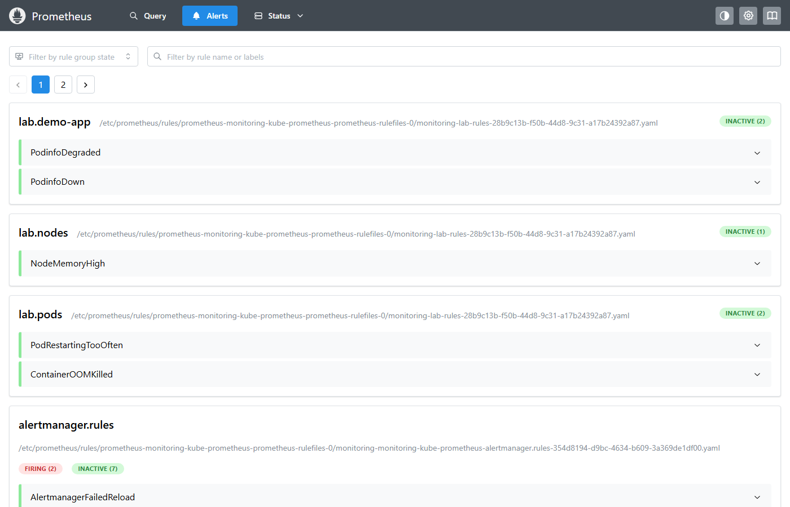

- `lab.demo-app`, `lab.nodes`, `lab.pods` – 5 reguł labu, wszystkie **INACTIVE** (zielone).
- `alertmanager.rules` – **FIRING (2)**: `AlertmanagerFailedToSendAlerts` i
  `AlertmanagerClusterFailedToSendAlerts` – przykładowy adres healthchecks.io
  ([problemy](problemy.md#alertmanagerfailedtosendalerts-zaraz-po-instalacji)).

Alertmanager (`:30093`):

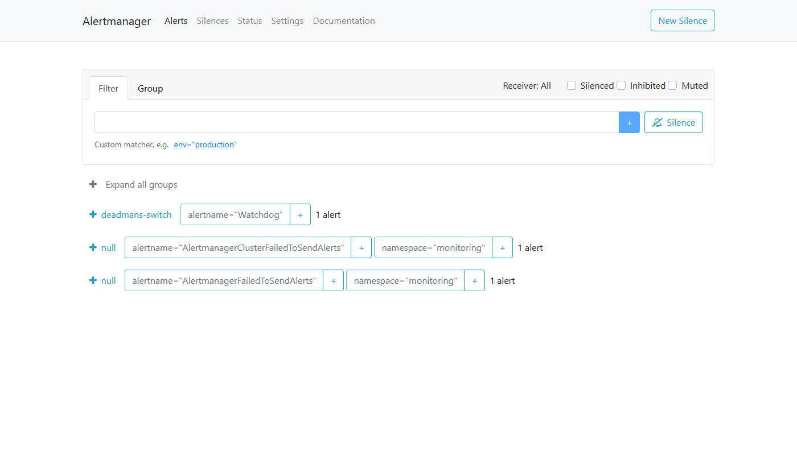

Alerty pogrupowane według **odbiorcy**: `Watchdog` → `deadmans-switch` (trasa szczegółowa
z pliku values), reszta → `null` (trasa domyślna). Każda grupa ma etykiety z `group_by`
(`alertname`, `namespace`).

*Status* Alertmanagera – *Cluster Status: disabled* (jedna replika, opis w
[teorii](04-teoria-monitoringu.md#8-alertmanager--decyduje-kogo-powiadomić)):

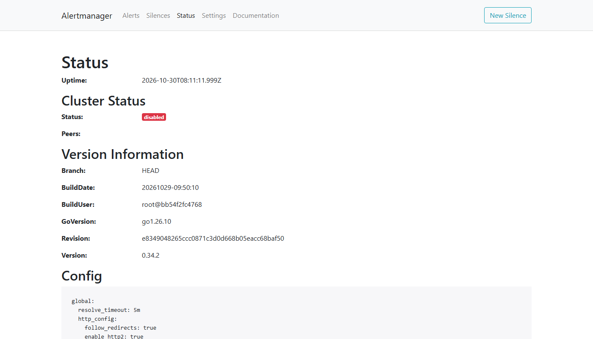

## Poziom 5 – gotowe dashboardy w Grafanie

Grafana: `http://192.168.180.51:30300`, login `admin`. Wszystkie dashboardy poniżej przyszły
gotowe z kube-prometheus-stack – nikt ich nie rysował ręcznie.

**Node Exporter / Nodes**, maszyna `192.168.180.51` (master), ostatnia godzina:

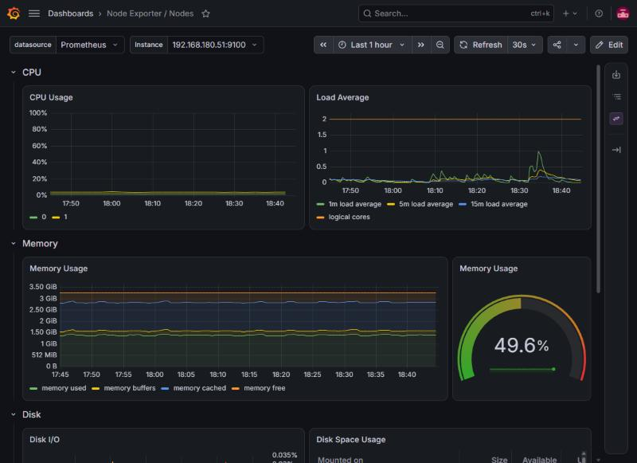

- **CPU Usage** – prawie zero: master w spoczynku prawie nie pracuje.
- **Load Average** – średnio poniżej 0,5 przy 2 rdzeniach (pomarańczowa linia *logical cores* = 2).
  Skok około 18:35 to praca przy klastrze, nie problem.
- **Memory Usage** – wskaźnik **49,6%**: połowa z 4 GiB zajęta. Na wykresie obok – podział na
  pamięć używaną, bufory, pamięć podręczną (*cached*) i wolną.
- Przełącznik **Instance** u góry zmienia maszynę – ten sam dashboard dla każdego węzła.

**Kubernetes / Compute Resources / Cluster** – cały klaster naraz:

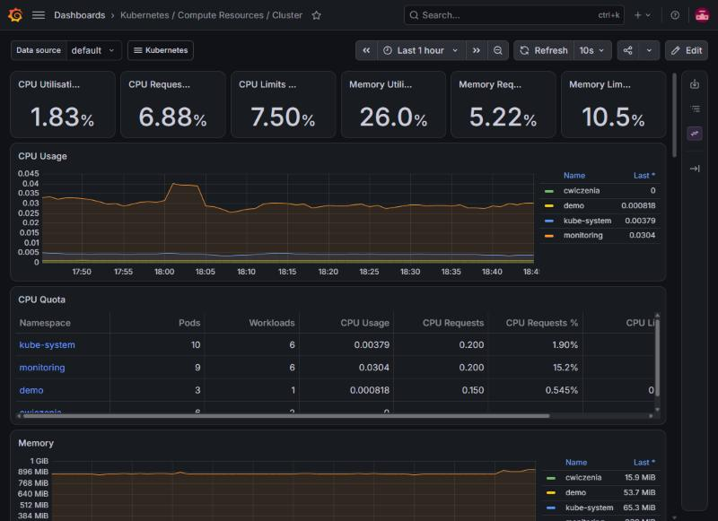

- Kafelki u góry: CPU klastra wykorzystane w **1,83%**, pamięć w **26%**.
- **CPU Quota** – tabela namespace'ów: `kube-system` 10 podów, `monitoring` 9, `demo` 3.
  Na zrzucie widać też `cwiczenia` – w tym czasie trwały ćwiczenia z kubectl z Etapu 2.
- Najwięcej CPU zużywa `monitoring` (0,03 rdzenia) – monitoring kosztuje więcej niż to, co
  monitoruje.

**Kubernetes / Compute Resources / Namespace (Pods)**, namespace `monitoring` – pamięć podów
(legenda posortowana kliknięciem w nagłówek *Last*):

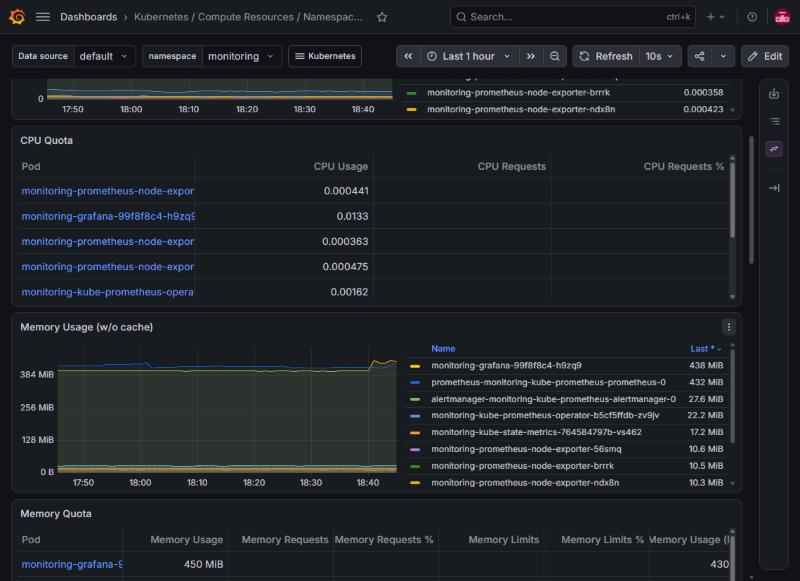

| Pod | Pamięć |
|---|---|
| `monitoring-grafana-…` | 438 MiB |
| `prometheus-monitoring-kube-prometheus-prometheus-0` | 432 MiB |
| `alertmanager-…` | 27,6 MiB |
| `monitoring-kube-prometheus-operator-…` | 22,2 MiB |
| `monitoring-kube-state-metrics-…` | 17,2 MiB |
| `monitoring-prometheus-node-exporter-…` (×4) | ok. 10,5 MiB każdy |

Odpowiedź na pytanie z ćwiczenia: **najwięcej zużywają Grafana i Prometheus, prawie po równo**.
Grafana wyprzedziła Prometheusa dopiero pod koniec wykresu – skok o 18:43 to moment, w którym
zaczęło się klikanie po dashboardach (każdy otwarty panel to zapytania i obliczenia po stronie
Grafany). Prometheus rośnie powoli, razem z liczbą zbieranych serii i długością historii.

**Edycja panelu** (menu panelu → **Edit**) – pod wykresem widać zapytanie PromQL, które go rysuje:

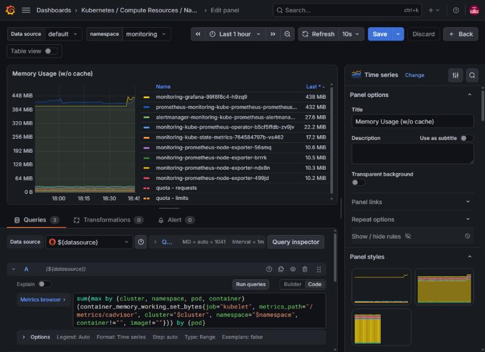

```
sum(max by (cluster, namespace, pod, container)
  (container_memory_working_set_bytes{job="kubelet", metrics_path="/metrics/cadvisor",
   cluster="$cluster", namespace="$namespace", container!="", image!=""})) by (pod)
```

- `$namespace` i `$cluster` to **zmienne dashboardu** – wartości z rozwijanych list u góry.
  Dzięki nim jeden dashboard obsługuje każdy namespace.
- Źródło danych: `Prometheus` – Grafana nie ma własnych metryk, za każdym razem pyta Prometheusa.
- Wyjście bez zmian: **Discard** albo **Back** bez zapisu.

**Sprawdź się – odpowiedzi:**
- Skąd Grafana bierze dane? Ze **źródła danych** (*Connections → Data sources*) – tu Prometheus
  w klastrze, ustawiony automatycznie przez kube-prometheus-stack.
- Czy Grafana przechowuje metryki? **Nie.** Przechowuje tylko dashboardy, użytkowników
  i ustawienia. Metryki są w Prometheusie.

## Poziom 6 – narodziny alertu

```
$ kubectl -n demo get deploy podinfo
NAME      READY   UP-TO-DATE   AVAILABLE   AGE
podinfo   3/3     3            3           93m

$ kubectl -n demo scale deployment podinfo --replicas=0
deployment.apps/podinfo scaled

$ kubectl -n demo get deploy,pods
NAME                      READY   UP-TO-DATE   AVAILABLE   AGE
deployment.apps/podinfo   0/0     0            0           93m
```

Zero podów – lista podów jest pusta.

Stan alertów co ~10 sekund (z API Prometheusa), licząc od `scale` o 11:22:07:

| Czas | PodinfoDown | PodinfoDegraded | Co się dzieje |
|---|---|---|---|
| +0 s … +46 s | – | – | Prometheus jeszcze nie wie: kube-state-metrics musi zauważyć zmianę, Prometheus pobrać metryki (co 30 s), a reguła się obliczyć (co 30 s) |
| **+56 s** | **pending** | **pending** | warunek spełniony; zaczyna się odliczanie `for` |
| **+112 s** | **firing** | pending | minęła minuta (`for: 1m`) – alert idzie do Alertmanagera |
| **+171 s** | firing | **firing** | minęły 2 minuty (`for: 2m`) |

Zrzut przy *pending* (+56 s):

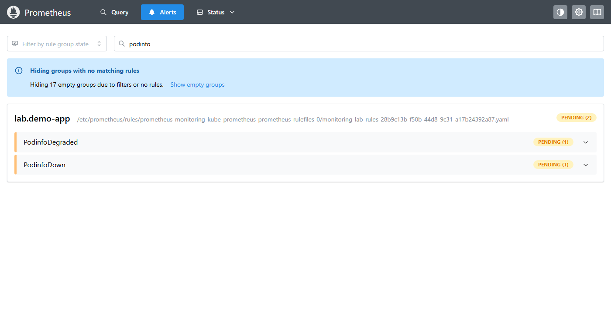

Zrzut przy *firing* (+112 s):

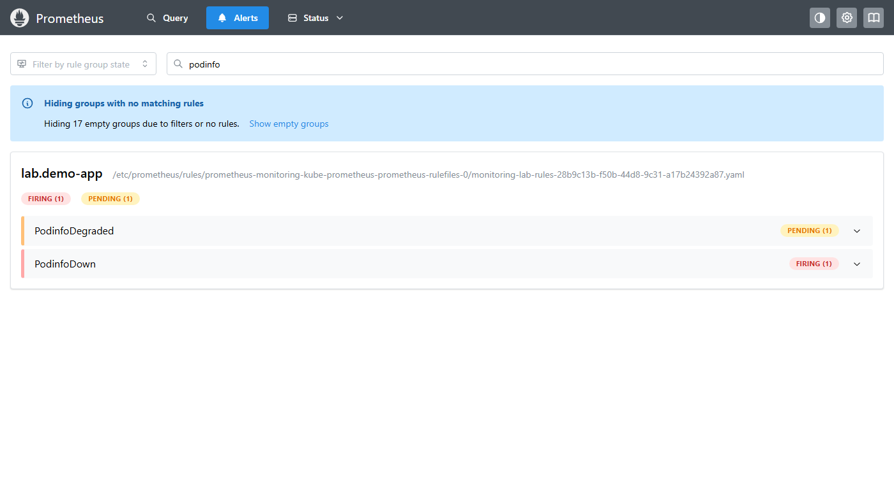

Alertmanager – nowe grupy `PodinfoDown` i `PodinfoDegraded` przy odbiorcy `null`:

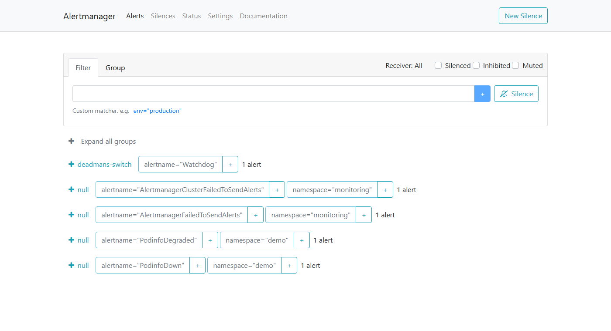

Wykres dostępnych replik (`kube_deployment_status_replicas_available{namespace="demo"}`, 15 min) –
spadek z 3 do 0:

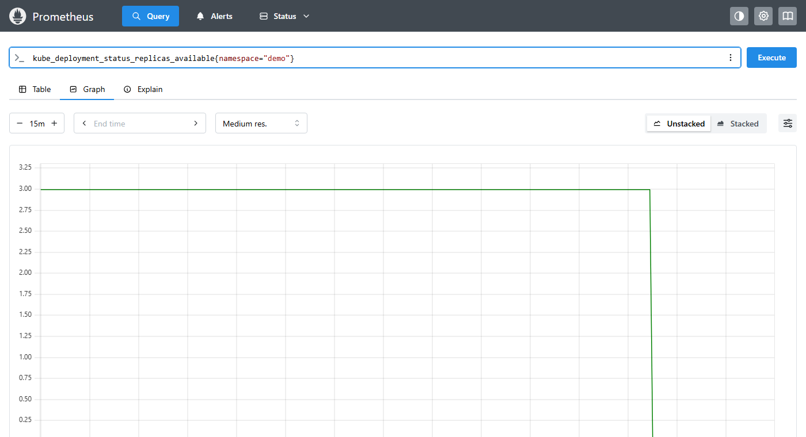

**Odpowiedzi:**
- Od awarii do *firing* minęło **~1 min 52 s**: ~56 s, zanim Prometheus w ogóle zobaczył zmianę
  (pobieranie metryk + ocena reguły co 30 s), plus 1 minuta `for`. Do powiadomienia doszłoby
  jeszcze `group_wait: 30s` w Alertmanagerze. Monitoring zawsze ma takie opóźnienie – to cena za
  brak fałszywych alarmów.
- Dwa alerty naraz: `PodinfoDegraded` (< 3 repliki) też jest prawdziwy, gdy jest 0 replik. W
  produkcji ukrywa się go regułą **tłumienia** (inhibition): gdy aplikacja leży, „działa słabiej”
  nie jest już potrzebne.

## Poziom 7 – wyciszenie na czas prac

Wyciszenie utworzone przez API Alertmanagera – dokładnie to, co wysyła formularz **New Silence**:

```bash
curl -X POST -H 'Content-Type: application/json' http://192.168.180.51:30093/api/v2/silences -d '{
  "matchers": [{"name": "alertname", "value": "PodinfoDown", "isRegex": false, "isEqual": true}],
  "startsAt": "2026-10-30T10:25:35Z", "endsAt": "2026-10-30T11:25:35Z",
  "createdBy": "grzegorz", "comment": "Ćwiczenie – podinfo celowo wyłączone"}'
```

Zakładka *Silences* – jedno aktywne wyciszenie, koniec za godzinę, warunek `alertname="PodinfoDown"`:

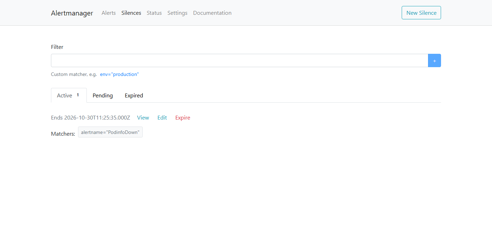

Szczegóły wyciszenia (*View*): kto, kiedy, do kiedy, komentarz i **Affected alerts: 1** – które
alerty obejmuje:

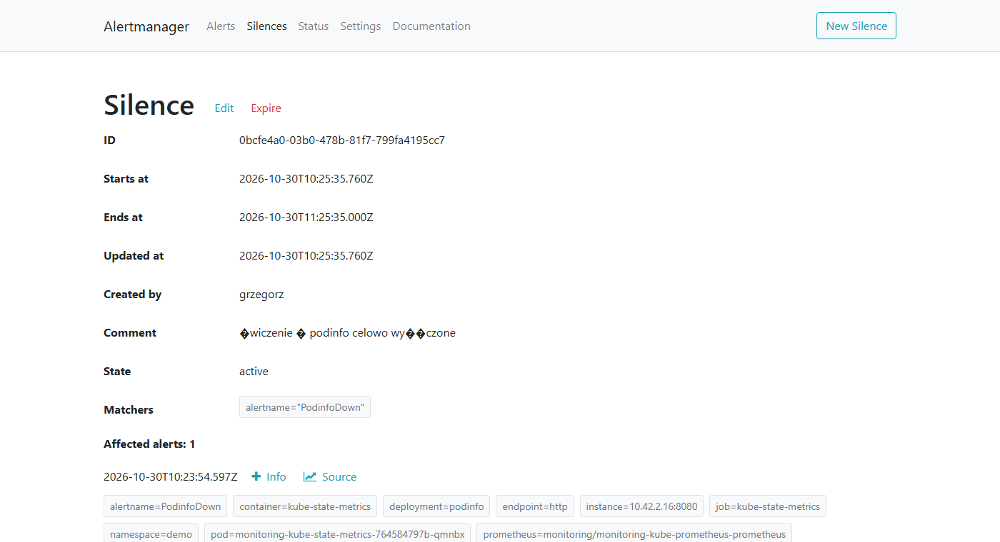

> **Nieudany komentarz.** Polskie litery w komentarzu zamieniły się w `�`. Wyciszenie wysłano
> poleceniem `curl` z Git Bash na Windowsie, który przekazał tekst w kodowaniu Windows (CP-1250),
> a Alertmanager oczekuje UTF-8. Z formularza w przeglądarce ten problem nie wystąpi. Wniosek:
> przy wysyłaniu danych przez API z Windowsa pilnuj kodowania (np. plik JSON zapisany w UTF-8
> i `curl -d @plik.json`) albo pisz komentarze bez polskich znaków.

Zakładka *Alerts*, domyślny widok – `PodinfoDown` **zniknął**, `PodinfoDegraded` został (wyciszenie
obejmuje tylko `alertname="PodinfoDown"`):

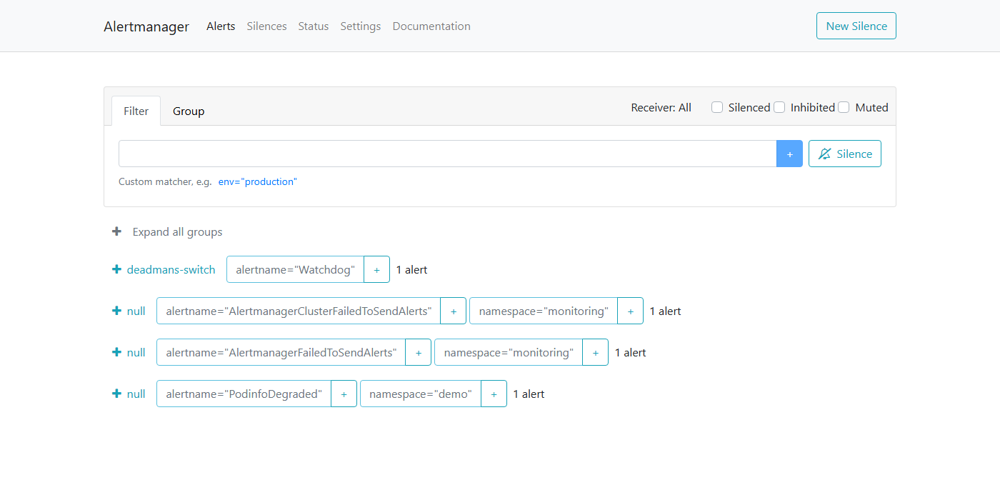

Po zaznaczeniu **Silenced** – `PodinfoDown` wraca na listę:

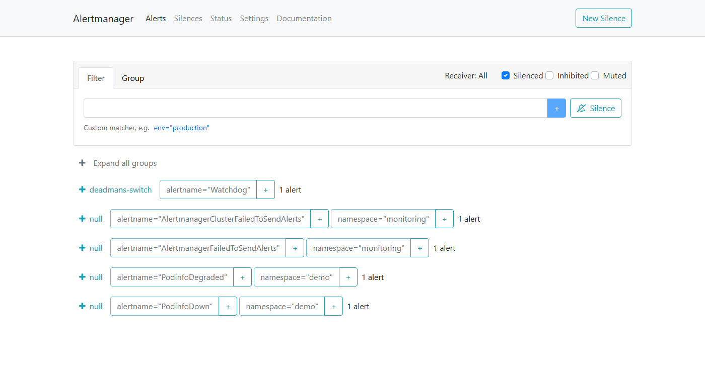

W Prometheusie w tym samym czasie oba alerty dalej **firing** (`PodinfoDegraded=firing
PodinfoDown=firing` z API) – wyciszenie działa tylko w Alertmanagerze: problem jest, ale nikt nie
dostaje powiadomień.

**Sprzątanie.** Wyciszenie wygaszone (`DELETE /api/v2/silence/<id>` – przycisk **Expire**,
odpowiedź `200`), potem:

```
$ kubectl -n demo scale deployment podinfo --replicas=3
deployment.apps/podinfo scaled

$ kubectl -n demo rollout status deployment/podinfo --timeout=120s
Waiting for deployment "podinfo" rollout to finish: 0 of 3 updated replicas are available...
Waiting for deployment "podinfo" rollout to finish: 1 of 3 updated replicas are available...
Waiting for deployment "podinfo" rollout to finish: 2 of 3 updated replicas are available...
deployment "podinfo" successfully rolled out

$ kubectl -n demo get pods -o wide
NAME                      READY   STATUS    RESTARTS   AGE   IP           NODE
podinfo-c9cdb7df5-j9jkm   1/1     Running   0          67s   10.42.3.12   k3s-worker-3
podinfo-c9cdb7df5-s6qlz   1/1     Running   0          67s   10.42.1.16   k3s-worker-2
podinfo-c9cdb7df5-xzb8w   1/1     Running   0          67s   10.42.2.20   k3s-worker-1
```

Nowe pody mają **nowe adresy IP** (`10.42.3.12` zamiast `10.42.3.11` itd.) – ServiceMonitor sam je
znalazł, bez zmiany konfiguracji Prometheusa.

Alerty `Podinfo…` zniknęły z *firing* po **~61 sekundach** od przywrócenia replik (znowu: pobranie
metryk + ocena reguły). Alerty labu wróciły do *inactive*:

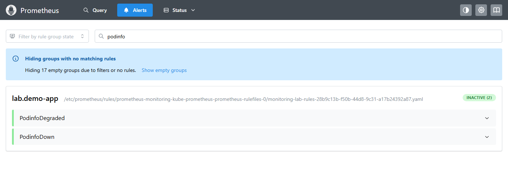

Wykres replik z ostatnich 15 minut – spadek do 0 w poziomie 6 i powrót do 3:

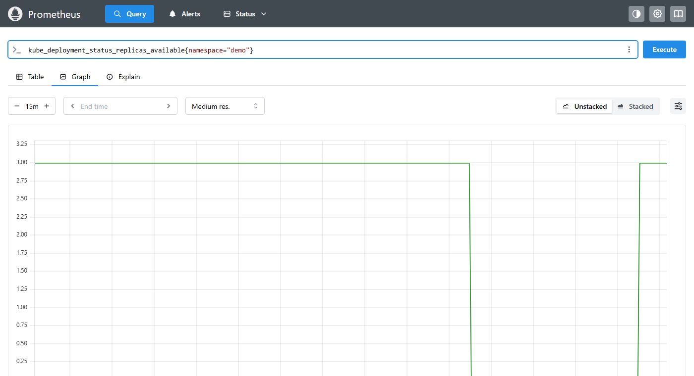

Aktywne wyciszenia po sprzątaniu: **0**.

**Odpowiedzi:**
- Wyciszenie nie zmienia reguły ani nie ukrywa problemu w Prometheusie – tylko zatrzymuje
  powiadomienia, na określony czas. Usunięcie reguły wyłączyłoby wykrywanie na zawsze, także
  wtedy, gdy ktoś zapomni ją przywrócić.
- Czas końca chroni przed wyciszeniem „zapomnianym” na tygodnie, a autor i komentarz mówią
  dyżurnemu, kto i dlaczego to zrobił.

## Poziom 8 – własny wykres w Grafanie

**Panel 1 – pamięć według namespace.** Grafana 12: **Dashboards → New → New dashboard** → po
prawej **Panel** (kafelek z plusem) → **Configure visualization**. Źródło danych Prometheus jest
wybrane od razu. Edytor zapytania przełączony na **Code**, zapytanie wpisane, **Run queries**,
potem typ wykresu **Time series**, tytuł i jednostka *Standard options → Unit → Data → bytes(IEC)*
(najszybciej przez lupę *Search options* i słowo `Unit`):

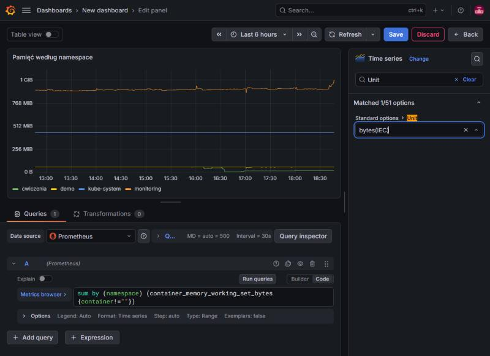

Bez jednostki oś pokazywałaby `1000000000`; z `bytes(IEC)` – `1 GiB`, `768 MiB`.

**Panel 2 – restarty w ostatniej godzinie**, wizualizacja **Table**:

```
sum by (pod) (increase(kube_pod_container_status_restarts_total[1h]))
```

W *Options* pod zapytaniem: **Type → Instant**, **Format → Table**. Zapytanie zakresowe (*Range*)
zwraca serię punktów dla każdego poda – tabela pokazałaby wtedy tylko jeden pod naraz. Zapytanie
chwilowe (*Instant*) daje jedną wartość na pod – jeden wiersz tabeli.

**Gotowy dashboard** po **Back** → **Save** → nazwa `Lab – mój dashboard`:

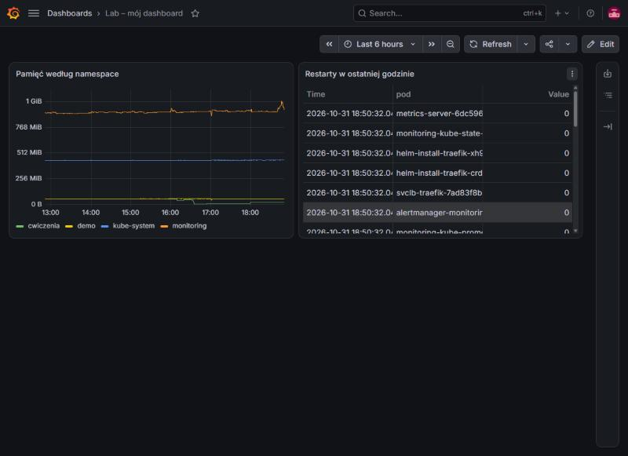

- `monitoring` – około 900 MiB–1 GiB, `kube-system` – około 450 MiB, `demo` – kilkadziesiąt MiB.
  Zielona linia `cwiczenia` pojawia się i znika – to namespace z ćwiczeń kubectl.
- Restarty: same **zera** – w ostatniej godzinie żaden kontener się nie restartował. Tak ma być.
  Po scenariuszu awarii z Etapu 5 (np. OOMKilled) w tej tabeli pojawi się liczba większa od zera.

To samo zapytanie co w panelu 1, wpisane w Prometheusie – wykres warstwowy (*Stacked*),
1 godzina, 30.10.2026:

```
sum by (namespace) (container_memory_working_set_bytes{container!=""})
```

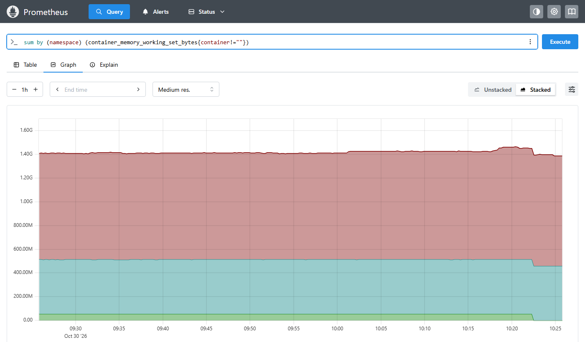

| Warstwa | Namespace | Pamięć |
|---|---|---|
| górna (czerwona) | `monitoring` | ~887 MiB |
| środkowa (turkusowa) | `kube-system` | ~439 MiB |
| dolna (zielona) | `demo` | ~24 MiB – **znika o 10:22 UTC**, gdy w poziomie 6 podinfo zeszło do 0 replik |

Monitoring zużywa dwa razy więcej pamięci niż cały system k3s – w Prometheusie i w Grafanie
widać to samo, bo Grafana pyta Prometheusa tym samym zapytaniem.

**Sprawdź się – odpowiedź:** `{container!=""}` odrzuca serie bez nazwy kontenera. cAdvisor
podaje pamięć osobno dla każdego kontenera **i** dodatkowo sumę dla całego poda (seria z pustym
`container`). Bez filtra każdy pod liczyłby się dwa razy, a wykres pokazywałby dwukrotnie
zawyżone wartości.

**Uwaga:** dashboard zapisany w Grafanie zniknie po restarcie poda Grafany – Grafana w labie nie
ma trwałego dysku.

---

## Jak powstały zrzuty – dla ciekawych

Zrzut strony bez otwierania okna przeglądarki:

```bash
msedge --headless=new --window-size=1400,900 --screenshot=plik.png http://192.168.180.51:30090/targets
```

Wystarcza dla stron, które rysują się od razu (tabele). Wykresy Prometheusa rysują się dopiero po
pobraniu danych, a `--screenshot` robi zdjęcie za wcześnie – pusty wykres. Dlatego przeglądarka
była sterowana przez **DevTools Protocol** (ten sam mechanizm, którego używają Playwright
i Puppeteer): skrypt w Node.js uruchamia Edge, otwiera stronę, czeka kilka sekund naprawdę
i dopiero wtedy prosi o zrzut. Takie testy „przez przeglądarkę” to codzienność w CI/CD.
