# Etap 3 – rozwiązania ćwiczeń: etykiety, ConfigMap, Secret i trwałe dane

Wykonanie poziomów z [ćwiczeń](09-cwiczenia-etykiety-configmap-pvc.md) na klastrze labu,
03.11.2026, z prawdziwymi wynikami i odpowiedziami na „Sprawdź się”. Zrób poziom sam, potem
porównaj.

**Jak powstały zrzuty.** Polecenia wykonał Claude przez SSH na masterze, w katalogu
`~/k3s-monitoring-lab`. Wyniki terminala zamieniono na obrazki skryptem
[tools/terminal-shot.sh](../../tools/terminal-shot.sh), a strony aplikacji sfotografowano Edge
bez okna ([tools/cdpshot.mjs](../../tools/cdpshot.mjs)). Podgląd katalogu na dysku workera zrobiono
przez Ansible z maszyny `monitoring` – Ty użyjesz `ssh -t k3s-worker-1 sudo ls …`. Czas w podach
to UTC (o godzinę mniej niż w Polsce).

---

## Poziom 1 – naklejki na podach

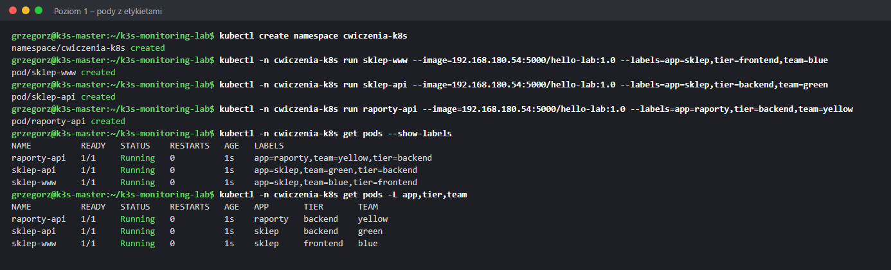

`--show-labels` pokazuje wszystkie etykiety w jednej kolumnie, posortowane alfabetycznie po
kluczu. `-L app,tier,team` robi z wybranych kluczy osobne kolumny – czytelniej, gdy etykiet
jest dużo (pody z Helma mają ich często 6–8).

**Odpowiedzi:**
- Nazwa jest jedna i unikalna w namespace; etykiet obiekt ma wiele, a tę samą etykietę może mieć
  wiele obiektów. Po nazwie wskazujesz **jeden** obiekt, po etykiecie – **grupę**.
- Przy wielu etykietach `-L` z kluczami, które Cię interesują.

## Poziom 2 – selektory

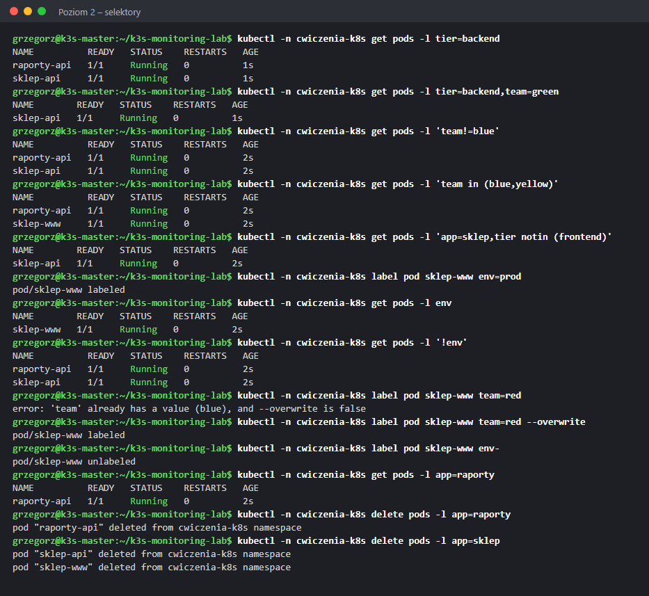

| Selektor | Wynik | Dlaczego |
|---|---|---|
| `tier=backend` | `raporty-api`, `sklep-api` | oba mają `tier=backend` |
| `tier=backend,team=green` | `sklep-api` | przecinek = **i** – oba warunki naraz |
| `'team!=blue'` | `raporty-api`, `sklep-api` | wszystko poza `blue` |
| `'team in (blue,yellow)'` | `raporty-api`, `sklep-www` | jedna z wartości = **lub** |
| `'app=sklep,tier notin (frontend)'` | `sklep-api` | sklep, ale nie frontend |
| `env` | `sklep-www` | jedyny pod z kluczem `env` (wartość dowolna) |
| `'!env'` | `raporty-api`, `sklep-api` | pody **bez** klucza `env` |

`label pod sklep-www team=red` bez `--overwrite` kończy się błędem – Kubernetes chroni przed
przypadkową zmianą. `env-` usuwa etykietę (`unlabeled`). `delete pods -l app=sklep` usunął
**dwa** pody jednym poleceniem – dlatego przed `delete -l` zawsze robisz `get -l`.

**Odpowiedzi:**
- Przecinek to „i”. „Lub” dla jednego klucza zapisujesz przez `in (a,b)`. „Lub” między różnymi
  kluczami (`app=x` albo `team=y`) w selektorze się nie da – robisz dwa zapytania.
- Bez apostrofów bash potraktuje nawiasy `( )` jako własną składnię i zgłosi błąd; `!` w `'!env'`
  bash wziąłby za odwołanie do historii poleceń.
- Żeby nie nadpisać czegoś przez pomyłkę – np. etykiety, po której Service szuka podów.

## Poziom 3 – etykiety łączą obiekty

W [sklep.yaml](../../kubernetes/cwiczenia-k8s/sklep.yaml) `app: sklep` występuje trzy razy:
`spec.selector.matchLabels` Deploymentu (które pody są „moje”), `spec.template.metadata.labels`
(jaką naklejkę dostaje każdy nowy pod) i `spec.selector` Service (dokąd wysyłać ruch).

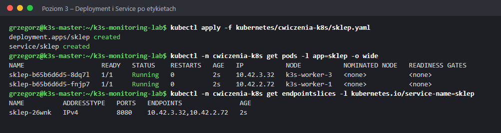

Dwa pody na dwóch węzłach; endpointy Service to dokładnie ich adresy (`10.42.3.32`, `10.42.2.72`).

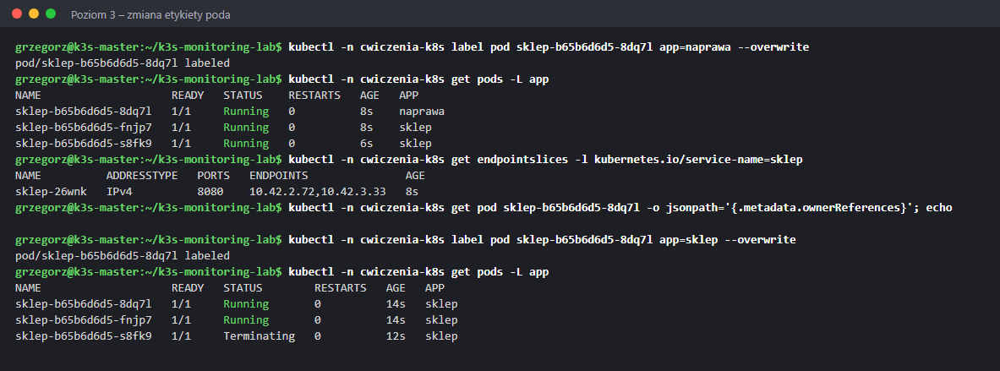

Co się stało po `app=naprawa`:

1. ReplicaSet liczy pody z `app=sklep` – zostały 1 z 2, więc w 2 sekundy utworzył nowy
   (`…-s8fk9`, `AGE 6s`).
2. Service też szuka po `app=sklep` – adres odklejonego poda (`10.42.3.32`) zniknął z endpointów,
   pojawił się adres nowego (`10.42.3.33`).
3. `ownerReferences` jest puste – pod nie ma już właściciela. Nikt go nie odtworzy ani nie
   usunie; żyje, dopóki go sam nie skasujesz.

Po przywróceniu `app=sklep` ReplicaSet znów go „adoptował”, zobaczył **3** pody zamiast 2
i jeden usunął – `…-s8fk9` dostał `Terminating`.

**Odpowiedzi:**
- ReplicaSet nie śledzi konkretnych podów, tylko **liczy** pody pasujące do selektora. Pod
  z inną etykietą dla niego nie istnieje.
- Nikt (`ownerReferences` puste) – to sierota.
- Przy nadmiarze ReplicaSet usuwa pody według kolejności: najpierw niegotowe, potem te, które
  działają najkrócej. Najmłodszy był `…-s8fk9`.
- Pod z chorą aplikacją odklejasz od Service (przestaje dostawać ruch), Deployment stawia zdrowy
  zamiennik, a Ty diagnozujesz chory pod (`logs`, `exec`) bez pośpiechu. Potem usuwasz go ręcznie.

## Poziom 4 – ConfigMap

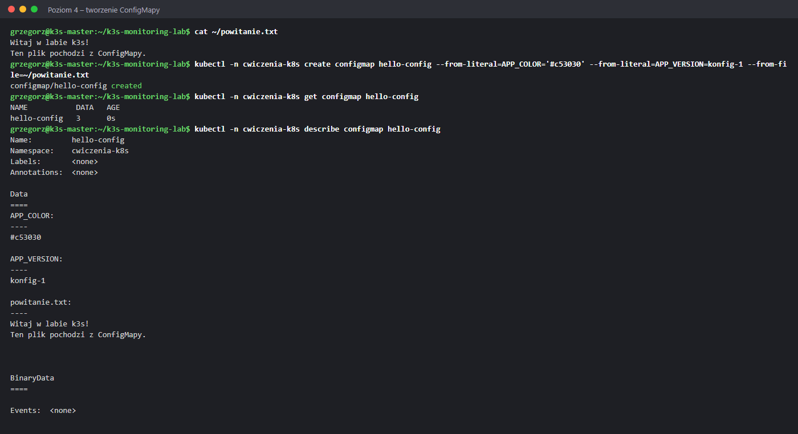

`DATA 3` – trzy klucze: dwa z `--from-literal` i jeden z `--from-file`, którego kluczem jest
**nazwa pliku** (`powitanie.txt`), a wartością cała treść.

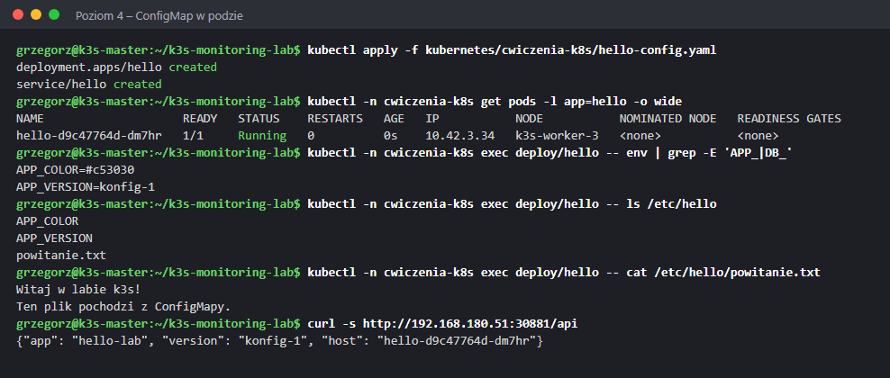

- `envFrom` zamienił każdy klucz na zmienną – stąd `APP_COLOR` i `APP_VERSION`.
- Wolumen `configMap` zamienił każdy klucz na plik w `/etc/hello` – stąd trzy pliki.
- `DB_HASLO` nie ma, bo Secretu `baza` jeszcze nie ma.

Strona `http://192.168.180.51:30881`:

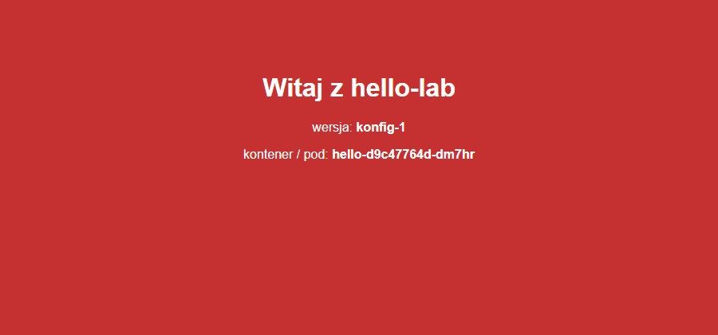

**Odpowiedzi:**
- Zmienne podane przez Kubernetes (`env`, `envFrom`) **nadpisują** `ENV` z Dockerfile. Ten sam
  obraz, inne ustawienia – o to chodzi w ConfigMapie.
- Kluczem jest nazwa pliku: `powitanie.txt`.
- W [hello-config.yaml](../../kubernetes/cwiczenia-k8s/hello-config.yaml) odwołanie do Secretu ma
  `optional: true`. Bez tego pod utknąłby w `CreateContainerConfigError`
  ([Etap 5, problem 3.6](../etap-5-scenariusze-awarii/02-typowe-awarie-kubernetesa.md#36-createcontainerconfigerror--brak-secretu-lub-configmapy)).

## Poziom 5 – zmiana konfiguracji

Zaraz po `patch` (13:44:01):

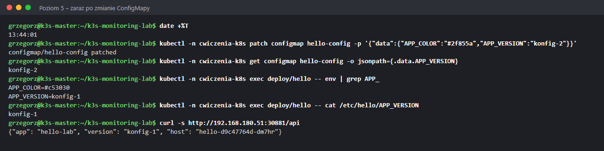

ConfigMapa ma już `konfig-2`, ale zmienne, plik i aplikacja – wszystko stare.

Po 52 sekundach (13:44:53):

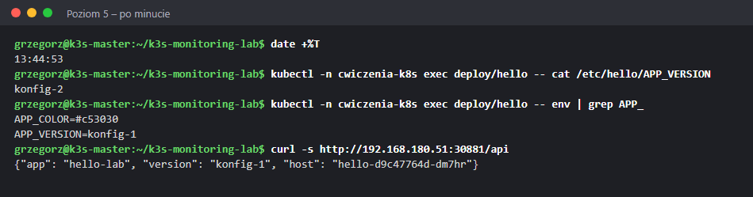

Plik `/etc/hello/APP_VERSION` ma już `konfig-2`, zmienne nadal stare, aplikacja dalej odpowiada
`konfig-1`. Strona wciąż czerwona:

Po `rollout restart`:

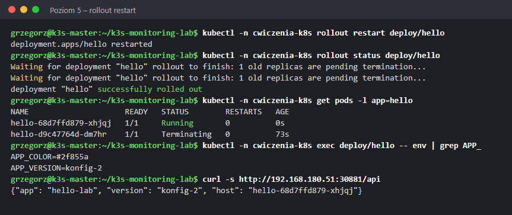

Nowy pod (`hello-68d7ffd879-xhjqj`) przy starcie dostał nowe zmienne:

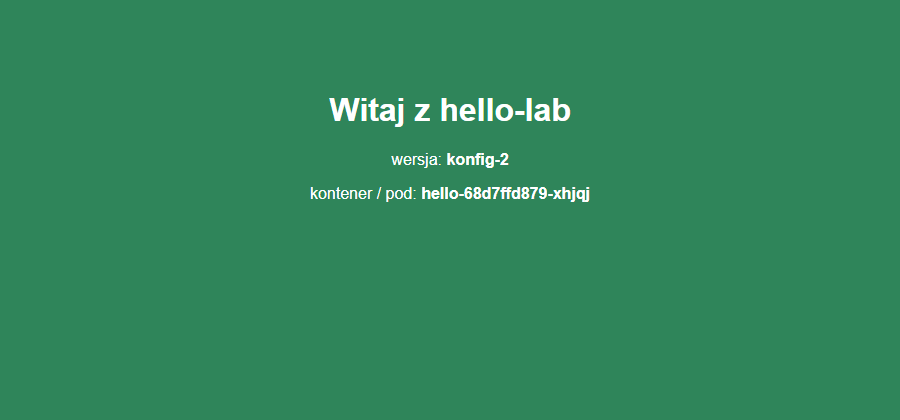

**Odpowiedzi:**
- W tym przebiegu 52 s (w innym teście w labie 77 s). Plik podmienił **kubelet** na węźle –
  co jakiś czas sprawdza, czy ConfigMapa się zmieniła, i aktualizuje wolumen.
- Zmienne środowiskowe ustawia się **raz**, przy starcie procesu. Działający proces nie dostaje
  nowych – potrzebny nowy kontener.
- Restart nie byłby potrzebny – plik zmienia się sam. Tak działają np. Prometheus i nginx po
  przeładowaniu konfiguracji. Wyjątek: wolumen zamontowany przez `subPath` nie aktualizuje się nigdy.

## Poziom 6 – Secret

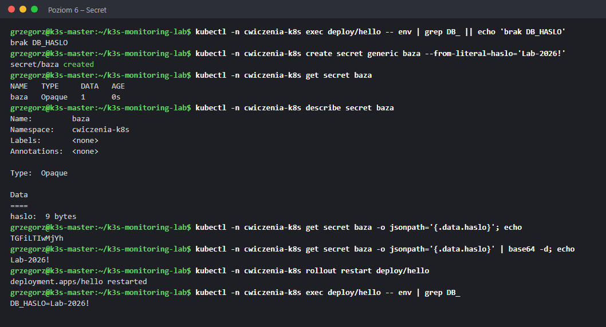

- `describe` ukrywa wartość (`haslo: 9 bytes`) – to tylko grzeczność wyświetlania.
- `-o jsonpath` pokazuje `TGFiLTIwMjYh`, a `base64 -d` zamienia to z powrotem na `Lab-2026!`.
- Po `rollout restart` pod ma `DB_HASLO=Lab-2026!` – `optional: true` pozwolił mu działać bez
  Secretu, a teraz Secret jest.

**Odpowiedzi:**
- Nie. base64 to tylko zapis (np. żeby zmieścić dane binarne), odwracalny bez klucza. W labie
  Secret przeczyta każdy, kto ma kubeconfig – a `/etc/rancher/k3s/k3s.yaml` ma uprawnienia `644`,
  więc każdy użytkownik mastera ([problem w Etapie 3](problemy.md#kubectl-działa-a-helm-nie-widzi-klastra)).
- Repozytorium jest publiczne, a historia gita pamięta wszystko. Poprawnie: Sealed Secrets lub
  SOPS (zaszyfrowany plik w gicie), zewnętrzny sejf (Vault), a w labie – `lab.env` poza gitem
  i Ansible Vault.
- Każdy, kto może `kubectl exec` do poda (polecenie `env`), oraz każdy proces w kontenerze.
  Zmienne trafiają też czasem do logów przy błędach. Bezpieczniej podawać Secret jako **plik**
  z wolumenu.

## Poziom 7 – własny trwały dysk

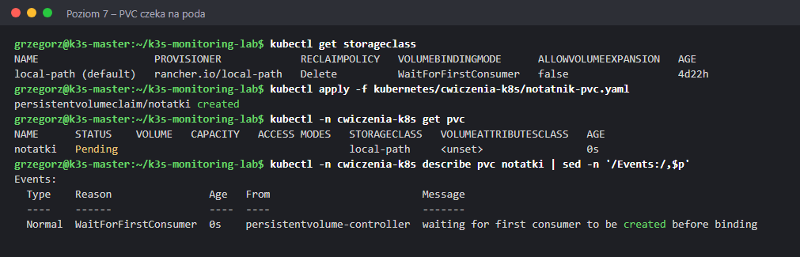

PVC jest `Pending`, a zdarzenie mówi wprost: `waiting for first consumer to be created before
binding`. Klasa `local-path` ma `VOLUMEBINDINGMODE WaitForFirstConsumer`.

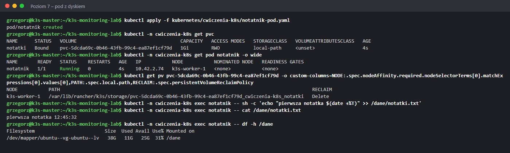

- Po starcie poda PVC jest `Bound`, a PV powstał na `k3s-worker-1` – tam, gdzie scheduler
  postawił pod.
- `PATH` pokazuje prawdziwy katalog: `/var/lib/rancher/k3s/storage/pvc-…_cwiczenia-k8s_notatki`.
- `df -h /dane` pokazuje cały dysk workera: 38G, wolne 25G.

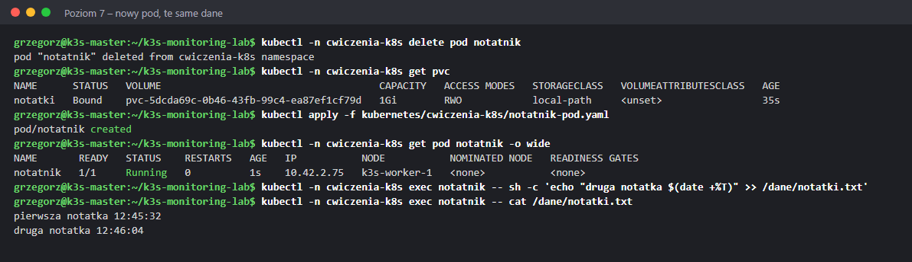

Po usunięciu poda PVC dalej jest `Bound`. Nowy pod (inny IP: `10.42.2.75`) stanął znów na
`k3s-worker-1` i widzi pierwszą notatkę; dopisał drugą.

Katalog na dysku workera (przez Ansible z `monitoring`):

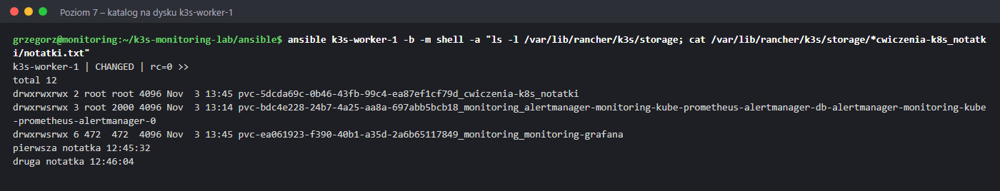

Obok notatek leżą dyski Grafany i Alertmanagera z [trwałych danych monitoringu](08-trwale-dane.md) –
też są na worker-1.

**Odpowiedzi:**
- `WaitForFirstConsumer`: dysk local-path to katalog na konkretnym węźle. Gdyby powstał od razu,
  np. na worker-3, a scheduler postawiłby pod na worker-1 – pod nie mógłby go użyć. Dlatego dysk
  powstaje dopiero tam, gdzie wyląduje pod.
- local-path to zwykły katalog na głównym dysku, bez limitu. `1Gi` w PVC to tylko opis wniosku.
  Prawdziwy dysk (EBS, Ceph RBD) miałby dokładnie 1Gi.
- PV ma `nodeAffinity` na `k3s-worker-1`, więc scheduler może postawić pod **tylko** tam.
  Gdyby worker-1 był wyłączony, pod czekałby w `Pending` aż do jego powrotu.

## Poziom 8 – sprzątanie i reclaimPolicy

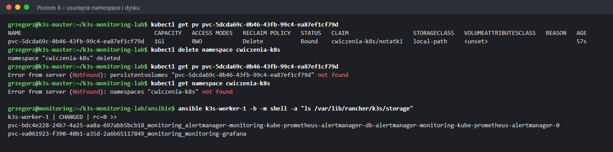

`kubectl delete namespace` usunął wszystko w środku: pody, Deploymenty, ConfigMapę, Secret
i PVC. Usunięcie PVC usunęło PV (`NotFound`), a provisioner skasował katalog na worker-1 – zostały
tylko dyski monitoringu.

**Odpowiedzi:**
- `RECLAIMPOLICY Delete` w klasie `local-path` (`kubectl get storageclass`): usunięcie PVC =
  usunięcie PV i danych.
- Przy `Retain` PV i katalog zostałyby (status `Released`), a dane trzeba by odzyskać lub usunąć
  ręcznie. W firmie `Retain` dla baz danych i wszystkiego, czego utrata boli – pomyłkowe
  `kubectl delete` nie skasuje danych.
- PVC należą do namespace. `cwiczenia-k8s` nie ma nic wspólnego z PVC w `monitoring`.
