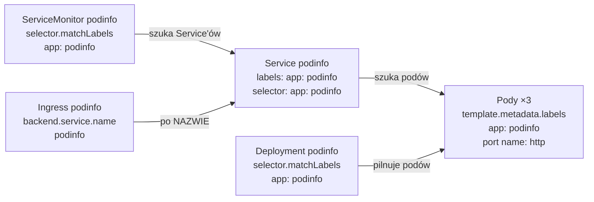

# Jak czytać i pisać YAML Kubernetesa – na przykładzie podinfo

Ten rozdział rozbiera na części cztery pliki aplikacji demo z
[kubernetes/demo-app/](../../kubernetes/demo-app/) i ServiceMonitor z
[kubernetes/monitoring/](../../kubernetes/monitoring/servicemonitor-podinfo.yaml).
Po nim wiesz, co znaczy każda linia, skąd ją wziąć i jak sprawdzić plik, zanim trafi do klastra.

Wszystkie wyniki pochodzą z labu (05.11.2026, `k3s-master`). Polecenia wpisujesz na 🐧 `k3s-master`
albo na 🪟 Windowsie, jeśli masz tam `kubectl`.

## Spis treści

1. [Najpierw składnia YAML – 5 zasad](#1-najpierw-składnia-yaml--5-zasad)
2. [Szkielet każdego obiektu: apiVersion, kind, metadata, spec](#2-szkielet-każdego-obiektu-apiversion-kind-metadata-spec)
3. [apiVersion i kind – co to za obiekt](#3-apiversion-i-kind--co-to-za-obiekt)
4. [metadata – kim jest obiekt](#4-metadata--kim-jest-obiekt)
5. [spec – czego od niego chcesz](#5-spec--czego-od-niego-chcesz)
6. [selector – jak obiekty się znajdują](#6-selector--jak-obiekty-się-znajdują)
7. [Deployment podinfo linia po linii](#7-deployment-podinfo-linia-po-linii)
8. [Service, Ingress i ServiceMonitor podinfo](#8-service-ingress-i-servicemonitor-podinfo)
9. [Jak napisać taki plik od zera – 4 sposoby](#9-jak-napisać-taki-plik-od-zera--4-sposoby)
10. [Sprawdź plik, zanim go wyślesz](#10-sprawdź-plik-zanim-go-wyślesz)
11. [Typowe błędy – prawdziwe komunikaty z labu](#11-typowe-błędy--prawdziwe-komunikaty-z-labu)
12. [Ćwiczenie: podinfo-v2 od zera](#12-ćwiczenie-podinfo-v2-od-zera)
13. [Pytania, które mogą paść na rozmowie](#13-pytania-które-mogą-paść-na-rozmowie)

## 1. Najpierw składnia YAML – 5 zasad

YAML to zwykły tekst, w którym **wcięcie mówi, co do czego należy**. Kubernetes potrzebuje tylko kilku elementów:

| Zasada | Przykład | Co znaczy |
|---|---|---|
| `klucz: wartość` | `name: podinfo` | pole i jego wartość; **spacja po dwukropku obowiązkowa** |
| wcięcie = „należy do” | `metadata:` → niżej `  name: podinfo` | `name` jest częścią `metadata`; **tylko spacje, nigdy tabulator**, zwykle 2 |
| myślnik = element listy | `- name: http` | kolejny element listy (np. kolejny kontener, kolejny port) |
| `#` | `# komentarz` | komentarz, Kubernetes go pomija |
| `---` | między obiektami | kilka obiektów w jednym pliku |

Najczęściej mylone: **słownik** (mapa) a **lista**.

```yaml
labels:            # słownik: każdy klucz najwyżej raz, kolejność bez znaczenia
  app: podinfo
  tier: web

ports:             # lista: elementy zaczynają się od "-", może ich być dowolnie wiele
  - name: http
    containerPort: 9898
  - name: grpc
    containerPort: 9999
```

Wszystko, co stoi pod jednym myślnikiem z tym samym wcięciem, to **jeden element** listy
(`name: http` i `containerPort: 9898` opisują ten sam port).

> Skąd wiedzieć, czy pole ma być słownikiem, czy listą? `kubectl explain` pokazuje typ:
> `<map[string]string>` to słownik, `<[]Container>` (nawiasy `[]`) to lista. Więcej w [rozdziale 9](#9-jak-napisać-taki-plik-od-zera--4-sposoby).

## 2. Szkielet każdego obiektu: apiVersion, kind, metadata, spec

Każdy obiekt w Kubernetesie – Deployment, Service, Ingress, ServiceMonitor – ma te same **cztery pola
na najwyższym poziomie**:

```yaml
apiVersion: apps/v1      # 1. w jakiej wersji API opisany jest ten typ
kind: Deployment         # 2. jaki to typ obiektu
metadata:                # 3. KIM jest obiekt: nazwa, namespace, etykiety
  name: podinfo
  namespace: demo
spec:                    # 4. CZEGO chcesz: stan docelowy (różny dla każdego typu)
  replicas: 3
  ...
```

Jest jeszcze piąte pole – **`status`** – ale **nie piszesz go Ty**. Wypełnia je klaster i opisuje, co
jest naprawdę. Kontroler cały czas porównuje `spec` (chcę) ze `status` (jest) i poprawia różnicę.

Prawdziwy wynik z labu – to samo widać w opisie typu:

```text
$ kubectl explain deployment
GROUP:      apps
KIND:       Deployment
VERSION:    v1
...
FIELDS:
  apiVersion	<string>
  kind	<string>
  metadata	<ObjectMeta>
  spec	<DeploymentSpec>
    Specification of the desired behavior of the Deployment.
  status	<DeploymentStatus>
    Most recently observed status of the Deployment.
```

## 3. apiVersion i kind – co to za obiekt

`kind` to typ obiektu, pisany **WielkąLiterą** (CamelCase): `Deployment`, `Service`, `Ingress`.
`apiVersion` mówi, w której **grupie API** ten typ mieszka i w jakiej wersji. Nie zgadujesz jej –
odczytujesz z klastra:

```text
$ kubectl api-resources | grep -E "^(NAME|deployments|services|ingresses|namespaces|servicemonitors|pods) "
NAME              SHORTNAMES   APIVERSION                 NAMESPACED   KIND
namespaces        ns           v1                         false        Namespace
pods              po           v1                         true         Pod
services          svc          v1                         true         Service
deployments       deploy       apps/v1                    true         Deployment
servicemonitors   smon         monitoring.coreos.com/v1   true         ServiceMonitor
ingresses         ing          networking.k8s.io/v1       true         Ingress
```

**Polecenia ze zrzutu:** `kubectl api-resources` wypisuje wszystkie typy, które zna klaster.
`grep -E "^(…|…) "` zostawia tylko wiersze zaczynające się (`^`) od jednej z podanych nazw (`|` = „albo”).

| Kolumna | Co z niej bierzesz |
|---|---|
| `APIVERSION` | wartość do pola `apiVersion` |
| `KIND` | wartość do pola `kind` |
| `NAMESPACED` | `true` – obiekt należy do namespace'u i trzeba podać `namespace`; `false` – obiekt jest dla całego klastra (Namespace, Node) |
| `SHORTNAMES` | skróty do `kubectl`: `kubectl get deploy`, `kubectl get smon` |

Jak to czytać:

| apiVersion | Grupa | Wersja | Przykład |
|---|---|---|---|
| `v1` | „core” – grupa podstawowa, bez nazwy | v1 | Pod, Service, Namespace, ConfigMap, Secret |
| `apps/v1` | `apps` | v1 | Deployment, StatefulSet, DaemonSet |
| `networking.k8s.io/v1` | `networking.k8s.io` | v1 | Ingress |
| `monitoring.coreos.com/v1` | `monitoring.coreos.com` | v1 | ServiceMonitor – **typ dodany przez CRD** z kube-prometheus-stack |

Ostatni wiersz jest ważny: `ServiceMonitor` nie jest wbudowany w Kubernetesa. Istnieje tylko dlatego, że
chart zainstalował CRD ([teoria, rozdział 15](03-teoria-kubernetes-helm.md#15-crd--nowe-słowa-w-słowniku-kubernetesa)).
Na czystym klastrze ten plik dałby błąd `no matches for kind` – patrz [rozdział 11](#11-typowe-błędy--prawdziwe-komunikaty-z-labu).

## 4. metadata – kim jest obiekt

```yaml
metadata:
  name: podinfo          # nazwa – unikalna w obrębie namespace'u i typu
  namespace: demo        # w którym "folderze" leży obiekt
  labels:                # etykiety – po nich inne obiekty szukają tego obiektu
    app: podinfo
  annotations:           # adnotacje – notatki dla narzędzi, NIE służą do wyszukiwania
    opis: "aplikacja demo"
```

| Pole | Obowiązkowe? | Zasady |
|---|---|---|
| `name` | tak | małe litery, cyfry, `-`, `.`; max 253 znaki (dla Service 63). Dwa Deploymenty `podinfo` w jednym namespace = konflikt; Deployment `podinfo` i Service `podinfo` – w porządku (inny typ) |
| `namespace` | nie | bez niego obiekt trafi do namespace'u `default` (albo tego z `kubectl -n …`). W plikach labu zawsze wpisujemy go jawnie – plik zawsze ląduje tam, gdzie trzeba |
| `labels` | nie, ale w praktyce zawsze | słownik `klucz: wartość`; **na nich opierają się selektory** |
| `annotations` | nie | dowolne notatki, np. dla Traefika, Prometheusa, historii `kubectl apply` |

Część `metadata` uzupełnia klaster. Prawdziwy Service podinfo pobrany z labu
(`kubectl get svc podinfo -n demo -o yaml`, skrócone):

```yaml
metadata:
  annotations:
    kubectl.kubernetes.io/last-applied-configuration: |   # dopisał kubectl apply: Twoja ostatnia wersja pliku
      {"apiVersion":"v1","kind":"Service",...}
  creationTimestamp: "2026-10-30T08:49:02Z"    # klaster: kiedy powstał
  labels:
    app: podinfo                               # Twoje
  name: podinfo                                # Twoje
  namespace: demo                              # Twoje
  resourceVersion: "14585"                     # klaster: numer wersji obiektu
  uid: 35c137cd-73d4-4029-b90f-c55ab273eb82    # klaster: unikalny identyfikator
```

Dlatego **nie kopiuj na ślepo** wyniku `kubectl get -o yaml` do repozytorium – pola `uid`,
`resourceVersion`, `creationTimestamp` i `status` usuwasz ([rozdział 9](#9-jak-napisać-taki-plik-od-zera--4-sposoby)).

## 5. spec – czego od niego chcesz

`spec` to jedyna część, która **dla każdego typu wygląda inaczej**. To „zamówienie”:

| kind | Co mówi `spec` w podinfo |
|---|---|
| Namespace | nic – nie ma `spec`, wystarczy nazwa |
| Deployment | „trzymaj 3 pody z takim kontenerem, aktualizuj po jednym” |
| Service | „daj stały adres podom z etykietą `app: podinfo`, port 9898, z zewnątrz 30898” |
| Ingress | „ruch na `podinfo.lab.local` kieruj do Service'u `podinfo`” |
| ServiceMonitor | „Prometheusie, zbieraj `/metrics` z Service'ów z etykietą `app: podinfo`” |

Jakie pola wolno wpisać do `spec`? To zależy od typu, a podpowiada `kubectl explain`
(`kubectl explain deployment.spec`, `kubectl explain service.spec.ports`). Nie trzeba ich pamiętać.

## 6. selector – jak obiekty się znajdują

Obiekty w Kubernetesie **nie łączą się po nazwach ani po adresach IP**, tylko przez etykiety:
jeden obiekt ma etykiety (`labels`), drugi ma **selector** – zapytanie „szukam wszystkiego z takimi etykietami”.

W podinfo ta sama etykieta `app: podinfo` spina **cztery** obiekty:



| Kto szuka | Gdzie w pliku | Czego szuka | Zapis |
|---|---|---|---|
| Deployment | `spec.selector.matchLabels` | swoich podów | `matchLabels:` (z „match”) |
| Service | `spec.selector` | podów, do których wysłać ruch | **bez** `matchLabels` – sam słownik |
| ServiceMonitor | `spec.selector.matchLabels` | **Service'ów** (nie podów!) | `matchLabels:` |
| topologySpreadConstraints | `labelSelector.matchLabels` | podów do równego rozłożenia | `matchLabels:` |
| Ingress | `backend.service.name` | Service'u – **wyjątek: po nazwie** | `name: podinfo` |

Dlaczego Service pisze selector inaczej? Service to jeden z najstarszych typów (`v1`), z czasów, gdy
selektor był zwykłym słownikiem. Nowsze typy (`apps/v1`) używają obiektu `LabelSelector`, który obok
`matchLabels` pozwala na `matchExpressions`, np. „etykieta `tier` ma wartość `web` albo `api`”:

```yaml
selector:
  matchExpressions:
    - key: tier
      operator: In        # In, NotIn, Exists, DoesNotExist
      values: [web, api]
```

Prawdziwy opis z labu:

```text
$ kubectl explain deployment.spec.selector
FIELD: selector <LabelSelector>
DESCRIPTION:
    Label selector for pods. Existing ReplicaSets whose pods are selected by
    this will be the ones affected by this deployment. It must match the pod
    template's labels.
    ...The result of matchLabels and matchExpressions are ANDed. An empty label selector matches
    all objects. A null label selector matches no objects.
```

Trzy rzeczy z tego opisu, które warto zapamiętać:

1. Selektor Deploymentu **musi pasować** do etykiet w `template` (inaczej błąd – [rozdział 11](#11-typowe-błędy--prawdziwe-komunikaty-z-labu)).
2. Kilka etykiet w selektorze = **wszystkie naraz** (AND). `app: podinfo` + `tier: web` znajdzie tylko pody z obiema.
3. Selektor Deploymentu po utworzeniu jest **niezmienny** – żeby go zmienić, usuwasz Deployment i tworzysz od nowa.

Drugie połączenie po nazwie to **port**: Service ma `targetPort: http`, a kontener ma port nazwany `http`.
Gdy zmienisz numer portu w kontenerze, Service, sondy i Ingress dalej działają – szukają po nazwie.

## 7. Deployment podinfo linia po linii

Plik [10-deployment.yaml](../../kubernetes/demo-app/10-deployment.yaml). Kluczowa jest budowa
„obiekt w obiekcie”: **Deployment zawiera szablon poda** (`template`), a szablon ma własne `metadata` i `spec`.

```yaml
apiVersion: apps/v1                # Deployment mieszka w grupie apps
kind: Deployment
metadata:                          # ── metadata DEPLOYMENTU
  name: podinfo
  namespace: demo
  labels:
    app: podinfo                   # etykieta samego Deploymentu (do kubectl get deploy -l app=podinfo)
spec:                              # ── spec DEPLOYMENTU: czego chcę od Deploymentu
  replicas: 3                      # ile podów ma działać
  revisionHistoryLimit: 5          # ile starych wersji trzymać do "rollout undo"
  selector:
    matchLabels:
      app: podinfo                 # "moje są pody z app=podinfo"  ◄──┐ muszą
  strategy:                        #                                  │ być
    type: RollingUpdate            # aktualizacja po kawałku          │ zgodne
    rollingUpdate:                 #                                  │
      maxUnavailable: 1            # najwyżej 1 pod naraz wyłączony   │
      maxSurge: 1                  # najwyżej 1 pod ponad 3 w trakcie │
  template:                        # ── SZABLON PODA: z niego powstaje każdy pod
    metadata:                      #    metadata PODA                 │
      labels:                      #                                  │
        app: podinfo               # każdy nowy pod dostaje tę etykietę ┘
    spec:                          # ── spec PODA: jakie kontenery uruchomić
      topologySpreadConstraints:   # rozłóż pody równo na węzłach
        - maxSkew: 1               #   różnica liczby podów między węzłami najwyżej 1
          topologyKey: kubernetes.io/hostname   # "węzeł" = różna wartość tej etykiety węzła
          whenUnsatisfiable: ScheduleAnyway     # jak się nie da – uruchom mimo to
          labelSelector:
            matchLabels:
              app: podinfo         #   licz tylko pody podinfo
      containers:                  # LISTA kontenerów (stąd "-" niżej)
        - name: podinfo            # nazwa kontenera w podzie
          image: ghcr.io/stefanprodan/podinfo:6.7.1   # obraz z KONKRETNĄ wersją, nie :latest
          ports:
            - name: http           # nazwa portu – używana przez sondy, Service i ServiceMonitor
              containerPort: 9898  # na tym porcie słucha aplikacja
          readinessProbe:          # "czy przyjmować ruch?" – nie: pod znika z Service'u
            httpGet:
              path: /readyz
              port: http           # port po nazwie
            initialDelaySeconds: 3
            periodSeconds: 5
          livenessProbe:           # "czy żyje?" – nie: kubelet restartuje kontener
            httpGet:
              path: /healthz
              port: http
            initialDelaySeconds: 5
            periodSeconds: 10
          resources:
            requests:              # gwarantowane minimum – scheduler szuka węzła, który tyle ma
              cpu: 50m             # 50 milicore = 5% jednego rdzenia
              memory: 64Mi
            limits:                # twardy sufit
              cpu: 200m            # ponad to – dławienie (throttling)
              memory: 128Mi        # ponad to – OOMKilled
```

Jak to zapamiętać: **dwa poziomy, dwa razy `metadata` i `spec`**.

```
Deployment
├── metadata        ← kim jest Deployment
└── spec            ← czego chcę od Deploymentu (ile, jak aktualizować, które pody moje)
    └── template    ← przepis na pod
        ├── metadata   ← kim będzie każdy pod (etykiety!)
        └── spec       ← co działa w podzie (kontenery, sondy, zasoby)
```

Ta sama budowa jest w StatefulSet, DaemonSet, Job i CronJob – jak umiesz jedno, umiesz wszystkie.

## 8. Service, Ingress i ServiceMonitor podinfo

### Service – [20-service.yaml](../../kubernetes/demo-app/20-service.yaml)

```yaml
apiVersion: v1                     # Service jest w grupie core
kind: Service
metadata:
  name: podinfo                    # ← po tej NAZWIE znajdzie go Ingress
  namespace: demo
  labels:
    app: podinfo                   # ← po tej ETYKIECIE znajdzie go ServiceMonitor
spec:
  type: NodePort                   # dostęp także z zewnątrz, przez port na każdym węźle
  selector:                        # ← do których podów wysyłać ruch (bez matchLabels!)
    app: podinfo
  ports:
    - name: http                   # ← po tej NAZWIE szuka ServiceMonitor (endpoints.port)
      port: 9898                   # port Service'u w klastrze (10.43.36.134:9898)
      targetPort: http             # port w podzie – po nazwie z containerPort
      nodePort: 30898              # port na każdym węźle (192.168.180.51:30898)
```

Trzy porty, które się myli:

| Pole | Gdzie słucha | Przykład z labu |
|---|---|---|
| `nodePort` | na każdym węźle, z zewnątrz | `http://192.168.180.51:30898` |
| `port` | na adresie Service'u w klastrze | `http://podinfo.demo:9898` |
| `targetPort` | w kontenerze | `http://10.42.x.x:9898` |

### Ingress – [30-ingress.yaml](../../kubernetes/demo-app/30-ingress.yaml)

```yaml
apiVersion: networking.k8s.io/v1
kind: Ingress
metadata:
  name: podinfo
  namespace: demo                  # Ingress widzi Service'y tylko z własnego namespace'u
spec:
  ingressClassName: traefik        # który kontroler Ingress ma obsłużyć regułę (w k3s: Traefik)
  rules:                           # lista reguł
    - host: podinfo.lab.local      # dla tej domeny...
      http:
        paths:                     # lista ścieżek
          - path: /                # ...dla wszystkiego od "/"...
            pathType: Prefix       # Prefix = "/" i wszystko pod spodem; Exact = tylko dokładnie ta ścieżka
            backend:
              service:
                name: podinfo      # ...wyślij do Service'u podinfo (po NAZWIE)
                port:
                  name: http       # na jego port "http"
```

### ServiceMonitor – [servicemonitor-podinfo.yaml](../../kubernetes/monitoring/servicemonitor-podinfo.yaml)

```yaml
apiVersion: monitoring.coreos.com/v1   # typ z CRD kube-prometheus-stack
kind: ServiceMonitor
metadata:
  name: podinfo
  namespace: demo
  labels:
    app: podinfo
spec:
  selector:
    matchLabels:
      app: podinfo                 # szukaj SERVICE'ÓW z tą etykietą
  namespaceSelector:
    matchNames:
      - demo                       # tylko w namespace demo
  endpoints:                       # lista: skąd brać metryki
    - port: http                   # NAZWA portu Service'u (nie numer!)
      path: /metrics
      interval: 15s                # co ile pobierać
```

Ten łańcuch możesz poklikać w [symulatorze ServiceMonitor](07-symulator-servicemonitor.html).

## 9. Jak napisać taki plik od zera – 4 sposoby

Nikt nie pisze YAML-a z pamięci. W pracy używa się tych czterech sposobów, zwykle razem.

### Sposób 1: wygeneruj szkielet poleceniem (`--dry-run=client -o yaml`)

`kubectl create` z `--dry-run=client` **niczego nie tworzy** – tylko wypisuje YAML, który by wysłał.
Prawdziwy wynik z labu:

```text
$ kubectl create deployment podinfo --image=ghcr.io/stefanprodan/podinfo:6.7.1 \
    --replicas=3 --port=9898 -n demo --dry-run=client -o yaml
apiVersion: apps/v1
kind: Deployment
metadata:
  labels:
    app: podinfo
  name: podinfo
  namespace: demo
spec:
  replicas: 3
  selector:
    matchLabels:
      app: podinfo
  strategy: {}
  template:
    metadata:
      labels:
        app: podinfo
    spec:
      containers:
      - image: ghcr.io/stefanprodan/podinfo:6.7.1
        name: podinfo
        ports:
        - containerPort: 9898
        resources: {}
status: {}
```

**Polecenia ze zrzutu:** `kubectl create deployment NAZWA` – utwórz Deployment; `--image` – obraz;
`--replicas=3` – liczba podów; `--port=9898` – `containerPort`; `-n demo` – namespace;
`--dry-run=client` – tylko pokaż, nie wysyłaj; `-o yaml` – wynik jako YAML. `\` na końcu linii
oznacza „polecenie ciągnie się w następnej linii”.

Zwróć uwagę: `kubectl` **sam** dobrał etykietę `app: podinfo` i ustawił zgodny `selector` i `template`.
Zapisujesz to do pliku i dopisujesz resztę (sondy, zasoby, nazwę portu):

```bash
kubectl create deployment podinfo --image=ghcr.io/stefanprodan/podinfo:6.7.1 \
  --replicas=3 --port=9898 -n demo --dry-run=client -o yaml > 10-deployment.yaml
```

Do usunięcia: `status: {}`, `strategy: {}` i `resources: {}` (puste – nic nie wnoszą).

Tak samo Service:

```text
$ kubectl create service nodeport podinfo --tcp=9898:9898 --node-port=30898 -n demo --dry-run=client -o yaml
apiVersion: v1
kind: Service
metadata:
  labels:
    app: podinfo
  name: podinfo
  namespace: demo
spec:
  ports:
  - name: 9898-9898
    nodePort: 30898
    port: 9898
    protocol: TCP
    targetPort: 9898
  selector:
    app: podinfo
  type: NodePort
status:
  loadBalancer: {}
```

Tu poprawiasz ręcznie: `name: 9898-9898` → `name: http`, `targetPort: 9898` → `targetPort: http`.

> `kubectl` zapisuje listy bez dodatkowego wcięcia (`- name:` równo z `ports:`), a w repozytorium
> piszemy z wcięciem (`  - name:`). **Oba zapisy są poprawne** – YAML akceptuje jeden i drugi, byle
> w jednym pliku konsekwentnie.

Polecenia, które generują szkielety:

| Obiekt | Polecenie (zawsze z `--dry-run=client -o yaml`) |
|---|---|
| Deployment | `kubectl create deployment NAZWA --image=OBRAZ --replicas=N --port=P` |
| Service | `kubectl create service nodeport\|clusterip NAZWA --tcp=PORT:TARGET` albo `kubectl expose deployment NAZWA --port=P` |
| Ingress | `kubectl create ingress NAZWA --class=traefik --rule="host/ścieżka=service:port"`; dla podinfo: `--rule="podinfo.lab.local/*=podinfo:http"` (`/*` daje `pathType: Prefix`) |
| ConfigMap | `kubectl create configmap NAZWA --from-literal=KLUCZ=WARTOŚĆ` |
| Secret | `kubectl create secret generic NAZWA --from-literal=KLUCZ=WARTOŚĆ` |
| Namespace | `kubectl create namespace NAZWA` |
| Pod | `kubectl run NAZWA --image=OBRAZ` |

### Sposób 2: `kubectl explain` – wbudowana dokumentacja

Gdy nie wiesz, jak nazywa się pole albo co do niego wpisać:

```bash
kubectl explain deployment.spec                       # pola spec Deploymentu
kubectl explain deployment.spec.template.spec.containers.readinessProbe
kubectl explain service.spec.ports                    # pola jednego portu Service'u
kubectl explain servicemonitor.spec.endpoints         # działa też dla typów z CRD
kubectl explain deployment --recursive | less         # całe drzewo pól naraz
```

Ścieżkę budujesz tak jak wcięcia w YAML-u – kropka = „poziom niżej”.

### Sposób 3: przykład z dokumentacji

[kubernetes.io/docs](https://kubernetes.io/docs/concepts/workloads/controllers/deployment/) ma przy każdym
typie gotowy przykład. W VS Code rozszerzenie **YAML (Red Hat)** z ustawieniem schematu Kubernetesa
podpowiada pola i podkreśla literówki.

### Sposób 4: skopiuj działający obiekt z klastra

```bash
kubectl get svc podinfo -n demo -o yaml > service.yaml
```

To dobry sposób, gdy obiekt utworzył ktoś inny albo Helm. Przed zapisaniem do gita **wytnij pola od
klastra**: `status`, `metadata.uid`, `resourceVersion`, `creationTimestamp`, `generation`,
adnotację `last-applied-configuration`, a w Service także `clusterIP` i `clusterIPs`
(inaczej plik nie zadziała na innym klastrze).

## 10. Sprawdź plik, zanim go wyślesz

Trzy poziomy kontroli – od najsłabszej do najmocniejszej:

| Polecenie | Co sprawdza | Kto sprawdza |
|---|---|---|
| `kubectl apply --dry-run=client -f plik.yaml` | składnię YAML, czy `kind` i `apiVersion` istnieją | Twój `kubectl` |
| `kubectl apply --dry-run=server -f plik.yaml` | **wszystko** – nieznane pola, zgodność selektora, typy wartości, CRD | API server – ale nic nie zapisuje |
| `kubectl diff -f plik.yaml` | co **dokładnie zmieni się** w klastrze po `apply` | API server |

Prawdziwy wynik z labu – cały folder podinfo:

```text
$ kubectl apply --dry-run=server -f ~/k3s-monitoring-lab/kubernetes/demo-app/
namespace/demo unchanged (server dry run)
deployment.apps/podinfo configured (server dry run)
service/podinfo unchanged (server dry run)
ingress.networking.k8s.io/podinfo unchanged (server dry run)
```

`unchanged` = plik zgadza się z klastrem. `configured` = coś by się zmieniło. Co dokładnie? `kubectl diff`:

```text
$ kubectl diff -f ~/k3s-monitoring-lab/kubernetes/demo-app/10-deployment.yaml
--- /tmp/LIVE-25225332/apps.v1.Deployment.demo.podinfo
+++ /tmp/MERGED-306172132/apps.v1.Deployment.demo.podinfo
@@ -15,7 +15,7 @@
 spec:
   progressDeadlineSeconds: 600
-  replicas: 0
+  replicas: 3
```

**Jak czytać:** `-` to stan w klastrze (LIVE), `+` to stan po `apply` (MERGED). Tu widać, że w labie
podinfo jest przeskalowany do 0 (zostało po ćwiczeniu z alertem `PodinfoDown`), a plik w repozytorium
mówi 3. `kubectl apply -f` przywróciłby 3 repliki.

> Nawyk z pracy: **przed każdym `apply` na produkcji – `diff`**. To samo robi Argo CD z Etapu 7:
> pokazuje różnicę między gitem a klastrem.

## 11. Typowe błędy – prawdziwe komunikaty z labu

Każdy plik poniżej sprawdzony w labie przez `kubectl apply --dry-run=server` (nic nie zostało utworzone).

### Selektor nie pasuje do etykiet szablonu

```yaml
spec:
  selector:
    matchLabels:
      app: podinfo-test        # ← szukam podinfo-test
  template:
    metadata:
      labels:
        app: podinfo           # ← a pody dostają podinfo
```

```text
The Deployment "podinfo-test" is invalid: spec.template.metadata.labels: Invalid value: {"app":"podinfo"}: `selector` does not match template `labels`
```

**Naprawa:** ta sama etykieta w `selector.matchLabels` i w `template.metadata.labels`.

### Literówka w nazwie pola

```yaml
spec:
  replica: 3                   # ← powinno być replicas
```

```text
Error from server (BadRequest): error when creating "literowka.yaml": Deployment in version "v1" cannot be handled as a Deployment: strict decoding error: unknown field "spec.replica"
```

**Naprawa:** komunikat podaje pełną ścieżkę błędnego pola (`spec.replica`). Sprawdź właściwą nazwę:
`kubectl explain deployment.spec`.

> Uwaga: `--dry-run=client` takiej literówki **nie złapie** – tylko serwer zna wszystkie pola.
> Ten sam plik sprawdzony po stronie klienta w labie: `deployment.apps/t created (dry run)`, kod wyjścia 0.

### Złe wcięcie

```yaml
spec:
  selector:
    app: podinfo
   ports:                      # ← 3 spacje zamiast 2
    - port: 9898
```

```text
error: error parsing wciecie.yaml: error converting YAML to JSON: yaml: line 8: did not find expected key
```

**Naprawa:** komunikat podaje numer linii (8). Błąd bywa linię wyżej lub niżej – sprawdź, czy
pola na tym samym poziomie mają **identyczne** wcięcie. Pomaga `cat -A plik.yaml` – tabulator
widać jako `^I`.

### Zła para apiVersion + kind

```yaml
apiVersion: v1                 # ← Deployment nie jest w v1, tylko w apps/v1
kind: Deployment
```

```text
error: resource mapping not found for name: "podinfo-test" namespace: "" from "zly-kind.yaml": no matches for kind "Deployment" in version "v1"
ensure CRDs are installed first
```

**Naprawa:** `kubectl api-resources | grep -i deployment` i weź `APIVERSION`. Ten sam błąd zobaczysz
przy `ServiceMonitor` na klastrze bez kube-prometheus-stack – wtedy podpowiedź „ensure CRDs are
installed first” jest trafna.

### Błędy, których `apply` NIE zgłosi

Najgroźniejsze, bo plik jest poprawny, a aplikacja nie działa:

| Błąd | Co się dzieje | Jak wykryć |
|---|---|---|
| selektor Service'u nie pasuje do podów | Service bez podów, `curl` wisi albo `Connection refused` | `kubectl get endpointslices -n demo` – puste |
| selektor ServiceMonitora nie pasuje do Service'u | brak celu w Prometheusie, **bez błędu** | Prometheus → Status → Target health |
| `targetPort` / `endpoints.port` z nazwą, której nie ma | brak ruchu / brak celu | porównaj nazwy portów w trzech plikach |
| zły obraz | `ImagePullBackOff` | `kubectl describe pod` → Events |

## 12. Ćwiczenie: podinfo-v2 od zera

**Cel:** napisać samodzielnie Deployment i Service drugiej wersji podinfo w osobnym namespace,
nie kopiując plików z repozytorium.

1. 🐧 `k3s-master`: utwórz katalog `~/yaml-cwiczenie` i namespace `yaml-lab`
   (szkielet: `kubectl create namespace yaml-lab --dry-run=client -o yaml`).
2. Wygeneruj szkielet Deploymentu `podinfo-v2` (2 repliki, obraz `ghcr.io/stefanprodan/podinfo:6.7.1`,
   port 9898) do pliku `deployment.yaml`.
3. Dopisz ręcznie: etykietę `wersja: v2` (w **obu** miejscach – selektor i szablon), nazwę portu `http`,
   `readinessProbe` na `/readyz` i limity `memory: 128Mi`. Nazwy pól sprawdzaj w `kubectl explain`.
4. Wygeneruj szkielet Service'u `NodePort` na porcie `30899`, popraw nazwę portu i `targetPort` na `http`.
5. Sprawdź oba pliki: `kubectl apply --dry-run=server -f .`, potem `kubectl diff -f .`, dopiero potem `kubectl apply -f .`.
6. Celowo zepsuj selektor Service'u (`wersja: v3`) i znajdź przyczynę, zanim zajrzysz do pliku.
7. Sprzątanie: `kubectl delete namespace yaml-lab`.

**Co powinieneś zobaczyć:** 2 pody `Running` rozłożone na różnych workerach, odpowiedź JSON z
`http://192.168.180.51:30899`, a po kroku 6 pustą listę w `kubectl get endpointslices -n yaml-lab`.

**Sprawdź się:**
- Dlaczego etykietę `wersja: v2` trzeba wpisać w dwóch miejscach Deploymentu?
- Co się stanie, gdy dopiszesz ją tylko do `template.metadata.labels`, a nie do selektora? (podpowiedź: nic złego – selektor `app` + szablon `app, wersja` dalej pasuje; a odwrotnie?)
- Dlaczego `--dry-run=client` nie znalazł literówki w nazwie pola, a `--dry-run=server` tak?

## 13. Pytania, które mogą paść na rozmowie

**Jakie pola ma każdy obiekt Kubernetesa?**
`apiVersion`, `kind`, `metadata` i (prawie zawsze) `spec`. Do tego `status`, które wypełnia klaster.
`spec` to stan pożądany, `status` – stan faktyczny; kontroler wyrównuje różnicę.

**Czym różni się `spec` od `status`?**
`spec` piszesz Ty – co chcesz. `status` pisze klaster – co jest. Np. `spec.replicas: 3`, a
`status.readyReplicas: 2`, bo jeden pod jeszcze startuje.

**Skąd wiesz, jakie `apiVersion` wpisać?**
`kubectl api-resources` (kolumna APIVERSION) albo `kubectl explain <typ>` (GROUP i VERSION).

**Czym różnią się etykiety od adnotacji?**
Po etykietach obiekty się wyszukują (selektory, `kubectl -l`). Adnotacje to notatki dla ludzi
i narzędzi – nie da się po nich filtrować.

**Dlaczego w Deploymencie są dwa razy `metadata` i dwa razy `spec`?**
Pierwsza para opisuje Deployment, druga (w `template`) – pody, które Deployment z niej tworzy.

**Co się stanie, gdy selektor Deploymentu nie pasuje do etykiet szablonu?**
API odrzuci obiekt: „`selector` does not match template `labels`”. Inaczej Deployment tworzyłby pody,
których sam by nie widział, i tworzyłby je bez końca.

**Czym różni się `selector` w Service od `selector` w Deployment?**
Service ma prosty słownik etykiet. Deployment ma `LabelSelector` z `matchLabels` i opcjonalnie
`matchExpressions` (operatory `In`, `NotIn`, `Exists`, `DoesNotExist`).

**`port`, `targetPort`, `nodePort` – co jest czym?**
`nodePort` – port na każdym węźle (z zewnątrz), `port` – port adresu Service'u w klastrze,
`targetPort` – port w kontenerze. `targetPort` może być nazwą portu kontenera.

**Jak szybko napisać manifest, którego nie pamiętasz?**
`kubectl create … --dry-run=client -o yaml > plik.yaml`, a brakujące pola z `kubectl explain`.

**Jak sprawdzić manifest bez wdrażania?**
`kubectl apply --dry-run=server -f` (pełna walidacja przez API) i `kubectl diff -f` (co się zmieni).

**Twój ServiceMonitor nie daje celu w Prometheusie, a `apply` przeszło bez błędu. Co sprawdzasz?**
Kolejno: czy Prometheus w ogóle czyta ten ServiceMonitor (etykieta `release`), czy `selector`
pasuje do **etykiet Service'u**, czy `endpoints.port` to nazwa portu Service'u, czy Service ma
endpointy, czy aplikacja odpowiada pod `path`.
