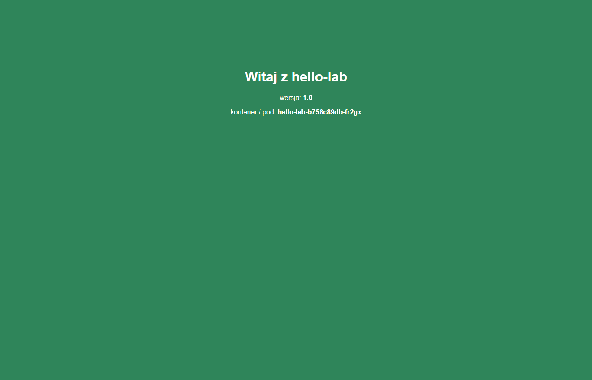

# Jak zbudować własny obraz kontenera

Do tej pory klaster uruchamiał **cudze** obrazy: Grafanę, Prometheusa, podinfo. W pracy DevOps
prawie zawsze uruchamia się **własną** aplikację firmy. Ktoś musi zrobić z niej obraz, zapisać go
w rejestrze i wdrożyć na klaster. Ten rozdział pokazuje całą drogę na małej aplikacji `hello-lab`:

```
app.py + Dockerfile ──docker build──▶ obraz ──docker push──▶ rejestr ──pobiera──▶ k3s (pody)
    (monitoring)                    (monitoring)          (monitoring:5000)       (workery)
```

Docker jest na maszynie `monitoring`, bo w tym etapie i tak uruchamia Grafanę i Uptime Kumę.
W Etapie 7 to samo zrobi automatycznie GitLab CI. Najpierw jednak trzeba umieć to zrobić ręcznie.

Ćwiczenia krok po kroku: [ćwiczenia z budowania obrazu](03-cwiczenia-obraz.md), wykonanie
z prawdziwymi wynikami: [rozwiązania](04-cwiczenia-obraz-rozwiazania.md). Gotowe pliki są
w repozytorium: [apps/hello-lab/](../../apps/hello-lab/) (aplikacja, `Dockerfile`, `.dockerignore`)
i [kubernetes/hello-lab/hello-lab.yaml](../../kubernetes/hello-lab/hello-lab.yaml) (wdrożenie).

## 1. Obraz i kontener – czym się różnią

Porównanie z labu: Packer w Etapie 0 zbudował **szablon** maszyny wirtualnej, a z szablonu
powstały **klony**. Z kontenerami jest tak samo:

| Pojęcie | Odpowiednik z Etapu 0 | Co to jest |
|---|---|---|
| **Dockerfile** | szablon Packera (`.pkr.hcl`) | przepis: z czego zacząć i co dołożyć |
| **obraz** (*image*) | szablon VM | gotowy, **niezmienny** wynik budowania: system plików + polecenie startowe |
| **kontener** | klon VM | **uruchomiona** kopia obrazu; może ich być wiele z jednego obrazu |
| **rejestr** (*registry*) | – (folder z szablonami) | serwer, który przechowuje obrazy i wydaje je przez sieć (Docker Hub, ghcr.io, GitLab) |

Najważniejsza różnica: kontener **nie ma własnego systemu operacyjnego** (jądra). Korzysta
z jądra maszyny, na której działa. Dlatego startuje w ułamek sekundy i waży megabajty,
a nie gigabajty.

## 2. Warstwy – dlaczego budowanie bywa szybkie

Obraz składa się z **warstw**, jak z przezroczystych folii nałożonych jedna na drugą. Każda
instrukcja w Dockerfile, która zmienia pliki (`RUN`, `COPY`, `ADD`), dokłada jedną folię.

```
┌──────────────────────────────┐  COPY app.py .          ← zmienia się często
├──────────────────────────────┤  RUN useradd ... app    ← rzadko
├──────────────────────────────┤  WORKDIR /app
├──────────────────────────────┤
│  python:3.14-slim            │  obraz bazowy (Debian + Python), pobrany z Docker Hub
└──────────────────────────────┘
```

Przy ponownym budowaniu Docker sprawdza każdą warstwę po kolei. Jeśli instrukcja i pliki się
nie zmieniły, bierze gotową warstwę z pamięci (**cache**, w wyniku widać `CACHED`). Gdy
jakaś warstwa się zmieni, Docker buduje od nowa **ją i wszystkie nad nią**.

Wniosek: to, co zmienia się najczęściej (kod), kładzie się **na końcu** Dockerfile. Wtedy zmiana
jednej linii w `app.py` przebudowuje tylko ostatnią warstwę. W labie trwało to 0,1 s
([poziom 4 rozwiązań](04-cwiczenia-obraz-rozwiazania.md#poziom-4--warstwy-cache-i-dockerignore)).

Warstwy są też współdzielone. Pięć obrazów na `python:3.14-slim` trzyma na dysku jedną kopię
Pythona, a `docker push` wysyła do rejestru tylko warstwy, których tam jeszcze nie ma
(`Layer already exists`).

## 3. Dockerfile – instrukcje, które trzeba znać

Końcowy plik z labu: [apps/hello-lab/Dockerfile](../../apps/hello-lab/Dockerfile).

| Instrukcja | Co robi | Przykład z `hello-lab` |
|---|---|---|
| `FROM` | obraz bazowy, od którego zaczynasz | `FROM python:3.14-slim` |
| `ARG` | zmienna **tylko podczas budowania**, podawana przez `--build-arg` | `ARG APP_VERSION=dev` |
| `ENV` | zmienna środowiskowa **zapisana w obrazie**, widoczna dla aplikacji | `ENV APP_VERSION=${APP_VERSION}` |
| `WORKDIR` | katalog roboczy (tworzy go, jeśli nie ma) | `WORKDIR /app` |
| `RUN` | wykonuje polecenie **podczas budowania**, wynik zostaje w warstwie | `RUN useradd --uid 10001 ... app` |
| `COPY` | kopiuje pliki z Twojego katalogu do obrazu | `COPY app.py .` |
| `USER` | od tej chwili wszystko działa jako ten użytkownik (nie root) | `USER 10001` |
| `EXPOSE` | **tylko informacja**, na jakim porcie słucha aplikacja; niczego nie otwiera | `EXPOSE 8080` |
| `HEALTHCHECK` | polecenie, którym Docker co jakiś czas sprawdza, czy aplikacja żyje | `CMD python -c "...urlopen('/healthz')"` |
| `CMD` | polecenie uruchamiane **przy starcie kontenera** | `CMD ["python", "app.py"]` |
| `ENTRYPOINT` | jak `CMD`, ale trudniej je nadpisać; `CMD` staje się wtedy argumentami | (nie używamy) |

Trzy pary, o które pytają na rozmowach:

- **`RUN` a `CMD`.** `RUN` działa raz, przy **budowaniu** (np. instaluje pakiet). `CMD` działa
  przy każdym **starcie** kontenera.
- **`ARG` a `ENV`.** `ARG` istnieje tylko w trakcie `docker build`. `ENV` zostaje w obrazie
  i aplikacja go widzi. W `hello-lab` wersja przychodzi jako `ARG` i jest przepisywana do `ENV`.
- **`COPY` a `ADD`.** `ADD` umie dodatkowo rozpakować archiwum i pobrać plik z URL. Zalecany
  jest `COPY`, bo robi tylko to, co widać.

**Forma JSON w `CMD`.** `CMD ["python", "app.py"]` uruchamia Pythona bezpośrednio, jako proces
nr 1 w kontenerze. Forma tekstowa `CMD python app.py` uruchamia najpierw powłokę `sh`. Wtedy
sygnał zatrzymania (`docker stop`, usunięcie poda) trafia do `sh`, a nie do aplikacji, więc
zatrzymanie trwa 10 s (Docker) albo 30 s (Kubernetes), aż system zabije proces siłą.

## 4. Budowanie, uruchamianie, tagi

```bash
docker build --build-arg APP_VERSION=1.0 -t hello-lab:1.0 .
docker run -d --name hello -p 8080:8080 hello-lab:1.0
```

| Fragment | Znaczenie |
|---|---|
| `docker build` | zbuduj obraz według `Dockerfile` |
| `--build-arg APP_VERSION=1.0` | wartość dla `ARG APP_VERSION` |
| `-t hello-lab:1.0` | **tag**, czyli nazwa obrazu: `nazwa:wersja` |
| `.` (kropka na końcu) | **kontekst budowania**: katalog, z którego `COPY` bierze pliki |
| `docker run -d` | uruchom kontener w tle (*detached*) |
| `--name hello` | nazwa kontenera (inaczej Docker wylosuje, np. `amazing_bhaskara`) |
| `-p 8080:8080` | port **maszyny** : port **kontenera**; dopiero to otwiera dostęp z zewnątrz |

**Pełna nazwa obrazu** ma postać `rejestr/ścieżka/nazwa:tag`:

| Nazwa | Skąd Docker pobierze |
|---|---|
| `nginx:alpine` | Docker Hub (domyślny), czyli `docker.io/library/nginx:alpine` |
| `ghcr.io/stefanprodan/podinfo:6.7.1` | rejestr GitHuba (podinfo z Etapu 3) |
| `192.168.180.54:5000/hello-lab:1.0` | nasz rejestr na maszynie `monitoring` |

**Nie używaj tagu `latest` na klastrze.** `latest` to zwykła nazwa, a nie „najnowsza wersja”.
Nie wiadomo, co pod nią jest. Po `kubectl rollout undo` nie wrócisz do poprzedniej wersji, bo
nazwa się nie zmieniła. Dwa węzły mogą też mieć dwie różne wersje pod tą samą nazwą. Każde
wydanie dostaje własny tag: `1.0`, `1.1`, albo skrót commita, np. `b3fc178`.

## 5. Dobry obraz – mały i bezpieczny

| Zasada | Dlaczego | Jak w `hello-lab` |
|---|---|---|
| mały obraz bazowy | mniej do pobrania i mniej programów z podatnościami | `python:3.14` = 1,63 GB, `python:3.14-slim` = ok. 120 MB, `-alpine` = 74 MB (pomiar z labu) |
| nie-root (`USER`) | włamanie do aplikacji nie daje od razu roota w kontenerze | `USER 10001`, `id` w kontenerze zwraca `uid=10001(app)` |
| kod na końcu | szybkie przebudowanie (cache) | `COPY app.py .` jako ostatnia warstwa |
| `.dockerignore` | `COPY . .` nie wciągnie sekretów (`.env`), `.git` ani śmieci | w labie plik 200 MB trafił do obrazu, dopóki nie dodano `.dockerignore` |
| konkretna wersja bazy | ten sam obraz dziś i za miesiąc | `python:3.14-slim`, a nie `python:latest` |
| `HEALTHCHECK` / sondy | system wie, czy aplikacja naprawdę działa | `/healthz`, w Kubernetesie `readinessProbe` i `livenessProbe` |
| skan podatności | znane dziury wykryte przed wdrożeniem | Trivy w Etapie 7 |

**Alpine nie zawsze jest lepszy.** Alpine używa biblioteki `musl` zamiast `glibc`. Niektóre
biblioteki Pythona się wtedy kompilują albo działają inaczej. `slim` to bezpieczny wybór
domyślny.

### Budowanie wieloetapowe (*multi-stage*) – teoria

Gdy aplikację trzeba **skompilować** (Go, Java, frontend w Node.js), narzędzia do kompilacji
ważą setki MB, a do **uruchomienia** nie są potrzebne. Multi-stage to kilka `FROM` w jednym pliku.
Pierwszy etap kompiluje, a do drugiego kopiuje się tylko gotowy program:

```dockerfile
# Etap 1 – kompilacja (obraz z kompilatorem Go, ok. 800 MB)
FROM golang:1.26 AS build
WORKDIR /src
COPY . .
RUN CGO_ENABLED=0 go build -o /app .

# Etap 2 – uruchomienie (sam program, kilka MB)
FROM gcr.io/distroless/static-debian12
COPY --from=build /app /app
USER 65532
ENTRYPOINT ["/app"]
```

Do końcowego obrazu trafia tylko to, co skopiowano przez `COPY --from=build`. Kompilator, kod
źródłowy i cache zostają w pierwszym etapie i znikają. `hello-lab` nie potrzebuje tego, bo Python
nie jest kompilowany, a aplikacja korzysta tylko z biblioteki standardowej.

## 6. Rejestr – skąd klaster weźmie obraz

Obraz zbudowany na `monitoring` istnieje **tylko tam**. Workery k3s go nie widzą, bo k3s ma
własny containerd, a nie Dockera. Trzeba go wysłać do **rejestru**, z którego pobierze go każdy
węzeł.

W labie rejestr to kontener `registry:3` (oficjalny obraz projektu CNCF Distribution) na
`monitoring`, port 5000:

```bash
docker run -d --name rejestr --restart always -p 5000:5000 \
  -v rejestr-dane:/var/lib/registry \
  -v ~/rejestr-certs/registry.crt:/certs/registry.crt:ro \
  -v ~/rejestr-certs/registry.key:/certs/registry.key:ro \
  -e REGISTRY_HTTP_TLS_CERTIFICATE=/certs/registry.crt \
  -e REGISTRY_HTTP_TLS_KEY=/certs/registry.key \
  registry:3
```

| Fragment | Znaczenie |
|---|---|
| `--restart always` | kontener wstaje sam po restarcie maszyny i Dockera |
| `-v rejestr-dane:/var/lib/registry` | **wolumen**: obrazy przetrwają usunięcie kontenera |
| `-v ~/rejestr-certs/registry.crt:…:ro` (i `.key`) | **tylko** certyfikat i klucz rejestru, do odczytu (`ro`). Nie cały katalog – w nim leży też `ca.key`, pieczątka CA, której kontener nie potrzebuje ([dlaczego](05-przebieg-wdrozenia.md#63-rejestr-z-tls--tylko-dwa-pliki-w-kontenerze)) |
| `REGISTRY_HTTP_TLS_*` | rejestr mówi po **HTTPS**, przedstawiając się tym certyfikatem |

### Dlaczego HTTPS i własny urząd certyfikacji (CA)

Docker i containerd **domyślnie wymagają HTTPS**. Rejestr na zwykłym HTTP kończy się błędem
`http: server gave HTTP response to HTTPS client`
([problem w Etapie 4](problemy.md#docker-push-http-server-gave-http-response-to-https-client)).
Można to obejść wpisem `insecure-registries`, ale wtedy obrazy płyną bez szyfrowania i bez
sprawdzenia, kto je podaje. Każdy w sieci może podsunąć klastrowi swój obraz. Tak się nie robi,
a w labie ten skrót został zablokowany jako osłabienie zabezpieczeń.

Zamiast tego lab ma **własny urząd certyfikacji (CA)**. Działa to jak pieczątka:

1. Tworzysz **CA labu**: parę klucz prywatny `ca.key` (pieczątka, pilnujesz jej) i certyfikat
   `ca.crt` (wzór pieczątki, który rozdajesz).
2. CA **podpisuje** certyfikat rejestru `registry.crt`, wystawiony na adres `192.168.180.54`.
3. Docker i każdy węzeł k3s dostają `ca.crt`, czyli wiedzą, jak wygląda prawdziwa pieczątka.
   Ufają każdemu certyfikatowi z tą pieczątką i niczemu innemu.

```bash
mkdir -p ~/rejestr-certs && cd ~/rejestr-certs
# 1. CA labu: klucz + certyfikat ważny 10 lat
openssl req -x509 -newkey rsa:4096 -sha256 -days 3650 -nodes \
  -keyout ca.key -out ca.crt -subj "/CN=k3s-lab CA"
# 2. Klucz i wniosek o certyfikat dla rejestru
openssl req -newkey rsa:2048 -nodes -keyout registry.key -out registry.csr -subj "/CN=192.168.180.54"
# 3. CA podpisuje wniosek; SAN = adresy, pod którymi rejestr jest dostępny
printf "subjectAltName=IP:192.168.180.54,DNS:monitoring\n" > san.ext
openssl x509 -req -in registry.csr -CA ca.crt -CAkey ca.key -CAcreateserial \
  -out registry.crt -days 825 -sha256 -extfile san.ext
chmod 600 ca.key registry.key
```

**SAN** (*Subject Alternative Name*) to lista adresów, dla których certyfikat jest ważny.
Programy sprawdzają SAN, a nie pole `CN`. Bez `IP:192.168.180.54` połączenie po adresie IP
skończy się błędem certyfikatu.

Gdzie trafia `ca.crt`:

| Kto pobiera obraz | Gdzie położyć `ca.crt` | Restart |
|---|---|---|
| Docker na `monitoring` (`docker push`) | `/etc/docker/certs.d/192.168.180.54:5000/ca.crt` | nie trzeba |
| k3s na **każdym** węźle | `/etc/rancher/k3s/lab-ca.crt` + [`/etc/rancher/k3s/registries.yaml`](../../apps/hello-lab/k3s-registries.yaml) | `k3s` (master) / `k3s-agent` (workery) |

Zaufanie dotyczy **tylko tego jednego rejestru**. Nie dodajemy CA labu do zaufanych certyfikatów
całego systemu.

`registries.yaml` mówi containerd w k3s, którym CA sprawdzać rejestr:

```yaml
configs:
  "192.168.180.54:5000":
    tls:
      ca_file: /etc/rancher/k3s/lab-ca.crt
```

Na workerach katalogu `/etc/rancher/k3s` **nie ma**, bo agent k3s trzyma swoje pliki
w `/etc/rancher/node`. Trzeba go utworzyć
([problem](problemy.md#ansible-copy-destination-directory-etcrancherk3s-does-not-exist)).
Plik rozsyła się na 4 węzły jednym poleceniem Ansible z `monitoring`
([poziom 7 ćwiczeń](03-cwiczenia-obraz.md#poziom-7--obraz-z-rejestru-na-k3s)).

### Uwaga: Docker omija firewall ufw

Na `monitoring` ufw wpuszcza tylko porty 22, 3000 i 3001. Mimo to workery pobrały obraz
z portu 5000. Docker przy `-p 5000:5000` sam dopisuje reguły do iptables (przekierowanie NAT).
Te reguły działają, **zanim** pakiet dotrze do reguł ufw. Port opublikowany przez Dockera jest
więc otwarty dla każdego, kto dosięgnie maszyny. W labie to tylko sieć NAT VMware. W firmie
ogranicza się to łańcuchem `DOCKER-USER` albo publikuje port tylko na wybranym adresie
(`-p 127.0.0.1:5000:5000`). Rejestr w labie **nie ma logowania**. Rejestr GitLaba w Etapie 7
będzie je miał.

## 7. Obraz na klastrze

Manifest: [kubernetes/hello-lab/hello-lab.yaml](../../kubernetes/hello-lab/hello-lab.yaml):
Deployment z 2 replikami, Service NodePort `30880`, sondy na `/healthz`,
`runAsNonRoot: true` (Kubernetes odmówi uruchomienia, gdyby obraz chciał działać jako root).

```bash
kubectl apply -f ~/k3s-monitoring-lab/kubernetes/hello-lab/hello-lab.yaml
curl http://192.168.180.51:30880/api
```



Nowa wersja: zbuduj `hello-lab:1.1`, wypchnij, `kubectl set image ...`, a w razie kłopotu
`kubectl rollout undo` ([poziom 8](03-cwiczenia-obraz.md#poziom-8--nowa-wersja-i-wycofanie)).

## 8. Pytania rekrutacyjne

**Czym różni się obraz od kontenera?**
Obraz to niezmienny szablon: warstwy z plikami i polecenie startowe. Kontener to uruchomiona
instancja obrazu z własną cienką warstwą do zapisu. Z jednego obrazu można uruchomić wiele
kontenerów.

**Czym różni się kontener od maszyny wirtualnej?**
VM ma własne jądro systemu i emulowany sprzęt, więc startuje w minutę i waży gigabajty. Kontener
korzysta z jądra hosta i jest od reszty oddzielony mechanizmami jądra (namespaces, cgroups).
Startuje w ułamek sekundy, ale izolacja jest słabsza.

**Jak przyspieszyć budowanie obrazu?**
Rzeczy, które zmieniają się rzadko (system, zależności), daję na początek Dockerfile, a kod na
koniec. Wtedy cache warstw przebudowuje tylko ostatnią warstwę. Do tego `.dockerignore`, żeby
kontekst budowania był mały.

**Jak zmniejszyć obraz?**
Mała baza (`slim`, `alpine`, `distroless`), multi-stage build dla języków kompilowanych,
czyszczenie cache menedżera pakietów w tym samym `RUN` i `.dockerignore`.

**Dlaczego kontener nie powinien działać jako root?**
Jeśli ktoś włamie się do aplikacji, dostaje uprawnienia procesu. Root w kontenerze to łatwiejsza
droga do ucieczki na host. W Dockerfile ustawiam `USER`, a w Kubernetesie `runAsNonRoot: true`.

**Dlaczego nie `latest`?**
Bo nie wiadomo, jaka wersja jest pod tą nazwą. Nie da się wiarygodnie wycofać wdrożenia, a węzły
mogą mieć różne obrazy pod tym samym tagiem. Używam wersji albo skrótu commita.

**Co robi `EXPOSE`?**
Nic nie otwiera. To informacja dla ludzi i narzędzi. Port otwiera `-p` w Dockerze albo Service
w Kubernetesie.

**Jak Kubernetes pobiera obraz z prywatnego rejestru?**
Kubelet zleca to containerd na węźle, z którego ma ruszyć pod. Jeśli rejestr wymaga logowania,
dane trafiają do Secretu typu `docker-registry`, wskazanego w `imagePullSecrets`. Jeśli rejestr
ma certyfikat z własnego CA, węzeł musi temu CA ufać. W k3s robi się to w `registries.yaml`.

Na rozmowie: *"I built my own image for a small Python app – non-root user, healthcheck, layer
caching, .dockerignore – pushed it to a private registry with TLS signed by my own lab CA,
and deployed it to k3s with a rolling update and rollback."*
