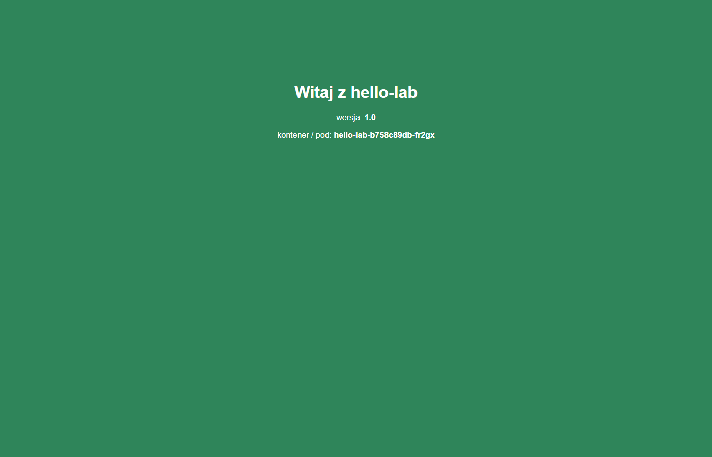

# Etap 4 – rozwiązania ćwiczeń z obrazu

Wykonanie [ćwiczeń z budowania obrazu](03-cwiczenia-obraz.md) w labie, 03.11.2026: Docker 29.9.2
na `monitoring` (Ubuntu 26.04), k3s v1.36.5. Wyniki są prawdziwe, skrócone tylko o powtarzające
się linie (`...`). Identyfikatory, nazwy podów i czasy u Ciebie będą inne.

> Ćwiczenia wykonał Claude, żeby powstały wzorcowe wyniki. Właściciel labu przechodzi je sam,
> po [pełnym resecie](#pełny-reset).

## Poziom 0 – Docker na monitoring

Docker zainstalowany oficjalnym skryptem `get.docker.com` (ten sam, którego używa
`scripts/06-setup-monitoring-vm.sh`). Skrypt rozpoznał Ubuntu 26.04 jako `resolute` i dodał
repozytorium Dockera:

```
+ sh -c echo "deb [arch=amd64 signed-by=/etc/apt/keyrings/docker.asc] https://download.docker.com/linux/ubuntu resolute stable" > ...
+ sh -c DEBIAN_FRONTEND=noninteractive apt-get -y -qq install docker-ce docker-ce-cli containerd.io docker-compose-plugin ...
INFO: Docker daemon enabled and started
Docker version 29.9.2, build a82e528
```

Po `usermod -aG docker` i ponownym zalogowaniu: `groups=...,983(docker)`.

**Odpowiedź – grupa docker a sudo:** demon Dockera działa jako root. Kto może mu wydawać polecenia,
może np. uruchomić `docker run -v /:/host -it alpine chroot /host` i dostać powłokę roota na
maszynie. Członkostwo w grupie `docker` = root bez hasła. Dlatego tylko dla zaufanych
administratorów.

## Poziom 1 – pierwszy kontener

```
$ docker run hello-world
Unable to find image 'hello-world:latest' locally
latest: Pulling from library/hello-world
4f55086f7dd0: Pull complete
Digest: sha256:c567b231f65614688711a75f31518a064258a51d442117a3e771a3a8fdba78ef
Status: Downloaded newer image for hello-world:latest
Hello from Docker!
This message shows that your installation appears to be working correctly.

$ docker ps -a --format "table {{.Image}}\t{{.Status}}"
IMAGE         STATUS
hello-world   Exited (0) 23 seconds ago

$ docker run -d --name web -p 8081:80 nginx:alpine
$ docker ps
CONTAINER ID   IMAGE          COMMAND                  CREATED         STATUS         PORTS                                     NAMES
6de7c9c60c95   nginx:alpine   "/docker-entrypoint.…"   2 seconds ago   Up 2 seconds   0.0.0.0:8081->80/tcp, [::]:8081->80/tcp   web

$ curl -s localhost:8081 | head -4
<!DOCTYPE html>
<html>
<head>
<title>Welcome to nginx!</title>

$ docker logs web | tail -1
172.17.0.1 - - [03/Nov/2026:07:47:33 +0000] "GET / HTTP/1.1" 200 896 "-" "curl/8.18.0" "-"
```

`hello-world` zrobił swoje i się zakończył (`Exited (0)`, czyli sukces). Kontener działa tak
długo, jak jego główny proces. `172.17.0.1` w logu nginx to adres maszyny w wewnętrznej sieci
Dockera `docker0`, bo zapytanie przyszło przez przekierowanie portu.

**Odpowiedzi:**
- `docker rm` usuwa **kontener** (uruchomioną kopię). Obraz zostaje i następny `docker run`
  wystartuje bez pobierania. `docker rmi` usuwa **obraz**, ale tylko gdy nie używa go żaden kontener.
- `-p 8081:80`: **8081 na maszynie** `monitoring` → **80 w kontenerze**. Kolejność zawsze
  `host:kontener`.

## Poziom 2 – pierwszy Dockerfile

```
$ docker build -t moja-strona:1 .
#1 [internal] load build definition from Dockerfile
#3 [internal] load .dockerignore
#4 [internal] load build context
#4 transferring context: 80B done
#5 [1/2] FROM docker.io/library/nginx:alpine@sha256:785835ea...
#6 [2/2] COPY index.html /usr/share/nginx/html/index.html
#7 naming to docker.io/library/moja-strona:1 done

$ docker images moja-strona
IMAGE           ID             DISK USAGE   CONTENT SIZE
moja-strona:1   c790ff414094       93.6MB         26.3MB

$ curl -s localhost:8082
<h1>Moja pierwsza strona w kontenerze</h1>
```

`DISK USAGE` to rozmiar po rozpakowaniu na dysku, a `CONTENT SIZE` to skompresowane warstwy,
czyli tyle, ile się pobiera. `nginx:alpine` był już pobrany w poziomie 1, więc `FROM` trwał
ułamek sekundy.

**Odpowiedź – kropka:** to **kontekst budowania**, katalog wysyłany do Dockera. Tylko z niego
`COPY` może brać pliki. `COPY ../tajne.txt` nie zadziała.

## Poziom 3 – własna aplikacja

```
$ docker build --build-arg APP_VERSION=1.0 -t hello-lab:1.0 .
#5 [1/3] FROM docker.io/library/python:3.14-slim@sha256:930e1abb...
#5 DONE 20.1s
#6 [2/3] WORKDIR /app
#7 [3/3] COPY app.py .
#8 naming to docker.io/library/hello-lab:1.0 done

$ docker images hello-lab
IMAGE           ID             DISK USAGE   CONTENT SIZE
hello-lab:1.0   d1aad8a38dc4        178MB         43.6MB

$ curl -s localhost:8080/api
{"app": "hello-lab", "version": "1.0", "host": "65465acea09c"}
$ curl -s localhost:8080/healthz
ok
$ docker logs hello
hello-lab 1.0 słucha na porcie 8080
172.17.0.1 - - [03/Nov/2026 07:48:13] "GET /api HTTP/1.1" 200 -
172.17.0.1 - - [03/Nov/2026 07:48:13] "GET /healthz HTTP/1.1" 200 -
$ docker exec hello whoami
root
$ docker exec hello env | grep APP
APP_VERSION=1.0
```

Pierwsze budowanie trwało ok. 20 s, bo trzeba było pobrać `python:3.14-slim`. Następne trwają
ułamek sekundy.

**Odpowiedzi:**
- Bez `--build-arg` działa wartość domyślna z `ARG APP_VERSION=dev`, więc `/api` pokaże
  `"version": "dev"`.
- `host` to nazwa kontenera w systemie (`socket.gethostname()`). Docker nadaje ją z ID kontenera
  (`65465acea09c`), a Kubernetes z nazwy poda. Dzięki temu w poziomie 7 widać, który pod
  odpowiedział.
- `root` w kontenerze: luka w aplikacji daje atakującemu pełne prawa w kontenerze, a stąd
  bliżej do ucieczki na host. Naprawa w poziomie 5.

## Poziom 4 – warstwy, cache i .dockerignore

```
$ docker history hello-lab:1.0 --format "table {{.CreatedBy}}\t{{.Size}}"
CREATED BY                                      SIZE
CMD ["python" "app.py"]                         0B
EXPOSE [8080/tcp]                               0B
COPY app.py . # buildkit                        12.3kB
WORKDIR /app                                    8.19kB
ENV APP_VERSION=1.0                             0B
ARG APP_VERSION=1.0                             0B
CMD ["python3"]                                 0B          ← od tej linii w dół: obraz python:3.14-slim
RUN /bin/sh -c set -eux;  for src in idle3 p…   16.4kB
RUN /bin/sh -c set -eux;   savedAptMark="$(a…   42.1MB
ENV PYTHON_VERSION=3.14.10                      0B
...
```

Nasze instrukcje to 6 górnych linii. Pod nimi jest historia obrazu bazowego. Tylko `COPY`
i `WORKDIR` dokładają pliki, a `ENV`, `CMD` i `EXPOSE` zmieniają same metadane (0B).

Ponowne budowanie bez zmian: wszystkie kroki `CACHED`. Po zmianie koloru w `app.py`:

```
#6 [2/3] WORKDIR /app
#6 CACHED
#7 [3/3] COPY app.py .
#7 DONE 0.0s
```

Docker przebudował tylko warstwę z `app.py`.

Doświadczenie z `COPY . .` i plikiem 200 MB:

```
#6 transferring context: 209.77MB 0.9s done
#7 [3/3] COPY . .

$ docker images hello-lab
IMAGE            ID             DISK USAGE   CONTENT SIZE
hello-lab:1.0    aaaf964884b8        178MB         43.6MB
hello-lab:test   ade1089ab7a6        388MB         43.8MB

$ docker run --rm hello-lab:test ls -la /app
-rw-rw-r-- 1 root root       132 Nov  3 07:48 Dockerfile
-rw-r--r-- 1 root root      2071 Nov  3 07:48 app.py
-rw-rw-r-- 1 root root 209715200 Nov  3 07:48 kopia-zapasowa.tar
```

Po dodaniu `.dockerignore`:

```
#4 transferring context: 130B done
hello-lab:test   6277f495a606        178MB         43.6MB
$ docker run --rm hello-lab:test ls /app
Dockerfile
app.py
```

`CONTENT SIZE` prawie się nie zmienił (43.8 MB), bo plik z samych zer kompresuje się do
kilkuset kB. Prawdziwe archiwum (już skompresowane) urosłoby o pełne 200 MB. Z `COPY app.py .`
problem nie występuje: BuildKit wysyła tylko pliki, o które prosi `COPY` (`transferring context: 28B`).

**Odpowiedzi:**
- Zmiana warstwy przebudowuje ją i **wszystkie nad nią**. Gdyby `COPY app.py .` było przed
  `RUN pip install ...`, każda poprawka w kodzie oznaczałaby ponowną instalację pakietów.
- Do `.dockerignore`: `.git`, `.env` i inne sekrety, `node_modules`/`venv`, logi, kopie zapasowe,
  pliki IDE, testy i dokumentacja (jeśli nie są potrzebne w obrazie).

## Poziom 5 – lepszy obraz: nie-root, HEALTHCHECK, rozmiar

```
$ docker images python
IMAGE                ID             DISK USAGE   CONTENT SIZE
python:3.14          22caa054c0d3       1.63GB          434MB
python:3.14-alpine   eb2c62658b8d       73.9MB         18.5MB
```

`hello-lab` na `-slim` ma 178 MB. Pełny `python:3.14` dałby ok. 1,6 GB, prawie 10 razy więcej,
z kompilatorem `gcc` i setkami pakietów, które aplikacja nie używa, ale skaner podatności
je znajdzie.

Budowanie końcowego Dockerfile:

```
#5 [1/4] FROM docker.io/library/python:3.14-slim@sha256:930e1abb...
#6 [2/4] WORKDIR /app
#6 CACHED
#7 [3/4] RUN useradd --uid 10001 --no-create-home --shell /usr/sbin/nologin app
#8 [4/4] COPY app.py .

$ docker ps --format "table {{.Names}}\t{{.Image}}\t{{.Status}}"
NAMES     IMAGE           STATUS
hello     hello-lab:1.0   Up 40 seconds (healthy)

$ docker exec hello id
uid=10001(app) gid=10001(app) groups=10001(app)
```

**Odpowiedzi:**
- `RUN useradd` przed `COPY`, bo użytkownik się nie zmienia, a kod tak. Zmiana `app.py` nie
  wywoła ponownego `useradd` (cache).
- HEALTHCHECK w Dockerze tylko **oznacza** kontener jako `unhealthy`. Sam Docker go nie restartuje
  (robi to dopiero Docker Swarm albo własny skrypt). Kubernetes **ignoruje** HEALTHCHECK z obrazu
  i ma własne sondy: `livenessProbe` (kubelet restartuje kontener) i `readinessProbe`
  (pod wypada z Service). Dlatego manifest `hello-lab.yaml` definiuje obie sondy na `/healthz`.

## Poziom 6 – prywatny rejestr z TLS

Rejestr bez TLS:

```
$ docker push 192.168.180.54:5000/hello-lab:1.0
The push refers to repository [192.168.180.54:5000/hello-lab]
failed to do request: Head "https://192.168.180.54:5000/v2/hello-lab/blobs/sha256:cadca929...":
http: server gave HTTP response to HTTPS client
```

Obejście (`insecure-registries` w `/etc/docker/daemon.json`) zostało w labie **zablokowane**
jako osłabienie zabezpieczeń. Rozwiązaniem jest TLS ([problem](problemy.md#docker-push-http-server-gave-http-response-to-https-client)).

CA i certyfikat:

```
$ ls -l ~/rejestr-certs
-rw-rw-r-- 1 grzegorz grzegorz 1809 Nov  3 08:54 ca.crt
-rw------- 1 grzegorz grzegorz 3268 Nov  3 08:54 ca.key
-rw-rw-r-- 1 grzegorz grzegorz 1484 Nov  3 08:54 registry.crt
-rw-rw-r-- 1 grzegorz grzegorz  899 Nov  3 08:54 registry.csr
-rw------- 1 grzegorz grzegorz 1704 Nov  3 08:54 registry.key
$ openssl x509 -in registry.crt -noout -subject -issuer -ext subjectAltName
subject=CN=192.168.180.54
issuer=CN=k3s-lab CA
X509v3 Subject Alternative Name:
    IP Address:192.168.180.54, DNS:monitoring
```

Rejestr z TLS w logach:

```
level=info msg="listening on [::]:5000, tls" ... version=3.1.2
```

Połączenie:

```
$ curl -s https://192.168.180.54:5000/v2/_catalog; echo "kod: $?"
kod: 60
$ curl -s --cacert ca.crt https://192.168.180.54:5000/v2/_catalog
{"repositories":[]}
$ docker push 192.168.180.54:5000/hello-lab:1.0
failed to do request: Head "https://192.168.180.54:5000/v2/...": tls: failed to verify certificate:
x509: certificate signed by unknown authority
```

Po skopiowaniu `ca.crt` do `/etc/docker/certs.d/192.168.180.54:5000/`:

```
$ docker push 192.168.180.54:5000/hello-lab:1.0
b507f786ea72: Pushed
...
6fc242d221a6: Pushed
1.0: digest: sha256:cb8a86b8bb7ca49c27a7112d5d7419836e5986e91af41074d5f948b2e9e1492d size: 856
$ curl -s --cacert ~/rejestr-certs/ca.crt https://192.168.180.54:5000/v2/_catalog
{"repositories":["hello-lab"]}
$ curl -s --cacert ~/rejestr-certs/ca.crt https://192.168.180.54:5000/v2/hello-lab/tags/list
{"name":"hello-lab","tags":["1.0"]}
```

Kod `60` w `curl` oznacza „nie mogę sprawdzić certyfikatu serwera”. To ten sam problem, który
Docker zgłasza jako `unknown authority`.

**Odpowiedzi:**
- `ca.key` to pieczątka, którą podpisuje się certyfikaty. Kto ją ma, może podrobić dowolny
  serwer w labie, więc ma uprawnienia `600` i nie wychodzi z `monitoring`. `ca.crt` to wzór
  pieczątki, publiczny, rozdawany wszystkim, którzy mają ufać.
- SAN: Docker i containerd sprawdzają, czy adres, z którym się łączą (`192.168.180.54`), jest
  na liście w certyfikacie. Pole `CN` jest dziś ignorowane. Bez SAN pojawia się błąd
  `certificate is not valid for any names` / `doesn't contain any IP SANs`.
- ufw: Docker przy `-p 5000:5000` dopisuje własne reguły do iptables, które działają przed
  regułami ufw ([teoria](02-wlasny-obraz.md#uwaga-docker-omija-firewall-ufw)). `ufw status`
  na `monitoring` pokazuje tylko 22, 3000 i 3001, a workery pobrały obraz z portu 5000.

## Poziom 7 – obraz z rejestru na k3s

Wdrożenie przed konfiguracją węzłów:

```
$ kubectl -n hello-lab get pods -o wide
NAME                         READY   STATUS             RESTARTS   AGE   IP           NODE
hello-lab-57dd97cd57-58vmw   0/1     ErrImagePull       0          25s   10.42.3.23   k3s-worker-3
hello-lab-57dd97cd57-ldkwv   0/1     ImagePullBackOff   0          25s   10.42.2.35   k3s-worker-1

$ kubectl -n hello-lab get events --sort-by=.lastTimestamp
Normal    Pulling   Pulling image "192.168.180.54:5000/hello-lab:1.0"
Warning   Failed    Failed to pull image "192.168.180.54:5000/hello-lab:1.0": ... failed to do request:
                    Head "https://192.168.180.54:5000/v2/hello-lab/manifests/1.0": tls: failed to verify
                    certificate: x509: certificate signed by unknown authority
Warning   Failed    Error: ErrImagePull
Normal    BackOff   Back-off pulling image "192.168.180.54:5000/hello-lab:1.0"
Warning   Failed    Error: ImagePullBackOff
```

Ten sam błąd co w Dockerze, tylko teraz zgłasza go containerd na workerze.

Ansible. Pierwsza próba `copy` bez tworzenia katalogu:

```
k3s-master   | CHANGED => {
k3s-worker-1 | FAILED! => {  "msg": "Destination directory /etc/rancher/k3s does not exist"
k3s-worker-2 | FAILED! => {
k3s-worker-3 | FAILED! => {
$ ansible k3s_agents -b -m command -a "ls /etc/rancher"
k3s-worker-1 | CHANGED | rc=0 >>
node
```

Po `-m file ... state=directory` wszystkie `copy` dały `CHANGED`, a restarty
`k3s` i `k3s-agent` (po jednym) przeszły bez błędów. Opis problemu:
[problemy](problemy.md#ansible-copy-destination-directory-etcrancherk3s-does-not-exist).

Po restarcie:

```
$ kubectl get nodes
NAME           STATUS   ROLES           AGE     VERSION
k3s-master     Ready    control-plane   4d17h   v1.36.5+k3s1
k3s-worker-1   Ready    worker          4d17h   v1.36.5+k3s1
k3s-worker-2   Ready    worker          4d17h   v1.36.5+k3s1
k3s-worker-3   Ready    worker          4d17h   v1.36.5+k3s1

$ kubectl -n hello-lab get events --field-selector reason=Pulled
Normal   Pulled   pod/hello-lab-57dd97cd57-ldkwv   Successfully pulled image "192.168.180.54:5000/hello-lab:1.0" in 333ms ...
Normal   Pulled   pod/hello-lab-b758c89db-cqkjl    Container image "192.168.180.54:5000/hello-lab:1.0" already present on machine ...

$ kubectl -n hello-lab get pods,svc -o wide
pod/hello-lab-b758c89db-cqkjl    1/1     Running   0   1s    10.42.3.24   k3s-worker-3
pod/hello-lab-b758c89db-h598h    1/1     Running   0   7s    10.42.2.36   k3s-worker-1
service/hello-lab   NodePort   10.43.127.228   <none>   80:30880/TCP   104s   app=hello-lab

$ for i in 1 2 3 4 5 6; do curl -s http://192.168.180.52:30880/api; done
{"app": "hello-lab", "version": "1.0", "host": "hello-lab-57dd97cd57-58vmw"}
{"app": "hello-lab", "version": "1.0", "host": "hello-lab-b758c89db-h598h"}
...
```

Stare pody (`57dd97cd57`) same pobrały obraz przy kolejnej próbie z `ImagePullBackOff`, czyli
naprawa nie wymagała ponownego wdrożenia. `rollout restart` tylko je wymienił. Zapytania na
adres **worker-1** (`.52`) trafiają do podów na worker-1 i worker-3. To NodePort z
[poprzedniej lekcji](../etap-3-monitoring/03-teoria-kubernetes-helm.md).



**Odpowiedzi:**
- `-f 1` (*forks*): Ansible restartuje agentów **po kolei**, a nie wszystkich naraz. Restart
  agenta nie zabija podów, ale gdyby coś poszło źle, padnie jeden węzeł, a nie cały klaster.
  W playbooku to samo robi `serial: 1`.
- Bez `-m file` moduł `copy` na workerach kończy się `FAILED`, bo agent k3s nie ma
  `/etc/rancher/k3s`.
- Obraz pobiera **containerd** na węźle, na który scheduler przydzielił pod. Kubelet tylko go
  o to prosi przez interfejs CRI. Dockera na workerach w ogóle nie ma. Dlatego zaufanie do CA
  ustawia się w konfiguracji containerd (`registries.yaml`), a nie Dockera.

## Poziom 8 – nowa wersja i wycofanie

```
$ docker build --build-arg APP_VERSION=1.1 -t 192.168.180.54:5000/hello-lab:1.1 .
#6 CACHED
$ docker push 192.168.180.54:5000/hello-lab:1.1
40a79f5805ed: Layer already exists
a772f521be11: Pushed
1.1: digest: sha256:6ab46ccb3575d6bd674bd59525db8dfa397602366d63f9d140f195ce8c9203e3 size: 856
$ curl -s --cacert ~/rejestr-certs/ca.crt https://192.168.180.54:5000/v2/hello-lab/tags/list
{"name":"hello-lab","tags":["1.0","1.1"]}
```

Na klastrze:

```
$ kubectl -n hello-lab set image deployment/hello-lab hello-lab=192.168.180.54:5000/hello-lab:1.1
deployment.apps/hello-lab image updated
$ kubectl -n hello-lab rollout status deployment/hello-lab
Waiting for deployment "hello-lab" rollout to finish: 1 out of 2 new replicas have been updated...
Waiting for deployment "hello-lab" rollout to finish: 1 old replicas are pending termination...
deployment "hello-lab" successfully rolled out
$ curl -s http://192.168.180.51:30880/api
{"app": "hello-lab", "version": "1.1", "host": "hello-lab-59bd989685-q76cw"}

$ kubectl -n hello-lab rollout history deployment/hello-lab
REVISION  CHANGE-CAUSE
1         <none>
2         <none>
3         wersja 1.1

$ kubectl -n hello-lab rollout undo deployment/hello-lab
Warning: resource deployments/hello-lab was previously managed with 'kubectl apply'. Rolling back will
not update the kubectl.kubernetes.io/last-applied-configuration annotation ...
deployment.apps/hello-lab rolled back
$ curl -s http://192.168.180.51:30880/api
{"app": "hello-lab", "version": "1.0", "host": "hello-lab-b758c89db-fr2gx"}
```

Rewizja 1 to pierwsze wdrożenie (pody z błędem x509), 2 to `rollout restart`, 3 to wersja 1.1.

Zepsute wdrożenie, tag 2.0, którego nie ma:

```
$ kubectl -n hello-lab get pods
NAME                         READY   STATUS         RESTARTS   AGE
hello-lab-74569bfdbc-66bfh   0/1     ErrImagePull   0          30s
hello-lab-b758c89db-494rc    1/1     Running        0          7m54s
hello-lab-b758c89db-fr2gx    1/1     Running        0          7m48s
$ kubectl -n hello-lab rollout status deploy/hello-lab --timeout=5s
Waiting for deployment "hello-lab" rollout to finish: 1 out of 2 new replicas have been updated...
error: timed out waiting for the condition
$ curl -s http://192.168.180.51:30880/api
{"app": "hello-lab", "version": "1.0", "host": "hello-lab-b758c89db-494rc"}
$ kubectl -n hello-lab rollout undo deploy/hello-lab
deployment "hello-lab" successfully rolled out
```

**Odpowiedzi:**
- Wersja 1.1 różni się od 1.0 tylko zmienną `APP_VERSION` (metadane obrazu). Wszystkie warstwy
  z plikami są identyczne i rejestr już je ma (`Layer already exists`). Wysłany został tylko
  nowy opis obrazu.
- Aplikacja działa, bo Deployment wymienia pody stopniowo. Przy 2 replikach i domyślnych
  `maxSurge: 25%` (zaokrąglone w górę, czyli 1 pod nadmiarowy) i `maxUnavailable: 25%`
  (zaokrąglone w dół, czyli 0) Kubernetes najpierw tworzy 1 nowy pod. Stary usuwa dopiero, gdy
  nowy jest gotowy. Nowy nigdy nie wstał, więc oba stare dalej obsługiwały ruch.
- `rollout undo` zmienia Deployment na klastrze, ale nie plik YAML w repozytorium ani adnotację
  `last-applied-configuration`. Następny `kubectl apply -f hello-lab.yaml` przywróci to, co jest
  w pliku. Tak ma być: źródłem prawdy jest repozytorium. W Etapie 7 Argo CD będzie tego pilnować.

## Pełny reset

Żeby przejść ćwiczenie od zera, cofnij to, co zrobiły poziomy 0–8.

🐧 k3s-master:

```bash
kubectl delete namespace hello-lab
```

🐧 monitoring:

```bash
cd ~/k3s-monitoring-lab/ansible
ansible k3s_cluster -b -m file -a "path=/etc/rancher/k3s/registries.yaml state=absent"
ansible k3s_cluster -b -m file -a "path=/etc/rancher/k3s/lab-ca.crt state=absent"
ansible k3s_server -b -m systemd -a "name=k3s state=restarted"
ansible k3s_agents -b -f 1 -m systemd -a "name=k3s-agent state=restarted"
docker rm -f hello rejestr
docker volume rm rejestr-dane
sudo rm -rf /etc/docker/certs.d/192.168.180.54:5000
rm -rf ~/rejestr-certs ~/hello-lab ~/strona
docker image prune -a -f
```

Docker zostaje, bo jest potrzebny w Etapie 4 (Grafana i Uptime Kuma). Kto chce przejść też
poziom 0: `sudo apt purge -y docker-ce docker-ce-cli containerd.io docker-buildx-plugin
docker-compose-plugin docker-ce-rootless-extras docker-model-plugin`.

Uwaga: zepsute obiekty z [typowych awarii Kubernetesa](../etap-5-scenariusze-awarii/02-typowe-awarie-kubernetesa.md)
korzystają z obrazu `hello-lab:1.0` z tego rejestru. Po resecie odtwórz go (poziomy 3, 5 i 6).
