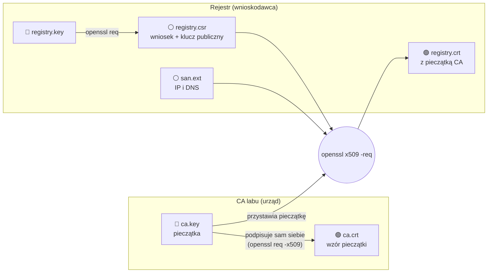
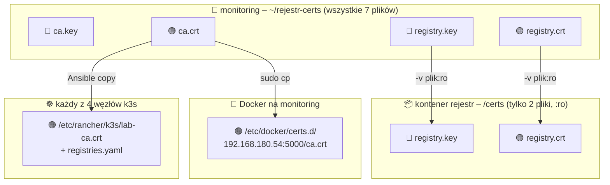
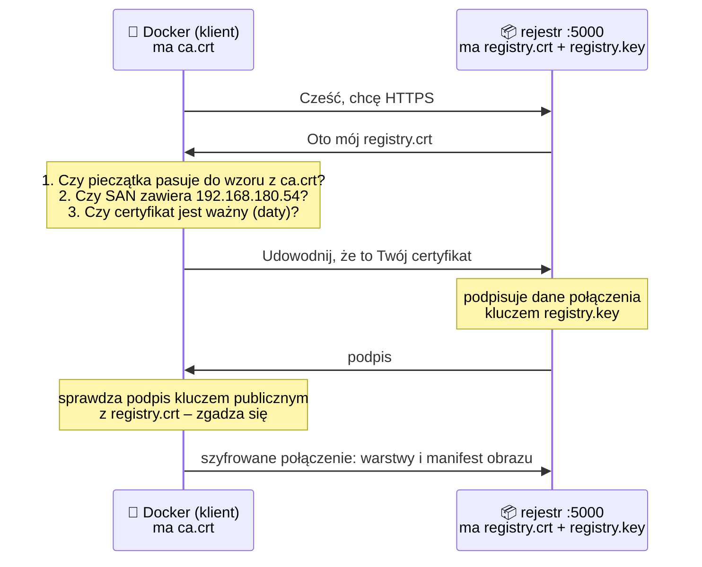
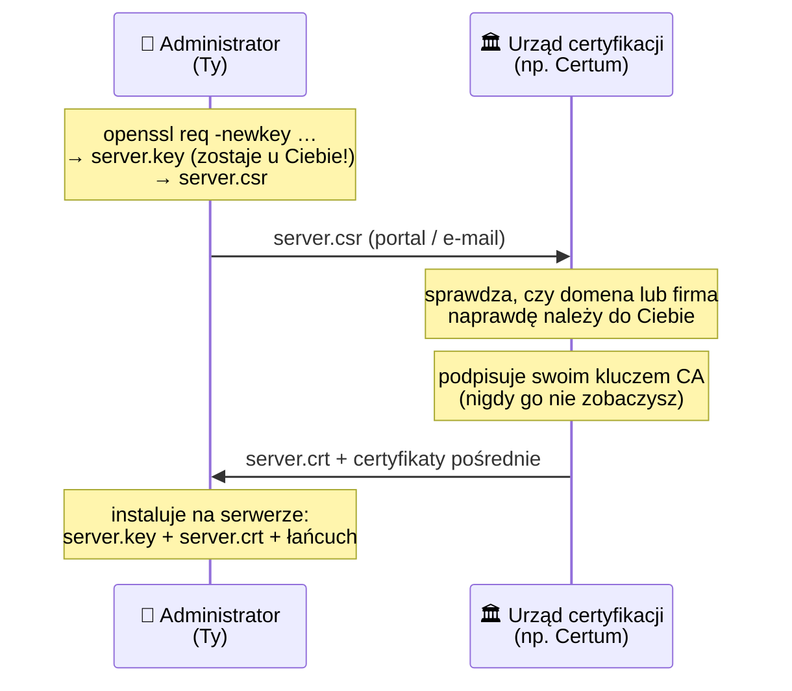

# Certyfikaty w labie – gdzie jest jaki klucz

Uzupełnienie do sekcji [„Dlaczego HTTPS i własny urząd certyfikacji”](02-wlasny-obraz.md#dlaczego-https-i-własny-urząd-certyfikacji-ca)
i do [kroku 6.3 przebiegu](05-przebieg-wdrozenia.md#63-rejestr-z-tls--tylko-dwa-pliki-w-kontenerze).
Odpowiada na trzy pytania: **który plik jest czym**, **gdzie który leży** i **kto go używa**.
Na końcu porównanie z prawdziwym urzędem certyfikacji (np. Certum by Asseco).

## 1. Siedem plików w `~/rejestr-certs`

Wszystkie powstały na `monitoring` w [kroku 6.2](05-przebieg-wdrozenia.md#62-ca-labu-i-certyfikat-rejestru):

```text
/home/grzegorz/rejestr-certs/
├── ca.key         🔴 klucz prywatny CA       – pieczątka urzędu
├── ca.crt         🟢 certyfikat CA           – wzór pieczątki, jawny
├── ca.srl         ⚪ licznik numerów seryjnych
├── registry.key   🔴 klucz prywatny rejestru
├── registry.csr   ⚪ wniosek o certyfikat
├── registry.crt   🟢 certyfikat rejestru      – „dowód osobisty” z pieczątką CA
└── san.ext        ⚪ lista adresów SAN
```

🔴 tajne (klucz prywatny, `chmod 600`) · 🟢 jawne (certyfikat, można rozdawać) · ⚪ pomocnicze (po podpisaniu niepotrzebne)

| Plik | Prywatny / publiczny | Do czego | Kto go potrzebuje |
|---|---|---|---|
| `ca.key` | **prywatny** | podpisywanie certyfikatów | tylko Ty, w chwili podpisywania |
| `ca.crt` | publiczny | sprawdzanie podpisów CA, czyli zaufanie | każdy klient: Docker, węzły k3s, curl |
| `registry.key` | **prywatny** | rejestr udowadnia nim, że jest sobą | tylko kontener `rejestr` |
| `registry.crt` | publiczny | rejestr pokazuje go klientom | tylko kontener `rejestr` (wysyła go sam) |
| `registry.csr` | publiczny | wniosek „podpiszcie mnie” | tylko CA, raz |
| `san.ext` | – | adresy, dla których certyfikat jest ważny | tylko CA, raz |
| `ca.srl` | – | numer seryjny ostatniego certyfikatu | `openssl` przy następnym podpisie |

## 2. Jak powstają – kto co podpisuje



Klucz prywatny rejestru **nigdy nie trafia do CA**. CA dostaje tylko wniosek, w którym jest klucz
**publiczny** rejestru i jego dane (`CN`, SAN). Tak samo jest w prawdziwych urzędach (punkt 5).

## 3. Gdzie który plik leży



Zasada w jednym zdaniu: **klucz prywatny serwera zostaje przy serwerze, certyfikat CA jedzie do
klientów, a klucz CA nie jedzie nigdzie.**

| Miejsce | `ca.key` | `ca.crt` | `registry.key` | `registry.crt` |
|---|---|---|---|---|
| `~/rejestr-certs` na `monitoring` | ✅ | ✅ | ✅ | ✅ |
| kontener `rejestr` (`/certs`) | ❌ | ❌ | ✅ | ✅ |
| Docker (`/etc/docker/certs.d/…`) | ❌ | ✅ | ❌ | ❌ |
| węzły k3s (`/etc/rancher/k3s/`) | ❌ | ✅ (jako `lab-ca.crt`) | ❌ | ❌ |

Rejestr nie potrzebuje `ca.crt`: on się przedstawia, a nie sprawdza innych. Docker i k3s nie
potrzebują `registry.crt`: dostają go od rejestru przy każdym połączeniu.

W labie `ca.key` leży na `monitoring` obok reszty, bo tak jest prościej. W firmie klucz CA trzyma się
**poza serwerami**: na maszynie offline, w module HSM albo w usłudze typu Vault PKI. Używa się go
tylko do podpisania nowego certyfikatu.

## 4. Co się dzieje przy `docker push`



Co psuje każdy z kroków:

| Brakuje | Błąd |
|---|---|
| TLS w rejestrze (zwykłe HTTP) | `http: server gave HTTP response to HTTPS client` |
| `ca.crt` u klienta | `x509: certificate signed by unknown authority` (curl: kod 60) |
| adresu w SAN | `x509: certificate is valid for …, not 192.168.180.54` |
| pasującego `registry.key` | rejestr nie wstanie albo uzgadnianie TLS się nie powiedzie |

`ca.crt` nie jest tajny, ale musi być **prawdziwy**. Kto podmieni klientowi `ca.crt` na własny, ten
może podstawić własny rejestr z własnym obrazem. Dlatego `ca.crt` rozsyłamy z naszej maszyny
(`sudo cp`, Ansible), a nie pobieramy z sieci.

## Sprawdź sam (🐧 monitoring)

```bash
ls -l ~/rejestr-certs/                                   # 7 plików, klucze z -rw-------
docker exec rejestr ls -l /certs/                        # tylko registry.crt i registry.key
docker exec rejestr ls /certs/ca.key                     # No such file or directory – i dobrze
sudo ls -l /etc/docker/certs.d/192.168.180.54:5000/      # ca.crt (po kroku 6.3)
```

Czy klucz pasuje do certyfikatu (oba skróty muszą być identyczne):

```bash
openssl x509 -in ~/rejestr-certs/registry.crt -noout -pubkey | sha256sum
openssl pkey -in ~/rejestr-certs/registry.key -pubout | sha256sum
```

Czy certyfikat rejestru podpisało nasze CA (`registry.crt: OK`):

```bash
openssl verify -CAfile ~/rejestr-certs/ca.crt ~/rejestr-certs/registry.crt
```

## 5. To samo w prawdziwym urzędzie (np. Certum by Asseco)

Gdy firma kupuje certyfikat SSL dla serwera, proces jest **taki sam jak w labie**. Różnica jest
jedna: pieczątkę (`ca.key`) ma komercyjny urząd, a nie Ty.



| Lab | Prawdziwy urząd |
|---|---|
| `registry.key` – tworzysz sam | `server.key` – tworzysz sam, **nie wysyłasz nikomu** |
| `registry.csr` | CSR wysłany przez portal urzędu |
| `ca.key` – masz go Ty | klucz urzędu w HSM, nigdy go nie widzisz |
| `registry.crt` | certyfikat pobrany od urzędu |
| `ca.crt` ręcznie na każdym kliencie | certyfikat główny urzędu jest **już wbudowany** w systemy i przeglądarki |
| brak | **certyfikaty pośrednie** – urząd podpisuje kluczem pośrednim, a główny trzyma offline |

Dwie rzeczy, których lab nie ma:

- **Weryfikacja wnioskodawcy.** Urząd sprawdza, czy domena należy do Ciebie (DV), albo także firmę (OV/EV).
  Nasze CA podpisze wszystko, bo sami je obsługujemy.
- **Łańcuch certyfikatów.** Serwer wysyła swój certyfikat **i** certyfikaty pośrednie. Klient ma tylko
  certyfikat główny. Brak pośredniego na serwerze to częsty błąd: przeglądarka czasem sobie poradzi,
  a curl i Docker zgłoszą `unable to get local issuer certificate`.

Jeśli urząd generuje klucz za Ciebie (np. w przeglądarce albo na karcie), klucz prywatny i tak
zostaje u Ciebie. Gotowa paczka `.pfx` / `.p12` zawiera klucz z certyfikatem i jest chroniona hasłem.

Ta sama zasada wraca dalej: Secret typu `kubernetes.io/tls` (certyfikat + klucz) w Ingressie,
cert-manager, który sam wysyła CSR do Let's Encrypt, i mTLS, gdzie także klient ma swój klucz i certyfikat.

## Pytania rekrutacyjne

1. **Czym różni się klucz prywatny od certyfikatu?** Klucz prywatny jest tajny i służy do podpisywania.
   Certyfikat to klucz publiczny plus dane właściciela (CN, SAN, daty) plus podpis wystawcy. Jest jawny.
2. **Co jest w CSR i czy można go komuś wysłać?** Klucz publiczny i dane, dla kogo ma być certyfikat,
   podpisane kluczem prywatnym wnioskodawcy. Tak, CSR jest jawny; klucza prywatnego się nie wysyła.
3. **Docker zgłasza `x509: certificate signed by unknown authority`. Co robisz?** Klient nie zna CA,
   które podpisało certyfikat. Dokładam `ca.crt` do `/etc/docker/certs.d/<rejestr:port>/` (albo do
   `registries.yaml` w k3s). Nie włączam `insecure-registries`.
4. **Dlaczego klucz CA nie może trafić do kontenera ani do Kubernetesa?** Kto go ma, wystawi ważny
   certyfikat na dowolny adres, a wszyscy, którzy ufają temu CA, uwierzą podróbce.
5. **Co to są certyfikaty pośrednie i co się dzieje, gdy serwer ich nie wysyła?** Urząd podpisuje
   certyfikaty kluczem pośrednim, a klucz główny trzyma offline. Serwer musi wysłać pełny łańcuch;
   bez niego klienci zgłaszają `unable to get local issuer certificate`.
