# Etap 5 – scenariusze awarii

Każdy scenariusz opisuj w sekcji „Czego się nauczyłem” w README: co się stało, co pokazał monitoring,
jak znalazłeś przyczynę i jak ją usunąłeś.

## Awaria węzła

1. Wyłącz maszynę `k3s-worker-1` (twarde wyłączenie w VMware).
2. Obserwuj: `kubectl get nodes -w` oraz `kubectl -n demo get pods -o wide -w`.
3. Oczekiwane:
   - po ok. 50 s węzeł przechodzi w `NotReady`; alert `KubeNodeNotReady` jest najpierw `pending`, a `firing` dopiero po 15 min (`for: 15m`),
   - po ok. 5 minutach pody z wyłączonego węzła są tworzone na `k3s-worker-2`,
   - w tym czasie aplikacja działa dalej dzięki replikom na drugim węźle.
4. Włącz węzeł z powrotem i sprawdź, czy wrócił do stanu `Ready`.

Pytanie do przemyślenia: dlaczego Kubernetes czeka kilka minut, zanim przeniesie pody?
Odpowiedź: chwilowy brak sieci nie powinien od razu przenosić wszystkiego. Każdy pod dostaje
automatycznie tolerancję `node.kubernetes.io/unreachable` z `tolerationSeconds: 300`
(sprawdzisz: `kubectl -n hello-lab get pod <pod> -o jsonpath='{.spec.tolerations}'`).

### Co się dzieje z podami, gdy węzeł pada

Oś czasu po twardym wyłączeniu workera:

| Czas | Co się dzieje |
|---|---|
| 0 s | maszyna wyłączona; pody na niej przestają działać od razu |
| ok. 50 s | węzeł `NotReady` (status `Unknown`), pody z niego znikają z endpointów Service |
| ok. 5 min | pody węzła dostają status `Terminating`, kontrolery tworzą nowe na zdrowych węzłach |
| po włączeniu | węzeł `Ready`, stare pody są sprzątane; **nowe nie wracają same** na ten węzeł |

Co przeżyje, a co nie, zależy od rodzaju obiektu:

| Obiekt | Co po awarii węzła |
|---|---|
| Deployment z kilkoma replikami na **różnych** węzłach | aplikacja działa cały czas, przez 5 min z mniejszą liczbą replik |
| Deployment z 1 repliką albo wszystkie repliki na jednym węźle | **przerwa ok. 5–6 min**, potem pod startuje gdzie indziej |
| StatefulSet (Prometheus, Alertmanager) | pod **nie** jest odtwarzany, dopóki węzeł nie wróci albo nie usuniesz poda ręcznie (`kubectl delete pod … --force --grace-period=0`) – StatefulSet nie dopuszcza dwóch kopii tego samego poda |
| DaemonSet (node-exporter, svclb) | na tym węźle po prostu nie działa; nigdzie się nie przenosi |
| pod bez kontrolera (`kubectl run`) | znika na zawsze |
| dane w `emptyDir` | **tracone** razem z podem |
| dane w PVC `local-path` | leżą na dysku tego węzła; pod może wystartować **tylko tam** – czeka na powrót węzła |

### Co jest zagrożone w naszym klastrze (stan 03.11.2026)

Wynik `kubectl get pods -A -o wide` i `kubectl get deploy,sts -A`:

| Węzeł | Pojedyncze pody (1 replika) |
|---|---|
| k3s-master | `coredns`, `metrics-server`, `local-path-provisioner` |
| k3s-worker-2 | `prometheus-…-0`, `prometheus-operator`, `kube-state-metrics` |
| k3s-worker-3 | `alertmanager-…-0`, `grafana`, `traefik` |

Wnioski:

- **worker-3 to najgorszy węzeł do wyłączenia:** jednocześnie znika Grafana i Alertmanager,
  czyli monitoring nie wyśle alertu o własnej awarii. Dlatego potrzebny jest monitoring
  **poza klastrem** (healthchecks.io i Uptime Kuma na `monitoring`, Etap 4).
- **Prometheus trzyma dane w `emptyDir`** (`kubectl get pvc -A` → `No resources found`).
  Po przeniesieniu na inny węzeł zaczyna z pustą bazą – znika historia metryk.
- `podinfo` (3 repliki) i `hello-lab` (2 repliki) mają kopie na dwóch węzłach – przeżyją.
  Ale `podinfo` ma 2 z 3 replik na worker-3: scheduler rozkłada pody „zwykle” równo, nie zawsze.
- **Master jest jeden.** Gdy padnie, działające pody na workerach dalej pracują, ale nie da się
  nic zmienić (`kubectl` nie działa), nic nie zostanie naprawione ani przeniesione, a do tego
  przestaje działać DNS w klastrze (jedyny `coredns` jest na masterze).

### Przewidywanie: wyłączenie k3s-worker-3

Na podstawie stanu klastra (k3s v1.36.5, reguły kube-prometheus-stack). Zapisz przed
ćwiczeniem, a po nim porównaj z tym, co naprawdę zobaczyłeś.

| Czas | Aplikacje | Monitoring |
|---|---|---|
| 0–50 s | `podinfo`, `hello-lab`, `web` odpowiadają **z przerwami** – Service dalej wysyła część ruchu do martwych podów. Grafana (`:30300`) i traefik nie działają wcale | Prometheus (worker-2) działa; cel `node-exporter` worker-3 ma `up = 0` |
| ok. 50 s | węzeł `NotReady`, martwe pody wypadają z endpointów – aplikacje znów odpowiadają za każdym razem (z worker-1 i worker-2) | `KubeNodeNotReady` w stanie `pending` |
| ok. 5 min 50 s | pody worker-3 → `Terminating`; nowe `grafana`, `traefik`, 2× `podinfo`, `hello-lab`, 2× `web` startują na worker-1/2 (miejsca wystarczy – workery mają zajęte ok. 10% CPU i pamięci). Grafana wraca, ale bez zmian zrobionych ręcznie w UI (`emptyDir`); dashboardy z ConfigMap są | `alertmanager-…-0` wisi w `Terminating` i **nie jest odtwarzany** (StatefulSet) |
| 10–15 min | – | `TargetDown` (10 min) i `KubeNodeNotReady` (15 min) przechodzą w `firing`, ale **nikt nie dostaje powiadomienia** – Alertmanager nie działa. Alert widać tylko w Prometheusie `:30090` → Alerts |
| po włączeniu | węzeł `Ready`, pody `Terminating` znikają. Przeniesione pody **zostają** na worker-1/2 – worker-3 jest prawie pusty | `alertmanager-…-0` startuje od nowa (bez historii wyciszeń) |

**Bilans strat po awarii worker-3:**

| Rodzaj | Co | Jak długo / ile |
|---|---|---|
| przerwa | Grafana `:30300` | ok. 6 min + pobranie obrazu na nowym węźle |
| przerwa | `http://podinfo.lab.local` (Ingress przez traefik) | ok. 6 min – choć repliki `podinfo` na worker-2 działają, jedyny traefik leżał |
| przerwa | powiadomienia o alertach | **cały czas awarii**, aż worker-3 wróci (Alertmanager to StatefulSet) |
| błędy | `podinfo` / `hello-lab` / `web` przez NodePort | ok. 50 s; część zapytań (ok. 2/3, 1/2, 1/2 – tyle replik było na worker-3) kończy się błędem |
| ryzyko | `podinfo` przez 6 min na 1 replice | druga awaria w tym czasie = pełna przerwa |
| dane – na zawsze | Grafana: użytkownicy, dashboardy i ustawienia zrobione w UI (baza SQLite w `emptyDir`) | – |
| dane – na zawsze | Alertmanager: wyciszenia (silences) i dziennik wysłanych powiadomień – po starcie wyciszone alerty wracają, możliwe duplikaty | – |
| dane – na zawsze | logi podów z worker-3 (`kubectl logs` ich już nie pokaże, brak centralnych logów) | – |
| dane – dziura | metryki worker-3 z czasu awarii | brak punktów na wykresach |

**Nie tracisz:** historii metryk (Prometheus jest na worker-2), stanu klastra (baza na masterze),
obrazów (rejestr na `monitoring`), manifestów (git), hasła admina Grafany i dashboardów z ConfigMap
(Secret i ConfigMapy są w klastrze, nie na węźle).

### Jak się przed tym zabezpieczyć

| Sposób | Co daje |
|---|---|
| `replicas: 2` lub więcej | jest kopia, która przejmuje ruch |
| `topologySpreadConstraints` (`topologyKey: kubernetes.io/hostname`) albo `podAntiAffinity` | **wymusza** repliki na różnych węzłach, a nie tylko „zwykle” |
| `PodDisruptionBudget` (`minAvailable: 1`) | `kubectl drain` przy konserwacji nie zabierze wszystkich replik naraz (nie chroni przed awarią sprzętu) |
| PVC na pamięci sieciowej (NFS, Longhorn, dysk w chmurze) | dane nie są przywiązane do jednego węzła; pod może wstać gdziekolwiek |
| HA control plane: 3 mastery z wbudowanym etcd (`k3s server --cluster-init`) | klaster działa po utracie jednego mastera (potrzebna większość: 2 z 3) |
| monitoring z zewnątrz klastra | alert dochodzi nawet wtedy, gdy klaster leży |

Przykład rozkładania replik na różne węzły (fragment `spec.template.spec` Deploymentu):

```yaml
topologySpreadConstraints:
  - maxSkew: 1
    topologyKey: kubernetes.io/hostname
    whenUnsatisfiable: DoNotSchedule
    labelSelector:
      matchLabels:
        app: podinfo
```

`maxSkew: 1` oznacza: na żadnym węźle nie może być o więcej niż 1 pod więcej niż na innym.

**Pytania rekrutacyjne:**

- *Węzeł padł. Po jakim czasie pody pojawią się gdzie indziej?* Po ok. 50 s węzeł jest
  `NotReady`, po kolejnych ok. 5 min (`tolerationSeconds: 300`) pody są tworzone na innych węzłach.
  Dotyczy to Deploymentów; StatefulSet czeka, aż węzeł wróci albo ktoś usunie pod ręcznie.
- *Masz 3 repliki. Czy to gwarantuje wysoką dostępność?* Nie – mogą trafić na jeden węzeł.
  Trzeba `topologySpreadConstraints` lub `podAntiAffinity`, a przy konserwacji `PodDisruptionBudget`.
- *Co się stanie z klastrem, gdy padnie jedyny master?* Działające aplikacje pracują dalej, ale
  nie ma API: brak zmian, samonaprawy i przenoszenia podów. Rozwiązanie: 3 mastery (etcd potrzebuje większości).

## OOMKilled

```bash
sudo ./scripts/chaos.sh oom
kubectl -n chaos get pods -w
kubectl -n chaos describe pod -l scenario=oom    # Last State: Terminated, Reason: OOMKilled
```

W Grafanie: zużycie pamięci kontenera dochodzi do limitu. Alert: `ContainerOOMKilled`.
Rozwiązanie w praktyce: zwiększenie limitu albo znalezienie przyczyny dużego zużycia pamięci w aplikacji.

### Przebieg w labie (10.11.2026)

**Zadanie:** w namespace `chaos` pod ciągle się restartuje – znajdź przyczynę i napraw.

**Co psuje awarię:** plik `kubernetes/chaos/oom.yaml` – program `stress` chce **250 MB**
(`--vm-bytes 250M`), a limit kontenera to **100 MiB**. Jak szklanka 100 ml, do której lejesz 250 ml.
Skrypt `chaos.sh oom` robi tylko `kubectl apply` namespace'u i tego pliku.

**1. Obserwacja** – `kubectl -n chaos get pods -w` (prawdziwy wynik, skrócony):

```
NAME                         READY   STATUS             RESTARTS      AGE
chaos-oom-5f498b4f86-nr2pq   1/1     Running            2 (16s ago)   22s
chaos-oom-5f498b4f86-nr2pq   0/1     Error              2 (16s ago)   22s
chaos-oom-5f498b4f86-nr2pq   0/1     CrashLoopBackOff   2 (24s ago)   46s
chaos-oom-5f498b4f86-nr2pq   1/1     Running            3 (25s ago)   47s
chaos-oom-5f498b4f86-nr2pq   0/1     OOMKilled          3 (26s ago)   48s
chaos-oom-5f498b4f86-nr2pq   0/1     CrashLoopBackOff   3 (48s ago)   95s
```

- Nazwa poda się **nie zmienia** – restartuje się kontener w tym samym podzie.
- `CrashLoopBackOff` to nie przyczyna, tylko „czekam przed kolejną próbą” (10 s, 20 s, 40 s… do 5 min).
  Przyczyna jest w linii wcześniej: `OOMKilled`.
- Raz pojawiło się `Error` zamiast `OOMKilled`: `stress` ma proces-rodzica i proces zjadający pamięć;
  gdy jądro zabije tylko potomka, rodzic kończy się kodem błędu. Przy `Error` też sprawdź `describe`.
- Po 18 minutach: `RESTARTS 8 (109s ago)`, a `kubectl top pod -n chaos` → `Metrics not available` –
  kontener żyje 1–2 s, metrics-server nie zdąży go zmierzyć.

**2. Przyczyna:** `kubectl -n chaos describe pod -l scenario=oom | grep -A5 "Last State"` →
`Reason: OOMKilled`, `Exit Code: 137` (128 + 9 = SIGKILL od jądra), `Limits: memory: 100Mi`.
`-l scenario=oom` wybiera pod po **etykiecie** z pliku YAML – nazwa poda się zmienia, etykieta nie.

**3. Naprawa – większy limit:**

```bash
kubectl -n chaos set resources deployment/chaos-oom --limits=memory=300Mi
```

Zmiana szablonu Deploymentu = nowy ReplicaSet i **nowy pod** (inna końcówka nazwy):

```
NAME                         READY   STATUS    RESTARTS   AGE
chaos-oom-69df9685df-2rh9s   1/1     Running   0          51m
```

**Wniosek:** `set resources` naprawia tylko obiekt w klastrze – plik `oom.yaml` dalej ma `100Mi`
(drift). W pracy zmienia się plik w gicie i robi `kubectl apply` (w Etapie 7 – Argo CD).
Najpierw jednak pytanie: czy aplikacja **naprawdę** potrzebuje więcej (stałe zużycie → większy limit),
czy pamięć rośnie bez końca (wyciek → błąd do programistów, limit tylko tymczasowo).

| Widzę | To znaczy | Robię |
|---|---|---|
| `OOMKilled`, `Exit Code: 137` | zabrakło pamięci – przekroczony limit | sprawdzam zużycie i zwiększam limit (albo zgłaszam wyciek) |

**Ile pamięci potrzebuje program?** Póki pada, nie da się go zmierzyć. Sposoby: przeczytać, co robi
(`grep args kubernetes/chaos/oom.yaml` → `--vm-bytes 250M`), dać tymczasowo dużo i zmierzyć
(`kubectl top pod -n chaos`), a w pracy – najwyższe zużycie z kilku dni w Grafanie.
Zasada: **limit = najwyższe zmierzone zużycie + 20–30% zapasu.**

### Ta sama awaria w monitoringu (powtórka 10.11, ze zrzutami)

Drugie przejście (pod `…-99x6g`, 47 minut obserwacji): przerwy między restartami rosły (ok. 20 s, 1 min,
1,5 min, 3 min) i od 7. restartu stały na **5 minutach** – to maksimum back-offu. W `describe`
w zdarzeniach `Pulling image "polinux/stress"` przy każdym restarcie – obraz bez wersji to `:latest`,
a przy `:latest` kubelet za każdym razem sprawdza rejestr. Dlatego w pracy podaje się wersję (`nginx:1.27`).

**1. Alertmanager** (`http://192.168.180.51:30093`, filtr `namespace="chaos"`) – 4 alerty: własny
`ContainerOOMKilled` (z `prometheusrule-lab.yaml`), `KubePodCrashLooping`, `KubeDeploymentReplicasMismatch`,
`KubePodNotReady`. Etykiety `pod=…` i `reason="OOMKilled"` mówią od razu co i gdzie. Odbiorca `null` –
nikt nie jest powiadamiany (e-maile odłożone). Czas w UTC (`15:22:56Z` = 16:22 u nas).

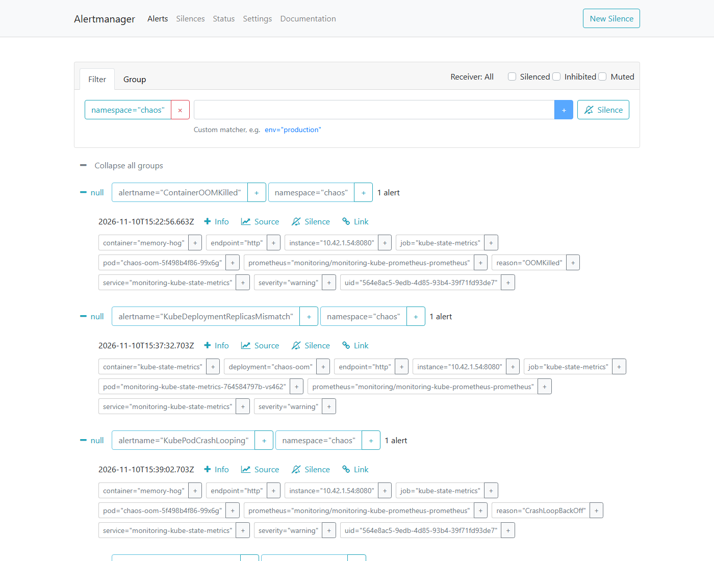

**2. Prometheus – powód zakończenia** – ta sama informacja co `Last State` w `describe`, jako metryka
(na niej opiera się alert `ContainerOOMKilled`):

```
kube_pod_container_status_last_terminated_reason{namespace="chaos"} == 1
```

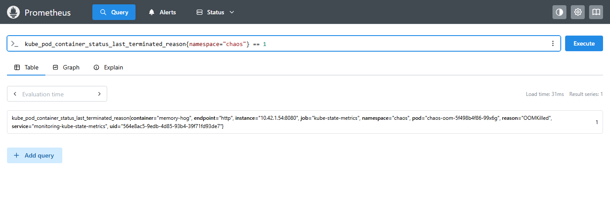

**3. Prometheus – restarty** – schody: na początku gęsto, potem równo co 5 minut (back-off doszedł do maksimum):

```
kube_pod_container_status_restarts_total{namespace="chaos"}
```

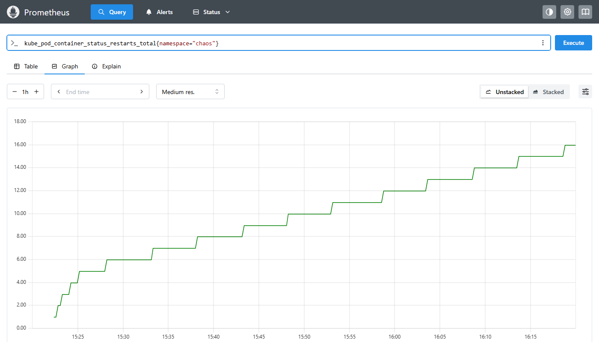

**4. Prometheus – pamięć przed naprawą: pusto.** Kontener żyje ok. 1 s, a pomiar jest co 30 s – nie
trafia. Limit widać (`104857600` B = 100 MiB). Przy OOM przyczynę pokazuje `describe` i metryka powodu,
nie wykres pamięci.

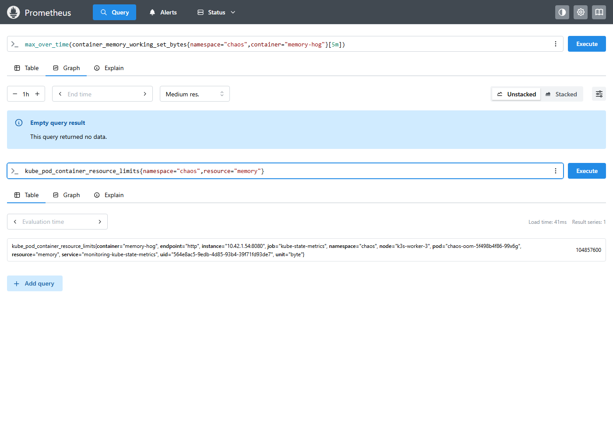

**5. Grafana po naprawie** (*Kubernetes / Compute Resources / Pod*, namespace `chaos`, panel
*Memory Usage (WSS)*): `memory-hog` **251 MiB**, `requests` 50 MiB, `limits` **300 MiB** – zużycie pod
limitem, 0 restartów. Spadki na wykresie to `--vm-hang 1` (program co sekundę zwalnia i zajmuje pamięć).

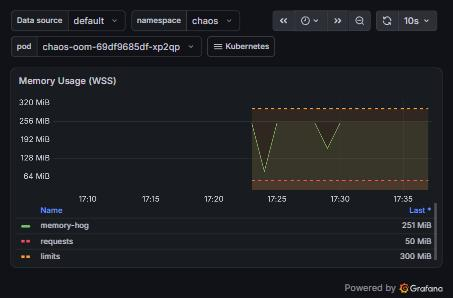

**Jak to opowiedzieć na rozmowie:** *„Dostałem alert `KubePodCrashLooping` i mój własny `ContainerOOMKilled`.
Etykiety w Alertmanagerze wskazały pod i powód. W `kubectl describe`: `OOMKilled`, kod 137, limit 100 MiB.
Wykres pamięci był pusty, bo kontener żył krócej niż odstęp pomiaru – oparłem się na `describe` i metryce
powodu zakończenia. Podniosłem limit do 300 MiB, a w Grafanie sprawdziłem, że zużycie, ok. 250 MiB, jest
poniżej limitu.”*

**Pytanie rekrutacyjne:** *Pod ma status OOMKilled. Co robisz?* – `describe`: powód, kod 137 i limit;
w metrykach sprawdzam, czy zużycie jest stałe, czy rośnie. Stałe – podnoszę limit w manifeście w gicie;
rośnie – zgłaszam wyciek pamięci, limit podnoszę tylko tymczasowo.

## CrashLoopBackOff

```bash
sudo ./scripts/chaos.sh crashloop
kubectl -n chaos logs -l scenario=crashloop --previous
```

Logi pokazują przyczynę (brak pliku konfiguracyjnego). Odstępy między restartami rosną (back-off).
Alerty: `PodRestartingTooOften`, a po dłuższym czasie `KubePodCrashLooping`.

### Przebieg w labie (10.11.2026)

**Zadanie:** pod restartuje się w kółko, ale pamięci mu nie brakuje – znajdź przyczynę i napraw.
W Zadaniu 1 system zabijał program; tutaj **program sam się wyłącza** – przyczyna jest w **logach**.

**1. Logi** – `kubectl -n chaos logs -l scenario=crashloop` (bez słowa `pod` – przy `logs` podaje się
albo nazwę poda, albo `-l`):

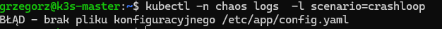

Gdy logi są puste (pod akurat czeka w back-offie), pomaga `--previous` – logi poprzedniego, martwego uruchomienia.

**2. `describe`** – `kubectl -n chaos describe pod -l scenario=crashloop | grep -A5 "Last State"`:

```
Last State:     Terminated
  Reason:       Error
  Exit Code:    1
  Started:      Tue, 10 Nov 2026 17:44:59 +0100
  Finished:     Tue, 10 Nov 2026 17:45:04 +0100
```

| Kod | Kto zakończył | Gdzie szukać przyczyny |
|---|---|---|
| `0` | program – wszystko OK | – |
| `1` | **program sam** – błąd | **logi** |
| `137` | **system** (128 + 9) – zwykle brak pamięci | `describe` → `OOMKilled` |

**3. Naprawa – dostarczyć plik przez ConfigMap** („teczka” z plikami przypinana do poda):

```bash
kubectl -n chaos create configmap app-config --from-literal=config.yaml="poziom_logow: info"
```

Potem przypięcie teczki w katalogu `/etc/app` łatką (`patch`) z pliku. Program w `crashloop.yaml` to
atrapa – zawsze kończy się błędem – więc łatka podmienia też polecenie na takie, które naprawdę sprawdza plik:

```yaml
# /tmp/naprawa-crashloop.yaml
spec:
  template:
    spec:
      volumes:
        - name: config
          configMap:
            name: app-config
      containers:
        - name: broken-app
          volumeMounts:
            - name: config
              mountPath: /etc/app
          args:
            - "if [ -f /etc/app/config.yaml ]; then echo 'OK - wczytano config:'; cat /etc/app/config.yaml; echo; while true; do sleep 3600; done; else echo 'BŁĄD - brak pliku konfiguracyjnego /etc/app/config.yaml'; exit 1; fi"
```

```bash
kubectl -n chaos patch deployment chaos-crashloop --patch-file /tmp/naprawa-crashloop.yaml
# deployment.apps/chaos-crashloop patched
```

`patch` dokleja tylko podane pola (kontenery łączone po nazwie), reszta Deploymentu zostaje.

**4. Monitoring** – restarty starego poda rosną schodkami (7 restartów w 12 minut), po naprawie nowy pod
(zielona linia na dole) ma 0:

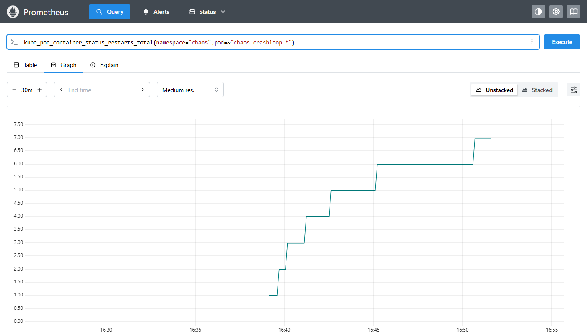

Alert `KubePodCrashLooping` był tylko w stanie *pending* – reguła ma `for: 15m`, a naprawa przyszła
wcześniej, więc do Alertmanagera nic nie dotarło. Krótka awaria naprawiona szybko nie budzi nikogo – i tak ma być.

| Widzę | To znaczy | Robię |
|---|---|---|
| restarty, `Error`, `Exit Code: 1` | program sam się wyłącza | `logs` (albo `logs --previous`) i naprawiam to, czego brakuje |

**Pytanie rekrutacyjne:** *Pod jest w CrashLoopBackOff. Od czego zaczynasz?* – `kubectl logs --previous`
(co program wypisał przed śmiercią) i `describe` (powód i kod wyjścia: `1` – błąd aplikacji, `137` – zabity,
zwykle OOM). CrashLoopBackOff to nie przyczyna, tylko czekanie między restartami.

## ImagePullBackOff

```bash
sudo ./scripts/chaos.sh imagepull
kubectl -n chaos describe pod -l scenario=imagepull   # sekcja Events
```

Typowe przyczyny w praktyce: literówka w nazwie lub tagu, prywatny rejestr bez danych logowania,
limit pobrań z Docker Hub.

### Przebieg w labie (10.11.2026)

**Zadanie:** pod w ogóle nie startuje – bez restartów i bez logów. Kubernetes nie może pobrać programu
(jak przesyłka zamówiona pod adres sklepu, którego nie ma). Narzędzie: sekcja **Events** w `describe`.

**Dowód w trzech poleceniach:**

| Dowód | Polecenie | Co mówi |
|---|---|---|
| 1. stan | `kubectl -n chaos get pods -l scenario=imagepull` | `ImagePullBackOff`, `RESTARTS 0` – kontener nigdy nie ruszył |
| 2. przyczyna | `kubectl -n chaos describe pod -l scenario=imagepull \| grep -A10 Events` | `Failed to pull image … not found` |
| 3. wpis | `kubectl -n chaos get deployment chaos-imagepull -o jsonpath='{.spec.template.spec.containers[*].image}'` | tag, którego nie ma w rejestrze |

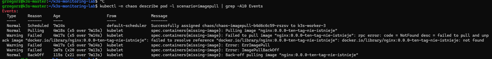

Kolejno: `Scheduled` (worker-3) → `Pulling` → `Failed … NotFound` → `ErrImagePull` → `ImagePullBackOff` →
`BackOff` (21 prób w 7 minut). W pliku jest samo `nginx`, a kubelet szuka `docker.io/library/nginx` – bez
nazwy rejestru domyślny jest Docker Hub.

| Komunikat w Events | Przyczyna |
|---|---|
| `not found` | zła nazwa albo tag (ten przypadek) |
| `unauthorized` / `access denied` | prywatny rejestr bez danych logowania |
| `toomanyrequests` | limit pobrań Docker Hub |
| `x509: certificate signed by unknown authority` | węzeł nie ufa certyfikatowi rejestru ([Etap 4](../etap-4-monitoring-zewnetrzny/problemy.md#x509-certificate-signed-by-unknown-authority)) |
| `no such host` / `timeout` | sieć albo DNS na węźle |

**Naprawa.** Skąd części polecenia: `deployment/chaos-imagepull` – `kind` i `metadata.name` z pliku
(albo `kubectl -n chaos get deployments`), `missing-image` – nazwa kontenera (`containers[].name`, w Events
`spec.containers{missing-image}`):

```bash
kubectl -n chaos set image deployment/chaos-imagepull missing-image=nginx:1.27   # szybko, tylko w klastrze
```

**Właściwie** zmienia się manifest, a nie sam klaster – inaczej przy następnym `kubectl apply` zły obraz wraca
(drift). Plik w `kubernetes/chaos/` jest celowo zepsuty, więc ćwiczy się na kopii:

```bash
cp kubernetes/chaos/imagepull.yaml /tmp/imagepull-naprawa.yaml
nano /tmp/imagepull-naprawa.yaml                 # image: nginx:1.27
kubectl diff -f /tmp/imagepull-naprawa.yaml      # co się zmieni – bez zmiany
kubectl apply -f /tmp/imagepull-naprawa.yaml
```

W pracy: zmiana w repozytorium, commit, `kubectl apply` (w Etapie 7 – Argo CD). Naprawy nie wykonano w labie
10.11 – właściciel przeszedł do kolejnego zadania po diagnozie.

| Widzę | To znaczy | Robię |
|---|---|---|
| `ErrImagePull` / `ImagePullBackOff`, 0 restartów | obraz się nie pobiera | Events → komunikat → poprawiam nazwę/tag w manifeście |

**Pytanie rekrutacyjne:** *Pod wisi w ImagePullBackOff. Co sprawdzasz?* – Events w `describe`: `not found`
(literówka w nazwie lub tagu), `unauthorized` (brak `imagePullSecrets`), `toomanyrequests` (limit Docker Hub),
`x509` (zaufanie do rejestru), `timeout` (sieć). Naprawiam w manifeście w gicie, nie tylko w klastrze.

## Obciążenie CPU

```bash
sudo ./scripts/chaos.sh cpu
kubectl top pods -n chaos
```

W Grafanie (*Kubernetes / Compute Resources / Pod*) widać, że kontener jest ograniczany do limitu 500m
(CPU throttling), a nie zabijany – inaczej niż przy pamięci.

### Przebieg w labie (10.11.2026)

**Zadanie:** pod działa (`Running`, 0 restartów), ale jest wolny. Czy dostaje tyle procesora, ile chce?

| | Pamięć (Zadanie 1) | Procesor (Zadanie 4) |
|---|---|---|
| przekroczenie limitu | program **zabity** (`OOMKilled`) | program **spowolniony** (throttling) |
| porównanie | szklanka się przelewa | samochód z ogranicznikiem prędkości |

W `cpu.yaml`: `args: ["--cpu", "2"]` – dwa procesy liczące bez przerwy, razem 2 rdzenie (2000m);
limit `500m` = pół rdzenia (`m` – tysięczna część rdzenia). Ile program **chce**, monitoring nie pokaże –
widać tylko, ile **dostał** i jak często był przyhamowany.

**1. Grafana** (*Kubernetes / Compute Resources / Namespace (Pods)*, namespace `chaos`): tabela *CPU Quota* –
`chaos-cpu`: Usage 0.313 (rośnie), Requests 0.100 (313%), Limits 0.500 (62.6%). `requests` to gwarantowane
minimum, nie maksimum – zużycie może je przekraczać aż do `limits`.

**2. `kubectl top pod -n chaos`** po kilku minutach: `chaos-cpu-… 501m` – dokładnie limit.

**3. Prometheus – throttling** (procent okresów 100 ms, w których kontener wyczerpał przydział i czekał):

```
100 * sum by (pod) (rate(container_cpu_cfs_throttled_periods_total{namespace="chaos",container="cpu-hog"}[2m]))
    / sum by (pod) (rate(container_cpu_cfs_periods_total{namespace="chaos",container="cpu-hog"}[2m]))
```

Wynik: **100%** przy limicie 500m (zielona linia), po podniesieniu limitu – ok. 0 (nowy pod na dole):

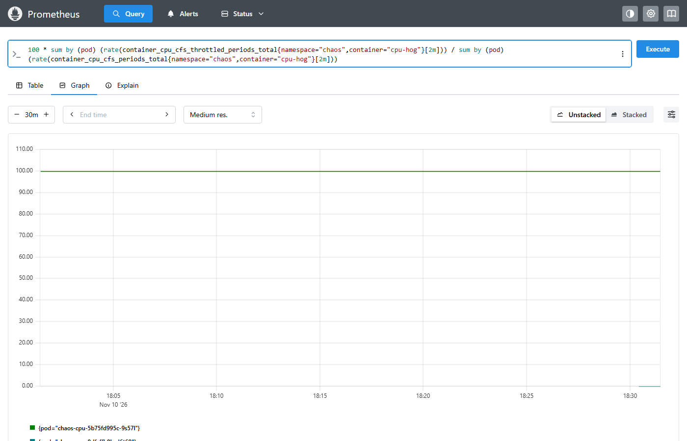

**4. Alert `CPUThrottlingHigh`** (z kube-prometheus-stack): throttling > 25% przez `for: 15m`, `severity: info`.
W Prometheusie: zakładka **Alerts** (nie *Status → Rule health*), wyszukaj nazwę – najpierw *PENDING*:

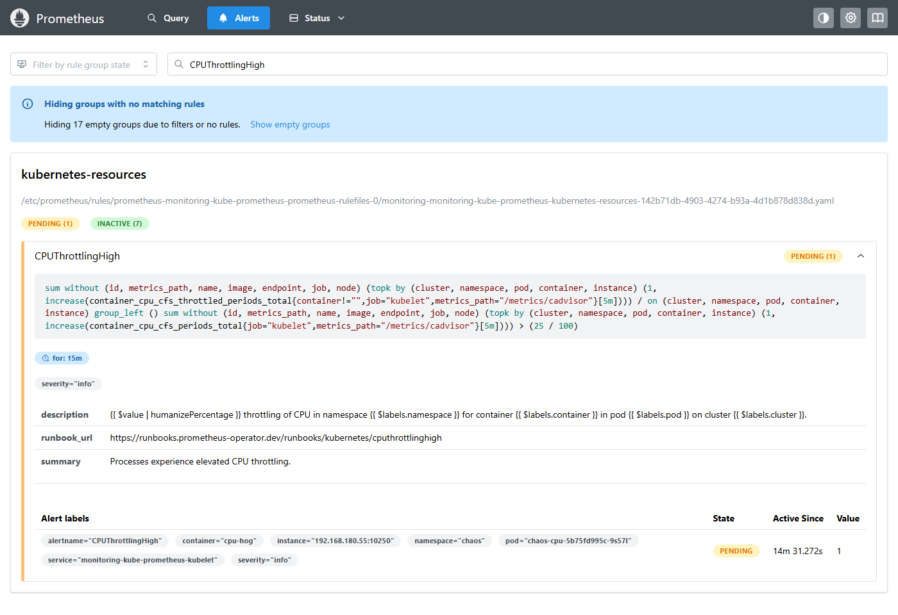

W Alertmanagerze po 15 minutach jest, ale **niewidoczny** na liście – trzeba zaznaczyć **☑ Inhibited**
(adres: `http://192.168.180.51:30093/#/alerts?inhibited=true&filter=%7Bnamespace%3D%22chaos%22%7D`):

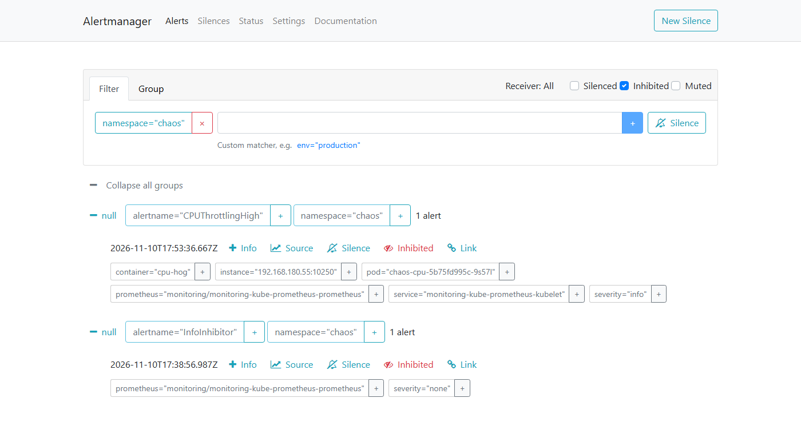

`InfoInhibitor` (z kube-prometheus-stack, `severity: none`) to alert pomocniczy – „nie przeszkadzać
drobiazgami”. Włącza się, gdy w namespace są alerty `info` i nie ma `warning`/`critical`; Alertmanager tłumi
wtedy wszystkie alerty `info` z tego namespace'u. Gdy pojawi się prawdziwy problem (`warning`), wyciszacz gaśnie
i `info` przychodzi jako kontekst.

| Pole w Alertmanagerze | Kto ukrywa | Kiedy |
|---|---|---|
| **Silenced** | człowiek, ręcznie (*New Silence*) | planowane prace, ćwiczenia |
| **Inhibited** | reguła (`inhibit_rules`) | jest ważniejszy alert albo `InfoInhibitor` |
| **Muted** | harmonogram (`time_intervals`) | np. weekendy – w labie nieużywane |

**5. Naprawa – podniesienie limitu:**

```bash
kubectl -n chaos set resources deployment/chaos-cpu --limits=cpu=3
kubectl top pod -n chaos      # chaos-cpu-8dfcffb8b-d6t69   1905m
```

Program naprawdę chciał ok. **1,9 rdzenia**. Linia zużycia: 0.5 płasko (ogranicznik), potem nowy pod rośnie:

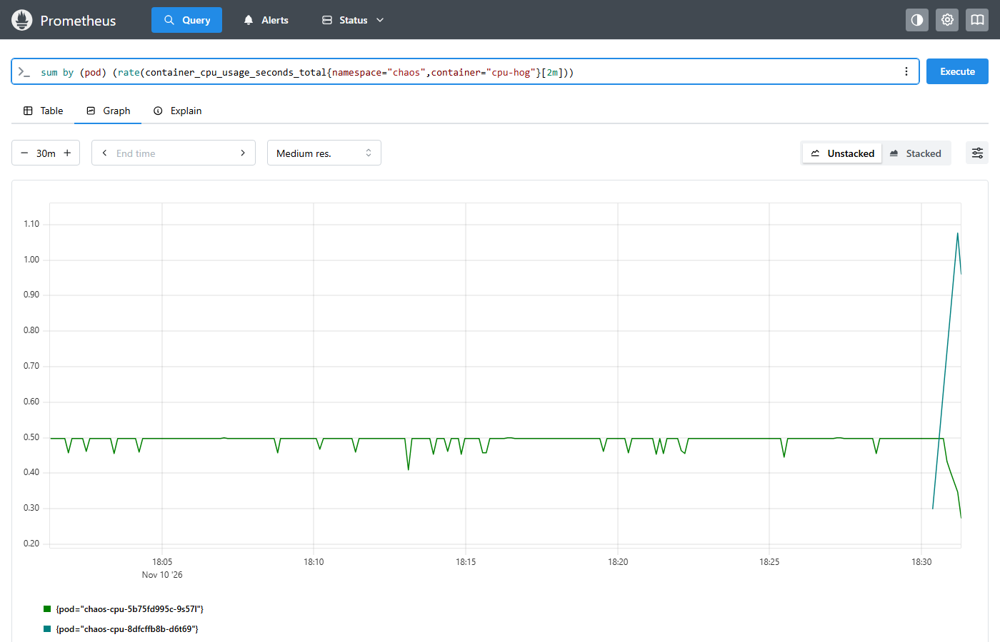

⚠️ Workery mają po **2 rdzenie** (`count by (instance)(node_cpu_seconds_total{mode="idle"})`) – pod bez
ogranicznika zajmuje prawie cały węzeł i spowalnia sąsiadów. Dlatego limity CPU ustawia się świadomie,
a scenariusz po ćwiczeniu się usuwa.

| Widzę | To znaczy | Robię |
|---|---|---|
| zużycie płasko na limicie, throttling wysoki, aplikacja wolna | program chce więcej, niż pozwala limit | sprawdzam, ile potrzebuje; podnoszę limit albo optymalizuję aplikację |

**Pytanie rekrutacyjne:** *Czym różni się przekroczenie limitu pamięci od limitu CPU?* – Pamięci nie da się
„oddać” na chwilę, więc kontener jest zabijany (`OOMKilled`, 137). Procesor dzieli się w czasie, więc kontener
jest tylko przyhamowywany (throttling) – działa, ale wolniej. Widać to w metryce `container_cpu_cfs_throttled_periods_total`
i w alercie `CPUThrottlingHigh` (domyślnie `info`, tłumiony przez `InfoInhibitor`).

## Błędne wdrożenie i wycofanie

```bash
sudo ./scripts/chaos.sh bad-deploy
```

Skrypt wdraża nieistniejącą wersję obrazu, pokazuje historię wdrożeń i wycofuje zmianę przez
`kubectl rollout undo`. Dzięki `maxUnavailable: 1` aplikacja działa przez cały czas.

## Awaria całego klastra

Wyłącz wszystkie węzły. Oczekiwane: alarm w Uptime Kuma i powiadomienie z healthchecks.io
(brak alertu `Watchdog`).

## Ćwiczenie: własna reguła alertu

Reguły w labie przyszły z chartu albo z repozytorium ([instalacja monitoringu](../etap-3-monitoring/01-instalacja-monitoringu.md#własne-alerty)).
W tym ćwiczeniu piszesz **własną** – od zapytania do alertu w stanie *firing*.

Cel: alert `NodeDiskAlmostFull`, gdy główny dysk (`/`) któregoś węzła jest zapełniony w ponad 85%.

**1. Najpierw zapytanie – w Prometheusie** (`http://192.168.180.51:30090`, *Query*):

```
(1 - node_filesystem_avail_bytes{mountpoint="/"} / node_filesystem_size_bytes{mountpoint="/"}) * 100
```

Zobaczysz zajętość dysku w % dla każdego węzła. Zawsze zaczynaj od samego zapytania: jeśli nie
zwraca danych, reguła też nic nie wykryje.

| Część | Znaczenie |
|---|---|
| `node_filesystem_avail_bytes` | wolne miejsce w bajtach (z node-exportera) |
| `node_filesystem_size_bytes` | rozmiar systemu plików |
| `{mountpoint="/"}` | tylko główny dysk, bez `/boot` i systemów tymczasowych |
| `1 - wolne/rozmiar` | ułamek zajętego miejsca; `* 100` – procenty |

**2. Reguła – dopisz na końcu pliku** `kubernetes/monitoring/prometheusrule-lab.yaml`
(na masterze: `nano ~/k3s-monitoring-lab/kubernetes/monitoring/prometheusrule-lab.yaml`),
z takimi samymi wcięciami jak grupa `lab.nodes`:

```yaml
        - alert: NodeDiskAlmostFull
          expr: (1 - node_filesystem_avail_bytes{mountpoint="/"} / node_filesystem_size_bytes{mountpoint="/"}) > 0.85
          for: 10m
          labels:
            severity: warning
          annotations:
            summary: "Dysk na {{ $labels.instance }} prawie pełny"
            description: "Zajęte {{ $value | humanizePercentage }} głównego systemu plików."
```

`humanizePercentage` zamienia `0.87` na `87%`. Wcięcia w YAML to spacje – zła liczba spacji to
najczęstszy błąd.

**3. Sprawdzenie i wdrożenie:**

```bash
kubectl apply --dry-run=server -f ~/k3s-monitoring-lab/kubernetes/monitoring/prometheusrule-lab.yaml
kubectl apply -f ~/k3s-monitoring-lab/kubernetes/monitoring/prometheusrule-lab.yaml
```

`--dry-run=server` wysyła obiekt do API bez zapisywania – **webhook operatora** sprawdzi przy
tym poprawność reguły (zły PromQL = błąd od razu, a nie zepsuta reguła w Prometheusie).

Po ~1 minucie: *Status → Rule health* – reguła `NodeDiskAlmostFull` w stanie `ok`;
*Alerts* – w stanie *inactive*.

**4. Wywołanie alertu.** Żeby zobaczyć *pending* → *firing* bez zapełniania dysku, zmień
tymczasowo próg z `0.85` na wartość **niższą** niż obecna zajętość (np. `0.10`) i `for` na `1m`,
wykonaj `kubectl apply`, obserwuj stronę *Alerts*. Potem przywróć `0.85` i `10m`.

**5. Do gita** – to Twoja reguła:

```bash
cd ~/k3s-monitoring-lab && git diff && git add kubernetes/monitoring/prometheusrule-lab.yaml && git commit -m "Alert NodeDiskAlmostFull"
```

Na rozmowie: *"I wrote a custom alert rule – I tested the PromQL query in Prometheus first,
validated it with a server-side dry run and deployed it as a PrometheusRule."*

## Sprzątanie

```bash
sudo ./scripts/chaos.sh cleanup
```
