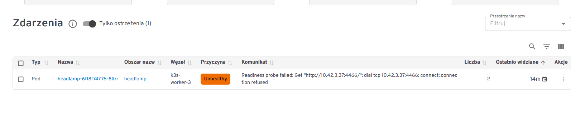

# Headlamp – panel WWW do klastra

Headlamp to `kubectl` w przeglądarce. Widać w nim pody, logi, zdarzenia i YAML każdego obiektu.
Można też skalować i edytować. Instalacja z 03.11.2026: chart `headlamp/headlamp` **0.46.0**,
namespace `headlamp`, adres **`http://192.168.180.51:30400`**.

## Spis treści

1. [Czym jest Headlamp](#czym-jest-headlamp)
2. [Instalacja krok po kroku](#instalacja-krok-po-kroku)
3. [Logowanie tokenem](#logowanie-tokenem)
4. [Pierwsze ostrzeżenie: Readiness probe failed](#pierwsze-ostrzeżenie-readiness-probe-failed)
5. [Bezpieczeństwo](#bezpieczeństwo)
6. [Odinstalowanie](#odinstalowanie)
7. [Pytania rekrutacyjne](#pytania-rekrutacyjne)

## Czym jest Headlamp

🔦 **Analogia:** `kubectl` to rozmowa z klastrem przez telefon – pytasz i słuchasz odpowiedzi.
Headlamp to okno, przez które widzisz cały klaster naraz i klikasz zamiast pisać.

| Narzędzie | Co pokazuje | Kiedy |
|---|---|---|
| `kubectl` | stan obiektów, tekstem | zawsze, także w skryptach i gdy GUI nie działa |
| **Headlamp** | stan obiektów, w przeglądarce: pody, logi, zdarzenia, YAML | szybki przegląd, szukanie, nauka zależności |
| Grafana | **metryki w czasie** (CPU, pamięć, ruch) | „co działo się przez ostatnią godzinę” |

Headlamp nie zbiera metryk i nie ma bazy. Każdy ekran to zapytanie do API Kubernetesa – tego
samego, z którym rozmawia `kubectl`. Dlatego nie potrzebuje trwałego dysku.

Działa w **osobnym namespace `headlamp`**, nie w `monitoring`: to nie jest narzędzie monitoringu,
a własny namespace pozwala usunąć je w całości bez ruszania Prometheusa. Namespace mówi, gdzie
mieszka pod Headlampa – co Headlamp **widzi**, zależy od uprawnień konta (tu cały klaster).

## Instalacja krok po kroku

Wszystko 🐧 na `k3s-master` (`ssh k3s-master`).

### Krok 1. Repozytorium charta

```bash
helm repo add headlamp https://kubernetes-sigs.github.io/headlamp/
helm repo update
helm search repo headlamp/headlamp
```

`helm repo add` dopisuje adres katalogu chartów pod nazwą `headlamp`, `helm repo update`
pobiera aktualny spis, `helm search` pokazuje najnowszą wersję (03.11.2026: `0.46.0`).

### Krok 2. Instalacja

```bash
helm install headlamp headlamp/headlamp --version 0.46.0 -n headlamp --create-namespace
```

- `headlamp` (pierwsze) – nazwa release'u, `headlamp/headlamp` – repozytorium/chart,
- `--version 0.46.0` – stała wersja, żeby instalacja dała się powtórzyć,
- `-n headlamp --create-namespace` – namespace `headlamp`, Helm sam go założy.

Co powstało (prawdziwy wynik z labu):

```
grzegorz@k3s-master:~/k3s-monitoring-lab$ kubectl -n headlamp get pods,svc
NAME                            READY   STATUS    RESTARTS   AGE
pod/headlamp-6ff8f74776-8ltrr   1/1     Running   0          5m

NAME               TYPE        CLUSTER-IP      EXTERNAL-IP   PORT(S)   AGE
service/headlamp   ClusterIP   10.43.225.232   <none>        80/TCP    5m
```

Oprócz tego chart utworzył konto usługi `headlamp` i powiązanie `headlamp-admin` z rolą
**`cluster-admin`** (`kubectl get clusterrolebinding headlamp-admin`).

### Krok 3. Dostęp z przeglądarki – NodePort

Service typu **ClusterIP** ma adres widoczny tylko wewnątrz klastra (`10.43.…`), przeglądarka na
Windowsie tam nie dojdzie. Zmieniamy typ na **NodePort** – każdy węzeł otworzy port 30400:

```bash
helm upgrade headlamp headlamp/headlamp --version 0.46.0 -n headlamp --reuse-values --set service.type=NodePort --set service.nodePort=30400
```

- `--reuse-values` – zachowaj dotychczasowe ustawienia, dołóż tylko nowe,
- `--set service.nodePort=30400` – stały numer; bez niego Kubernetes wylosowałby port z 30000–32767.

```
Release "headlamp" has been upgraded. Happy Helming!
NAMESPACE: headlamp
STATUS: deployed
REVISION: 2
```

`REVISION: 2` – nowa wersja release'u. Powrót do poprzedniej: `helm rollback headlamp 1 -n headlamp`.

```
grzegorz@k3s-master:~/k3s-monitoring-lab$ kubectl -n headlamp get svc headlamp
NAME       TYPE       CLUSTER-IP      EXTERNAL-IP   PORT(S)        AGE
headlamp   NodePort   10.43.225.232   <none>        80:30400/TCP   9m10s
```

`80:30400` – port 80 wewnątrz klastra, 30400 na każdym węźle. Firewall (`ufw`) wpuszcza
NodePorty tylko z `ADMIN_CIDR`, więc panel otworzysz z Windowsa, ale nie z dowolnej sieci.

> Ustawienia z `--set` żyją tylko w release'ie Helma, nie w gicie. Przy następnej zmianie warto
> przenieść je do pliku values w repozytorium (tak jak `monitoring/kube-prometheus-stack-values.yaml`).

### Krok 4. Otwórz panel

🪟 W przeglądarce na Windowsie: `http://192.168.180.51:30400` (działa też adres każdego workera,
np. `.52:30400`). Headlamp poprosi o token – patrz niżej.

## Logowanie tokenem

Headlamp **nie ma loginu ani hasła** (nie ma konta `admin` jak Grafana). Prosi o **token** konta
usługi i pyta Kubernetesa, kim jest właściciel tokenu i co mu wolno. Tak samo działa `kubectl` –
też nie ma hasła, tylko certyfikat w kubeconfigu.

```bash
kubectl create token headlamp -n headlamp --duration=24h
```

Wynik to jedna długa linia `eyJhbGciOiJSUzI1NiIs…` – skopiuj całość, wklej w pole **ID token**
i kliknij **Authenticate**.

### Ważność tokenu

| Polecenie | Ważny |
|---|---|
| `kubectl create token headlamp -n headlamp` | 1 godzina (domyślnie) |
| `… --duration=24h` | 24 godziny |
| `… --duration=1440h` | około 2 miesięcy (60 × 24 h) |

`--duration` przyjmuje godziny, minuty i sekundy (`h`, `m`, `s`), ale nie dni. Termin ważności
sprawdzisz bez wypisywania tokenu (każde wywołanie tworzy nowy token):

```bash
kubectl create token headlamp -n headlamp --duration=1440h -o jsonpath='{.status.expirationTimestamp}'; echo
```

W labie 03.11.2026 wynik to `2027-01-02T15:14:11Z` – k3s przyjmuje tak długi termin.

Niezależnie od tokenu Headlamp ma własny czas sesji: `config.sessionTTL: 86400` (24 h). Po
wylogowaniu wklejasz **ten sam** token, nie trzeba generować nowego.

### Dlaczego tokeny wygasają

Token to klucz do całego klastra. Po wycieku (historia przeglądarki, zrzut ekranu, notatka)
działa tylko do terminu ważności – jak karta hotelowa, nie klucz do mieszkania. Tokeny z
`kubectl create token` pochodzą z API **TokenRequest**: nie zostają w klastrze jako Secret
i nie da się ich unieważnić pojedynczo. Jedyny sposób to usunąć konto usługi (wtedy przestają
działać wszystkie jego tokeny; Helm odtworzy konto przy `helm upgrade`).

Token „na zawsze” daje stary mechanizm – Secret typu `kubernetes.io/service-account-token`.
Kubernetes odradza go od wersji 1.24. W firmach Headlamp loguje przez **OIDC** (Keycloak,
Azure AD, Google): pracownik wchodzi kontem firmowym, uprawnienia wynikają z jego grupy
(w chartcie: `config.oidc`).

## Pierwsze ostrzeżenie: Readiness probe failed

Zaraz po instalacji w Headlampie (Zdarzenia → „Tylko ostrzeżenia”) widać:



Zdarzenia z klastra pokazują, że to chwila startu:

```
grzegorz@k3s-master:~$ kubectl -n headlamp get events --sort-by=.lastTimestamp
15m   Normal    Pulled      Successfully pulled image "ghcr.io/headlamp-k8s/headlamp:v0.46.0" in 48.611s
15m   Normal    Started     Container started
15m   Warning   Unhealthy   Readiness probe failed: Get "http://10.42.3.37:4466/": dial tcp 10.42.3.37:4466: connect: connection refused
```

Test gotowości w chartcie nie ma `initialDelaySeconds`:

```
{"failureThreshold":3,"httpGet":{"path":"/","port":"http"},"periodSeconds":10,"timeoutSeconds":1}
```

Kubelet zapytał zaraz po starcie kontenera, zanim program otworzył port 4466 – stąd
`connection refused` (2 razy). Następny test przeszedł, pod jest `1/1 Running`, 0 restartów.
To norma przy starcie. Problem byłby, gdyby licznik rósł, a „ostatnio widziane” było świeże.

| Test | Gdy nie przejdzie |
|---|---|
| `readinessProbe` (gotowość) | pod wypada z Service – nie dostaje ruchu, **bez restartu** |
| `livenessProbe` (czy żyje) | kontener jest **restartowany** |

Zdarzenia w Kubernetesie znikają same po około godzinie.

## Bezpieczeństwo

- Konto `headlamp` ma `cluster-admin` – kto ma token, ma cały klaster. Tokenu nie wklejaj do
  repozytorium, notatek w gicie ani na zrzuty.
- Dostęp tylko z `ADMIN_CIDR` (firewall na węzłach), bez wystawiania do internetu.
- Kolejny krok (do zrobienia): osobne konto tylko do odczytu, np. ServiceAccount z rolą `view`,
  do przeglądania bez ryzyka przypadkowego usunięcia.

## Odinstalowanie

```bash
helm uninstall headlamp -n headlamp
kubectl delete namespace headlamp
```

Usuwa pod, Service, konto usługi i powiązanie z `cluster-admin`. Reszta klastra zostaje.

## Pytania rekrutacyjne

**Czym różni się Headlamp (albo Kubernetes Dashboard, Lens) od Grafany?**
Headlamp pokazuje aktualny stan obiektów z API Kubernetesa (pody, YAML, zdarzenia) i pozwala je
zmieniać. Grafana pokazuje metryki w czasie z Prometheusa. Jedno nie zastępuje drugiego.

**Jak wystawić aplikację z klastra bez Ingressa?**
Service typu NodePort – port 30000–32767 otwarty na każdym węźle (`80:30400`). W chmurze
LoadBalancer, w produkcji zwykle Ingress albo Gateway API z TLS.

**Po co Service, skoro pod ma IP?**
IP poda jest tymczasowe. Service daje stały adres i nazwę DNS (`headlamp.headlamp.svc.cluster.local`),
wybiera pody po etykietach (selektor) i kieruje ruch tylko do tych, które są Ready.

**Dlaczego `kubectl create token` daje token z terminem ważności?**
To krótkotrwałe tokeny z API TokenRequest – ograniczają szkody po wycieku i nie zostają w klastrze
jako Secret. Wieczne tokeny w Secretach są odradzane od Kubernetesa 1.24.

**Co znaczy `Readiness probe failed: connection refused` zaraz po starcie poda?**
Test gotowości trafił, zanim aplikacja otworzyła port. Jednorazowo przy starcie to norma;
`initialDelaySeconds` albo `startupProbe` to wyciszają. Readiness wyłącza poda z ruchu,
liveness go restartuje.

**Po co `--reuse-values` w `helm upgrade`?**
Bez niego Helm bierze wartości domyślne charta plus to, co podasz teraz – wcześniejsze `--set`
by przepadły. Lepsza praktyka to plik values w gicie podawany przez `-f`.
