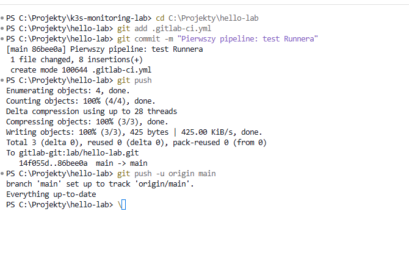

# GitLab Runner na `monitoring` i pierwszy pipeline (26.11.2026)

**Runner** to „pracownik” GitLaba: sam GitLab tylko przechowuje kod i plan pipeline'u (`.gitlab-ci.yml`),
a zadania wykonuje Runner. Runner co kilka sekund pyta GitLaba „masz coś dla mnie?”, bierze zadanie,
uruchamia je i odsyła log i wynik. Połączenie zawsze inicjuje Runner – GitLab nie musi mieć dostępu do maszyny Runnera.

Runner stoi na `monitoring` (`192.168.180.54`), a nie na serwerze `gitlab` – zadania wykonują kod z każdego
commita, więc nie powinny mieć dostępu do bazy i sekretów GitLaba; budowanie obrazów zabiera też RAM i CPU.

```
GitLab (.56)  ◀── „masz zadanie?” (co kilka s) ──  Runner na monitoring (.54)
   │                                                  │ executor docker
   └── zadanie z .gitlab-ci.yml ───────────────────▶  świeży kontener → log i wynik z powrotem do GitLaba
```

## Krok 1. Repozytorium pakietów Runnera

🐧 Na `monitoring` – tak jak przy GitLabie: najpierw pobierz skrypt, przejrzyj, dopiero potem uruchom.

```bash
curl -fsSL -o runner-repo.sh https://packages.gitlab.com/install/repositories/runner/gitlab-runner/script.deb.sh
```

Skrypt ląduje w katalogu, w którym jesteś (po `ssh monitoring` – `/home/grzegorz`). Wynik: 5315 bajtów, 232 linie.

**Co robi skrypt (funkcja `main`):**

1. `detect_system_info` – czyta `/etc/os-release`: `os=ubuntu`, `dist=resolute` (Ubuntu 26.04).
2. `require_tool gpg gnupg` – doinstalowuje `gpg`, jeśli go brak.
3. `fetch_repo_config` – pobiera opis repozytorium do `/etc/apt/sources.list.d/runner_gitlab-runner.list`
   (kod błędu 22 = system niewspierany, 35/60 = problem z TLS).
4. `setup_gpg_key` – pobiera klucz GPG GitLaba, `gpg --dearmor` (zamiana na format binarny) i zapis do
   `/etc/apt/keyrings/runner_gitlab-runner-archive-keyring.gpg`.
5. `apt-get update` – `apt` poznaje pakiety z nowego repozytorium.

Skrypt **nie instaluje** Runnera – tylko przygotowuje `apt`. `set -e` na początku przerywa go przy pierwszym błędzie.

```bash
sudo bash runner-repo.sh
```

Sprawdzenie:

```bash
cat /etc/apt/sources.list.d/runner_gitlab-runner.list
apt-cache policy gitlab-runner
```

```text
deb [signed-by=/etc/apt/keyrings/runner_gitlab-runner-archive-keyring.gpg] https://packages.gitlab.com/runner/gitlab-runner/ubuntu resolute main
gitlab-runner:
  Installed: (none)
  Candidate: 19.6.1-1
```

`signed-by=` – pakiety z tego repozytorium `apt` przyjmie tylko podpisane **tym** kluczem (nie każdym zaufanym kluczem
w systemie). Wersja Runnera 19.6.1 = wersja GitLaba – tak najlepiej.

## Krok 2. Instalacja

```bash
sudo apt install -y gitlab-runner
gitlab-runner --version
```

```text
Version:      19.6.1
Git revision: 9afb29f8
Git branch:   19-6-stable
GO version:   go1.26.11
OS/Arch:      linux/amd64
```

Pakiet zakłada użytkownika systemowego `gitlab-runner` i usługę `gitlab-runner` (systemd). Bez rejestracji usługa
nic nie robi.

## Krok 3. Utworzenie Runnera w GitLabie

W przeglądarce, jako `grzegorz`: projekt **lab / hello-lab → Settings → CI/CD → Runners → Expand → New project runner**:

| Pole | Wartość |
|---|---|
| Tags | `docker` |
| Run untagged jobs | zaznaczone – Runner weźmie też zadania bez tagów |
| Runner description | `monitoring-docker` |

**Create runner** → strona z tokenem `glrt-…` i gotowym poleceniem `gitlab-runner register`.
Token to hasło Runnera – nie wklejaj go do czatu, zrzutów ani do repozytorium.

> Od GitLaba 16 Runnera **tworzy się w GitLabie** (token `glrt-`), a dawny „registration token” wspólny dla
> projektu jest wycofywany. Dzięki temu każdy Runner ma własny token, który można unieważnić osobno.

## Krok 4. Rejestracja

```bash
sudo gitlab-runner register
```

| Pytanie | Odpowiedź |
|---|---|
| `Enter the GitLab instance URL` | `http://192.168.180.56` |
| `Enter the registration token` | token `glrt-…` (wklejanie w terminalu SSH: prawy przycisk myszy) |
| `Enter a name for the runner` | `monitoring-docker` |
| `Enter an executor` | `docker` |
| `Enter the default Docker image` | `alpine:latest` |

**`sudo` jest ważne.** Polecenie skopiowane z GitLaba go nie ma – bez `sudo` Runner zapisuje się w
`~/.gitlab-runner/config.toml` (tryb użytkownika), a usługa systemowa czyta `/etc/gitlab-runner/config.toml`
i takiego Runnera nie widzi.

Wynik zapisuje się w `/etc/gitlab-runner/config.toml` (`sudo cat` – **plik zawiera token, to sekret**):

| Linia | Znaczenie |
|---|---|
| `concurrent = 1` | jedno zadanie naraz |
| `url = "http://192.168.180.56"` | GitLab, od którego Runner bierze zadania |
| `token = "glrt-…"` | dane logowania Runnera |
| `executor = "docker"` | każde zadanie w świeżym kontenerze, usuwanym po zakończeniu (jednorazowe rękawiczki) |
| `image = "alpine:latest"` | obraz domyślny, gdy zadanie nie poda własnego `image:` |
| `privileged = false` | kontenery bez pełnych uprawnień do hosta |
| `volumes = ["/cache"]` | pamięć podręczna między zadaniami |

Sprawdzenie:

```bash
sudo gitlab-runner verify
```

```text
Runtime platform    arch=amd64 os=linux pid=4330 revision=9afb29f8 version=19.6.1
Running in system-mode.

Verifying runner... is valid    runner=ONR1xLro1 runner_name=monitoring-docker
```

`system-mode` = Runner zarejestrowany dla usługi systemowej (z `sudo`). `is valid` = GitLab zna ten token.
W GitLabie przy `monitoring-docker` zielona kropka – *online*.

## Krok 5. Pierwszy pipeline – test Runnera

🪟 Na Windowsie, w repozytorium `C:\Projekty\hello-lab`, plik `.gitlab-ci.yml` (kropka na początku nazwy
obowiązkowa; GitLab sam go wykrywa przy każdym `git push`):

```yaml
stages:
  - test

hello:
  stage: test
  script:
    - echo "Pipeline dziala, kontener $(hostname)"
    - cat /etc/os-release
```

| Linia | Znaczenie |
|---|---|
| `stages:` | lista etapów pipeline'u w kolejności wykonania |
| `hello:` | nazwa zadania (job) |
| `stage: test` | do którego etapu należy zadanie |
| `script:` | polecenia wykonywane po kolei w kontenerze (tu domyślny `alpine:latest`) |

```powershell
cd C:\Projekty\hello-lab
git add .gitlab-ci.yml
git commit -m "Pierwszy pipeline: test Runnera"
git push
```



```text
[main 86bee0a] Pierwszy pipeline: test Runnera
 1 file changed, 8 insertions(+)
 create mode 100644 .gitlab-ci.yml
...
To gitlab-git:lab/hello-lab.git
   14f055d..86bee0a  main -> main
```

Dodatkowe `git push -u origin main` odpowiedziało `Everything up-to-date` – gałąź była już wypchnięta; `-u` tylko
zapamiętuje, że lokalny `main` śledzi `origin/main` (potem wystarczy samo `git push`).

Wynik pipeline'u: projekt → **Build → Pipelines**.

## Pytania rekrutacyjne

- *Czym jest GitLab Runner i kto inicjuje połączenie?* – osobny program, który wykonuje zadania z pipeline'u;
  sam odpytuje GitLaba (polling), więc GitLab nie potrzebuje dostępu do maszyny Runnera.
- *Jakie znasz executory?* – `shell` (polecenia wprost na maszynie Runnera), `docker` (każde zadanie w świeżym
  kontenerze), `kubernetes` (każde zadanie jako pod), też `ssh`, `virtualbox`. `docker` daje czyste, powtarzalne
  środowisko i izolację między zadaniami.
- *Czym różni się token `glrt-` od dawnego registration tokena?* – Runner tworzy się w GitLabie i dostaje własny
  token; da się go unieważnić bez ruszania innych Runnerów. Stary token był wspólny dla projektu/grupy.
- *Do czego służą tagi Runnera?* – zadanie z `tags: [docker]` trafi tylko do Runnera z tym tagiem
  (np. osobne Runnery do budowania obrazów, do wdrożeń na produkcję, z GPU).
- *Dlaczego `privileged = false`?* – kontener uprzywilejowany ma praktycznie pełny dostęp do hosta; złośliwy
  commit mógłby przejąć maszynę Runnera. Potrzebny tylko do Docker-in-Docker – lepiej tego unikać (np. Kaniko, Buildah).
