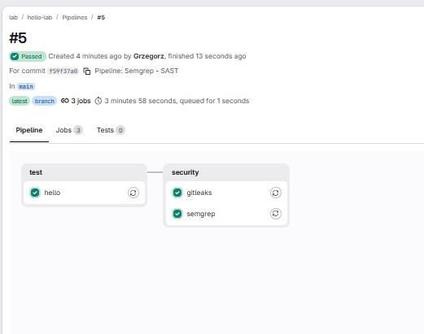
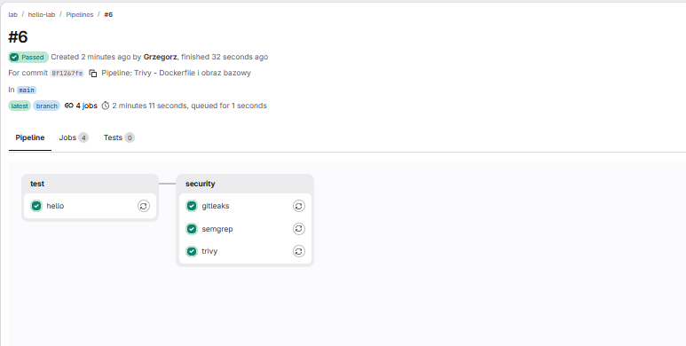

# Etap 7b – skanery bezpieczeństwa w pipeline (26.11.2026)

**DevSecOps / „shift left”:** bezpieczeństwo sprawdzane automatycznie przy każdym commicie, a nie raz przed
wdrożeniem. Błąd znaleziony w pipeline kosztuje minutę; ten sam błąd na produkcji – incydent.

| Skaner | Rodzaj | Czego szuka | Gdzie |
|---|---|---|---|
| gitleaks | secret scanning | hasła, tokeny, klucze w kodzie **i w historii gita** | zadanie `gitleaks` |
| Semgrep | SAST (Static Application Security Testing) | niebezpieczne wzorce w kodzie i w Dockerfile, bez uruchamiania aplikacji | zadanie `semgrep` |
| Trivy | SCA / skan obrazu i konfiguracji | znane podatności (CVE) w pakietach, błędy w Dockerfile | zadanie `trivy` |

Wszystko w repozytorium `lab/hello-lab` w GitLabie (plik `.gitlab-ci.yml`), na Runnerze `monitoring-docker`
([02-gitlab-runner.md](02-gitlab-runner.md)).

## Krok 1. gitleaks – sekrety w historii

Etap `security` po etapie `test`; zadanie w obrazie z gitleaks. Plik `.gitlab-ci.yml` z komentarzami
(komentarz w YAML zaczyna się od `#` – GitLab go pomija, a w repozytorium zostaje ściągawka):

```yaml
# Ustawienia wspólne dla WSZYSTKICH zadań w tym pliku
default:
  tags:
    - docker            # zadania bierze tylko Runner z tagiem "docker" (monitoring-docker)

# Etapy pipeline'u – wykonują się po kolei, z góry na dół
stages:
  - test                # 1. etap: proste testy
  - security            # 2. etap: skanery bezpieczeństwa (rusza dopiero, gdy "test" przejdzie)

# Zadanie 1: test, czy Runner działa
hello:
  stage: test           # należy do etapu "test"
  script:               # polecenia wykonywane po kolei w kontenerze (domyślny obraz alpine:latest)
    - echo "Pipeline dziala, kontener $(hostname)"
    - cat /etc/os-release

# Zadanie 2: gitleaks – szuka sekretów (hasła, tokeny, klucze) w kodzie i w historii commitów
gitleaks:
  stage: security       # należy do etapu "security"
  image:
    name: zricethezav/gitleaks:latest   # obraz z programem gitleaks (zamiast alpine)
    entrypoint: [""]    # wyłącza domyślne polecenie obrazu – GitLab uruchomi nasz "script"
  variables:
    GIT_DEPTH: 0        # pobierz CAŁĄ historię (domyślnie tylko 20 ostatnich commitów)
  script:
    - gitleaks git --verbose --redact .
    # git       – skanuje historię gita (każdy commit, nie tylko obecne pliki)
    # --verbose – wypisuje szczegóły każdego znaleziska
    # --redact  – zamienia znaleziony sekret na "REDACTED", żeby nie wyciekł przez log
    # .         – skanuj bieżący katalog (repozytorium sklonowane przez Runnera)
```

| Element | Po co |
|---|---|
| `image:` w zadaniu | zadanie działa w obrazie z narzędziem zamiast w domyślnym `alpine:latest` |
| `entrypoint: [""]` | obraz gitleaks ma własne polecenie startowe; puste pozwala GitLabowi uruchomić `script` |
| `GIT_DEPTH: 0` | Runner domyślnie klonuje płytko (ostatnie 20 commitów) – sekret sprzed lat by umknął |
| `--redact` | log pipeline'u widzi wiele osób – nie może sam ujawniać znalezionego sekretu |

Commit `8c1fff2` → **pipeline #4 passed** (20 s): `hello` ✅ → `gitleaks` ✅. gitleaks kończy się błędem przy
każdym znalezisku, więc zielone zadanie = brak sekretów w całej historii (4 commity).


Log zadania `gitleaks` (job #10, 17 s) – skrócony:

```text
Running with gitlab-runner 19.6.1 (9afb29f8)
  on monitoring-docker ONR1xLro1, system ID: s_d7ec67165f91
Preparing the "docker" executor                                    00:17
Pulling docker image zricethezav/gitleaks:latest ...
Using docker image sha256:c08b6bd0aeb3… for zricethezav/gitleaks:latest with digest zricethezav/gitleaks@sha256:c08b6bd0aeb3…
Preparing environment
Running on runner-onr1xlro1-project-1-concurrent-0 via monitoring...
Getting source from Git repository
Fetching changes...
Checking out 8c1fff28 as detached HEAD (ref is main)...
Executing "step_script" stage of the job script
$ gitleaks git --verbose --redact .
7:56AM INF 4 commits scanned.
7:56AM INF scanned ~5032 bytes (5.03 KB) in 53.5ms
7:56AM INF no leaks found
Cleaning up project directory and file based variables
Job succeeded
```

| Sekcja logu | Co się dzieje |
|---|---|
| `Preparing the "docker" executor` | Runner pobiera obraz z zadania (17 s – pierwszy raz; potem z pamięci Dockera na `monitoring`) |
| `Using docker image … with digest …` | dokładna wersja obrazu (digest) – `latest` może jutro oznaczać inny obraz, digest nie |
| `Getting source from Git repository` | Runner klonuje repozytorium i przełącza się na commit pipeline'u (`8c1fff28`) |
| `Executing "step_script"` | polecenia z `script:` |
| `4 commits scanned`, `no leaks found` | dzięki `GIT_DEPTH: 0` przejrzana cała historia – 4 commity, brak sekretów |
| `Cleaning up` | kontener zadania usunięty („jednorazowe rękawiczki”) |

Uwaga `Unknown SCM platform` – gitleaks nie rozpoznał GitLaba po adresie IP, więc w raporcie nie ma linków
do commitów; nie wpływa na wynik skanu.

**Sekret w historii:** usunięcie hasła w nowym commicie nic nie daje – stary commit nadal je zawiera i każdy,
kto sklonuje repozytorium, może je odczytać. Kolejność: **najpierw unieważnij** (nowe hasło / nowy token),
potem ewentualnie przepisz historię (`git filter-repo`) i dodaj regułę do pipeline'u.

## Krok 2. Semgrep – SAST

Dopisane na końcu `.gitlab-ci.yml`:

```yaml
# Zadanie 3: Semgrep (SAST) – szuka niebezpiecznych wzorców w kodzie, bez uruchamiania aplikacji
semgrep:
  stage: security       # ten sam etap co gitleaks – oba zadania ruszą równolegle
  image: semgrep/semgrep:latest   # oficjalny obraz z programem semgrep
  script:
    - semgrep scan --config p/python --config p/dockerfile --error .
    # scan                  – przeskanuj pliki w katalogu
    # --config p/python     – gotowy zestaw reguł dla Pythona (app.py)
    # --config p/dockerfile – reguły dla Dockerfile
    # --error               – są znaleziska = zadanie czerwone, pipeline zatrzymany
    # .                     – skanuj całe repozytorium
```

`p/python`, `p/dockerfile` – gotowe zestawy reguł z rejestru Semgrepa (pobierane przy każdym skanie).
Zadania w tym samym etapie (`gitleaks`, `semgrep`) działają **równolegle**.

Commit `f59f37a` → **pipeline #5 passed**: `hello` ✅ → `gitleaks` ✅ + `semgrep` ✅. Całość 3 min 58 s – obraz
Semgrepa (kilkaset MB) pobierał się pierwszy raz – w logu `Preparing the "docker" executor` **3 min 46 s**, sam skan 3 s.

Log zadania `semgrep` (job #13) – skrócony:

```text
Fetching changes with git depth set to 20...
Checking out f59f37a0 as detached HEAD (ref is main)...
$ semgrep scan --config p/python --config p/dockerfile --error .

  Scanning 3 files tracked by git with 158 Code rules:

  Language     Rules   Files          Origin      Rules
  python         151       1          Community     158
  dockerfile       7       1
  yaml             1       1

  ✅ Scan completed successfully.
   • Findings: 0 (0 blocking)
   • Rules run: 158
   • Targets scanned: 3
   • Parsed lines: ~100.0%
   • Scan was limited to files tracked by git
Ran 158 rules on 3 files: 0 findings.
Job succeeded
```

| Linia | Znaczenie |
|---|---|
| `git depth set to 20` | zwykły płytki klon – Semgrep patrzy na obecny kod, nie na historię (inaczej niż gitleaks) |
| `3 files tracked by git` | `app.py`, `Dockerfile`, `.gitlab-ci.yml` – Semgrep skanuje tylko pliki śledzone przez gita |
| `151 / 7 / 1` reguł | reguły dobrane do języka pliku (Python, Dockerfile, YAML) z zestawów `p/python` i `p/dockerfile` |
| `Origin: Community` | darmowe reguły społeczności; więcej reguł (Pro) po `semgrep login` |
| `Findings: 0 (0 blocking)` | brak znalezisk – `--error` nie miał czego zatrzymać |
| `Parsed lines: ~100.0%` | Semgrep zrozumiał cały kod (niski procent = pliki, których nie umie przeczytać – fałszywe poczucie bezpieczeństwa) |

0 znalezisk nie znaczy „kod bez błędów” – tylko że żadna z 158 reguł nie pasuje. `app.py` jest mały, bez bazy
danych, plików i poleceń systemowych, a `Dockerfile` ma już `USER 10001` (Etap 4).



## Krok 3. Trivy – Dockerfile i obraz bazowy

Własnego obrazu pipeline jeszcze nie buduje, więc Trivy sprawdza `Dockerfile` (`trivy config`) i **obraz bazowy**
`python:3.14-slim` – z niego aplikacja dziedziczy wszystkie pakiety systemowe i Pythona.

```yaml
# Zadanie 4: Trivy – błędy w Dockerfile i znane podatności (CVE) w obrazie bazowym
trivy:
  stage: security
  image:
    name: aquasec/trivy:latest   # obraz z programem trivy
    entrypoint: [""]             # jak przy gitleaks – GitLab uruchamia nasz "script"
  script:
    - trivy config --exit-code 1 .
    # config        – sprawdza pliki konfiguracyjne (u nas Dockerfile) z dobrymi praktykami
    # --exit-code 1 – są błędy = zadanie czerwone
    - trivy image --severity HIGH,CRITICAL --ignore-unfixed --exit-code 0 python:3.14-slim
    # image              – pobiera obraz i porównuje jego pakiety z bazą znanych podatności (CVE)
    # --severity         – pokazuj tylko poważne: HIGH i CRITICAL
    # --ignore-unfixed   – pomiń podatności, na które nie ma jeszcze poprawki (nie da się ich naprawić)
    # --exit-code 0      – na razie tylko raport, bez zatrzymywania pipeline'u
```

`--exit-code 0` przy obrazie bazowym: to nie nasz kod – pipeline stawałby na podatności, której nie możemy sami
naprawić. Najpierw raport, potem decyzja o progu.

Commit `8f1267f` → **pipeline #6 passed** (2 min 11 s): `hello` → `gitleaks` + `semgrep` + `trivy` równolegle.
`trivy config` przeszedł (przy `--exit-code 1` błąd w `Dockerfile` zatrzymałby zadanie).



Log `trivy image` (job #17) – skrócony:

```text
INFO  Detected OS     family="debian" version="13.8"
INFO  [debian] Detecting vulnerabilities...    os_version="13" pkg_num=87
INFO  Number of language-specific files       num=1
INFO  [python-pkg] Detecting vulnerabilities...
Report Summary
│ Target                                                          │ Type       │ Vulnerabilities │
│ python:3.14-slim (debian 13.8)                                  │ debian     │ 1               │
│ Python                                                          │ python-pkg │ 5               │
│ usr/local/lib/python3.14/site-packages/pip-26.2.2.dist-info/... │ python-pkg │ 0               │

python:3.14-slim (debian 13.8)
Total: 1 (HIGH: 1, CRITICAL: 0)
│ Library   │ Vulnerability   │ Severity │ Status │ Installed Version │ Fixed Version        │ Title                                          │
│ libzstd1  │ CVE-2026-124851 │ HIGH     │ fixed  │ 1.5.7+dfsg-1      │ 1.5.7+dfsg-1+deb13u1 │ zstd: Information Disclosure via Uninitialized Buffer │

Python (python-pkg)
Total: 5 (HIGH: 5, CRITICAL: 0)
│ msgpack    │ CVE-2026-114613     │ HIGH │ fixed │ 1.1.2  │ 1.2.3  │ Denial of Service via memory leak during map deserialization │
│            │ GHSA-6v7p-g79w-8964 │      │       │        │ 1.2.1  │ Out-of-bounds read / crash on Unpacker reuse │
│ setuptools │ CVE-2025-47273      │      │       │ 70.3.0 │ 78.1.1 │ Path Traversal Vulnerability in setuptools PackageIndex │
│ urllib3    │ CVE-2026-97687      │      │       │ 2.7.0  │ 2.8.0  │ Traffic interception via HTTPS proxy TLS configuration override │
│            │ CVE-2026-97689      │      │       │        │        │ Denial of Service via unbounded memory allocation in chunk parser │
Job succeeded
```

### Jak czytać wynik (triage)

| Pytanie | Odpowiedź dla `hello-lab` |
|---|---|
| Ile i jak poważne? | 6 × HIGH, 0 × CRITICAL; wszystkie mają poprawkę (`Status: fixed`) |
| Skąd się wzięły? | `libzstd1` – pakiet Debiana w obrazie bazowym; `msgpack`, `setuptools`, `urllib3` – biblioteki Pythona dostarczone z obrazem (narzędzia instalacyjne, m.in. `pip`) |
| Czy aplikacja ich używa? | **Nie** – `app.py` korzysta tylko z biblioteki standardowej (`http.server`, `json`, `socket`); nie importuje `urllib3` ani `msgpack`. Podatność jest w obrazie, ale nieosiągalna z kodu aplikacji (*reachability*) |
| Czy mimo to naprawiać? | Tak, ale bez paniki: atakujący, który wejdzie do kontenera, może ich użyć; skaner w firmie i audytor i tak je zgłoszą |
| Jak naprawić? | nowszy obraz bazowy (wydawca łata regularnie), `apt-get upgrade` w `Dockerfile`, usunięcie zbędnych narzędzi z obrazu końcowego (`pip`, `setuptools`) albo obraz minimalny (distroless) |

`WARN Using severities from other vendors` – dla części CVE Trivy bierze ocenę od innego dostawcy (np. NVD zamiast
Debiana), bo dystrybucja jeszcze jej nie podała.

## Pytania rekrutacyjne

- *Co to jest „shift left”?* – przesunięcie testów (też bezpieczeństwa) na wcześniejszy etap: do IDE i pipeline'u
  przy każdym commicie, zamiast audytu przed wdrożeniem. Wcześniej znaleziony błąd jest tańszy.
- *Deweloper wypchnął token do repozytorium i od razu go usunął. Co robisz?* – traktuję token jako ujawniony:
  unieważniam i wystawiam nowy, sprawdzam logi użycia, dopiero potem czyszczę historię. Samo usunięcie z pliku
  nie pomaga – sekret jest w historii.
- *Dlaczego gitleaks z `GIT_DEPTH: 0`?* – domyślny płytki klon nie zawiera starych commitów, a sekrety często
  siedzą właśnie tam.
- *Trivy znalazł 6 podatności HIGH w obrazie. Co robisz?* – triage: czy jest poprawka, skąd pochodzi pakiet,
  czy aplikacja go używa (reachability), czy jest publiczny exploit; potem aktualizacja obrazu bazowego
  i odchudzenie obrazu końcowego. Nie każde HIGH oznacza realne ryzyko dla tej aplikacji.
- *Dlaczego `--ignore-unfixed`?* – podatność bez poprawki nie da się naprawić aktualizacją; zatrzymywanie na niej
  pipeline'u tylko blokuje pracę. Śledzi się ją osobno (akceptacja ryzyka, VEX).
- *Co to jest SCA?* – Software Composition Analysis: sprawdzanie cudzych komponentów (biblioteki, pakiety systemowe,
  obraz bazowy) w bazach znanych podatności (CVE, GHSA).
- *Dlaczego zielony pipeline nie znaczy „bezpiecznie”?* – próg (`--exit-code`, `--severity`) ustala człowiek;
  tu skan obrazu bazowego to tylko raport, a 0 znalezisk Semgrepa znaczy tylko, że żadna reguła nie pasuje.
- *Czym różni się secret scanning od SAST?* – secret scanning szuka danych uwierzytelniających (wzorce tokenów,
  entropia), SAST szuka błędów w logice i użyciu funkcji (wstrzyknięcia, XSS, niebezpieczne API).
