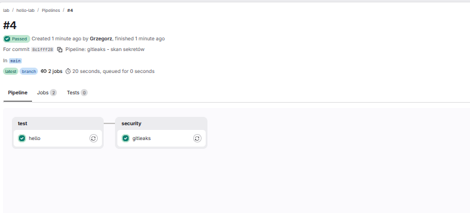

# Etap 7b – skanery bezpieczeństwa w pipeline (26.11.2026)

**DevSecOps / „shift left”:** bezpieczeństwo sprawdzane automatycznie przy każdym commicie, a nie raz przed
wdrożeniem. Błąd znaleziony w pipeline kosztuje minutę; ten sam błąd na produkcji – incydent.

| Skaner | Rodzaj | Czego szuka | Gdzie |
|---|---|---|---|
| gitleaks | secret scanning | hasła, tokeny, klucze w kodzie **i w historii gita** | zadanie `gitleaks` |
| Semgrep | SAST (Static Application Security Testing) | niebezpieczne wzorce w kodzie i w Dockerfile, bez uruchamiania aplikacji | zadanie `semgrep` |
| Trivy | SCA / skan obrazu i konfiguracji | znane podatności (CVE) w pakietach, błędy w Dockerfile | planowane |

Wszystko w repozytorium `lab/hello-lab` w GitLabie (plik `.gitlab-ci.yml`), na Runnerze `monitoring-docker`
([02-gitlab-runner.md](02-gitlab-runner.md)).

## Krok 1. gitleaks – sekrety w historii

Etap `security` po etapie `test`; zadanie w obrazie z gitleaks. Plik `.gitlab-ci.yml` z komentarzami
(komentarz w YAML zaczyna się od `#` – GitLab go pomija, a w repozytorium zostaje ściągawka):

```yaml
# Ustawienia wspólne dla WSZYSTKICH zadań w tym pliku
default:
  tags:
    - docker            # zadania bierze tylko Runner z tagiem "docker" (monitoring-docker)

# Etapy pipeline'u – wykonują się po kolei, z góry na dół
stages:
  - test                # 1. etap: proste testy
  - security            # 2. etap: skanery bezpieczeństwa (rusza dopiero, gdy "test" przejdzie)

# Zadanie 1: test, czy Runner działa
hello:
  stage: test           # należy do etapu "test"
  script:               # polecenia wykonywane po kolei w kontenerze (domyślny obraz alpine:latest)
    - echo "Pipeline dziala, kontener $(hostname)"
    - cat /etc/os-release

# Zadanie 2: gitleaks – szuka sekretów (hasła, tokeny, klucze) w kodzie i w historii commitów
gitleaks:
  stage: security       # należy do etapu "security"
  image:
    name: zricethezav/gitleaks:latest   # obraz z programem gitleaks (zamiast alpine)
    entrypoint: [""]    # wyłącza domyślne polecenie obrazu – GitLab uruchomi nasz "script"
  variables:
    GIT_DEPTH: 0        # pobierz CAŁĄ historię (domyślnie tylko 20 ostatnich commitów)
  script:
    - gitleaks git --verbose --redact .
    # git       – skanuje historię gita (każdy commit, nie tylko obecne pliki)
    # --verbose – wypisuje szczegóły każdego znaleziska
    # --redact  – zamienia znaleziony sekret na "REDACTED", żeby nie wyciekł przez log
    # .         – skanuj bieżący katalog (repozytorium sklonowane przez Runnera)
```

| Element | Po co |
|---|---|
| `image:` w zadaniu | zadanie działa w obrazie z narzędziem zamiast w domyślnym `alpine:latest` |
| `entrypoint: [""]` | obraz gitleaks ma własne polecenie startowe; puste pozwala GitLabowi uruchomić `script` |
| `GIT_DEPTH: 0` | Runner domyślnie klonuje płytko (ostatnie 20 commitów) – sekret sprzed lat by umknął |
| `--redact` | log pipeline'u widzi wiele osób – nie może sam ujawniać znalezionego sekretu |

Commit `8c1fff2` → **pipeline #4 passed** (20 s): `hello` ✅ → `gitleaks` ✅. gitleaks kończy się błędem przy
każdym znalezisku, więc zielone zadanie = brak sekretów w całej historii (4 commity).



**Sekret w historii:** usunięcie hasła w nowym commicie nic nie daje – stary commit nadal je zawiera i każdy,
kto sklonuje repozytorium, może je odczytać. Kolejność: **najpierw unieważnij** (nowe hasło / nowy token),
potem ewentualnie przepisz historię (`git filter-repo`) i dodaj regułę do pipeline'u.

## Pytania rekrutacyjne

- *Co to jest „shift left”?* – przesunięcie testów (też bezpieczeństwa) na wcześniejszy etap: do IDE i pipeline'u
  przy każdym commicie, zamiast audytu przed wdrożeniem. Wcześniej znaleziony błąd jest tańszy.
- *Deweloper wypchnął token do repozytorium i od razu go usunął. Co robisz?* – traktuję token jako ujawniony:
  unieważniam i wystawiam nowy, sprawdzam logi użycia, dopiero potem czyszczę historię. Samo usunięcie z pliku
  nie pomaga – sekret jest w historii.
- *Dlaczego gitleaks z `GIT_DEPTH: 0`?* – domyślny płytki klon nie zawiera starych commitów, a sekrety często
  siedzą właśnie tam.
- *Czym różni się secret scanning od SAST?* – secret scanning szuka danych uwierzytelniających (wzorce tokenów,
  entropia), SAST szuka błędów w logice i użyciu funkcji (wstrzyknięcia, XSS, niebezpieczne API).
