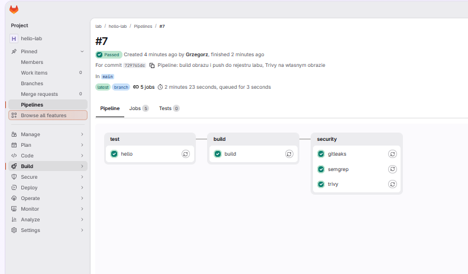
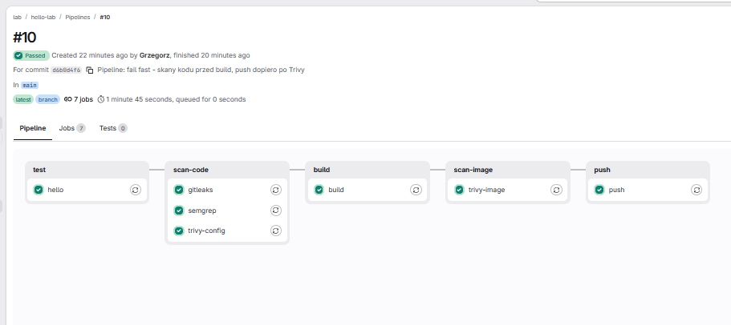
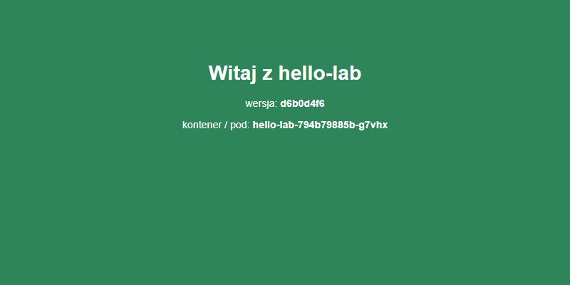

# Budowanie obrazu w pipeline, łatanie podatności i security gate (26.11.2026)

Po [skanerach z Etapu 7b](03-skanery-bezpieczenstwa.md) pipeline sam buduje obraz `hello-lab` z każdego commita,
wysyła go do rejestru labu na `monitoring` i skanuje Trivy **ten** obraz. Na koniec: łatki w `Dockerfile`
i bramka bezpieczeństwa, która zatrzymuje pipeline przy podatności.

```
git push → GitLab → Runner na monitoring:
  test      hello
  build     docker build + docker push ──▶ rejestr 192.168.180.54:5000/hello-lab:<hash commita>
  security  gitleaks + semgrep + trivy (config + image, exit-code 1)
```

**CI czy CD?** CI (Continuous Integration) – automatyczne sprawdzanie każdego commita (testy, skany).
Continuous Delivery – gotowy obraz w rejestrze, wdrożenie jednym poleceniem. Continuous Deployment – wdrożenie
też automatyczne. Po tym rozdziale: **CI + połowa CD** (obraz w rejestrze, wdrożenie jeszcze ręczne).

## Krok 1. Runner dostaje dostęp do Dockera (`docker.sock`)

`docker.sock` to **gniazdo** (socket) – specjalny plik, przez który programy rozmawiają z demonem Dockera
(„okienko podawcze” do Dockera; `ls -l` pokazuje literę `s`: `srw-rw---- root docker /var/run/docker.sock`).
Podłączone do kontenera zadania sprawia, że `docker build` w pipeline wykonuje Docker na `monitoring` –
ten, który od Etapu 4 ufa CA labu i może wysłać obraz do rejestru.

🐧 `sudo nano /etc/gitlab-runner/config.toml`, sekcja `[runners.docker]` – linia `volumes = ["/cache"]` zamieniona na:

```toml
    # PL: Pliki z maszyny monitoring podłączane do KAŻDEGO kontenera zadania.
    #     docker.sock = gniazdo Dockera: "docker build" w zadaniu wykona Docker na monitoring
    #     (ufa CA labu, może wysłać obraz do rejestru 192.168.180.54:5000).
    #     UWAGA: dostęp do docker.sock = root na monitoring. OK w labie; w firmie Kaniko/Buildah.
    # EN: Host files mounted into EVERY job container.
    #     docker.sock = Docker socket: "docker build" in a job runs on the host's Docker
    #     (trusts the lab CA, can push to the 192.168.180.54:5000 registry).
    #     WARNING: docker.sock access = root on the host. OK in a lab; in a company use Kaniko/Buildah.
    volumes = ["/var/run/docker.sock:/var/run/docker.sock", "/cache"]
```

Runner sam wczytuje zmieniony plik (bez restartu). Sprawdzenie: `journalctl -u gitlab-runner` (grupa `adm`, bez `sudo`)
→ `Configuration loaded`. Przy pierwszej próbie zostały duplikaty – opis w
[problemy.md](problemy.md#failed-to-load-config--key-runnersdockervolumes-has-already-been-defined).

⚠️ **Dostęp do `docker.sock` = root na maszynie.** Przez gniazdo można poprosić demona o wszystko, np. kontener
z całym dyskiem hosta. Kto może zmienić `.gitlab-ci.yml`, ten przejmie `monitoring`. W labie (jeden użytkownik)
świadomie akceptowane; w firmie budowanie bez demona:

| Narzędzie | Kto rozwija | Jak |
|---|---|---|
| Kaniko | Google (zarchiwizowane w 2025, fork Chainguard) | składa warstwy obrazu z `Dockerfile` jako zwykły program w kontenerze |
| Buildah | Red Hat (rodzina Podmana) | buduje bez demona, także bez roota (rootless) |
| BuildKit rootless | Docker / Moby | silnik budowania Dockera bez roota |

Do tego osobny Runner tylko do budowania, dla chronionych gałęzi.

## Krok 2. Zadanie `build`

Cały `.gitlab-ci.yml` (komentarze PL/EN):

```yaml
# PL: Ustawienia wspólne dla wszystkich zadań
# EN: Defaults for all jobs
default:
  tags:
    - docker            # PL: tylko Runner z tagiem "docker" / EN: only runners tagged "docker"

# PL: Zmienne dostępne w każdym zadaniu
# EN: Variables available in every job
variables:
  # PL: Pełna nazwa obrazu: rejestr labu / nazwa : krótki hash commita (każdy commit = osobna wersja)
  # EN: Full image name: lab registry / name : short commit hash (every commit = its own version)
  IMAGE: "192.168.180.54:5000/hello-lab:$CI_COMMIT_SHORT_SHA"

# PL: Etapy – po kolei / EN: Stages – run in order
stages:
  - test
  - build               # PL: budowanie obrazu / EN: build the image
  - security            # PL: skanery (Trivy skanuje zbudowany obraz) / EN: scanners (Trivy scans the built image)

hello:
  stage: test
  script:
    - echo "Pipeline dziala, kontener $(hostname)"

# PL: Budowanie obrazu Dockerem z maszyny monitoring (przez docker.sock z config.toml Runnera)
# EN: Build the image with the monitoring host's Docker (via docker.sock from the runner's config.toml)
build:
  stage: build
  image: docker:29-cli  # PL: sam program "docker" (bez demona) / EN: docker CLI only (no daemon)
  script:
    - docker build --build-arg APP_VERSION=$CI_COMMIT_SHORT_SHA -t $IMAGE .
    # PL: buduje obraz z Dockerfile; wersja aplikacji = hash commita
    # EN: builds the image from the Dockerfile; app version = commit hash
    - docker push $IMAGE
    # PL: wysyła obraz do rejestru labu (Docker na monitoring ufa CA labu)
    # EN: pushes the image to the lab registry (monitoring's Docker trusts the lab CA)

# PL: gitleaks – sekrety w całej historii gita / EN: gitleaks – secrets in the whole git history
gitleaks:
  stage: security
  image:
    name: zricethezav/gitleaks:latest
    entrypoint: [""]    # PL: GitLab uruchamia nasz "script" / EN: let GitLab run our "script"
  variables:
    GIT_DEPTH: 0        # PL: cała historia / EN: full history
  script:
    - gitleaks git --verbose --redact .

# PL: Semgrep (SAST) – niebezpieczne wzorce w kodzie / EN: Semgrep (SAST) – insecure code patterns
semgrep:
  stage: security
  image: semgrep/semgrep:latest
  script:
    - semgrep scan --config p/python --config p/dockerfile --error .

# PL: Trivy – błędy w Dockerfile i podatności (CVE) w NASZYM obrazie
# EN: Trivy – Dockerfile misconfigurations and vulnerabilities (CVE) in OUR image
trivy:
  stage: security
  image:
    name: aquasec/trivy:latest
    entrypoint: [""]
  script:
    - trivy config --exit-code 1 .
    - trivy image --image-src docker --severity HIGH,CRITICAL --ignore-unfixed --exit-code 1 $IMAGE
    # PL: --image-src docker = weź obraz z Dockera na monitoring (właśnie go zbudowaliśmy)
    # EN: --image-src docker = read the image from monitoring's Docker (we just built it)
```

| Element | Znaczenie |
|---|---|
| `variables: IMAGE` | nazwa obrazu w jednym miejscu: **rejestr / nazwa : wersja** |
| `$CI_COMMIT_SHORT_SHA` | zmienna od GitLaba – 8 znaków hasha commita (np. `729765dc`); każdy commit = osobna, identyfikowalna wersja |
| `image: docker:29-cli` | kontener z samym programem `docker`; pracę wykonuje demon na `monitoring` (przez `docker.sock`) |
| `--build-arg APP_VERSION=…` | wersja wpisana do aplikacji – widać ją na stronie i w `/api` |
| `trivy image --image-src docker` | Trivy bierze obraz prosto z Dockera na `monitoring` (bez pobierania z rejestru) |

Pierwszy commit nie poszedł do GitLaba (`git status` → `ahead 1` – był `commit`, nie było `push`). Po `git push`:
commit `729765d` → **pipeline #7 passed** (2 min 23 s, 5 zadań, 3 etapy):



W rejestrze nowy obraz:

```bash
curl -s --cacert /etc/docker/certs.d/192.168.180.54:5000/ca.crt https://192.168.180.54:5000/v2/hello-lab/tags/list
```

```text
{"name":"hello-lab","tags":["1.0","729765dc"]}
```

`--cacert` – „ufaj certyfikatom podpisanym przez to CA” (CA labu nie ma na systemowej liście zaufanych urzędów).
Nie `curl -k` – to wyłącza sprawdzanie i pozwala się podszyć pod rejestr.

### Etap 4 (ręcznie) a Etap 7 (pipeline)

| Krok | Etap 4 – 05.11, ręcznie na `monitoring` | Etap 7 – pipeline |
|---|---|---|
| Kod na maszynie | `mkdir ~/hello-lab`, `cp app.py`, `cp Dockerfile` | Runner sam klonuje repozytorium |
| Katalog | trzeba pamiętać o `cd` (pierwsza próba: `"/app.py": not found`) | zawsze katalog repozytorium |
| Wersja | `1.0` – wymyślona | hash commita – sama się zmienia |
| Nazwa z rejestrem | osobne `docker tag` | od razu `-t $IMAGE` |
| `docker build`, `docker push` | wpisujesz | wpisuje Runner |
| Bezpieczeństwo | brak | gitleaks, Semgrep, Trivy przy każdym commicie |
| Ślad | notatki | log każdego zadania w GitLabie |

Polecenia te same – zmienia się **kto** je wpisuje. Obraz `1.0` nie mówi, z jakiego kodu powstał; `729765dc` wskazuje
commit co do linijki.

## Krok 3. Trivy na własnym obrazie – i triage

Pipeline #7, zadanie `trivy` – wynik **taki sam jak dla samego `python:3.14-slim`**
([03-skanery-bezpieczenstwa.md](03-skanery-bezpieczenstwa.md#krok-3-trivy--dockerfile-i-obraz-bazowy)):

```text
192.168.180.54:5000/hello-lab:729765dc (debian 13.8)   debian      1
Python                                                 python-pkg  5
```

`app.py` nie dokłada bibliotek, więc wszystko pochodzi z obrazu bazowego. **Skąd dokładnie** – zajrzenie do obrazu:

```bash
docker run --rm --entrypoint sh 192.168.180.54:5000/hello-lab:729765dc -c "dpkg -l libzstd1"
docker run --rm --entrypoint sh 192.168.180.54:5000/hello-lab:729765dc -c "pip list; find / -name urllib3 -o -name msgpack 2>/dev/null"
```

| Część | Znaczenie |
|---|---|
| `docker run --rm` | uruchom kontener i usuń go po zakończeniu |
| `--entrypoint sh` | zamiast `python app.py` (z `CMD`) uruchom powłokę |
| `-c "…"` | polecenie dla powłoki; potem kontener się kończy – obraz bez zmian |
| `find / -name A -o -name B` | szukaj na całym dysku obrazu nazwy A **albo** B; `2>/dev/null` – ukryj błędy dostępu |

```text
ii  libzstd1:amd64 1.5.7+dfsg-1 amd64        fast lossless compression algorithm
Package Version
------- -------
pip     26.2.2
/usr/local/lib/python3.14/site-packages/pip/_vendor/msgpack
/usr/local/lib/python3.14/site-packages/pip/_vendor/urllib3
```

`msgpack`, `urllib3` (i `setuptools`) **nie są osobnymi pakietami** – siedzą wewnątrz `pip` (`pip/_vendor`).
Importy w `app.py` (`Select-String -Path app.py -Pattern "^import|^from"`): `json`, `os`, `socket`, `http.server` –
tylko biblioteka standardowa.

| Podatność | Skąd | Aplikacja używa? | Łatka |
|---|---|---|---|
| `libzstd1` CVE-2026-124851 | Debian w obrazie bazowym | pośrednio (system) | `apt-get upgrade` |
| `msgpack` ×2, `urllib3` ×2, `setuptools` | wnętrze `pip` | nie | usunięcie `pip` |

Metoda na każdą podatność: **1)** czy jest poprawka (kolumna *Fixed*), **2)** skąd pakiet, **3)** czy aplikacja go używa,
**4)** aktualizacja albo usunięcie.

### Ręczna kontrola obrazu znalazła coś, czego nie złapał żaden skaner

```bash
docker run --rm --entrypoint sh 192.168.180.54:5000/hello-lab:729765dc -c "id"
docker run --rm --entrypoint sh 192.168.180.54:5000/hello-lab:729765dc -c "ls -la /app"
```

```text
uid=10001(app) gid=10001(app) groups=10001(app)
-rw-rw-rw- 1 root root 2071 Nov 26 07:52 app.py
```

Aplikacja działa jako `app` (nie root) – dobrze. Ale `app.py` ma prawa **666**: ostatnie `rw-` = **każdy, także `app`,
może zmienić kod aplikacji**. Przyczyna: Runner z executorem Docker klonuje repozytorium z **`umask 0000`**, pliki
dostają 666, a `COPY` przenosi prawa do obrazu. Przy ręcznym budowaniu (Etap 4) tego nie było – **pipeline wprowadził
słabość niewidoczną w kodzie**, której nie złapał gitleaks, Semgrep ani Trivy
([problemy.md](problemy.md#apppy-w-obrazie-z-prawami-666--rw-rw-rw-)).

## Krok 4. Łatki w `Dockerfile`

```dockerfile
# 3b. PL: Łatki bezpieczeństwa (Trivy, pipeline #7): apt-get upgrade = poprawki Debiana (libzstd1),
#         pip uninstall pip = usuwa pip z msgpack/setuptools/urllib3 (aplikacja nie używa pip).
#     EN: Security patches (Trivy, pipeline #7): apt-get upgrade = Debian fixes (libzstd1),
#         pip uninstall pip = removes pip with msgpack/setuptools/urllib3 (the app does not use pip).
RUN apt-get update \
 && apt-get upgrade -y \
 && rm -rf /var/lib/apt/lists/* \
 && python -m pip uninstall -y pip

# 5. Kod aplikacji.
#    PL: --chmod=644 = właściciel czyta i pisze, reszta tylko czyta (Runner klonuje z umask 0000 → 666)
#    EN: --chmod=644 = owner read/write, others read-only (runner clones with umask 0000 → 666)
COPY --chmod=644 app.py .
```

- `\` – polecenie ciągnie się w następnej linii; `&&` – następna część tylko po sukcesie poprzedniej; jeden `RUN` = jedna warstwa.
- **Dlaczego usunąć `pip`:** to instalator – potrzebny przy instalowaniu, nie w czasie działania. Zasada **minimalnego
  obrazu**: w obrazie tylko to, czego aplikacja potrzebuje; każdy dodatkowy program to podatności i narzędzie dla
  atakującego (np. `pip install` czegoś złośliwego). Gdy aplikacja potrzebuje paczek – *multi-stage build*: etap z `pip`
  instaluje, etap końcowy kopiuje tylko gotowe paczki.

Commit `8480121` → obraz `hello-lab:8480121a`. Sprawdzenie:

```text
-rw-r--r-- 1 root root 2071 Nov 26 07:52 app.py
/usr/local/bin/python: No module named pip
```

Trivy (pipeline #8):

```text
INFO  Number of language-specific files       num=0
Report Summary
│ 192.168.180.54:5000/hello-lab:8480121a (debian 13.8) │ debian │ 0 │
Job succeeded
```

| | `729765dc` (pipeline #7) | `8480121a` (pipeline #8) |
|---|---|---|
| Debian | 1 × HIGH | **0** |
| Python | 5 × HIGH | **0** (`num=0` – brak pakietów Pythona) |
| prawa `app.py` | 666 | **644** |
| rozmiar | 178 MB | 190 MB |

Pełny cykl AppSec: **skan → analiza → łatka → potwierdzenie w pipeline**.

### Warstwy obrazu (`docker history`)

```bash
docker history --format "{{.Size}}\t{{.CreatedBy}}" 192.168.180.54:5000/hello-lab:8480121a
```

```text
0B      CMD ["python" "app.py"]
0B      HEALTHCHECK {Test:[CMD python -c import urll…
0B      EXPOSE [8080/tcp]
0B      USER 10001
12.3kB  COPY --chmod=644 app.py . # buildkit
49.2kB  RUN |1 APP_VERSION=8480121a /bin/sh -c usera…
8.21MB  RUN |1 APP_VERSION=8480121a /bin/sh -c apt-g…
8.19kB  WORKDIR /app
0B      ENV APP_VERSION=8480121a PYTHONUNBUFFERED=1
0B      ARG APP_VERSION=8480121a
0B      CMD ["python3"]
16.4kB  RUN /bin/sh -c set -eux;  for src in idle3 p…
42.1MB  RUN /bin/sh -c set -eux;   savedAptMark="$(a…
0B      ENV PYTHON_VERSION=3.14.10
4.93MB  RUN /bin/sh -c set -eux;  apt-get update;  a…
87.7MB  # debian.sh --arch 'amd64' out/ 'trixie' '@1…
```

Od dołu: Debian 13 *trixie* (87,7 MB), biblioteki (4,9 MB), Python 3.14.10 (42,1 MB) – to obraz bazowy; nad nim
warstwy z naszego `Dockerfile`. **Nasz kod to 12 kB ze 190 MB** – dlatego podatności prawie zawsze są w obrazie bazowym.
Warstwy 0 B to same ustawienia (metadane). `--no-trunc` pokazuje pełne polecenia.

**Dlaczego obraz urósł, choć usunęliśmy `pip`?** Warstwy można tylko dokładać: `pip uninstall` w wyższej warstwie
**zasłania** pliki, ale one zostają w niższej (z obrazu bazowego); `apt-get upgrade` dokłada nowe wersje (8,2 MB).
Dla bezpieczeństwa wystarczy (w działającym kontenerze `pip` nie istnieje, Trivy patrzy na obraz końcowy);
dla rozmiaru – *multi-stage build* albo obraz distroless.

## Krok 5. Security gate

Linia 65 – `--exit-code 0` → `--exit-code 1`:

```yaml
    - trivy image --image-src docker --severity HIGH,CRITICAL --ignore-unfixed --exit-code 1 $IMAGE
```

**Kod wyjścia** (exit code) – liczba, którą program zwraca na koniec: `0` = sukces, inna = błąd. GitLab patrzy tylko
na nią: `0` → zadanie zielone, inna → czerwone i pipeline staje. `--exit-code` mówi Trivy, co zwrócić, **gdy znajdzie
podatności** (bez znalezisk zawsze `0`):

| Ustawienie | Trivy znalazł podatność | Jak bramka na lotnisku |
|---|---|---|
| `--exit-code 0` | zadanie zielone, wpis w logu | piszczy, ale przepuszcza |
| `--exit-code 1` | zadanie czerwone, pipeline staje | piszczy i się zamyka |

Najpierw `0` (zobaczyć skalę problemu bez blokowania zespołu), po naprawie `1` – od teraz nic nowego nie przejdzie.
Bramka przepuszcza: MEDIUM/LOW (`--severity`), podatności bez poprawki (`--ignore-unfixed`) i błędy logiki (to Semgrep
i testy). Commit `6d83661`. Sprawdzenie kodu wyjścia ręcznie: `ls /tmp; echo $?` → `0`, `ls /nie-ma; echo $?` → `2`.

## Krok 6. Kolejność „fail fast” – push dopiero po skanie

Słaby punkt pipeline'u z kroków 2–5: `build` budował **i od razu wysyłał** obraz, a Trivy skanował go dopiero potem.
Czerwona bramka nic by nie dała – **dziurawy obraz leżałby już w rejestrze** (bramka zamyka się, gdy pasażer
jest w samolocie). Na rozmowie AppSec to pierwsze pytanie: *„czy obraz z podatnością trafi do rejestru?”*.

Nowa kolejność – 5 etapów, każdy czeka na zielony poprzedni (zadania **w jednym** etapie idą równolegle):

| Etap | Zadania | Pytanie | Jeśli nie |
|---|---|---|---|
| `test` | `hello` | czy działa? | stop |
| `scan-code` | `gitleaks`, `semgrep`, `trivy-config` | czy kod i `Dockerfile` są bezpieczne? | stop – nie budujemy |
| `build` | `build` | czy obraz się buduje? (tylko `docker build`, **bez push**) | stop |
| `scan-image` | `trivy-image` | czy obraz nie ma podatności? – **security gate** | stop – nie wysyłamy |
| `push` | `push` | `docker push` – do rejestru tylko obraz po skanie | – |

**Fail fast:** najtańsze sprawdzenia (sekundy) najpierw – sekret w kodzie zatrzymuje pipeline, zanim zaczniemy budować.
`push` jako osobny etap wymusza kolejność „sprawdź, potem wyślij” (w jednym etapie poszłyby naraz).

```yaml
# PL: Kolejność "fail fast": najpierw tanie skany kodu, push tylko czystego obrazu
# EN: "Fail fast" order: cheap code scans first, push only a clean image
stages:
  - test            # PL: testy / EN: tests
  - scan-code       # PL: skan KODU przed budowaniem / EN: scan the CODE before building
  - build           # PL: budowanie obrazu, BEZ wysyłki / EN: build the image, NO push
  - scan-image      # PL: skan OBRAZU – security gate / EN: scan the IMAGE – security gate
  - push            # PL: do rejestru tylko obraz po skanie / EN: only a scanned image goes to the registry

# PL: Trivy config – błędy w Dockerfile, przed budowaniem / EN: Dockerfile misconfigurations, before build
trivy-config:
  stage: scan-code
  image:
    name: aquasec/trivy:latest
    entrypoint: [""]
  script:
    - trivy config --exit-code 1 .

# PL: Budowanie – obraz zostaje tylko w Dockerze na monitoring (docker.sock), jeszcze NIE w rejestrze
# EN: Build – the image stays only in monitoring's Docker (docker.sock), NOT in the registry yet
build:
  stage: build
  image: docker:29-cli
  script:
    - docker build --build-arg APP_VERSION=$CI_COMMIT_SHORT_SHA -t $IMAGE .

# PL: Security gate – podatność HIGH/CRITICAL z poprawką = czerwony pipeline, push się NIE wykona
# EN: Security gate – a fixable HIGH/CRITICAL vulnerability = red pipeline, push will NOT run
trivy-image:
  stage: scan-image
  image:
    name: aquasec/trivy:latest
    entrypoint: [""]
  script:
    - trivy image --image-src docker --severity HIGH,CRITICAL --ignore-unfixed --exit-code 1 $IMAGE

# PL: Wysyłka do rejestru – tylko gdy wszystkie poprzednie etapy są zielone
# EN: Push to the registry – only when all previous stages are green
push:
  stage: push
  image: docker:29-cli
  script:
    - docker push $IMAGE
```

(`gitleaks` i `semgrep` bez zmian, tylko `stage: scan-code`.) Obraz między `build` a `push` przechowuje Docker na
`monitoring` – działa, bo wszystkie zadania idą przez ten sam `docker.sock`. Przy kilku Runnerach na różnych maszynach
trzeba by przekazać obraz inaczej (np. `docker save` jako *artifact* albo push do tymczasowego tagu i „promocja” po skanie).

Commit `d6b0d4f` → **pipeline #10 passed** (1 min 45 s, 7 zadań), w rejestrze `hello-lab:d6b0d4f6`:



```text
{"name":"hello-lab","tags":["1.0","6d836614","729765dc","8480121a","d6b0d4f6"]}
```

`729765dc` (z podatnościami) trafił do rejestru jeszcze w starej kolejności – przy nowej nie miałby jak.

## Krok 7. Wdrożenie w k3s (ręczne CD)

Aplikacja działa w k3s od Etapu 4 (`kubectl apply -f kubernetes/hello-lab/hello-lab.yaml`: Namespace, Deployment
z 2 podami, Service NodePort `30880`) – dotąd z obrazem `1.0`. Przed wdrożeniem: czy wersja jest w rejestrze
(literówka w tagu = `ImagePullBackOff`) i która jest najnowsza (lista tagów w rejestrze jest alfabetyczna, bez dat):

```bash
# 🐧 monitoring – daty utworzenia obrazów
docker images 192.168.180.54:5000/hello-lab --format "{{.CreatedAt}}  {{.Tag}}"
```

```text
2026-11-26 12:06:00 +0100 CET  d6b0d4f6
2026-11-26 11:10:40 +0100 CET  6d836614
2026-11-26 10:51:42 +0100 CET  8480121a
2026-11-26 09:43:31 +0100 CET  729765dc
2026-11-05 15:01:09 +0100 CET  1.0
```

```bash
# 🐧 k3s-master – węzły mają CA labu w /etc/rancher/k3s/lab-ca.crt
curl -s --cacert /etc/rancher/k3s/lab-ca.crt https://192.168.180.54:5000/v2/hello-lab/tags/list
kubectl set image deployment/hello-lab hello-lab=192.168.180.54:5000/hello-lab:d6b0d4f6 -n hello-lab
kubectl rollout status deployment/hello-lab -n hello-lab
```

```text
{"name":"hello-lab","tags":["1.0","6d836614","729765dc","8480121a","d6b0d4f6"]}
deployment.apps/hello-lab image updated
Waiting for deployment "hello-lab" rollout to finish: 1 old replicas are pending termination...
Waiting for deployment "hello-lab" rollout to finish: 1 old replicas are pending termination...
deployment "hello-lab" successfully rolled out
```

**Rolling update:** nowy pod startuje, przechodzi `readinessProbe` (`/healthz`), dopiero wtedy stary jest wyłączany –
bez przerwy w działaniu. Wynik:

```text
$ curl -s http://192.168.180.51:30880/api
{"app": "hello-lab", "version": "d6b0d4f6", "host": "hello-lab-794b79885b-sglpl"}

hello-lab-794b79885b-g7vhx   1/1   Running   k3s-worker-2
hello-lab-794b79885b-sglpl   1/1   Running   k3s-worker-3
```



Wersja `d6b0d4f6` na stronie = hash commita – w klastrze działa obraz zbudowany i sprawdzony przez pipeline.
Strona jest dostępna z Windowsa w przeglądarce pod `http://192.168.180.51:30880` (NodePort działa na każdym węźle;
sieć VMnet8 – tylko z tego komputera).

⚠️ **Drift:** `kubectl set image` zmienił obraz tylko w klastrze – w `kubernetes/hello-lab/hello-lab.yaml` (linia 29)
nadal jest `hello-lab:1.0`. Ponowne `kubectl apply -f` przywróciłoby stary obraz. Do poprawienia w pliku; docelowo
**GitOps (Argo CD)** – pipeline zmienia tag w gicie, Argo CD pilnuje, żeby klaster był taki jak w gicie.

## Gdzie co jest

```bash
docker ps                      # działające kontenery (kontenery zadań żyją sekundy – tu ich nie widać)
docker ps -a                   # też zatrzymane (np. "hello" z Etapu 4: Exited (255))
docker images | grep hello-lab # obrazy w Dockerze na monitoring
```

| Obraz | Gdzie działa (26.11) |
|---|---|
| `hello-lab:1.0` | zatrzymany kontener `hello` na `monitoring` (w k3s do 26.11, potem podmieniony) |
| `hello-lab:d6b0d4f6` | **2 pody w k3s** (worker-2, worker-3) – od kroku 7 |
| `hello-lab:729765dc` | nigdzie – tylko w rejestrze |
| `hello-lab:8480121a` | nigdzie – tylko w rejestrze (załatany) |

**Obraz a kontener:** pipeline tworzy **obraz** (zapakowane pudełko na półce w rejestrze); **kontener** to pudełko
otwarte i działające. Brakuje ostatniego kroku CD – wdrożenia nowego obrazu w k3s.

**Rejestr** (`registry:3`, Etap 4): `push` dzieli obraz na warstwy, pyta „masz już tę warstwę?”, wysyła tylko nowe,
na koniec **manifest** (spis warstw) pod nazwą `hello-lab:<tag>`; `pull` – odwrotnie. API: `/v2/_catalog`, `/v2/NAZWA/tags/list`.
Jeden obraz może mieć kilka nazw (`docker tag` dodaje etykietę, nie kopiuje danych). Każdy commit dokłada wersję –
w firmie *cleanup policy*.

## Pytania rekrutacyjne

- *Jak zbudować obraz Dockera w pipeline GitLaba? Jakie są opcje?* – `docker.sock` z hosta (prosto, ale = root na Runnerze),
  Docker-in-Docker (`privileged`), budowanie bez demona: Kaniko, Buildah, BuildKit rootless. W firmie – bez demona,
  osobny Runner dla chronionych gałęzi.
- *Dlaczego tag obrazu = hash commita, a nie `latest`?* – każda wersja wskazuje dokładny kod; `latest` zmienia znaczenie
  i nie da się z niego odtworzyć, co działa na produkcji; łatwy rollback do konkretnego hasha.
- *Trivy znalazł podatność w obrazie. Jak decydujesz, co łatać?* – czy jest poprawka, skąd pakiet (`dpkg -l`, `pip list`,
  `find` w obrazie), czy aplikacja go używa; potem aktualizacja (`apt-get upgrade`, nowszy obraz bazowy) albo usunięcie
  zbędnego komponentu.
- *Dlaczego `rm`/`uninstall` w Dockerfile nie zmniejsza obrazu?* – warstwy są tylko dokładane; usunięcie w wyższej
  warstwie zasłania pliki, ale zostają w niższej. Rozwiązanie: multi-stage build, distroless, wszystko w jednym `RUN`.
- *Co to jest security gate?* – próg w pipeline, po przekroczeniu którego pipeline staje (tu: Trivy `--exit-code 1`
  dla HIGH/CRITICAL z poprawką). Wprowadza się go stopniowo: najpierw raport, potem blokada.
- *Czy zielone skanery = bezpieczny obraz?* – nie: w labie `app.py` miał prawa 666 przez `umask 0000` Runnera, czego
  nie złapał żaden skaner. Ręczna kontrola zbudowanego obrazu (`id`, `ls -la`) uzupełnia automaty.
- *Czy obraz z podatnością trafi do rejestru?* – w kolejności build+push → skan: tak (błąd, który u siebie poprawiłem);
  w kolejności build → skan → push: nie, bo czerwony etap zatrzymuje następne. Fail fast: skany kodu przed budowaniem.
- *Exit code – co to i jak go sprawdzić?* – liczba zwracana przez program (`0` = sukces); `echo $?` po poleceniu.
