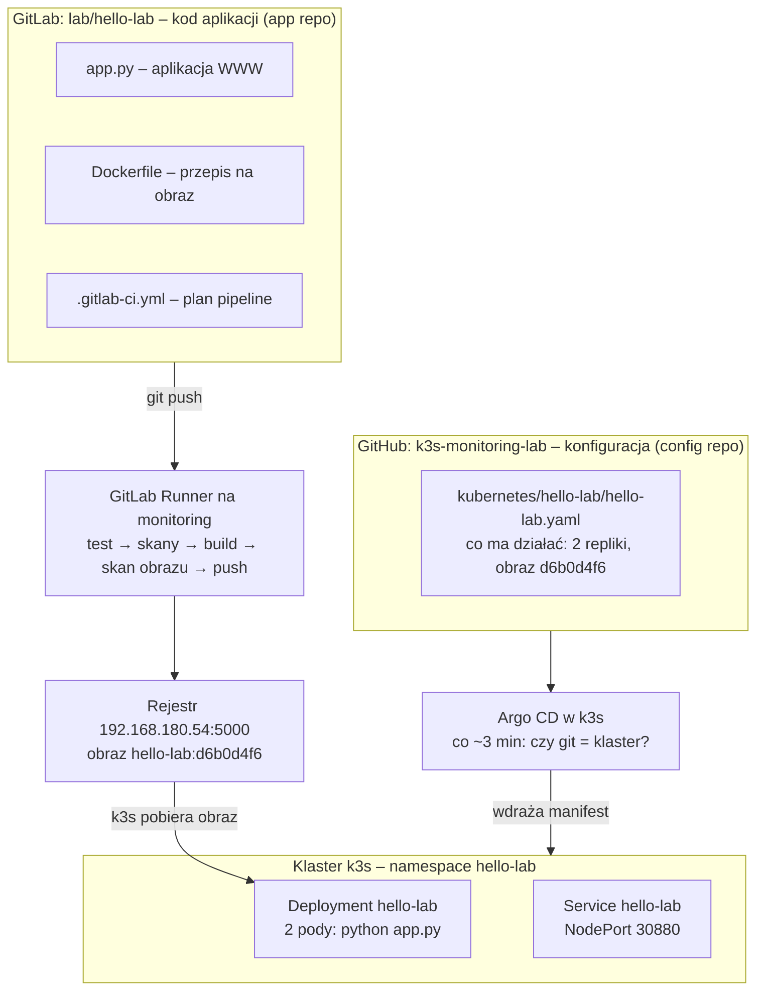
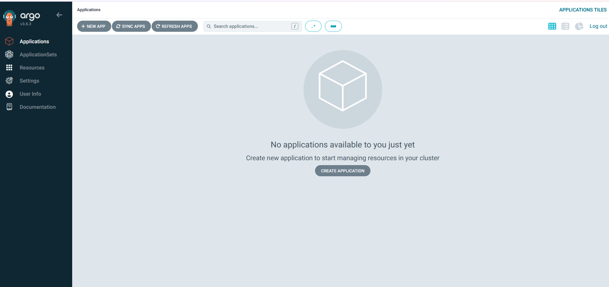
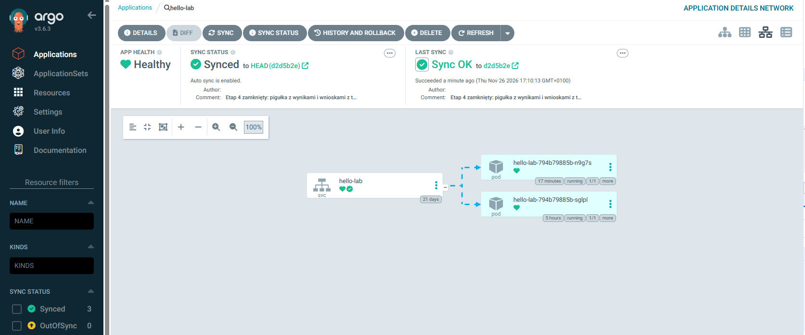

# Argo CD – GitOps dla `hello-lab` (26.11.2026)

Do tej pory obraz z pipeline'u wdrażał ręcznie właściciel: `kubectl set image`, a potem poprawka tagu w
`hello-lab.yaml`, żeby usunąć drift ([krok 7 w 04](04-budowanie-obrazu-i-security-gate.md)). **Argo CD** odwraca
kierunek: to klaster ma wyglądać tak jak git, a pilnuje tego kontroler działający w klastrze.

```
GitLab: kod (app.py, Dockerfile) ──pipeline──▶ obraz hello-lab:<sha> w rejestrze (.54:5000)
                                                          ▲ k3s pobiera obraz
GitHub: kubernetes/hello-lab/hello-lab.yaml ──Argo CD──▶ k3s (namespace hello-lab)
         („2 repliki, obraz d6b0d4f6”)        co ~3 min porównuje git z klastrem i wyrównuje
```

## Mapa: co, gdzie i który plik do czego



| Plik | Gdzie leży | Kto go czyta | Odpowiada na pytanie |
|---|---|---|---|
| `app.py` | GitLab | Python w kontenerze | **co robi aplikacja?** (strona, `/healthz`, `/api`) |
| `Dockerfile` | GitLab | `docker build` w pipeline | **jak zbudować obraz?** (Python, użytkownik bez roota, `CMD`) |
| `.gitlab-ci.yml` | GitLab | GitLab Runner | **jakie kroki po `git push`?** (test, skany, build, push) |
| `hello-lab.yaml` | GitHub | Argo CD → Kubernetes | **co ma działać w klastrze?** (ile replik, który obraz, port) |
| Application `hello-lab` | w klastrze (`kubectl get applications -n argocd`) | Argo CD | **którego folderu z gita pilnować?** |

Pary, które łatwo pomylić:

- **`Dockerfile` a `hello-lab.yaml`** – Dockerfile opisuje **jeden kontener** (co jest w obrazie), `hello-lab.yaml` –
  **ile** takich kontenerów uruchomić i jak je wystawić.
- **`.gitlab-ci.yml` a Application w Argo CD** – oba to automaty: pipeline **robi obraz** (CI), Argo CD **wdraża** (CD).
- **Obraz a pod** – obraz `hello-lab:d6b0d4f6` leży w rejestrze jak płyta instalacyjna; pod to uruchomiony kontener
  z tego obrazu (są 2).

**Dwa repozytoria – celowo.** *App repo* (GitLab `lab/hello-lab`) zawiera kod, z którego CI robi obraz.
*Config repo* (GitHub `k3s-monitoring-lab`) zawiera manifesty – opis tego, co ma działać w klastrze. Argo CD czyta
tylko config repo: historia gita w nim to historia wdrożeń, a uprawnienia do kodu i do wdrożeń są rozdzielone.
W firmie oba byłyby w jednym systemie (zwykle prywatne, Argo CD z tokenem tylko do odczytu); w labie config repo jest
publiczne na GitHubie, więc Argo CD nie potrzebuje hasła.

`hello-lab.yaml` mógłby równie dobrze leżeć w GitLabie – Argo CD potrzebowałby wtedy tylko adresu repozytorium i tokenu
do odczytu (*Settings → Repositories*). Manifest w tym samym repo co kod (np. `deploy/`) jest prostszy, ale commit ze
zmianą tagu uruchamia pipeline, który robi kolejny commit – trzeba to blokować regułami. Osobne repo konfiguracji
(np. `lab/hello-lab-config`) tego problemu nie ma i rozdziela uprawnienia. Ćwiczenie na później.

## Krok 1. Instalacja Helmem

🐧 Na `k3s-master` – zasoby: worker-3 miał ok. 14% zajętej pamięci, NodePorty 30800 i 30443 wolne.

```bash
helm repo add argo https://argoproj.github.io/argo-helm
helm repo update
helm search repo argo/argo-cd          # chart 10.20.0, aplikacja v3.6.3
helm install argocd argo/argo-cd --version 10.20.0 \
  -n argocd --create-namespace \
  --set server.service.type=NodePort \
  --set server.service.nodePortHttp=30800 \
  --set server.service.nodePortHttps=30443 \
  --set dex.enabled=false \
  --wait
kubectl get pods -n argocd -o wide
```

| Opcja | Znaczenie |
|---|---|
| `--version 10.20.0` | stała wersja chartu – powtarzalna instalacja (tak jak 92.16.1 przy kube-prometheus-stack) |
| `--create-namespace` | tworzy namespace `argocd`, jeśli go nie ma |
| `server.service.type=NodePort` + porty | interfejs WWW dostępny z Windowsa na `:30443` (HTTPS) i `:30800` (HTTP) |
| `dex.enabled=false` | bez Dexa – logowania przez GitHuba/Google (SSO); w labie wystarczy konto `admin`, jeden pod mniej |
| `--wait` | Helm czeka, aż wszystkie pody będą gotowe |

```text
NAME                                                READY   STATUS    RESTARTS   AGE   IP            NODE
argocd-application-controller-0                     1/1     Running   0          11m   10.42.3.121   k3s-worker-3
argocd-applicationset-controller-5f45cffb59-vn8kk   1/1     Running   0          11m   10.42.3.120   k3s-worker-3
argocd-notifications-controller-84f5c6b47-q7bbx     1/1     Running   0          11m   10.42.1.108   k3s-worker-2
argocd-redis-5999b54ccf-gwqrr                       1/1     Running   0          11m   10.42.3.123   k3s-worker-3
argocd-repo-server-559bb64487-d42pb                 1/1     Running   0          11m   10.42.3.122   k3s-worker-3
argocd-server-85764545fd-sp528                      1/1     Running   0          11m   10.42.3.119   k3s-worker-3
```

| Pod | Rola |
|---|---|
| `argocd-server` | interfejs WWW i API (`:30443`) |
| `argocd-repo-server` | pobiera repozytorium i robi z niego gotowe manifesty (zwykłe YAML, Helm, Kustomize) |
| `argocd-application-controller` | **serce Argo CD** – porównuje git z klastrem i synchronizuje |
| `argocd-redis` | pamięć podręczna |
| `argocd-applicationset-controller` | wiele aplikacji z jednego szablonu (np. ta sama aplikacja na kilku klastrach) |
| `argocd-notifications-controller` | powiadomienia (Slack, e-mail) o synchronizacji i błędach |

Co widać w wyniku:

- **`-0` na końcu** `argocd-application-controller-0` – to **StatefulSet** (stałe numery podów; kontrolery dzielą
  między siebie klastry według numeru). Reszta to Deploymenty: losowy ogon = hash ReplicaSetu + nazwa poda.
- **Prawie wszystko na worker-3** – master ma taint `NoSchedule`, a scheduler wybrał węzeł z największym zapasem
  pamięci (worker-1 i worker-2 niosą Prometheusa, Grafanę i Alertmanagera). Wniosek do testów awarii: wyłączenie
  worker-3 zatrzyma Argo CD na kilka minut, aż pody wstaną gdzie indziej.
- **IP podów** – każdy węzeł ma własną podsieć z `10.42.0.0/16`: worker-3 → `10.42.3.x`, worker-2 → `10.42.1.x`.

## Krok 2. Pierwsze logowanie

Hasło konta `admin` Argo CD generuje przy instalacji i zapisuje w sekrecie:

```bash
kubectl -n argocd get secret argocd-initial-admin-secret -o jsonpath="{.data.password}" | base64 -d; echo
```

- `-o jsonpath="{.data.password}"` – samo pole `password` z sekretu;
- `base64 -d` – sekrety Kubernetesa są **zakodowane** base64, nie zaszyfrowane; każdy z prawem odczytu sekretów
  w namespace `argocd` zna to hasło;
- `echo` – nowa linia, żeby hasło nie skleiło się z promptem.

Przeglądarka: `https://192.168.180.51:30443` → ostrzeżenie o certyfikacie z podpisem własnym → *Zaawansowane →
Przejdź dalej* → `admin` + hasło.



> Do zrobienia: zmiana hasła admina (*User Info → Update Password*) i usunięcie sekretu
> `argocd-initial-admin-secret` – tak zaleca dokumentacja Argo CD.

## Krok 3. Aplikacja `hello-lab`

**+ NEW APP** w interfejsie:

| Sekcja | Pole | Wartość |
|---|---|---|
| GENERAL | Application Name | `hello-lab` |
| | Project Name | `default` (wybrany z listy – jedyny projekt w świeżym Argo CD) |
| | Sync Policy | `Automatic` + **Prune Resources** + **Self Heal** |
| SOURCE | Repository URL | `https://github.com/programmingbygrzegorz/k3s-monitoring-lab.git` |
| | Revision | `HEAD` (najnowszy commit) |
| | Path | `kubernetes/hello-lab` |
| DESTINATION | Cluster URL | `https://kubernetes.default.svc` |
| | Namespace | `hello-lab` |

**`https://kubernetes.default.svc`** to adres API Kubernetesa widziany z wnętrza klastra: Service `kubernetes`
w namespace `default` (`kubectl get svc kubernetes -n default` → `10.43.0.1:443`), za którym stoi API na masterze
(`192.168.180.51:6443`). Argo CD może zarządzać wieloma klastrami; ten adres to klaster `in-cluster` – ten sam, w którym
działa Argo CD (*Settings → Clusters*). Inny adres, np. `https://192.168.180.51:6443`, trzeba by najpierw zarejestrować
(`argocd cluster add`), inaczej błąd *cluster … has not been configured*.

Pierwsze trzy próby nie utworzyły aplikacji – opis w [problemy.md](problemy.md#argo-cd-create-nic-nie-tworzy).

Ta sama aplikacja jako plik (tak robi się w firmach – definicja aplikacji też jest w gicie):

```yaml
# PL: aplikacja Argo CD – pilnuje, żeby hello-lab w klastrze = folder z gita
# EN: Argo CD application – keeps hello-lab in the cluster equal to the git folder
apiVersion: argoproj.io/v1alpha1
kind: Application
metadata:
  name: hello-lab
  namespace: argocd            # PL: obiekty Application zawsze w argocd / EN: always in the argocd namespace
spec:
  project: default
  source:
    repoURL: https://github.com/programmingbygrzegorz/k3s-monitoring-lab.git
    targetRevision: HEAD
    path: kubernetes/hello-lab
  destination:
    server: https://kubernetes.default.svc
    namespace: hello-lab
  syncPolicy:
    automated:
      prune: true              # PL: usunięte z gita = usunięte z klastra / EN: removed from git = removed from cluster
      selfHeal: true           # PL: ręczne zmiany są cofane / EN: manual changes are reverted
```

Wynik:

```text
$ kubectl get applications -n argocd -o wide
NAME        SYNC STATUS   HEALTH STATUS   REVISION                                   PROJECT
hello-lab   Synced        Healthy         d2d5b2efb1ca8d1f5f52606cc10bee39d5ba7b49   default
```

- **Synced** – klaster = git, rewizja `d2d5b2e` to ostatni commit na GitHubie; obraz `hello-lab:d6b0d4f6`.
- **Healthy** – Deployment, Service i Namespace działają.
- **Pody się nie zrestartowały** (wiek 4h18m) – klaster już wyglądał jak git (drift usunięty wcześniej), więc Argo CD
  tylko przejął istniejące zasoby.



## Krok 4. Test Self Heal – ręczna zmiana w klastrze

```bash
kubectl scale deployment hello-lab -n hello-lab --replicas=4
kubectl get pods -n hello-lab -w        # -w = obserwuj na żywo, wyjście Ctrl+C
```

**Pierwsze podejście – 4 pody zostały.** Argo CD pokazał **OutOfSync**, ale nic nie cofnął:

```text
$ kubectl get application hello-lab -n argocd -o jsonpath='{.spec.syncPolicy}'
{"automated":{"enabled":true,"prune":false,"selfHeal":false}}
```

W formularzu zaznaczyło się tylko *Automatic*, bez *Prune* i *Self Heal*. To pokazuje różnicę:

| Ustawienie | Co robi Argo CD |
|---|---|
| `automated` | wdraża **zmiany z gita** do klastra |
| `selfHeal` | cofa **ręczne zmiany w klastrze** do stanu z gita (bez tego tylko pokazuje OutOfSync) |
| `prune` | usuwa z klastra zasoby, które usunięto z gita |

Poprawka – w UI **DETAILS → SYNC POLICY → ENABLE** przy *Prune Resources* i *Self Heal* (to samo poleceniem:
`kubectl patch application hello-lab -n argocd --type merge -p '{"spec":{"syncPolicy":{"automated":{"prune":true,"selfHeal":true}}}}'`).

**Po włączeniu – kilka sekund:**

```text
Normal  ScalingReplicaSet  deployment/hello-lab  Scaled down replica set hello-lab-794b79885b from 4 to 2
Normal  Killing            pod/hello-lab-794b79885b-g7vhx   Stopping container hello-lab
Normal  Killing            pod/hello-lab-794b79885b-cv4pn   Stopping container hello-lab
```

Zostały 2 pody `Running`, status **Synced / Healthy**.

### Usuwane pody: `Terminating` → po 30 s `Error`

```text
hello-lab-794b79885b-cv4pn   1/1   Terminating   0   8m47s
hello-lab-794b79885b-cv4pn   0/1   Error         0   9m17s
```

Dokładnie **30 s** = domyślny `terminationGracePeriodSeconds`. Przy usuwaniu poda Kubernetes wysyła **SIGTERM**,
czeka 30 s i wysyła **SIGKILL** (kod wyjścia 137 = 128 + 9 → status `Error`).

Dlaczego aplikacja nie zamknęła się po SIGTERM:

- `CMD ["python", "app.py"]` (forma JSON) – Python jest w kontenerze **PID 1**
  (`kubectl exec -n hello-lab deploy/hello-lab -- cat /proc/1/cmdline` → `pythonapp.py`);
- jądro Linuksa chroni PID 1: sygnały, których proces **sam nie obsługuje**, są ignorowane (zwykły proces po SIGTERM
  kończy się domyślnie, PID 1 – nie);
- `app.py` nie ma obsługi sygnałów (`import signal`) – tylko `serve_forever()`.

Skutki: każde usunięcie poda trwa 30 s (wolniejsze wdrożenia i skalowanie), rozpoczęte żądania są zrywane.
Komentarz w `Dockerfile` *„Python dostaje sygnały, docker stop działa od razu”* jest w połowie błędny: Python sygnał
**dostaje**, ale go ignoruje.

Poprawka (do zrobienia przez pipeline): obsługa SIGTERM w `app.py` albo `STOPSIGNAL SIGINT` w `Dockerfile` (na SIGINT
Python reaguje sam), albo init (`tini`) jako PID 1.

## Pytania rekrutacyjne

- *Czym jest GitOps?* – git jest jedynym źródłem prawdy o stanie klastra; zmiany wchodzą commitem, a kontroler
  w klastrze (Argo CD, Flux) sam wyrównuje klaster do gita (*pull*, nie *push* z pipeline'u).
- *Push czy pull – czym różni się Argo CD od `kubectl apply` w pipeline?* – w modelu push pipeline potrzebuje
  danych dostępu do klastra; w pull Argo CD działa w klastrze i tylko czyta git – klucze do klastra nie wychodzą na
  zewnątrz, a drift jest wykrywany stale, nie tylko przy wdrożeniu.
- *Synced/OutOfSync a Healthy/Degraded?* – sync = czy klaster zgadza się z gitem; health = czy zasoby działają
  (np. Deployment ma gotowe repliki). Aplikacja może być Synced i Degraded (zły obraz w gicie).
- *Co robią `selfHeal` i `prune`?* – cofanie ręcznych zmian w klastrze i usuwanie zasobów usuniętych z gita.
  Bez `selfHeal` ręczna zmiana zostaje i jest tylko oznaczona OutOfSync (sprawdzone w labie).
- *Dlaczego osobne repozytorium aplikacji i konfiguracji?* – CI z repozytorium kodu buduje obraz, CD wdraża to, co
  zadeklarowano w repozytorium konfiguracji; historia wdrożeń w gicie, osobne uprawnienia, rollback = `git revert`.
- *Jak cofnąć wdrożenie w GitOps?* – `git revert` w config repo (Argo CD wdroży poprzedni stan); *History and
  Rollback* w UI działa tylko przy wyłączonym auto-sync, bo inaczej Argo CD wróci do gita.
- *Dlaczego pod usuwa się 30 sekund?* – aplikacja jako PID 1 bez obsługi SIGTERM ignoruje sygnał, Kubernetes czeka
  `terminationGracePeriodSeconds` i zabija ją SIGKILL; naprawa: obsługa sygnału, `STOPSIGNAL`, `tini`.
- *Czym jest `kubernetes.default.svc`?* – adres API serwera z wnętrza klastra (Service `kubernetes` w `default`).
