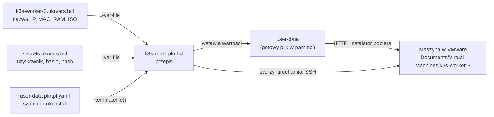

# Packer – jak to działa

Ten folder buduje nową maszynę laboratorium **od zera z ISO Ubuntu Server** w VMware Workstation.
Instalacja idzie bez klikania, a maszyna od pierwszego startu ma swoją nazwę, stały adres IP
i sklonowane repozytorium. Instrukcja krok po kroku: [docs/etap-0-maszyny-wirtualne/02-packer.md](../docs/etap-0-maszyny-wirtualne/02-packer.md).

## Pliki i ich role

| Plik | W gicie? | Co zawiera | Kiedy go zmieniasz |
|---|---|---|---|
| `k3s-node.pkr.hcl` | tak | **przepis** – jak zbudować dowolny węzeł labu | gdy zmieniasz *sposób* budowania (nowy krok, inny sprzęt wirtualny) |
| `user-data.pkrtpl.yaml` | tak | **odpowiedzi dla instalatora Ubuntu** (autoinstall) z miejscami na wartości `${...}` | gdy zmieniasz *co* instaluje się w systemie (pakiety, układ dysku, użytkownik) |
| `k3s-worker-3.pkrvars.hcl.example` | tak | **wzór parametrów** jednej maszyny | – |
| `secrets.pkrvars.hcl.example` | tak | **wzór danych logowania** | – |
| `k3s-worker-3.pkrvars.hcl` | **nie** | parametry *Twojej* maszyny: nazwa, IP, MAC, RAM, ISO | dla każdej nowej maszyny tworzysz osobny plik |
| `secrets.pkrvars.hcl` | **nie** | Twój użytkownik, hasło i jego hash | raz, przy pierwszym użyciu |

Podział wynika z dwóch zasad:

- **Przepis jest jeden, maszyn może być wiele.** `k3s-node.pkr.hcl` nie zawiera żadnej konkretnej
  nazwy ani adresu – wszystko bierze ze zmiennych. Nowa maszyna to nowy plik `.pkrvars.hcl`,
  a nie kopia przepisu.
- **Hasła i adresy z Twojej sieci nie trafiają do gita.** W repozytorium są tylko pliki `.example`;
  prawdziwe `.pkrvars.hcl` są w `.gitignore` (tak jak `lab.env`).

## Co z czym się łączy



1. Polecenie `packer build` wczytuje **przepis** i oba pliki **`.pkrvars.hcl`** (`-var-file`).
   Każda wartość z nich trafia do zmiennej, np. `node_ip = "192.168.180.55"` → `var.node_ip`.
2. Przepis wywołuje `templatefile()` na **`user-data.pkrtpl.yaml`**: w miejsca `${node_ip}`,
   `${node_name}`, `${password_hash}` itd. wstawia wartości zmiennych. Powstaje gotowy plik
   `user-data` – tylko w pamięci, nigdzie nie jest zapisywany.
3. Packer uruchamia na chwilę **serwer HTTP** na Twoim komputerze i udostępnia na nim `user-data`.
4. Packer tworzy **maszynę w VMware** (CPU, RAM, dysk, karta NAT ze stałym MAC) i podpina ISO.
5. Po starcie **wpisuje na klawiaturze maszyny** polecenie `boot_command` w menu GRUB:
   `autoinstall` + adres serwera HTTP. Instalator Ubuntu pobiera stamtąd `user-data`
   i instaluje system sam, bez pytań.
6. Po instalacji i restarcie maszyna ma już stały adres. Packer łączy się z nią przez **SSH**
   (`ssh_host = var.node_ip`, hasło z `secrets`) i wykonuje kroki z bloku `build`
   (`provisioner "shell"`): dopisuje maszyny labu do `/etc/hosts` i klonuje repozytorium.
7. Packer **wyłącza maszynę** i sprząta pliki tymczasowe. Gotowa maszyna zostaje
   w `output_directory`.

## Skąd się bierze każda wartość

| Ustawienie w gotowej maszynie | Zmienna | Plik, w którym ją ustawiasz | Gdzie jest użyta |
|---|---|---|---|
| nazwa w VMware i hostname | `node_name` | `k3s-worker-3.pkrvars.hcl` | `vm_name` w przepisie, `identity.hostname` w user-data |
| stały adres IP | `node_ip` | `k3s-worker-3.pkrvars.hcl` | `network` w user-data, `ssh_host` w przepisie |
| MAC karty sieciowej | `node_mac` | `k3s-worker-3.pkrvars.hcl` | `vmx_data` w przepisie, `match.macaddress` w user-data |
| nazwa karty (`ens33`) | `iface` | domyślnie w przepisie | `set-name` w user-data; slot PCI 33 w `vmx_data` |
| brama i DNS | `gateway`, `dns` | `k3s-worker-3.pkrvars.hcl` | `network` w user-data |
| RAM, CPU, dysk | `memory`, `cpus`, `disk_size` | `.pkrvars.hcl` lub domyślne w przepisie | blok `source` w przepisie |
| wpisy w `/etc/hosts` | `lab_hosts` | `k3s-worker-3.pkrvars.hcl` | pierwszy `provisioner` w przepisie |
| użytkownik | `username` | `secrets.pkrvars.hcl` | `identity` w user-data, `ssh_username` |
| hasło (zapisane w systemie) | `password_hash` | `secrets.pkrvars.hcl` | `identity.password` w user-data |
| hasło (do logowania Packera) | `password` | `secrets.pkrvars.hcl` | `ssh_password`, `sudo` w provisionerach, `shutdown_command` |
| obraz systemu | `iso_path`, `iso_checksum` | `k3s-worker-3.pkrvars.hcl` | `iso_url`, `iso_checksum` w przepisie |
| klucz SSH w `authorized_keys` | `ssh_public_key_file` | domyślnie `~/.ssh/k3s-lab.pub` w przepisie | `ssh.authorized-keys` w user-data |

**Logowanie:** Packer łączy się przez SSH hasłem, ale tylko w trakcie budowy. Ostatni krok
provisionera zapisuje `PasswordAuthentication no`, więc gotowa maszyna przyjmuje przez SSH
wyłącznie klucz `k3s-lab`. Hasło działa dalej przy `sudo` i w konsoli VMware.

`password` i `password_hash` to **to samo hasło** w dwóch postaciach: hash zapisuje instalator
w systemie, a zwykłym hasłem Packer loguje się przez SSH. Jeśli się różnią, budowa zatrzyma się
na `Waiting for SSH`.

## Budowa przepisu `k3s-node.pkr.hcl`

| Blok | Rola |
|---|---|
| `packer { required_plugins }` | który plugin pobrać przy `packer init` (VMware) |
| `variable "..." { }` | lista zmiennych z typami i wartościami domyślnymi; bez domyślnej = wymagana w `.pkrvars.hcl` |
| `source "vmware-iso" "k3s_node"` | **jaka maszyna**: sprzęt, sieć, ISO, pliki dla instalatora, polecenie startowe, połączenie SSH, wyłączenie |
| `build { provisioner ... }` | **co zrobić po instalacji**, przez SSH, zanim maszyna zostanie wyłączona |

## Nowa maszyna z tego samego przepisu

```powershell
copy k3s-worker-3.pkrvars.hcl k3s-worker-4.pkrvars.hcl
notepad k3s-worker-4.pkrvars.hcl   # node_name, node_ip, node_mac, output_directory, lab_hosts
packer build "-var-file=k3s-worker-4.pkrvars.hcl" "-var-file=secrets.pkrvars.hcl" .
```

Przepis, szablon i `secrets` zostają bez zmian. MAC musi być inny dla każdej maszyny
(pula VMware dla adresów statycznych: `00:50:56:00:00:00` – `00:50:56:3F:FF:FF`).

## Pliki, które powstają przy budowie

- `packer_cache/` – znaczniki Packera (blokada ISO); nie zawiera kopii obrazu. Można usunąć.
- `output_directory` (np. `Documents/Virtual Machines/k3s-worker-3`) – gotowa maszyna:
  `k3s-worker-3.vmx` (konfiguracja VMware) i pliki dysku `disk*.vmdk`.

Oba miejsca są poza gitem.
